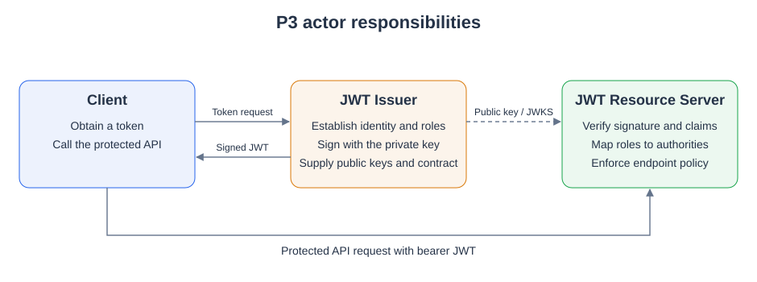

# 01-a — P3 responsibilities, issuer contract, and stakeholder readiness

[PNG](assets/png/IMG22.png) · [Mermaid source](assets/mermaid/IMG22.mmd)

## Who does what in P3?

| Actor | Responsibility | What crosses the boundary |
| --- | --- | --- |
| **Client** | Obtain an access token from the issuer and send it to the resource server when calling a protected API. | Requests a token from the issuer, receives the signed JWT, and sends it as a bearer token to the API. |
| **JWT Issuer** | Establish identity, decide which roles or scopes the token should carry, and sign it with its private key. Supply the verification key and document the token contract. | Returns the JWT to the client. Supplies the public key to the resource-server team through trusted configuration or a JWKS endpoint. |
| **JWT Resource Server** | Verify the JWT signature and claims locally, map permissions to Spring authorities, and enforce endpoint policy. | Receives the bearer token from the client and uses trusted public verification material from the issuer. Returns 401 for invalid authentication on a protected endpoint and 403 when authentication succeeds but authority is insufficient. |

The diagram represents the proposed P3 deployment. The current learning application demonstrates issuance and verification in one process. See the [P3 follow-up](01-stateless-jwt-and-in-memory-storage.md#p3-follow-up--what-each-participant-does).

## Is the role-to-authority contract an external dependency?

**Yes. The issuer’s token and permission contract is an external interface dependency for the resource-server project.** The issuer or identity-platform team provides and maintains the contract for what appears in its tokens. The API team specifies its audience and access requirements, agrees on the contract with the issuer team, and owns the conversion to Spring authorities and the endpoint rules. This agreement is needed before development. Signature verification and authority mapping run locally on the API for each request. A remote JWKS endpoint adds a network dependency for key retrieval and refresh.

| Reference and meaning | What must be agreed | Who provides or owns it |
| --- | --- | --- |
| **D01 — JWT issuer** | Which service issues tokens and how the client or test team obtains them. | Issuer team provides the service and access instructions. |
| **D02 — RSA public key or JWKS** | Where the API obtains trusted verification keys and how it learns about rotation. | Issuer team supplies public keys or the JWKS location. API team configures the trusted source. |
| **D03 — JWT claims contract** | Claim names, JSON types, required fields, and missing-claim behavior. Example: `roles` is an array of strings. | Issuer team publishes the emitted schema and representative tokens. API team agrees on acceptance rules. |
| **D04 — Trusted issuer identifier** | Exact `iss` value to accept. | Issuer team publishes it. API team configures it. |
| **D05 — Expected audience** | Exact audience that identifies the API and must appear in `aud`. | API team defines its audience. Issuer team configures issuance for it. |
| **D06 — Role and scope definitions** | Accepted values, casing, and business meaning. Example: `ADMIN` permits administration in this API. | Issuer team documents what it emits. API and security teams agree on what each value authorizes. |
| **R05 — Authority mapping** | Which validated JWT values become application authorities. | API team owns the Spring configuration. |
| **R07 — Authorization** | Which application authorities each protected endpoint requires. | API team owns enforcement, with security and business approval. |

### Example — From the `roles` claim to access

Assume the agreed contract uses uppercase role strings and the API adds the Spring prefix `ROLE_`. Only tokens that pass signature and claim validation reach the mapping step.

| Validated JWT claim | Authority produced by the API | Example outcome for `GET /api/admin` |
| --- | --- | --- |
| `"roles": ["ADMIN"]` | `ROLE_ADMIN` | Allowed because the endpoint requires `ROLE_ADMIN`. |
| `"roles": ["USER"]` | `ROLE_USER` | 403 because the authenticated caller lacks `ROLE_ADMIN`. |
| `"roles": []` | No role authorities | 403 under this contract, which allows an empty list. |

## Stakeholder list 1 — Assumptions and hypotheses to agree

| Topic | Decision to record | Decision owners |
| --- | --- | --- |
| Architecture and scope | Confirm separate issuer and resource-server deployments, one initially trusted issuer, and the scope of resource-server development. | Architects and issuer/API owners |
| Statelessness and data | Confirm local token verification, request-scoped authentication, and the exclusions for persistence and sessions. | Architects and API owner |
| Identity and permissions | Agree on the claim contract, role semantics, authority mapping, and endpoint policies. | Issuer, security, and API owners |
| Security and key lifecycle | Agree on HTTPS, PEM or JWKS, key rotation, and the initial revocation policy. | Security, platform, and issuer owners |

## Stakeholder list 2 — Constraints and dependencies to put in place

Record the named owner, readiness status, and evidence for each item before development starts. Mark conditional items according to the agreed design.

| Dependency classification | Readiness evidence | Suggested owner |
| --- | --- | --- |
| Runtime and software/build | Java 17 and servlet runtime confirmed. Maven repositories and approved Spring Security and Nimbus libraries reachable. | Platform and build teams |
| Contractual | Issuer, audience, claims schema, role catalog, and API authority mapping agreed and published. | Issuer and API teams |
| Cryptographic | A trusted test public key or test JWKS is available. Key identifiers and the rotation plan are documented. | Issuer and security teams |
| Conditional network | Remote JWKS connectivity is verified from the target environment, including DNS and relevant firewall or proxy rules. | Network and platform teams |
| Infrastructure and operations | TLS termination and trust configuration, synchronized clocks, and sanitized logging destination are confirmed. | Platform and operations teams |
| Testing | Signed fixtures and expected outcomes cover permitted and denied roles, missing claims, wrong audience, and expiry. | QA, issuer, and API teams |
| Excluded | Database, Redis, session storage, and token introspection are documented as outside the proposed resource-server scope. | Architect and platform team |

See the [DEV/UAT/PROD cryptographic prerequisites](07-cryptographic-environment-prerequisites.md) for the environment-specific provisioning matrix.
