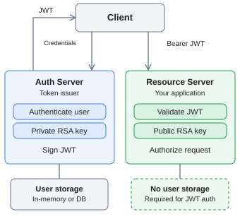
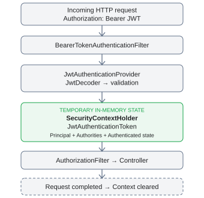
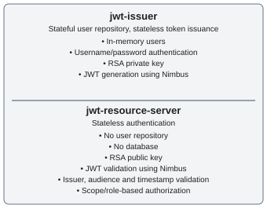

# 01 — Stateless JWT and in-memory storage

## Original prompt

> For the jwt-auth where is the "in memory" relevant. I mean "my" application that uses/validates the tokens (separate from the isuing one, auth server) does it need to store users, does it need db connection? Wnat data does it need to store?

## Answer

In your **`jwt-auth` learning project**, assuming RS256 JWT tokens and two separate applications, the distinction is quite important:

- **Authentication Server** — authenticates users, manages credentials and issues JWT tokens.
- **Resource Server (your application)** — receives JWT tokens, validates them and authorizes access to protected endpoints.

**Your Resource Server does not necessarily need a database, a user repository, a password store or even a `UserDetailsService`.** It can operate as a completely stateless application from an authentication perspective.

## 1. Architecture and responsibilities



[PNG](assets/png/IMG01.png) · [Mermaid source](assets/mermaid/IMG01.mmd)

## 2. What needs to be stored and where?

| Data | Auth Server | Your Resource Server |
|---|---|---|
| User accounts | Yes, or external identity provider | No |
| User passwords (hashed) | For password-based authentication | No |
| User roles | Typically yes | Not necessarily |
| RSA private key | Yes | No |
| RSA public key | Available | Yes |
| Issued access tokens | Optional | No |
| Refresh tokens | If supported, depending on design | No |
| HTTP authentication sessions | Optional | No |
| Trusted issuer configuration | Yes | Yes |
| Authorization rules | Optional | Yes |
| Current authenticated principal | During authentication | During each request |
| Business data | Not necessarily | Application-specific |

The Resource Server needs to know **whom to trust, how to validate a token and what permissions are required for each operation**, rather than maintaining its own list of users.

## 3. Where is "in-memory" actually relevant?

There are three distinct concepts that should not be confused.

| Concept | Spring Security component | Lifetime |
|---|---|---|
| In-memory user repository | `InMemoryUserDetailsManager` | Application runtime |
| In-memory authentication context | `SecurityContextHolder` | Current request in a stateless setup |
| In-memory public key storage/cache | `JwtDecoder` / JWK cache | Application runtime or cache lifetime |

### 3.1. In-memory user repository

This is relevant to the **Auth Server**, or to the plain Spring Security phase of your learning project.

```java
@Bean
public UserDetailsService userDetailsService() {
    UserDetails user = User.builder()
        .username("alice")
        .password(passwordEncoder().encode("password"))
        .roles("USER")
        .build();

    return new InMemoryUserDetailsManager(user);
}
```

Instead of retrieving users from a database, Spring retrieves them from an in-memory repository.

Your JWT Resource Server does not need this component.

### 3.2. In-memory authentication context

This is relevant to **your Resource Server**.

Even though the application is stateless, Spring Security temporarily holds the authenticated identity in memory while processing a request.



[PNG](assets/png/IMG02.png) · [Mermaid source](assets/mermaid/IMG02.mmd)

By default, Spring Security uses a `ThreadLocal` to make the authentication context available throughout synchronous request processing. With stateless configuration, authentication is reconstructed for each subsequent request.

### 3.3. In-memory RSA public key

Your application needs access to the RSA public key to validate the signature.

It can obtain it from a local PEM file, application configuration or a remote JWKS endpoint with key caching.

For your initial learning implementation, a local public key file is sufficient.

```yaml
spring:
  security:
    oauth2:
      resourceserver:
        jwt:
          public-key-location: classpath:keys/public.pem
```

This means that the Resource Server can validate tokens without communicating with the Auth Server for every request.

## 4. How does my application know the user without a database?

Consider the following decoded JWT payload:

```json
{
  "sub": "user-123",
  "iss": "https://auth.example.com",
  "aud": "order-service",
  "roles": ["USER", "ADMIN"],
  "scope": "orders.read orders.write",
  "iat": 1795680000,
  "exp": 1795683600
}
```

All the necessary identity and permission information can be inside the signed token.

| Claim | Purpose |
|---|---|
| `sub` | Identifies the user |
| `iss` | Identifies the trusted issuer |
| `aud` | Identifies the intended Resource Server |
| `roles` | User's roles |
| `scope` | Granted permissions |
| `iat` | When the token was issued |
| `exp` | When the token expires |

After signature and claim validation, your application can trust the relevant identity information provided by the issuer.

You can access it directly from a controller:

```java
@GetMapping("/me")
public String me(@AuthenticationPrincipal Jwt jwt) {
    return jwt.getSubject();
}
```

Or authorize a request:

```java
@PreAuthorize("hasAuthority('SCOPE_orders.read')")
@GetMapping("/orders")
public List<Order> getOrders() {
    return orderService.findAll();
}
```

Spring maps scopes to authorities by default. Custom `roles` claims require additional mapping. Method security must also be enabled for `@PreAuthorize`.

## 5. When would my Resource Server actually need a database?

In an enterprise application, JWT authentication and business authorization are two separate concerns.

Consider an `order-service`.

| Requirement | DB needed? |
|---|---|
| Validate JWT signature | No |
| Validate token expiration | No |
| Identify authenticated user | No |
| Check role from JWT | No |
| Check scope from JWT | No |
| Retrieve user's orders | Yes* |
| Check if user owns a specific order | Yes* |
| Store application-specific user preferences | Yes* |
| Check dynamically assigned local permissions | Typically |
| Immediately revoke a specific JWT | Shared state or external check |

\* Assuming this business information is stored in a database.

For example, your JWT could identify `user-123`, while your business database contains:

**ORDERS**

| order_id | owner_id | amount |
|---|---|---:|
| 1001 | user-123 | €250 |
| 1002 | user-456 | €500 |
| 1003 | user-123 | €120 |

You can associate business entities with the authenticated user without having a `USERS` table at all. In a multi-issuer environment, use the issuer and subject together as the identity reference.

One limitation of fully stateless JWT validation is that changes to a user's roles or account status at the Auth Server are not automatically reflected in already-issued tokens. Short-lived tokens or additional revocation checks can address this.

## 6. Recommended approach for your `jwt-auth` roadmap

Considering your original three-phase learning roadmap:

| Component | P1: No auth | P2: Plain Spring Security | P3: JWT Resource Server |
|---|---|---|---|
| `InMemoryUserDetailsManager` | ❌ | ✅ | ❌ |
| `UserDetailsService` | ❌ | ✅ | ❌ |
| `DaoAuthenticationProvider` | ❌ | ✅ | ❌ |
| `JwtAuthenticationProvider` | ❌ | ❌ | ✅ |
| `SecurityContextHolder` for authenticated identity | ❌ | ✅ | ✅ |
| `JwtDecoder` | ❌ | ❌ | ✅ |
| RSA public key | ❌ | ❌ | ✅ |
| RSA private key | ❌ | ❌ | ❌ |
| Database connection | ❌ | ❌ | ❌ |

For P3, I would introduce a separate, minimal token-issuing application.



[PNG](assets/png/IMG03.png) · [Mermaid source](assets/mermaid/IMG03.mmd)

Configure the Resource Server with:

```java
.sessionManagement(session -> session
    .sessionCreationPolicy(SessionCreationPolicy.STATELESS))
```

This approach preserves your original requirement: **RS256 JWT authentication and validation without implementing the OAuth2 authorization flow.**

I would use Spring Security's built-in Resource Server support rather than implement a custom JWT filter initially. Despite the `oauth2` package naming, you do not need to implement OAuth2 login, authorization codes or redirects.

The fundamental distinction to remember is:

**Plain Spring Security:** retrieve the user from a trusted repository and validate their credentials.

**JWT Resource Server:** retrieve the user identity from a cryptographically verified token and authorize the request.

Neither requires a database for your learning project, but only the first requires a user repository under the proposed design.

---

## Archive notes and technical clarifications (not part of original answer)

- Original prose, tables and code are retained. The original citation widgets could not be exported as verified links; no replacement citations are claimed.
- The YAML example is Spring Boot-specific; plain Spring requires explicit decoder configuration. The example alone does not configure issuer and audience validation.
- The diagram labels describe successful synchronous request processing; failed authentication or authorization terminates the flow earlier.
- SVGs reproduce the original diagram geometry where possible; the P3 interface card is reconstructed. Theme and font rendering may differ.
