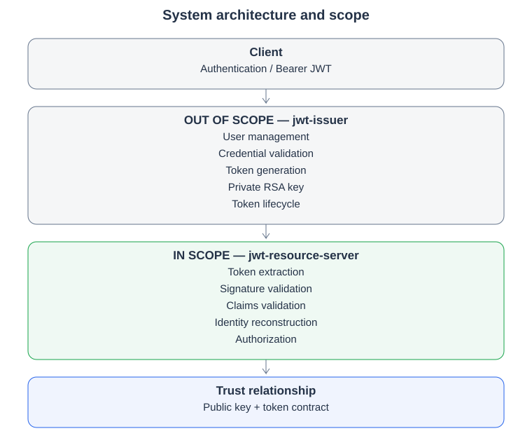
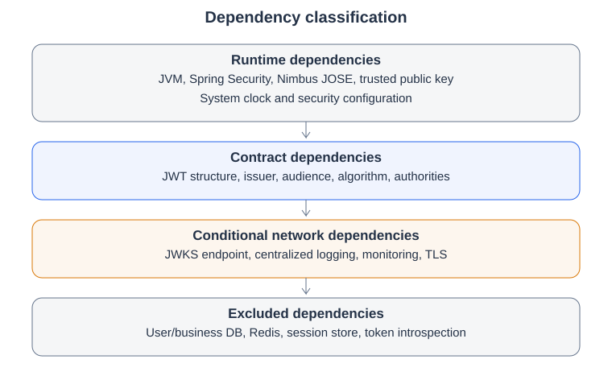
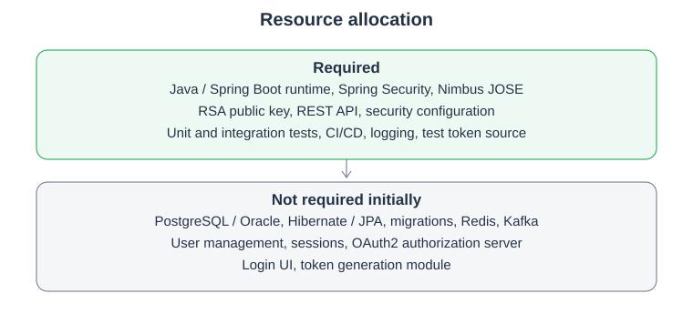
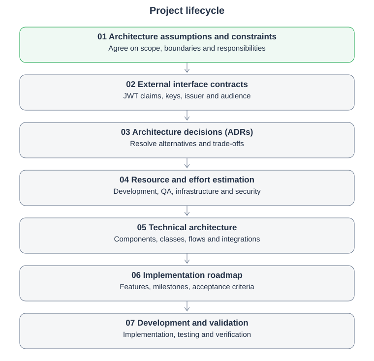

# 02 — Architecture assumptions and constraints

## Original prompt

> Good, I want to create a list first of the assumptions/hytoteses. Architecture/enterprise relevant to agree want this application will need. Scope [**jwt-resource-server**]. Not in scope [**jwt-issuer**] but of course it will be used in the ecosys. Constraints, responsabilities & dependencies. We need to agree now in order to allocate resources, plan even before we start development. Some assumptions/hytoteses I can think of: 2 separate [**jwt-resource-server**] - [**jwt-issuer**] with scope & resp., there will be no "proper" oauth2.0 flow, the service (in scope) will need no db connection..

## Answer

Before defining the implementation roadmap, we should establish an **Architecture Baseline (V0)** for `jwt-resource-server`. The objective is to agree on application boundaries, responsibilities, dependencies, security requirements and infrastructure needs before allocating development resources. At this stage, we define what the application must support, not how individual classes will implement it. All assumptions are proposed for agreement.

## 1. System architecture and scope



[PNG](assets/png/IMG04.png) · [Mermaid source](assets/mermaid/IMG04.mmd)

| ID | Assumption / responsibility / constraint | Implication |
|---|---|---|
| A01 | Two separate applications: jwt-issuer and jwt-resource-server | Independent application lifecycles |
| A02 | Only jwt-resource-server is in development scope | Issuer treated as an external system |
| A03 | Applications are independently deployable | No shared runtime or process |
| A04 | Communication is based on signed JWT tokens | Standardized security contract |
| A05 | No complete OAuth 2.0 authorization flow | No authorization codes, redirects or OAuth login |
| A06 | Resource Server exposes REST APIs | HTTP-based security boundary |
| A07 | One trusted token issuer initially | Multi-issuer support excluded initially |
| A08 | No synchronous dependency on issuer for each request | Independent request processing |

## 2. Application responsibilities

| ID | Assumption / responsibility / constraint | Implication |
|---|---|---|
| R01 | Token extraction | Extract Bearer JWT from HTTP header |
| R02 | Signature validation | Verify token authenticity using RSA public key |
| R03 | Claims validation | Validate issuer, audience, expiration and applicable temporal claims |
| R04 | Identity reconstruction | Build authenticated principal from JWT |
| R05 | Authority mapping | Convert token roles/scopes into Spring authorities |
| R06 | Authentication context | Maintain identity during request processing |
| R07 | Authorization | Enforce endpoint and method-level permissions |
| R08 | Security error handling | Return appropriate HTTP 401/403 responses |
| R09 | Security observability | Log authentication failures and relevant security events |
| R10 | Context cleanup | Clear temporary authentication state after request completion |

## 3. Data and persistence constraints

| ID | Assumption / responsibility / constraint | Implication |
|---|---|---|
| C01 | No database connection | No database infrastructure provisioning |
| C02 | No local user repository | No user entities or user-management service |
| C03 | No password storage | No password validation or encoding infrastructure |
| C04 | No persistent JWT storage | No token repository |
| C05 | No HTTP authentication sessions | Stateless authentication |
| C06 | No refresh token storage | Token renewal delegated to issuer/client |
| C07 | No distributed authentication cache | No Redis or equivalent infrastructure |
| C08 | Authentication context exists temporarily in memory | Request-scoped identity |
| C09 | Public key available locally or through a cache | Cryptographic verification capability |
| C10 | No business-data persistence in initial scope | Mock or static business endpoints |

Stateless authentication does not mean no in-memory data: configuration, keys and temporary request objects exist in JVM memory.

## 4. Security and cryptographic assumptions

| ID | Assumption / responsibility / constraint | Implication |
|---|---|---|
| S01 | RS256 mandatory | Asymmetric RSA cryptography |
| S02 | Private key belongs exclusively to issuer | Resource Server cannot issue tokens |
| S03 | Resource Server has access to trusted public keys | Local signature verification |
| S04 | Only explicitly permitted signing algorithms accepted | Prevent algorithm substitution |
| S05 | Tokens have limited validity period | Reduce exposure from compromised tokens |
| S06 | JWT payload is signed, not encrypted | No confidential information inside JWT |
| S07 | HTTPS mandatory in enterprise environments | Transport-level protection |
| S08 | Invalid or expired tokens rejected | Fail-closed security behavior |
| S09 | Tokens never written in full to logs | Prevent credential leakage |
| S10 | Immediate token revocation not initially supported | Valid tokens remain usable until expiration unless additional controls exist |
| S11 | Bearer token possession grants associated access | Token theft is a recognized risk |
| S12 | Public key rotation must be addressed | Operational key lifecycle requirement |

## 5. External dependencies and contracts

| ID | Dependency | Type | When needed |
|---|---|---|---|
| D01 | JWT issuer | External system | Token acquisition and ecosystem testing |
| D02 | RSA public key / JWKS | Trust material | Startup or runtime |
| D03 | JWT claims contract | Interface contract | Design and runtime |
| D04 | Trusted issuer identifier | Configuration | Runtime |
| D05 | Expected audience | Configuration | Runtime |
| D06 | Role/scope definitions | Security contract | Design and runtime |
| D07 | Reliable system clock | Infrastructure | Runtime |
| D08 | TLS infrastructure | Infrastructure | Deployment |
| D09 | Logging infrastructure | Operational | Runtime |
| D10 | Spring Security and Nimbus JOSE | Software libraries | Build and runtime |

### Dependency classification


[PNG](assets/png/IMG05.png) · [Mermaid source](assets/mermaid/IMG05.mmd)

## 6. Explicitly out-of-scope responsibilities

| ID | Assumption / responsibility / constraint | Implication |
|---|---|---|
| O01 | User registration | Issuer / Identity provider |
| O02 | Username/password authentication | Issuer |
| O03 | JWT generation and signing | Issuer |
| O04 | Private key management | Issuer |
| O05 | Password recovery | Identity provider |
| O06 | Refresh token management | Issuer / Client |
| O07 | OAuth 2.0 authorization flow | Not required |
| O08 | Login/logout UI | Client / Identity provider |
| O09 | Multi-factor authentication | Identity provider |
| O10 | User role assignment | Issuer / Identity provider |
| O11 | Persistent business-data management | Future business scope |

Out of scope does not mean irrelevant.

## 7. Non-functional requirements

| ID | Assumption / responsibility / constraint | Implication |
|---|---|---|
| N01 | Scalability | Multiple instances without shared authentication state |
| N02 | Availability | No issuer call required for every authenticated request |
| N03 | Performance | Local cryptographic validation |
| N04 | Maintainability | Standard Spring Security components preferred |
| N05 | Testability | Independent testing using controlled JWT fixtures |
| N06 | Observability | Authentication and authorization failures and metrics |
| N07 | Configurability | Environment-specific trust and security configuration |
| N08 | Portability | No dependency on a specific identity provider product |
| N09 | Security | Deny access unless explicitly authorized |
| N10 | Resilience | Defined behavior when public keys cannot be retrieved |
| N11 | Auditability | Traceable security events without exposing credentials |

## 8. Architecture decisions requiring agreement

| ID | Decision | Proposed initial choice | Priority |
|---|---|---|---|
| ADR01 | Public key distribution | Local PEM initially, JWKS later | High |
| ADR02 | JWT validation mechanism | Spring Security Resource Server + Nimbus | High |
| ADR03 | Authorization model | Roles and scopes | High |
| ADR04 | Session management | Stateless | High |
| ADR05 | Token revocation | Expiration-based initially | High |
| ADR06 | Token identity | Stable sub claim | High |
| ADR07 | Issuer availability dependency | Offline validation with trusted key | High |
| ADR08 | CSRF protection | Disabled only for exclusively Bearer-header authenticated APIs | Medium |
| ADR09 | CORS policy | Restricted to approved origins if browser clients supported | Medium |
| ADR10 | Key rotation | Manual initially, automated JWKS later | High |
| ADR11 | Testing issuer | External test issuer or pre-generated signed tokens | Medium |
| ADR12 | TLS termination | Application or infrastructure gateway | Medium |

## 9. Impact on resource allocation



[PNG](assets/png/IMG06.png) · [Mermaid source](assets/mermaid/IMG06.mmd)

## 10. Position in the project lifecycle



[PNG](assets/png/IMG07.png) · [Mermaid source](assets/mermaid/IMG07.mmd)

```text
jwt-auth/
├── docs/
│   ├── architecture/
│   │   ├── 01-assumptions-and-constraints.md
│   │   ├── 02-system-context-and-boundaries.md
│   │   ├── 03-external-contracts.md
│   │   ├── 04-architecture-decisions.md
│   │   └── 05-resource-estimation.md
│   └── roadmap/
└── src/
```

Architecture baseline should be agreed independently of implementation roadmap. No database connection is a constraint; NimbusJwtDecoder is a technical design decision. Actual effort estimates require measurable performance, availability and security acceptance requirements.

## Technical corrections and clarifications

Spring Boot was mentioned in the original resource list; the later plain Spring baseline supersedes that proposal.

