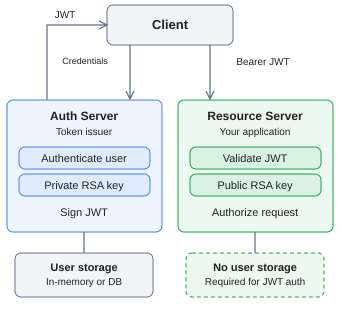

# 03-a — Sign and verify with RSA and RS256

## Original prompt

> JWKS & jwk / RS256 & certs. Where do they fit?

This companion expands the signing and verification section of the [original cryptography note](03-rs256-jwk-jwks-and-certificates.md).

## Answer

### 1. Follow one token from login to the API

Imagine signing in as the development user and then calling `GET /api/user`. The first request supplies credentials to `POST /auth/login`. The credential authentication manager checks those credentials. Once authentication succeeds, the application can build a JWT that identifies the user and records the issuer, intended audience, roles and expiration time. The issuer signs that token and returns it to the client. The second request carries the issued token in the Authorization header as a bearer credential.

**RSA** supplies the asymmetric key pair used in this example. The issuer holds the private key and uses it for signing. The API needs the matching public key for verification. This arrangement lets several APIs verify the same issuer’s tokens while the issuer retains exclusive control over signing. In this learning app, issuance and verification run in the same application, with separate configuration for each responsibility. In an enterprise arrangement those responsibilities can run in different services.

[PNG](assets/png/IMG01.png) · [Mermaid source](assets/mermaid/IMG01.mmd)

### 2. Inspect what RS256 covers

**RS256** is the JWT algorithm identifier for an RSA signature using SHA-256 and PKCS #1 v1.5 padding. RSA names the underlying key algorithm. RS256 specifies the signature scheme used with those keys. The JWT header carries an `alg` field, and the verifier enforces its configured algorithm policy before accepting the signature.

A compact signed JWT has three dot-separated segments. The first encodes the protected header, the second encodes the claim payload, and the third encodes the signature. For this token format, the signing input is the first two encoded segments joined by a dot. Base64url encoding makes those segments safe to carry in a token. Anyone who receives the token can decode and read those claims, so decide what belongs in a claim with that visibility in mind.

| Check | Question it answers |
|---|---|
| Signature verification | Does the signature match these exact encoded segments and a trusted key? |
| Claim validation | Is this token from the expected issuer, intended for this API and within its accepted time window? |
| Authorization | Do the resulting authorities allow this request? |

### 3. Trace the implementation

[`JwtTokenService`](../../src/main/java/com/example/securitylearning/security/JwtTokenService.java) builds claims from the authenticated identity and sets RS256 on the header. [`JwtIssuerConfig`](../../src/main/java/com/example/securitylearning/config/JwtIssuerConfig.java) builds the Nimbus encoder using the configured private key and checks that it matches the public key. [`JwtDecoderConfig`](../../src/main/java/com/example/securitylearning/config/JwtDecoderConfig.java) builds a Nimbus decoder with that public key and pins RS256. The configured decoder also checks the issuer and timestamps, and the application validates the required claims before Spring Security uses them for authentication.

### 4. Predict three outcomes

Start with a hypothetical valid development USER token. First, imagine changing its payload from USER to ADMIN while keeping the original signature. The encoded payload differs, so verification fails and the protected endpoint returns 401. Second, imagine presenting the original valid USER token to the admin route. Authentication succeeds and the role check returns 403. Third, imagine presenting a correctly signed token issued for a different API. Its audience fails validation and the protected endpoint returns 401. In each case, identify the first check that rejects the request. The [claim contract](../kick-off-development(-2-nov-2026)/JWT-CLAIM-CONTRACT.md) describes the application’s exact claim requirements.
