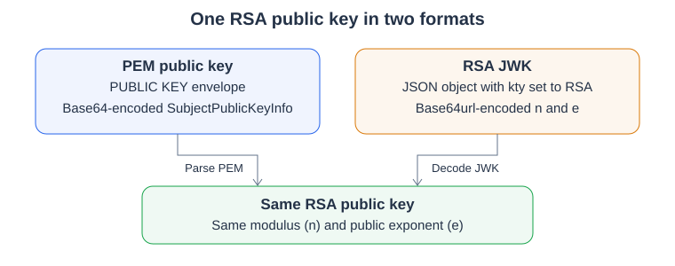

# 03-b — Compare PEM and JWK

## Original prompt

> JWKS & jwk / RS256 & certs. Where do they fit?

This companion expands the key representation section of the [original cryptography note](03-rs256-jwk-jwks-and-certificates.md).

## Answer

### 1. Recognize a key in two formats

After the issuer creates an RSA key pair, operators need a way to store the keys and give the verification key to the API. **PEM** and **JWK** can represent the same RSA public key. Converting between them preserves the mathematical public key. Its two defining numbers are the RSA modulus and public exponent. If both values match after decoding, the representations describe the same RSA public key, even when their text looks completely different.

PEM wraps Base64-encoded data between labeled boundary lines. The label identifies the type of data inside. In this repository, the verification file uses the `PUBLIC KEY` label and carries a SubjectPublicKeyInfo structure. A PEM file can also carry a certificate under `CERTIFICATE` or a private key under `PRIVATE KEY`. The parser expects a specific structure, so changing the label alone cannot convert one structure into another.

A **JWK** is a JSON object. A public RSA JWK carries `kty` set to `RSA`, `n` for the modulus and `e` for the public exponent. The numbers are encoded as unsigned Base64url values. For example, the common exponent 65537 appears as `AQAB`. Optional metadata can label the key or describe its intended usage.

| Field or property | Where you see it | What to check |
|---|---|---|
| `PUBLIC KEY` | PEM boundary | The body contains the structure your loader expects |
| `n` and `e` | RSA JWK | Both decode to the expected public numbers |
| `kid` | JWK metadata | The issuer and consumer agree on the key identifier |
| `alg` and `use` | JWK metadata | The metadata matches the configured verification policy |

[PNG](assets/png/IMG19.png) · [Mermaid source](assets/mermaid/IMG19.mmd)

### 2. Trace the repository’s two representations

[`JwtDecoderConfig`](../../src/main/java/com/example/securitylearning/config/JwtDecoderConfig.java) reads the configured public PEM file, converts it to an `RSAPublicKey` and checks its size. The decoder uses that one configured public key for RS256 signature verification. The loader’s `x509()` method refers to the public-key structure and reads the public key directly. The application does not need a certificate file for this setup.

[`JwtIssuerConfig`](../../src/main/java/com/example/securitylearning/config/JwtIssuerConfig.java) reads the local PKCS #8 private key, checks that it matches the verification key and builds a Nimbus RSA JWK for the encoder. That encoder-side JWK contains private material, so it stays inside the signing configuration. When distributing a key to another service, use a public-only representation. In an enterprise JWKS, the issuer publishes the public parameters and the accompanying selection metadata.

### 3. Compare values in a small exercise

Pick a development public key and a public JWK exported from it. Use a standard key parser to read the PEM and inspect its modulus and public exponent. Decode the JWK’s `n` and `e`, then compare the numeric values. You should see equality even though PEM encodes a structured binary object and JWK exposes fields individually.

Now consider two variations. If only the `kid` changes, the RSA public numbers remain equal, although a consumer may select the key differently. If the modulus changes, you have a different public key, even when the exponent is still 65537. Explain why comparing only the exponent cannot establish that two key representations match. Next, see how identifiers help when a [JWKS contains several keys](03-c-jwks-and-key-rotation.md).
