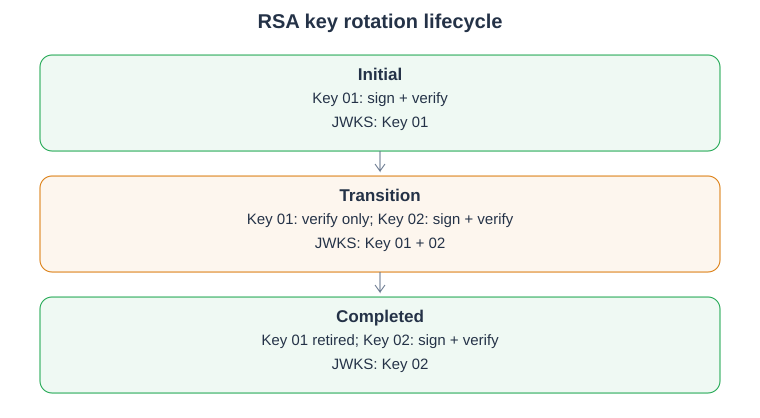

# 03-c — Rotate keys with JWKS and kid

## Original prompt

> JWKS & jwk / RS256 & certs. Where do they fit?

This companion expands the key distribution and rotation section of the [original cryptography note](03-rs256-jwk-jwks-and-certificates.md).

## Answer

### 1. Follow the verification key to the API

An enterprise API needs a reliable way to learn which public keys an issuer currently authorizes for token verification. A **JWKS**, or JSON Web Key Set, is an object with a `keys` array of JWK entries. The issuer’s **JWKS endpoint** serves that public set over HTTPS. The issuer keeps the corresponding private signing keys under its control. The API can cache the public set and verify signatures locally, so it can reuse a retrieved key across many requests.

**`kid`** is a key identifier. The issuer can put a `kid` in the JWT header and the same identifier on the associated public JWK. Imagine the header says `key-02`. The decoder can look for a suitable public verification key with that identifier in the trusted set. The header is available before verification, so it should guide selection only within the keys that the API is already configured to trust. A matching identifier still leaves the signature and claim checks to perform.

### 2. Walk through a planned rotation

Suppose Key 01 currently signs every token and the API can verify tokens using its public key. The issuer wants to switch to Key 02 without cutting off clients who still hold valid tokens. The [rotation diagram](assets/svg/IMG09.svg) shows how the two keys overlap.

[PNG](assets/png/IMG09.png) · [Mermaid source](assets/mermaid/IMG09.mmd)

| Phase | Issuer signs new tokens with | Public keys published | Why |
|---|---|---|---|
| Before rotation | Key 01 | Key 01 | Consumers know the current signing key |
| Publish ahead of switch | Key 01 | Key 01 and Key 02 | Consumers have time to discover the new key |
| Sign with new key | Key 02 | Key 01 and Key 02 | Previously issued tokens may still be valid |
| Retire old key | Key 02 | Key 02 | The last Key 01 tokens have aged out |

The time to retire the old key depends on the longest remaining token lifetime and the verifier’s allowed clock skew. The time between publication and starting to sign with the new key depends on how consumers refresh their cache. Some implementations can refresh on an unknown key identifier. Your integration should establish when that refresh happens, how retrieval failures are handled and when cached keys can still be used.

### 3. Connect the exercise to the current project

[`JwtTokenService`](../../src/main/java/com/example/securitylearning/security/JwtTokenService.java) emits a fixed `kid` called `local-issuer`. [`JwtDecoderConfig`](../../src/main/java/com/example/securitylearning/config/JwtDecoderConfig.java) uses one configured public key loaded from PEM at startup. The enterprise scenario adds a trusted endpoint, a cache and a rotation policy. The current app demonstrates the signature and claim checks that remain necessary when the key source changes.

### 4. Predict behavior during the switch

Imagine a request arrives just after the issuer starts signing with Key 02. The API’s cache contains only Key 01. The new token can authenticate only once the API obtains a suitable trusted Key 02 public key and completes verification. If refresh fails and the key is unavailable, expect authentication to fail. Then consider a valid Key 01 token during the overlap. It can still authenticate while the API retains that trusted key and the token passes its claim checks. Sketch these two requests on a timeline and mark when cache freshness first matters.
