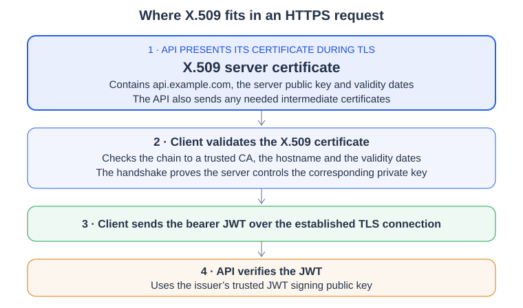
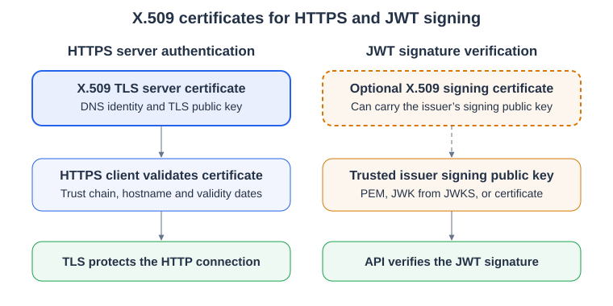

# 03-d — Separate X.509 and TLS from JWT verification

## Original prompt

> JWKS & jwk / RS256 & certs. Where do they fit?

This companion expands the HTTPS trust section of the [original cryptography note](03-rs256-jwk-jwks-and-certificates.md).

## Answer

### 1. Follow the request across two trust checks

Imagine a client calling your enterprise API at `https://api.example.com` with a bearer JWT. Before the API receives the HTTP request, the client establishes a **TLS** connection. During the handshake, the HTTPS endpoint presents an **X.509 certificate**, typically with intermediate certificates that help form a chain. The certificate contains a public key and identity information, such as DNS names. The client checks that the certificate chain leads to a trusted anchor, that the certificate is valid for the intended connection, and that its identity matches the hostname. The handshake also proves that the endpoint controls the corresponding private key.

Once the connection is established, TLS provides confidentiality and integrity for the transmitted HTTP data. The bearer token arrives at the API inside that protected connection. The API then checks the JWT signature with a trusted issuer signing public key and applies its claim validation and authorization rules. The [trust diagram](assets/svg/IMG20.svg) shows the X.509 checks before the API receives the bearer token.

[PNG](assets/png/IMG20.png) · [Mermaid source](assets/mermaid/IMG20.mmd)

| Trust check | Verifier | Material used | What it establishes |
|---|---|---|---|
| HTTPS to the API | HTTP client | API endpoint certificate chain and the client’s trust anchors | The HTTPS endpoint’s identity and a protected channel |
| HTTPS to remote JWKS | API’s HTTP client | JWKS host certificate chain and the API client’s trust anchors | The JWKS endpoint’s identity and a protected channel |
| Bearer JWT verification | Resource server | Trusted issuer public key and JWT validation policy | Signature integrity and whether claims meet the API contract |

### 2. Follow the extra connection for remote JWKS

If the API uses a remote **JWKS endpoint**, it becomes an HTTPS client when fetching public keys. For example, `api.example.com` may contact `issuer.example.com`. Each connection has its own server identity and trust checks. An enterprise CA can be part of the relevant client trust configuration when it signs the endpoint’s certificate. The JWKS response gives the API public keys it can use to check later bearer tokens. Once a suitable key is cached, subsequent token verification can happen locally according to the cache policy.

A certificate can also carry a JWT signing public key if the issuer’s distribution contract uses that representation. The purpose of such a certificate depends on how the API is configured to trust the signing material. The repository takes a simpler route. [`JwtDecoderConfig`](../../src/main/java/com/example/securitylearning/config/JwtDecoderConfig.java) reads a local public key and configures Nimbus for RS256. That local file loading is the starting point for learning the verification path before introducing another network connection.

### 3. Do TLS and JWT need separate X.509 certificates?

For ordinary HTTPS, the server presents an **X.509 TLS server certificate**. The HTTPS client uses it to authenticate the endpoint. If the API fetches keys from a remote JWKS endpoint, the JWKS host presents its own TLS server certificate on that connection.

For RS256 JWT verification, the API needs the **issuer’s trusted signing public key**. A public PEM file or a JWK from a trusted JWKS can supply that key directly. The issuer can also distribute the signing public key in an **optional X.509 signing certificate**, for example through a JWK’s `x5c` certificate chain. When certificates are used for both purposes, keep the TLS and JWT signing key pairs and certificates separate. They have different verifiers, trust policies, and rotation schedules.

For example, the API’s gateway can own the TLS certificate for `api.example.com` while the issuer controls its JWT signing key. Renewing the gateway certificate leaves the issuer’s JWT signing key in service. This repository loads the JWT verification key directly from a public PEM file.

[PNG](assets/png/IMG21.png) · [Mermaid source](assets/mermaid/IMG21.mmd)

### 4. Predict which check fails

Suppose the client’s HTTPS connection to the API succeeds, but the token was signed by a different issuer’s key. The API receives the request and rejects bearer authentication when signature verification fails. Now suppose the token is valid, but the client connects to a hostname that does not match the API certificate. The client rejects the HTTPS connection before the API can evaluate the bearer token.

Finally, suppose the API needs a new signing key and the remote JWKS endpoint presents a certificate chain the API client does not trust. The key retrieval fails. If the required public key is unavailable from the trusted cache, the API cannot verify that token. For each case, identify the verifier, the material it checks and the component that can observe the failure.
