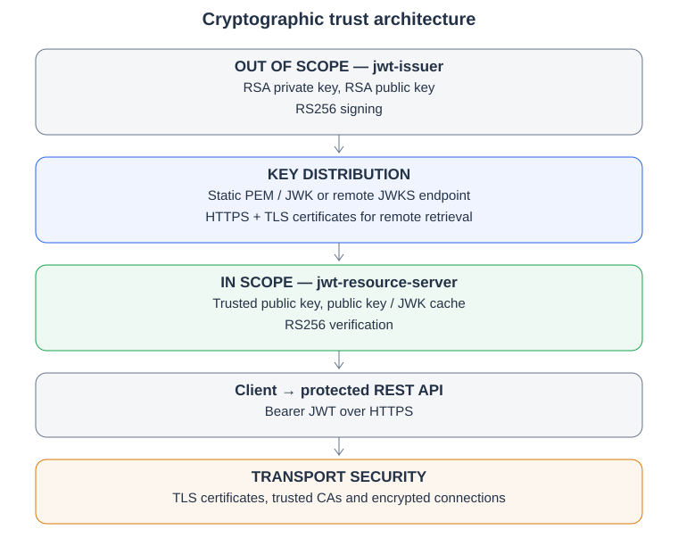
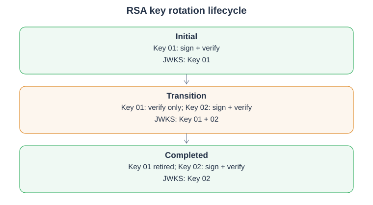
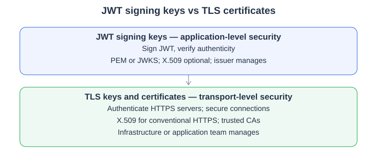
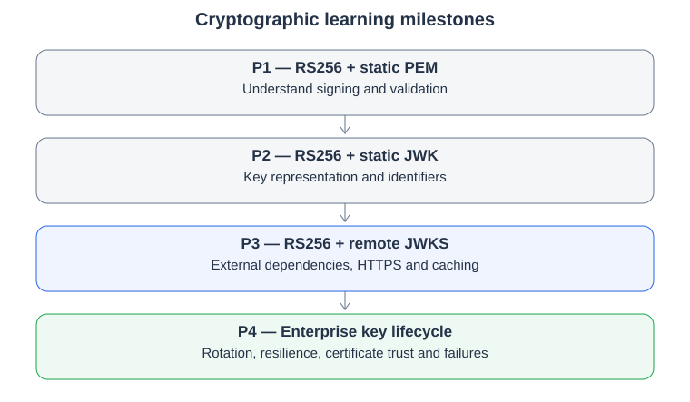

# 03 — RS256, JWK, JWKS and certificates

## Original prompt

> JWKS & jwk / RS256 & certs. Where do they fit?

## Answer

These belong to the **cryptographic trust architecture** between `jwt-issuer` and `jwt-resource-server`. They address signing, key representation, key distribution and transport security.

## 1. Where each concept fits

| Concept | What it is | Architectural purpose |
|---|---|---|
| RSA | Asymmetric cryptographic algorithm | Public/private key pair |
| RS256 | RSA signature algorithm using SHA-256 | JWT signing and verification |
| JWK | JSON Web Key | JSON representation of a cryptographic key |
| JWKS | JSON Web Key Set | Collection of JWKs |
| JWKS endpoint | HTTP endpoint exposing JWKS | Public key distribution and rotation |
| PEM | Textual encoding format | Distribute/store keys and certificates |
| X.509 certificate | Signed structure binding identity to public key | Establish cryptographic trust |
| TLS | Transport security protocol | Secure communication |
| kid | Key identifier | Select verification key |

## 2. How they fit into our architecture


[PNG](assets/png/IMG08.png) · [Mermaid source](assets/mermaid/IMG08.mmd)

Cryptography: how to sign and verify tokens. Key management: obtain and maintain trusted public keys. Transport security: secure network communication.

## 3. RSA, RS256, JWK and JWKS

### 3.1. RSA and RS256
| Operation | Private key | Public key |
|---|---|---|
| Sign JWT | Yes | No |
| Verify JWT | No | Yes |
| Stored by issuer | Yes | Yes |
| Available to Resource Server | No | Yes |
| Can be publicly distributed | No | Yes |

RS256 defines how the JWT signature is generated and verified using these keys.

### 3.2. JWK — representation of a key

```json
{"kty":"RSA","kid":"key-2026-01","use":"sig","alg":"RS256","n":"...","e":"AQAB"}
```
| Property | Meaning |
|---|---|
| kty | Key type |
| kid | Key identifier |
| use | Intended key usage |
| alg | Intended algorithm |
| n | RSA modulus |
| e | RSA public exponent |

A JWK can also represent a private key, but only public key material should be exposed through the issuer public JWKS endpoint.

### 3.3. JWKS — collection of keys

```json
{"keys":[{"kty":"RSA","kid":"key-2026-01","n":"...","e":"AQAB"},{"kty":"RSA","kid":"key-2026-02","n":"...","e":"AQAB"}]}
```

```http
GET https://issuer.example.com/.well-known/jwks.json
```
A JWKS endpoint does not require implementing OAuth 2.0 authorization flow.

### 3.4. Why multiple keys are relevant in an enterprise


[PNG](assets/png/IMG09.png) · [Mermaid source](assets/mermaid/IMG09.mmd)

The issuer signs new tokens with Key 02. Old tokens remain valid; the Resource Server supports both public keys and uses kid to select the key. Key 01 is removed after old tokens expire.

## 4. Where certificates fit


[PNG](assets/png/IMG10.png) · [Mermaid source](assets/mermaid/IMG10.mmd)
| Scenario | JWT signing key | TLS certificate |
|---|---|---|
| Sign JWT | Required | No |
| Validate JWT offline | Required public key | No |
| Retrieve JWKS over HTTPS | Provides verification keys | Required |
| Client calls protected API over HTTPS | Verifies JWT | Required |
| Prevent token modification | Yes | In transit |
| Prevent token interception in transit | No | Yes |
| Establish HTTPS server identity | No | Yes |

X.509 can contain the JWT signing public key; JWK supports x5c and x5t#S256. A trusted raw RSA public key is sufficient for JWT validation.

## 5. Architecture alternatives for public key distribution
| Criteria | Static PEM | Static JWK | Remote JWKS |
|---|---|---|---|
| RS256 support | Yes | Yes | Yes |
| Local signature verification | Yes | Yes | Yes |
| Network dependency | No | No | Yes |
| Multiple keys | Manual | Manual | Native |
| Key rotation | Manual | Manual | Can be automated |
| Application configuration changes | Typically | Typically | Usually unnecessary |
| Public key caching | Loaded in memory | Loaded in memory | Managed cache |
| TLS truststore for retrieval | No | No | Potentially |
| Issuer availability concerns | Low | Low | Conditional |
| Implementation complexity | Low | Low | Medium |
| Enterprise suitability | Limited | Moderate | High for rotating keys |

Remote JWKS adds endpoint availability, cache expiration, unknown kid handling, network timeouts, certificate trust and rotation policies. No database required.

## 6. Additional assumptions for our architecture baseline
| ID | Assumption / responsibility / constraint | Implication |
|---|---|---|
| K01 | RSA asymmetric key pairs are used | Agreed |
| K02 | RS256 is only accepted signing algorithm | Agreed |
| K03 | Private signing keys never enter Resource Server | Agreed |
| K04 | Public keys obtained through trusted distribution | Required |
| K05 | JWK is standard JSON key representation | Proposed |
| K06 | JWKS preferred enterprise distribution | Proposed |
| K07 | JWT header contains kid | Proposed |
| K08 | Multiple verification keys supported | Proposed |
| K09 | Public keys cached in JVM memory | Proposed |
| K10 | Rotation without redeployment | Proposed |
| K11 | JWT signing keys and TLS keys managed separately | Proposed |
| K12 | Remote JWKS uses HTTPS | Required if remote |
| K13 | TLS certificates validated against trusted CAs | Required if remote |
| K14 | No database or distributed cache for key management | Proposed |
| K15 | Unknown or untrusted keys result in rejection | Required |
| K16 | JWKS location trusted configuration, not arbitrary token URL | Required |
| K17 | JWT signing certificates optional | Proposed |
| K18 | Key retrieval failures and cache behavior defined | Open |

## 7. Impact on enterprise resource allocation
| Resource | Static PEM | Remote JWKS |
|---|---|---|
| Spring Security + Nimbus | Required | Required |
| Public key configuration | Required | Required |
| JWKS endpoint contract | — | Required |
| Outbound network permissions | — | Required |
| Firewall/proxy configuration | — | Conditional |
| JVM truststore / corporate CA | — | Conditional |
| Key rotation procedure | Manual | Automated or coordinated |
| Key cache configuration | — | Required |
| Network resilience testing | — | Required |
| Key rotation testing | Recommended | Required |
| Database | — | — |
| Redis | — | — |

## 8. My recommendation for our project
Remote JWKS as target enterprise architecture; static PEM as intermediate learning milestone.


[PNG](assets/png/IMG11.png) · [Mermaid source](assets/mermaid/IMG11.mmd)

These are proposed cryptographic milestones, not replacements for existing project phases. Decide whether remote JWKS and automatic rotation are mandatory or future extensions.

## Technical corrections and clarifications
Rotation without restart depends on cache and refresh behavior; publish new keys before signing with them. TLS keys need not be RSA.

