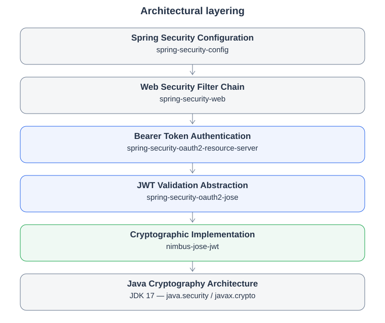
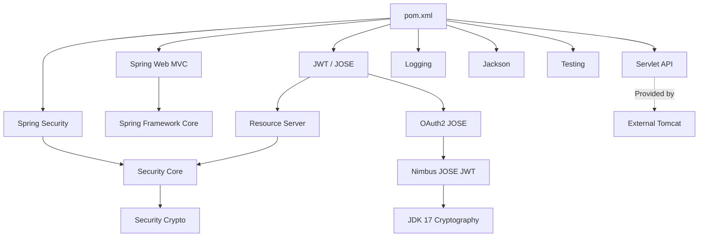

# 04 — Maven dependencies — Java 17 plain Spring

## Original prompt

> A review of mvn depdcy.. plain Spring vers. Brief depd. tree format. Compatble versions with J17. Create 2 lists. One for spring sc. JWT only, one including all .jars (web, test..).

## Answer

## Maven dependency baseline — jwt-resource-server
Java 17; plain Spring Framework and Spring Security without Boot; RS256 using Nimbus; static RSA and remote JWKS; servlet REST; no DB, JPA, Hibernate, Redis, issuer implementation or OAuth login flow.

## 1. Java 17 compatible versions
| Technology | Proposed version |
|---|---|
| Java | 17 LTS |
| Maven | 3.9.x |
| Spring Framework | 6.2.19 |
| Spring Security | 6.5.11 |
| Nimbus JOSE + JWT | Transitive, managed through JOSE dependency |
| Jakarta Servlet API | 6.0.x |
| Apache Tomcat | 10.1.x |
| Jackson | 2.21.x |
| JUnit Jupiter | 5.14.x |
| Mockito | 5.x |
| SLF4J | 2.0.x |
| Logback | 1.5.x |

Spring 6.x selected as conservative baseline.

## 2. List #1 — Spring Security + JWT only
[D] Direct; [T] Transitive.

```text
jwt-resource-server
├── [D] spring-security-config
│   └── [T] spring-security-core
│       └── [T] spring-security-crypto
├── [D] spring-security-web
│   └── [T] spring-security-core
├── [D] spring-security-oauth2-resource-server
│   ├── [T] spring-security-core
│   ├── [T] spring-security-web
│   └── [T] spring-security-oauth2-core
└── [D] spring-security-oauth2-jose
    ├── [T] spring-security-core
    ├── [T] spring-security-oauth2-core
    └── [T] nimbus-jose-jwt
```
| JAR | Relevant components / responsibility |
|---|---|
| spring-security-config | HttpSecurity, security DSL |
| spring-security-core | Authentication, AuthenticationManager, SecurityContextHolder |
| spring-security-crypto | General cryptographic utilities |
| spring-security-web | SecurityFilterChain, FilterChainProxy, AuthorizationFilter |
| spring-security-oauth2-resource-server | BearerTokenAuthenticationFilter, JwtAuthenticationProvider |
| spring-security-oauth2-core | Bearer token abstractions, errors and validators |
| spring-security-oauth2-jose | Jwt, JwtDecoder, NimbusJwtDecoder |
| nimbus-jose-jwt | RS256, JWT parsing, JWK, JWKS, verification |


[PNG](assets/png/IMG12.png) · [Mermaid source](assets/mermaid/IMG12.mmd)

RS256 does not require Bouncy Castle.

## 3. List #2 — Complete application dependency tree

The previous tree grouped dependencies by functionality, but did not clearly distinguish **what we declare in `pom.xml` from what Maven resolves transitively**.

**Legend:**
- `[D]` — Direct dependency, explicitly declared in `pom.xml`.
- `[T]` — Transitive dependency, automatically resolved by Maven.
- `[P]` — Provided dependency, declared in POM but supplied at runtime by the container.
- `[E]` — External runtime component.
- `[M]` — Version management, not a JAR.

### 3.1. Dependency declarations and their transitive JARs

```text
jwt-resource-server (Java 17 / WAR)
│
├── 1. VERSION MANAGEMENT
│   ├── [M] spring-framework-bom
│   └── [M] spring-security-bom
│
├── 2. SPRING WEB / MVC
│   └── [D] spring-webmvc
│       ├── [T] spring-web
│       │   └── [T] micrometer-observation
│       │       └── [T] micrometer-commons
│       ├── [T] spring-context
│       ├── [T] spring-aop
│       ├── [T] spring-beans
│       ├── [T] spring-expression
│       └── [T] spring-core
│           └── [T] spring-jcl
│
├── 3. SPRING SECURITY
│   ├── [D] spring-security-config
│   │   └── [T] spring-security-core
│   │       └── [T] spring-security-crypto
│   │
│   └── [D] spring-security-web
│       └── [T] spring-security-core
│
├── 4. JWT / JOSE / JWKS
│   ├── [D] spring-security-oauth2-resource-server
│   │   ├── [T] spring-security-core
│   │   ├── [T] spring-security-web
│   │   └── [T] spring-security-oauth2-core
│   │
│   └── [D] spring-security-oauth2-jose
│       ├── [T] spring-security-core
│       ├── [T] spring-security-oauth2-core
│       └── [T] nimbus-jose-jwt
│
├── 5. SERVLET INFRASTRUCTURE
│   ├── [P] jakarta.servlet-api
│   └── [E] Apache Tomcat 10.1.x
│
├── 6. JSON SERIALIZATION
│   └── [D] jackson-databind
│       ├── [T] jackson-core
│       └── [T] jackson-annotations
│
├── 7. LOGGING
│   ├── [D] slf4j-api
│   └── [D] logback-classic
│       ├── [T] slf4j-api
│       └── [T] logback-core
│
└── 8. TESTING (test scope)
    ├── [D] spring-test
    │   └── [T] spring-core
    │
    ├── [D] spring-security-test
    │   ├── [T] spring-security-core
    │   ├── [T] spring-security-web
    │   └── [T] spring-test
    │
    ├── [D] junit-jupiter
    │   ├── [T] junit-jupiter-api
    │   │   ├── [T] opentest4j
    │   │   ├── [T] apiguardian-api
    │   │   └── [T] junit-platform-commons
    │   ├── [T] junit-jupiter-engine
    │   │   └── [T] junit-platform-engine
    │   └── [T] junit-jupiter-params
    │
    ├── [D] mockito-junit-jupiter
    │   └── [T] mockito-core
    │       ├── [T] byte-buddy
    │       ├── [T] byte-buddy-agent
    │       └── [T] objenesis
    │
    └── [D] hamcrest
```

### 3.2. Summary — What we actually declare in `pom.xml`

| Category | Artifact ID | Scope |
|---|---|---|
| Version management | `spring-framework-bom` | import |
| Version management | `spring-security-bom` | import |
| Web | `spring-webmvc` | compile |
| Security | `spring-security-config` | compile |
| Security | `spring-security-web` | compile |
| JWT | `spring-security-oauth2-resource-server` | compile |
| JWT | `spring-security-oauth2-jose` | compile |
| Servlet | `jakarta.servlet-api` | provided |
| JSON | `jackson-databind` | compile |
| Logging | `slf4j-api` | compile |
| Logging | `logback-classic` | runtime |
| Testing | `spring-test` | test |
| Testing | `spring-security-test` | test |
| Testing | `junit-jupiter` | test |
| Testing | `mockito-junit-jupiter` | test |
| Testing | `hamcrest` | test |

| Summary | Count |
|---|---:|
| Production dependency declarations | 9 |
| Test dependency declarations | 5 |
| BOM imports | 2 |
| External runtime components | 1 |

### 3.3. Summary — Where important transitive JARs come from

| Transitive JAR | Introduced through |
|---|---|
| `spring-core` | `spring-webmvc` and other Spring modules |
| `spring-context` | `spring-webmvc` |
| `spring-web` | `spring-webmvc` |
| `spring-jcl` | `spring-core` |
| `spring-security-core` | `spring-security-config`, among others |
| `spring-security-crypto` | `spring-security-core` |
| `spring-security-oauth2-core` | Resource Server / JOSE |
| `nimbus-jose-jwt` | `spring-security-oauth2-jose` |
| `micrometer-observation` | Spring Web and Security modules |
| `micrometer-commons` | `micrometer-observation` |
| `jackson-core` | `jackson-databind` |
| `jackson-annotations` | `jackson-databind` |
| `logback-core` | `logback-classic` |
| `mockito-core` | `mockito-junit-jupiter` |
| `byte-buddy` | `mockito-core` |

### 3.4. Architectural dependency overview



### 3.5. Important observations

- `spring-security-crypto` is **transitive**, not a required direct POM declaration.
- `nimbus-jose-jwt` is **transitive**, introduced through `spring-security-oauth2-jose`. Declare it directly if our application code directly uses Nimbus APIs.
- Repeated dependencies in the tree do not imply multiple copies of the same JAR.
- Some directly declared dependencies are also reachable transitively. Explicit declarations make our intended dependencies clearer.
- Tomcat is external infrastructure under the proposed WAR deployment model.
- BOM imports manage versions without adding JARs.
- No additional JARs are inherently required for standard RS256 cryptography or X.509 certificate processing.

**Verification status:** This is a simplified, proposed dependency tree, not actual `mvn dependency:tree` output. Exact transitive relationships, additional JARs (such as `jcip-annotations`, depending on the resolved Nimbus version), scopes and version compatibility must still be verified against the final POM.

## 4. Maven BOM configuration

```xml
<properties>
    <maven.compiler.release>17</maven.compiler.release>
    <spring.version>6.2.19</spring.version>
    <spring-security.version>6.5.11</spring-security.version>
</properties>
<dependencyManagement>
    <dependencies>
        <dependency>
            <groupId>org.springframework</groupId>
            <artifactId>spring-framework-bom</artifactId>
            <version>${spring.version}</version>
            <type>pom</type>
            <scope>import</scope>
        </dependency>
        <dependency>
            <groupId>org.springframework.security</groupId>
            <artifactId>spring-security-bom</artifactId>
            <version>${spring-security.version}</version>
            <type>pom</type>
            <scope>import</scope>
        </dependency>
    </dependencies>
</dependencyManagement>
```
BOMs manage versions; they do not introduce JARs.

## 5. Dependencies explicitly not required
| Dependency | Reason |
|---|---|
| spring-boot-* | Plain Spring |
| spring-security-oauth2-client | No OAuth2 client flow |
| spring-security-oauth2-authorization-server | Issuer out of scope |
| spring-data-jpa | No persistence |
| hibernate-core | No ORM |
| spring-jdbc | No database |
| spring-tx | No database transactions |
| spring-session-* | Stateless authentication |
| spring-data-redis | No distributed state |
| jjwt-* | Nimbus provides JWT |
| bcprov-* | JDK supports RS256 |
| Additional JWKS library | Nimbus supports JWKS |

## 6. Dependencies for JWKS, RS256 and certificates
| Capability | Providing dependency |
|---|---|
| JWT parsing | Nimbus |
| RS256 verification | Nimbus + JDK |
| RSA public key | JDK |
| PEM processing | Spring Security + JDK |
| JWK representation | Nimbus |
| JWKS retrieval | Spring Security + Nimbus |
| JWKS caching | Nimbus / Spring Security |
| X.509 processing | JDK |
| TLS communication | JDK / JSSE |
| Certificate truststore | JDK |
| Incoming HTTPS | Tomcat or gateway |

No additional Maven dependencies fundamentally required for remote JWKS.

## 7. Enterprise architecture decision
| Decision | Proposed baseline |
|---|---|
| Java | 17 |
| Framework | Plain Spring 6.2 |
| Security | Spring Security 6.5 |
| Packaging | WAR |
| Servlet container | External Tomcat |
| JWT engine | Nimbus |
| Cryptographic provider | JDK default |
| Persistence | None |
| Dependency management | Maven BOMs |

Alternative: executable JAR with embedded Tomcat. Verify actual POM, convergence, support and vulnerabilities.
```bash
mvn dependency:tree
mvn dependency:tree -Dscope=runtime
mvn dependency:analyze
mvn help:effective-pom
```
## Technical corrections and clarifications
Versions and dependency paths above are historical proposals, not verified resolved output. jcip-annotations and other transitives must be checked against exact versions. No live Maven verification was performed in this archive.

