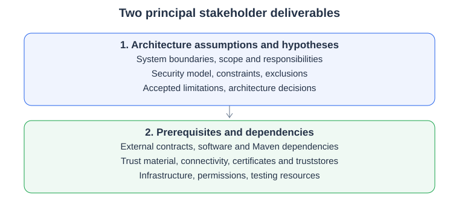

# 05 — Clarifications and revision requirements

## Original prompt

> Do not detail them for now but just show me u understand in a few words all points from the list:
> - Just a reminder.. [One limitation of fully stateless JWT validation is that changes to a user's roles or account status at the Auth Server are not automatically reflected in already-issued tokens. Short-lived tokens or additional revocation checks can address this.]
> - Is this relevant [No refresh token storage]?
> - spring-security-crypto is T or D? I also need a summary depd. tree where it is clear what depds. are declared in pom & where each needed .jar u already mentiond comes from (ot of those declared ones..)
> - Create all diagrams as mermaid "copy" (when u will export this thread as .zip/.mds)
> - Extens table/diagram under [For P3, I would introduce a separate, minimal token-issuing application.]
> - [Security and cryptographic assumptions]
>   - [JWT payload is signed, not encrypted]?
>   - X.509 certificates
>     - where are the X.509 certificates in this subsection?
>     - X.509 certificates & TSL are equiv.?
>     - [Where certificates fit] they were presented here..
>   - HTTPS & TSL are equiv.?
> - In [External dependencies and contracts] where does the roles/authoruties mapping fit?
> - Keep the numbering wehre applicable D01, S03, etc. Mention them explicitly when u explain the subsections I mentioned in this current list/prompt.
> - A reminder, need to apply the general structure under [Dependency classification]. As there are 2 lists I need when encoutering the architects & stakeholders od this feature/project. 1. assumptions/hypotesys 2. needed constrainst & dependencies that need to be put in place before the actual dev starts.
> - [RSA asymmetric key pairs are used], asymmetric?

## Answer

These are the points to address in the next revision and eventual ZIP / Markdown export. No detailed explanations or export yet.

| # | Topic | What needs to be addressed |
|---|---|---|
| 1 | Stateless JWT limitation | Document role changes, account disabling and logout do not automatically invalidate existing JWTs; S05, S10, ADR05. |
| 2 | No refresh token storage | Reassess C06 as consequence of O06. |
| 3 | spring-security-crypto | Transitive unless explicitly declared; clarify origin and responsibility. |
| 4 | Maven dependency tree | Two trees showing direct POM declarations and resolved transitive JARs, identifying origin. |
| 5 | Mermaid diagrams | Copyable Mermaid source inside exported Markdown. |
| 6 | P3 ecosystem architecture | Extend diagram and table with responsibilities, dependencies, keys, certificates, contracts and communication flows. |
| 7 | JWT signing vs encryption | S06: RS256 signs, does not encrypt; JWS vs JWE. |
| 8 | X.509 certificates | Introduce into security assumptions; S03, S07, K11–K13, K17. |
| 9 | X.509 vs TLS | Certificate is identity/trust artifact; TLS is protocol. |
| 10 | Certificate responsibilities | Consolidate signing vs TLS certificates. |
| 11 | HTTPS vs TLS | HTTPS is HTTP secured using TLS; S07, D08, K12. |
| 12 | Roles and authorities mapping | D03, D06 external contract vs R05 internal mapping and R07 enforcement. |
| 13 | Requirement traceability | Preserve A01, R01, C01, S03, D01, K01, ADR01 etc. |
| 14 | Dependency classification | Runtime, contractual, network, infrastructure, software/build and excluded. |
| 15 | Stakeholder preparation | Two architecture-level lists before development. |
| 16 | RSA asymmetric key pairs | K01, K02, K03: related but different keys, private signs and public verifies. |

## The two principal stakeholder deliverables

[PNG](assets/png/IMG13.png) · [Mermaid source](assets/mermaid/IMG13.mmd)

Distinguish mandatory, conditional, optional, excluded and unresolved items. Previous Maven trees were conceptual, not verified. The objective is an architecture agreement and development-readiness package, not merely a JWT learning guide.

