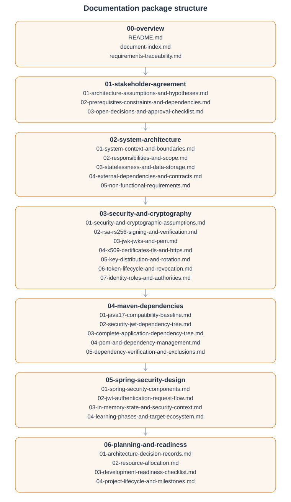
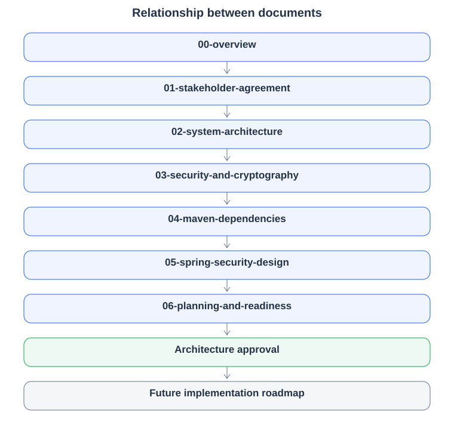
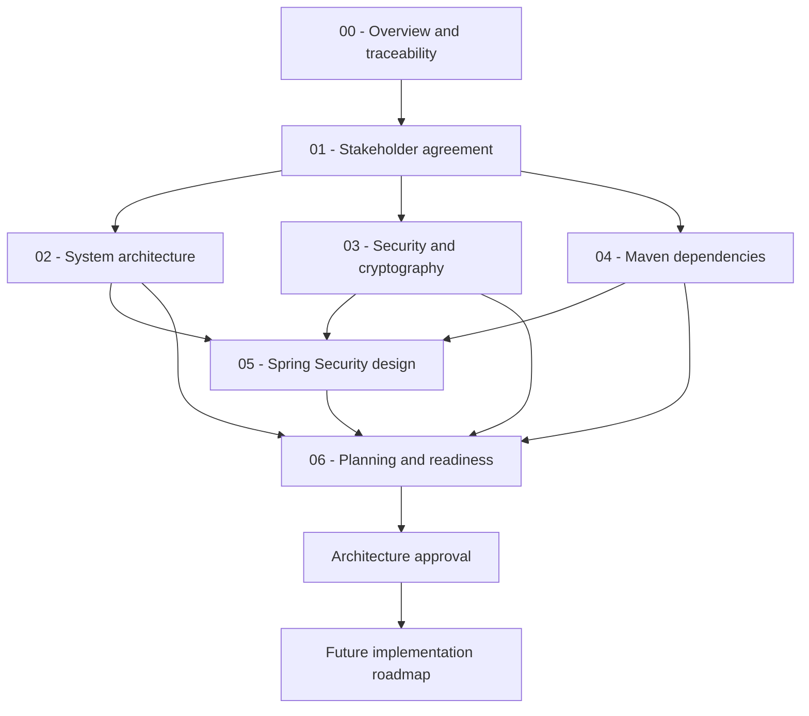
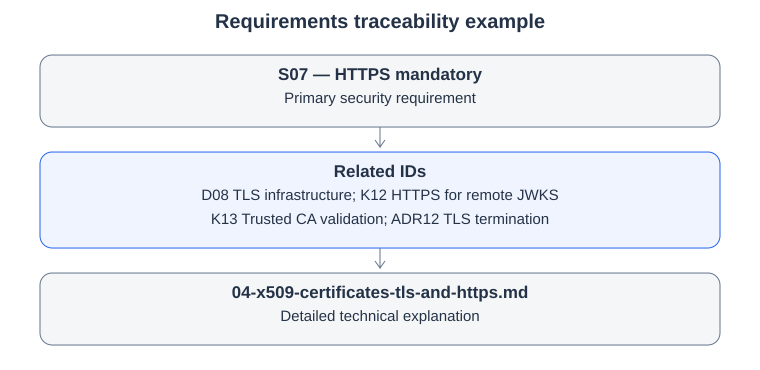
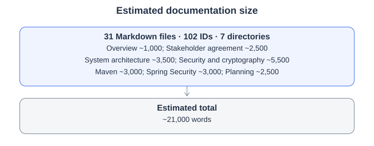

# 06 — Proposed architecture documentation package

## Original prompt

> Good, now if u would create a docs .zip, how would u organize it? All the info u provided in this thread neds to be inclued in the package.

## Answer

I would organize the package as **jwt-auth-architecture-docs.zip**, separating stakeholder agreement, development prerequisites, technical architecture and learning material. Two principal stakeholder documents should remain concise and independently readable. All information consolidated by topic.

## 1. Proposed package structure

[PNG](assets/png/IMG14.png) · [Mermaid source](assets/mermaid/IMG14.mmd)

7 directories · 31 Markdown documents · Mermaid diagrams embedded.

## 2. Content and purpose of each directory

### 00-overview

| Document | Content |
|---|---|
| README.md | Readme |
| document-index.md | Index |
| requirements-traceability.md | Traceability |

### 01-stakeholder-agreement

| Document | Content |
|---|---|
| 01-architecture-assumptions-and-hypotheses.md | Architecture assumptions and hypotheses |
| 02-prerequisites-constraints-and-dependencies.md | Prerequisites constraints and dependencies |
| 03-open-decisions-and-approval-checklist.md | Open decisions and approval checklist |

### 02-system-architecture

| Document | Content |
|---|---|
| 01-system-context-and-boundaries.md | System context and boundaries |
| 02-responsibilities-and-scope.md | Responsibilities and scope |
| 03-statelessness-and-data-storage.md | Statelessness and data storage |
| 04-external-dependencies-and-contracts.md | External dependencies and contracts |
| 05-non-functional-requirements.md | Non functional requirements |

### 03-security-and-cryptography

| Document | Content |
|---|---|
| 01-security-and-cryptographic-assumptions.md | Security and cryptographic assumptions |
| 02-rsa-rs256-signing-and-verification.md | Rsa rs256 signing and verification |
| 03-jwk-jwks-and-pem.md | Jwk jwks and pem |
| 04-x509-certificates-tls-and-https.md | X509 certificates tls and https |
| 05-key-distribution-and-rotation.md | Key distribution and rotation |
| 06-token-lifecycle-and-revocation.md | Token lifecycle and revocation |
| 07-identity-roles-and-authorities.md | Identity roles and authorities |

### 04-maven-dependencies

| Document | Content |
|---|---|
| 01-java17-compatibility-baseline.md | Java17 compatibility baseline |
| 02-security-jwt-dependency-tree.md | Security jwt dependency tree |
| 03-complete-application-dependency-tree.md | Complete application dependency tree |
| 04-pom-and-dependency-management.md | Pom and dependency management |
| 05-dependency-verification-and-exclusions.md | Dependency verification and exclusions |

### 05-spring-security-design

| Document | Content |
|---|---|
| 01-spring-security-components.md | Spring security components |
| 02-jwt-authentication-request-flow.md | Jwt authentication request flow |
| 03-in-memory-state-and-security-context.md | In memory state and security context |
| 04-learning-phases-and-target-ecosystem.md | Learning phases and target ecosystem |

### 06-planning-and-readiness

| Document | Content |
|---|---|
| 01-architecture-decision-records.md | Architecture decision records |
| 02-resource-allocation.md | Resource allocation |
| 03-development-readiness-checklist.md | Development readiness checklist |
| 04-project-lifecycle-and-milestones.md | Project lifecycle and milestones |

The first two stakeholder documents represent the two lists to bring to architects and stakeholders. Each item should have identifier, description, necessity, responsible party and approval/readiness status.

### List 1 — What must be agreed upon
| Category | Examples |
|---|---|
| Architecture | Two independently deployable applications |
| Scope | Resource Server only |
| Responsibilities | Token validation and authorization |
| Constraints | No DB, user repository, stateless authentication |
| Security | RS256, trusted issuer, HTTPS |
| Key management | PEM versus JWKS |
| Accepted limitations | No immediate revocation initially |
| Exclusions | No complete OAuth 2.0 flow |

### List 2 — What must be put in place
| Dependency classification | Examples |
|---|---|
| Runtime | JVM 17, servlet container |
| Contractual | JWT claims, roles, scopes, issuer, audience |
| Cryptographic | RSA public keys, JWKS |
| Network | JWKS connectivity, firewall, proxy |
| Infrastructure | TLS certificates, truststores, clock |
| Software/build | Maven, Spring, Nimbus, Nexus access |
| Testing | Signed JWT fixtures, test keys, test issuer |
| Operational | Logging, monitoring, rotation procedures |
| Excluded | Database, Redis, sessions |

Certificate document distinguishes signing keys from TLS keys, RSA public keys from X.509, RS256 from TLS, X.509 from TLS, HTTPS from TLS, and JWS from JWE. Maven trees use [D] explicit POM, [T] transitive, [P] provided by environment. Verify actual versions. Spring design retains Java, YAML and JSON examples, adapting to plain Spring. Planning covers ADRs, QA, infrastructure and readiness, not implementation.

## 3. Relationship between documents

[PNG](assets/png/IMG15.png) · [Mermaid source](assets/mermaid/IMG15.mmd)

## 4. Requirements traceability
| Prefix | Category | Existing items |
|---|---|---|
| A | Architecture assumptions | 8 |
| R | Responsibilities | 10 |
| C | Data and persistence constraints | 10 |
| S | Security assumptions | 12 |
| D | External dependencies | 10 |
| O | Out-of-scope functionality | 11 |
| N | Non-functional requirements | 11 |
| K | Cryptographic key management | 18 |
| ADR | Architecture decisions | 12 |
| Total |  | 102 |

[PNG](assets/png/IMG16.png) · [Mermaid source](assets/mermaid/IMG16.mmd)

Existing IDs not renumbered.

## 5. Estimated documentation size

[PNG](assets/png/IMG17.png) · [Mermaid source](assets/mermaid/IMG17.mmd)

## 6. Rules for generating the package
- Include all substantive information, including 16 clarification points.
- Preserve tables, examples, inventories and comparisons; correct inaccuracies.
- Reproduce diagrams as Mermaid; preserve identifiers.
- Distinguish agreed, proposed and unresolved items.
- Use relative links; verify Maven versions and relationships.
- Keep issuer outside implementation scope but inside ecosystem.
- Keep roadmap separate; no source code or implementation tasks yet.

Architecture and Development Readiness Baseline V0.1. No ZIP generated at that stage.

