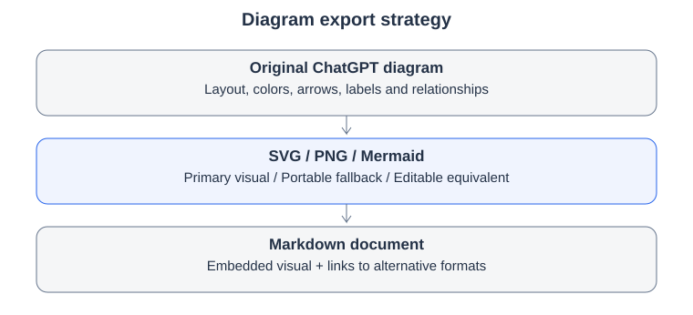

# 07 — Conversation export structure

## Original prompt

> Can u create a .md per each prompt/answer pair we hand in this thread? Wiht the mention: how would u best export the diagrams to look exactly like in the cgpt thread (as the mermaid ones are dofferent..). For now just create the list of .mds do not generate them.

## Answer

I would create a chronological conversation archive, separate from the structured 31-document architecture package. Each Markdown corresponds to one prompt/answer pair.

## 1. Proposed ZIP structure

```text
jwt-auth-conversation-docs/
├── 00-README.md
├── 01-stateless-jwt-and-in-memory-storage.md
├── 02-architecture-assumptions-and-constraints.md
├── 03-rs256-jwk-jwks-and-certificates.md
├── 04-maven-dependencies-java17-plain-spring.md
├── 05-clarifications-and-revision-requirements.md
├── 06-proposed-architecture-documentation-package.md
├── 07-conversation-export-structure.md
└── assets/
    ├── diagrams/
    │   ├── svg/
    │   └── png/
    └── mermaid/
```

## 2. Markdown document inventory
| File | Prompt/answer content |
|---|---|
| 01 | stateless jwt and in memory storage |
| 02 | architecture assumptions and constraints |
| 03 | rs256 jwk jwks and certificates |
| 04 | maven dependencies java17 plain spring |
| 05 | clarifications and revision requirements |
| 06 | proposed architecture documentation package |
| 07 | conversation export structure |

00-README is additional navigation.

## 3. How to preserve the original diagrams
| Format | Visual fidelity | Editable | Markdown compatible |
|---|---|---|---|
| SVG | Very high | Yes | Yes (viewer dependent) |
| PNG | Very high | No | Yes |
| Mermaid | Variable | Yes | Renderer-dependent |
| ASCII | Low | Yes | Yes |


[PNG](assets/png/IMG18.png) · [Mermaid source](assets/mermaid/IMG18.mmd)

Original SVG geometry can be preserved; UI elements need reconstruction. Pixel-perfect reproduction cannot be guaranteed.

## 4. Proposed diagram inventory
| ID | Source document | Diagram |
|---|---|---|
| IMG01 | 01 | Issuer vs Resource Server architecture |
| IMG02 | 01 | JWT authentication and SecurityContextHolder flow |
| IMG03 | 01 | P3 ecosystem |
| IMG04 | 02 | System architecture and scope boundaries |
| IMG05 | 02 | Dependency classification |
| IMG06 | 02 | Required vs excluded resources |
| IMG07 | 02 | Project lifecycle |
| IMG08 | 03 | Cryptographic trust architecture |
| IMG09 | 03 | RSA key rotation lifecycle |
| IMG10 | 03 | JWT signing keys vs TLS certificates |
| IMG11 | 03 | Cryptographic learning milestones |
| IMG12 | 04 | Maven security dependency layering |
| IMG13 | 05 | Two principal stakeholder deliverables |
| IMG14 | 06 | Documentation package structure |
| IMG15 | 06 | Relationship between documents |
| IMG16 | 06 | Requirements traceability example |
| IMG17 | 06 | Estimated documentation size |
| IMG18 | 07 | Diagram export strategy |

## 5. Internal structure of each Markdown
```markdown
# 01 — Stateless JWT and in-memory storage
## Original prompt
[Complete user prompt]
## Answer
[Complete assistant answer]

[PNG version](assets/diagrams/png/IMG01.png)
[Mermaid source](assets/mermaid/IMG01.mmd)
## Technical corrections and clarifications
[Corrections clearly separated from original answer]
```
## 6. Two separate documentation packages
|  | Conversation archive | Architecture baseline |
|---|---|---|
| ZIP name | jwt-auth-conversation-docs.zip | jwt-auth-architecture-docs.zip |
| Organization | Chronological | Thematic |
| Markdown files | 8 | 31 |
| Original prompts | Included | Not necessary |
| Original answers | Preserved | Consolidated and refined |
| Original diagrams | Reproduced | Reorganized where appropriate |
| Requirement IDs | Preserved | Preserved and cross-referenced |
| Purpose | Complete conversation reference | Enterprise architecture approval |
| Audience | Developer / learning | Architects / stakeholders / development team |

Create conversation archive first. No files had been generated at that point.

