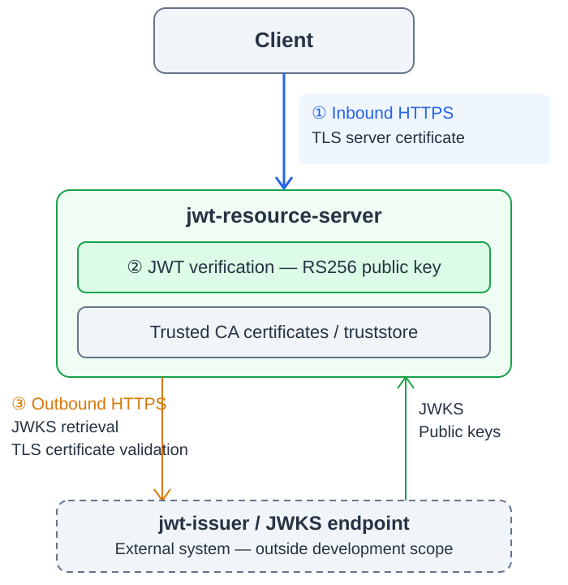
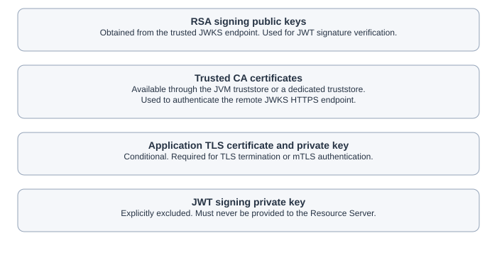
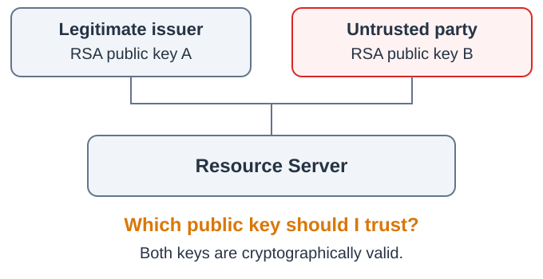
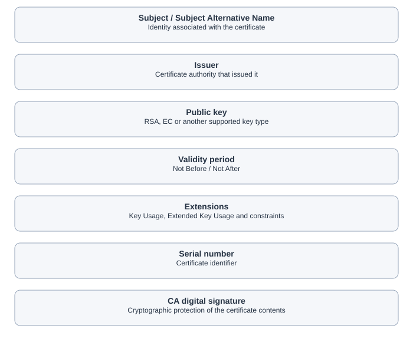
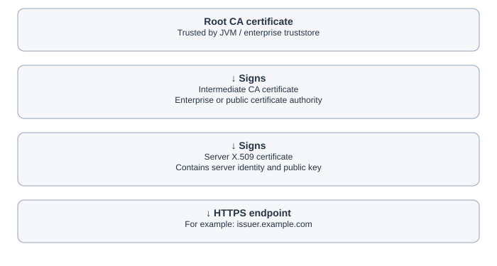
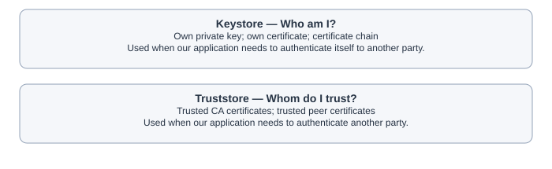

# 08 — Cryptographic architecture and environment prerequisites

## Original prompt

> How to formulate the request and expected dependency and constraints of the project of the dev/uat/prod environment for the cryptography? Do we need 2 certs, one for https, one for jwt (one for tsl even)? Why do we need certs in the firsyplace when we would supposedly have the public keys already? X.509 certificates are exclusive?

## Answer

For our `jwt-resource-server`, I would separate the enterprise cryptographic requirements into **three independent trust relationships** before requesting certificates, keys, infrastructure or network permissions for DEV, UAT and PROD.

The important point is that we should request **cryptographic capabilities and trust material**, rather than immediately requesting two or three certificates. The actual number of certificates depends on the deployment architecture.

# 1. Three cryptographic trust relationships



[PNG](assets/png/IMG19.png) · [Mermaid source](assets/mermaid/IMG19.mmd)

| Trust relationship | Purpose | Required cryptographic material |
|---|---|---|
| ① Client → Resource Server | Secure incoming HTTP requests | TLS server certificate and private key at TLS termination point |
| ② Issuer → Resource Server | Verify JWT authenticity | Trusted RSA signing public key |
| ③ Resource Server → JWKS endpoint | Secure public key retrieval | Trusted CA certificates and remote server certificate validation |

These are independent security concerns, even though all three may involve public-key cryptography.

# 2. Do we need two or three certificates?

Not necessarily.

| Certificate | Required? | Owner |
|---|---|---|
| Resource Server HTTPS/TLS certificate | Yes, at the TLS termination point | Infrastructure or application team |
| Issuer JWKS HTTPS/TLS certificate | Yes, if using remote HTTPS JWKS | Issuer team |
| JWT signing certificate | Optional | Issuer team |
| Resource Server client certificate | Only if outbound mTLS is required | Application or infrastructure team |
| CA certificates | Required as trust anchors where applicable | Enterprise PKI / infrastructure team |

**There is no separate HTTPS certificate and TLS certificate.** They refer to the same certificate in this context.

HTTPS is HTTP transported over TLS.

If an enterprise gateway or OpenShift ingress terminates incoming TLS, our Java application may not need to manage its own HTTPS certificate at all. Whether the internal connection must also use TLS depends on enterprise security policy.

## 3. What cryptographic material does our application actually need?

Assuming remote JWKS, standard TLS and gateway-managed inbound HTTPS:



[PNG](assets/png/IMG20.png) · [Mermaid source](assets/mermaid/IMG20.mmd)

# 4. Why do we need certificates if we already have public keys?

This is the fundamental distinction between **cryptographic verification and establishing trust**.

A public key allows us to verify that a signature was generated using the corresponding private key.

But how do we know that the public key actually belongs to the system we intend to trust?

## 4.1. Public key without a certificate



[PNG](assets/png/IMG21.png) · [Mermaid source](assets/mermaid/IMG21.mmd)

Anyone can generate an RSA key pair. The existence of a valid public key does not prove the identity of its owner.

If the Resource Server accepts an untrusted public key, it could successfully validate tokens signed by an unauthorized issuer.

However, if an RSA public key is securely provisioned by the enterprise security team and explicitly configured as trusted, **a certificate is not necessary for JWT verification**.

This is essentially the static PEM approach discussed under **ADR01 and K04**.

## 4.2. Public key with an X.509 certificate

An X.509 certificate contains more than the public key.



[PNG](assets/png/IMG22.png) · [Mermaid source](assets/mermaid/IMG22.mmd)

The certificate binds an identity to a public key through a signed statement.

The application establishes trust by validating the certificate chain against an already trusted certificate authority, together with validity, identity and applicable usage checks.

## 4.3. Certificate chain of trust



[PNG](assets/png/IMG23.png) · [Mermaid source](assets/mermaid/IMG23.mmd)

When our application retrieves a JWKS, TLS authenticates the endpoint and protects the communication. Our configured issuer/JWKS trust relationship determines whether the retrieved signing keys are trusted.

The individual JWKs do not necessarily need their own certificates.

# 5. Are X.509 certificates exclusive?

No. X.509 is a certificate standard, not a specific algorithm, key type or exclusive mechanism for establishing trust.

| Concept | Classification |
|---|---|
| RSA | Cryptographic algorithm |
| RS256 | Digital signature algorithm |
| X.509 | Certificate standard |
| JWK | Key representation standard |
| JWKS | Collection of JWKs |
| PEM | Textual encoding format |
| PKCS#12 | Key and certificate container format |
| JKS | Java keystore format |
| TLS | Transport security protocol |
| HTTPS | HTTP over TLS |

An X.509 certificate can contain an RSA public key, an elliptic-curve public key or another supported key type.

Furthermore, X.509 and JWK are not mutually exclusive. A JWK can contain an X.509 certificate chain through its `x5c` property.

```json
{
  "kty": "RSA",
  "kid": "signing-key-01",
  "alg": "RS256",
  "use": "sig",
  "n": "...",
  "e": "AQAB",
  "x5c": [
    "Base64EncodedX509Certificate..."
  ]
}
```

The `x5c` property is optional. Its presence does not automatically establish certificate trust.

# 6. Keystore vs truststore

This distinction will be particularly relevant when requesting environment configuration.



[PNG](assets/png/IMG24.png) · [Mermaid source](assets/mermaid/IMG24.mmd)

| Scenario | Keystore | Truststore |
|---|:---:|:---:|
| Offline JWT validation using PEM | No | No |
| Retrieve JWKS over standard HTTPS | No | Yes* |
| Application terminates incoming HTTPS | Yes** | Not necessarily |
| Outbound mTLS to issuer | Yes | Yes |
| Gateway terminates inbound TLS | Not necessarily | Not necessarily |

\* The default JVM truststore may already be sufficient.

\** Or equivalent private-key and certificate configuration.

# 7. List #1 — Cryptographic assumptions and constraints for architecture approval

This extends our existing **S, K and ADR** architecture requirements.

| ID | Proposed assumption / constraint | Necessity |
|---|---|---|
| K01 | RSA asymmetric signing keys | Mandatory |
| K02 | RS256 is the accepted JWT signing algorithm | Mandatory |
| K03 | JWT signing private keys remain exclusively with issuer | Mandatory |
| K04 | Verification keys are obtained from a trusted source | Mandatory |
| K05 | JWK representation supported | Proposed |
| K06 | Remote JWKS as target key distribution mechanism | Proposed |
| K07 | JWT contains a signing key identifier (`kid`) | Proposed |
| K09 | Public keys cached in JVM memory | Proposed |
| K10 | Key rotation without redeployment | Proposed |
| K11 | JWT signing keys and TLS keys are separate | Required |
| K12 | JWKS retrieval over HTTPS | Mandatory if remote |
| K13 | TLS certificate and hostname validation | Mandatory |
| K14 | No DB or distributed key cache | Proposed |
| K17 | X.509 JWT signing certificates | Optional |
| K18 | Defined key retrieval and cache failure policies | Required |
| S07 | HTTPS in enterprise environments | Mandatory |
| ADR12 | TLS termination location | Open |
| K19 (new) | Environment-specific trust configuration | Proposed |
| K20 (new) | Separate PROD and non-PROD signing keys | Proposed |
| K21 (new) | mTLS requirement | Open |
| K22 (new) | Certificate and key lifecycle ownership | Required |
| K23 (new) | Approved TLS versions and cryptographic policies | Required |

I would strongly recommend separating PROD and non-PROD signing keys and trust domains. A DEV-issued JWT should not be accepted in PROD.

# 8. List #2 — DEV / UAT / PROD prerequisites and dependencies

This is the actual provisioning and information request for infrastructure, security and issuer teams.

## 8.1. Environment dependency matrix

| Dependency | DEV | UAT | PROD |
|---|---|---|---|
| Trusted issuer identifier | Required | Required | Required |
| Expected JWT audience | Required | Required | Required |
| RSA public key / JWKS URL | Required | Required | Required |
| Issuer HTTPS certificate | If remote JWKS | If remote JWKS | If remote JWKS |
| Trusted CA chain | As applicable | As applicable | As applicable |
| JVM truststore configuration | As applicable | As applicable | As applicable |
| Outbound JWKS connectivity | If remote JWKS | If remote JWKS | If remote JWKS |
| Inbound TLS termination | Required* | Required | Required |
| Application TLS certificate | Conditional | Conditional | Conditional |
| mTLS client certificate | Conditional | Conditional | Conditional |
| Key rotation procedure | Testable | Validated | Operational |
| Certificate renewal procedure | Defined | Validated | Operational |
| Signed JWT test fixtures | Required | Required | Not normally |
| Reliable system clock | Required | Required | Required |

\* Local development may permit HTTP under an explicitly agreed exception.

## 8.2. Dependency classification and ownership

| ID | Classification | Required resource | Responsible team |
|---|---|---|---|
| D01 | External system | JWT issuer availability | Identity team |
| D02 | Cryptographic | RSA public keys / JWKS | Identity team |
| D03 | Contractual | JWT claims specification | Identity / architecture |
| D04 | Configuration | Issuer identifier | Identity team |
| D05 | Configuration | Expected audience | Architecture / identity |
| D06 | Contractual | Roles and scopes contract | Business / identity |
| D07 | Infrastructure | Clock synchronization | Infrastructure |
| D08 | Infrastructure | TLS termination and certificates | Infrastructure / PKI |
| D10 | Software | Spring Security and Nimbus | Development |
| D11 (new) | Network | Outbound JWKS connectivity | Network team |
| D12 (new) | Cryptographic | Trusted CA certificates | PKI team |
| D13 (new) | Configuration | JVM truststore provisioning | Infrastructure |
| D14 (new) | Operational | Key and certificate rotation | Identity / PKI |
| D15 (new) | Testing | Valid and invalid signed tokens | Identity / QA |
| D16 (new) | Security | mTLS material, if required | PKI team |

# 9. How to formulate the actual enterprise request

I would send the following to the architects, identity provider team, infrastructure team and security/PKI team before development starts.

---

# Cryptographic architecture and environment prerequisites

**Application:** jwt-resource-server  
**Environments:** DEV / UAT / PROD  
**Scope:** Architecture agreement and development readiness

## 1. Context

The application will operate as a stateless JWT Resource Server, validating RS256-signed tokens issued by an external trusted issuer.

The application will not issue tokens, store user credentials, implement a complete OAuth 2.0 authorization flow or maintain a database connection.

## 2. JWT signing and verification requirements

For each environment, please confirm or provide:

- Trusted JWT issuer identifier.
- Expected audience.
- Supported signing algorithm (RS256).
- RSA key size and applicable cryptographic policies.
- Trusted RSA public key or JWKS endpoint URL.
- Signing key identifier (`kid`) conventions.
- Public key rotation and retirement procedures.
- JWT validity period and clock-skew policy.
- Whether X.509 signing certificates are required by enterprise policy.
- Separation of PROD and non-PROD signing keys and trust domains.

The JWT signing private key must remain exclusively under the issuer's control.

## 3. TLS and certificate requirements

Please clarify:

- Where inbound HTTPS/TLS is terminated: gateway, ingress, load balancer or application.
- Whether internal communication must also use TLS.
- Whether the application requires its own TLS server certificate and private key.
- Whether outbound JWKS communication requires standard TLS or mutual TLS.
- Which certificate authorities must be trusted.
- Whether the default JVM truststore is sufficient or a dedicated enterprise truststore must be provisioned.
- Applicable TLS versions and cryptographic policies.

## 4. Network and infrastructure prerequisites

Please confirm:

- JWKS endpoint availability per environment.
- Required outbound firewall, proxy and DNS configuration.
- Certificate and truststore provisioning mechanisms.
- Secure private-key provisioning, if applicable.
- System clock synchronization.
- Certificate renewal and key rotation ownership.
- Expected behavior during JWKS endpoint outages.

## 5. Testing prerequisites

Please provide or identify a mechanism for obtaining:

- Valid RS256-signed JWTs.
- Expired JWTs.
- JWTs with invalid issuer or audience.
- JWTs signed with untrusted keys.
- JWTs containing different roles and scopes.
- Test scenarios for signing key rotation and certificate renewal.

## 6. Expected outcome

An agreed cryptographic architecture, environment-specific configuration inventory, identified infrastructure dependencies and assigned operational responsibilities before implementation begins.

Certificate provisioning should be based on the agreed TLS termination, key distribution and mutual authentication architecture, rather than assuming a fixed number of certificates per environment.

---

# 10. Recommended target architecture

For our project, I would propose the following baseline for stakeholder approval.

| Decision | Recommendation |
|---|---|
| JWT signing | RS256 |
| Public key distribution | Remote JWKS |
| JWT signing certificate | Not required unless enterprise policy mandates it |
| Inbound HTTPS | Infrastructure-managed TLS termination |
| Outbound JWKS communication | HTTPS |
| Outbound certificate validation | JVM or enterprise truststore |
| Application-owned TLS private key | Avoid unless required |
| mTLS | Only if mandated |
| Public key cache | Local JVM memory |
| Environment separation | Independent trust configuration |
| Database | None |

Under this proposed architecture, the Resource Server itself could operate with **zero application-owned certificates and zero private keys**. It would only need trusted RSA public keys and access to the appropriate CA trust material.

The HTTPS certificates would be managed by the infrastructure and issuer teams.

This remains a proposed architecture: the actual TLS termination point, enterprise PKI policies, issuer capabilities and mTLS requirements are not yet known. These are precisely the dependencies and decisions we need to resolve before allocating development and infrastructure resources.
