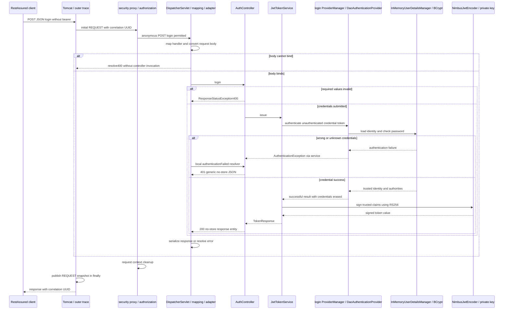
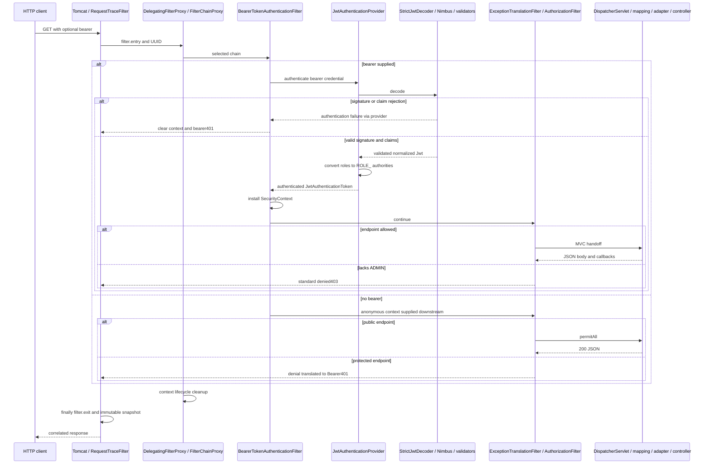
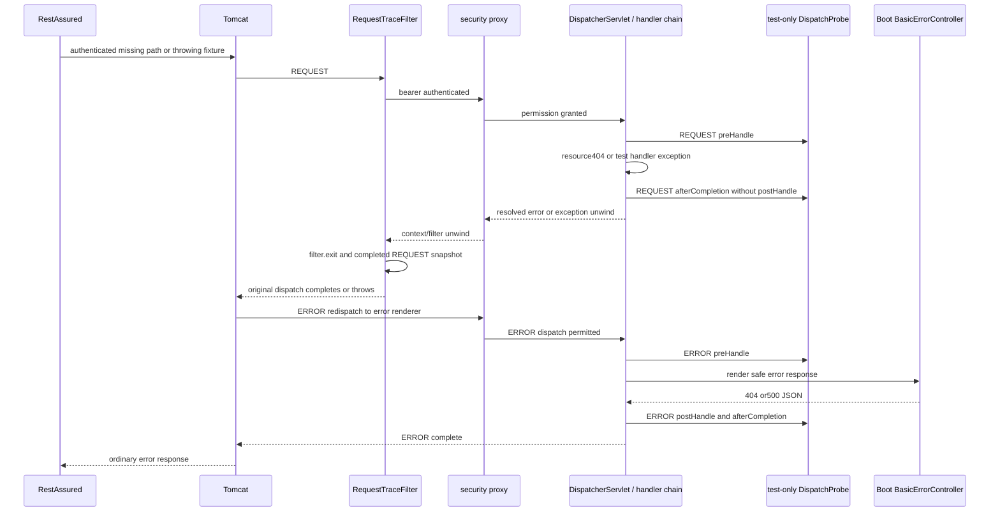

# Complete Java 17 JWT learning guide

This guide describes the current unconditional JWT application, its entire production source and executed tests. Read [setup](../../README.md), [scope](../IN-SCOPE-OUT-OF-SCOPE.md), [claim contract](../JWT-CLAIM-CONTRACT.md) and [test matrix](../TEST-MATRIX.md) alongside it. [JWT foundations](JWT-FOUNDATIONS.md) gives a gentler prerequisite narrative. The source audit below supersedes old checkpoint ranges; J walkthroughs retain actual historical execution evidence. No original comparison-course document is required.

## Reading path and step evidence

| Step | Learn | Artifact |
|---|---|---|
| J1.S1 | Java17 source/runtime enforcement | [Walkthrough](J1.S1-WALKTHROUGH.md) |
| J1.S2 | Unconditional JWT/proxy and retirement of other configurations | [Walkthrough](J1.S2-WALKTHROUGH.md) |
| J1.S3 | Credential/signing/bootstrap ownership | [Walkthrough](J1.S3-WALKTHROUGH.md) |
| J2.S1 | Login and endpoint authentication/authorization | [Walkthrough](J2.S1-WALKTHROUGH.md) |
| J2.S2 | Strict raw types, keys, deterministic timestamps | [Walkthrough](J2.S2-WALKTHROUGH.md) |
| J2.S3 | Actual filter entries, lifecycle and identity isolation | [Walkthrough](J2.S3-WALKTHROUGH.md) |
| J3.S1 | Current documentation contracts and extraction | [Walkthrough](J3.S1-WALKTHROUGH.md) |
| J3.S2 | Complete current source/flow/test guide | [Walkthrough](J3.S2-WALKTHROUGH.md) |
| J3.S3 | Final clean runtime/repository audit | Planned, walkthrough will be added when implemented |

All nine step slots are present without fabricating the ninth walkthrough or completion. The final audit remains a separately requested step in [ROADMAP](../../ROADMAP.md).

## Architecture and trust boundaries

Spring creates beans through component scanning and @Bean methods, then Boot starts embedded Tomcat. Required matching RSA keys are loaded before a usable application starts. Credential configuration, private-key signing, public-key verification and HTTP security policy have distinct owners. There is no mode selector or unsecured fallback. The dependency starter uses OAuth2 Resource Server capabilities without an OAuth2 authorization server, grant, redirect or external IdP.

| Operation | Input | Decision/collaborators | Output |
|---|---|---|---|
| Local credential login | JSON username/password | Dedicated ProviderManager → DaoAuthenticationProvider → in-memory user/BCrypt | Trusted principal/authorities for signing |
| Token issuance | Trusted identity, clock | NimbusJwtEncoder with local RSA private JWK | Signed300s RS256 token in no-store JSON |
| Bearer verification | Compact bearer string | Built-in bearer filter/provider → Nimbus/normalized validators → strict original-type guard | Validated Jwt |
| Authentication conversion | Validated subject/roles | JwtAuthenticationConverter and authority converter | Authenticated JwtAuthenticationToken, installed by Spring Security |
| Authorization | Current request identity/authorities/path | AuthorizationFilter and endpoint matchers | Continue to MVC or401/403 |

BCrypt checks a password hash only at login; RS256 verifies signed bearer requests with a public key. Neither encoding a payload nor verifying its signature alone grants access. Signature, algorithm, issuer, audience, timestamps, schema, identity conversion and permission are distinct gates. Base64URL claims are readable; never include passwords/private keys in them. kid is an identifier, not trust or a discovery URL. The issuer derives roles from its authenticated result, not caller-supplied JSON.

The fixed issuer is urn:spring-security-learning:local and required audience is spring-security-learning-api. Lifetime300s and skew60s are separate choices. Required exp differs from optional iat/nbf; present null optional dates still fail. Missing/empty roles authenticate with no role authorities, while malformed roles fail authentication. ADMIN does not inherit USER, because user access requires authenticated rather than ROLE_USER. The claim contract owns exact type/clock rules.

## Build and runtime ownership

[pom.xml](../../pom.xml) inherits Boot3.5.7 dependency/plugin management. java.version17 selects compiler release17; Enforcer3.6.2 executes requireJavaVersion at validate with range [17,18). A newer compiler targeting17 is insufficient. The rule gates Maven, not an arbitrary standalone java executable: choose JDK17 for jar startup too. Resource Server supplies runtime security/JOSE dependencies, web supplies MVC/Tomcat, and starter-test/RestAssured remain test-scoped. Boot packaging creates the executable jar. Surefire includes *Test. Failsafe includes *IT and binds integration-test plus verify, so package alone does not run the HTTP verification gate. Use `mvn verify` or `mvn clean verify` with the same JDK17 JAVA_HOME for all phases.

## Every production class and meaningful source block

The following 16-file audit uses current one-based inclusive ranges, checked against source after assembly. Every nonblank production line is assigned an explanation, including declarations/imports, annotations, fields, constructors, private helpers, records and configuration callbacks. Closing braces terminate their described blocks rather than add behavior. Package/import rows identify collaboration boundaries; ordinary Java syntax is not presented as an extra Spring runtime action. Runtime claims about library classes are explained separately below.

### SecurityLearningApplication.java

Source: [SecurityLearningApplication.java](../../src/main/java/com/example/securitylearning/SecurityLearningApplication.java).

| Lines | Explanation |
|---|---|
| 1–5 | Package sets the component-scan root. Imports select Boot startup, its composite annotation and only the servlet-security registration auto-configuration. |
| 7–8 | @SpringBootApplication combines configuration, component scanning and auto-configuration. Exclude SecurityFilterAutoConfiguration because the application explicitly registers the security servlet proxy. Other security auto-configuration is not globally excluded. |
| 10–13 | main(String[] args) delegates startup/arguments to SpringApplication.run. Boot creates beans and embedded Tomcat; failures propagate instead of starting an unsecured fallback. |

### api/AuthController.java

Source: [api/AuthController.java](../../src/main/java/com/example/securitylearning/api/AuthController.java).

| Lines | Explanation |
|---|---|
| 1–19 | Imports connect Map, service/sink, servlet request, HTTP responses/status/cache and MVC exception/binding annotations. @RestController makes this a scanned controller with response-body semantics. |
| 21–27 | Final fields and the single public constructor express required service/sink dependencies. Spring injects them without needing @Autowired. |
| 29–32 | @PostMapping selects POST login. @RequestBody binds JSON into LoginRequest through message conversion before invocation. HttpServletRequest is resolved separately. The method records controller.login only after argument resolution succeeds. |
| 33–36 | Reject null/blank username and null/empty password with ResponseStatusException400. Password isEmpty differs intentionally from isBlank: whitespace is not rejected by this shape check but still must authenticate. Invalid JSON/empty body can fail earlier in binding. |
| 37–40 | issue authenticates and signs. Only success records login.token.issued. ResponseEntity supplies200, Cache-Control no-store and TokenResponse for JSON serialization. No session/context save occurs here. |
| 42–47 | The local @ExceptionHandler handles AuthenticationException as generic401 invalid_credentials JSON with no-store. It records login.credentials.rejected without exception/credential contents. This MVC resolver path does not call the bearer entry point. |
| 49–55 | LoginRequest is a nested record: compiler-generated constructor/accessors support binding. @Override toString replaces the default field-revealing representation with a fixed redaction. Accessors still contain credentials and must never be logged. |

### api/DemoController.java

Source: [api/DemoController.java](../../src/main/java/com/example/securitylearning/api/DemoController.java).

| Lines | Explanation |
|---|---|
| 1–14 | Map/sink/servlet and MVC imports support deterministic JSON and tracing. @RestController selects response-body handling; @RequestMapping adds the /api prefix, without enforcing permissions. |
| 16–20 | Constructor injection retains a final shared sink, not shared request state. |
| 22–26 | publicEndpoint maps GET/public, records controller.public on the request and returns immutable Map.of(message,public). Jackson writes JSON. |
| 28–32 | userEndpoint repeats the same pattern for GET/user and controller.user. The security configuration, not this method, requires authentication. |
| 34–39 | adminEndpoint maps GET/admin, records controller.admin and returns the admin message. ADMIN checking already happened before invocation. |

### config/InMemoryIdentityConfig.java

Source: [config/InMemoryIdentityConfig.java](../../src/main/java/com/example/securitylearning/config/InMemoryIdentityConfig.java).

| Lines | Explanation |
|---|---|
| 1–15 | Imports identify bean/configuration APIs and credential authentication abstractions. @Configuration(proxyBeanMethods=false) is scanned; no configuration-method proxy is needed because collaborators are injected as method parameters. |
| 17–20 | @Bean passwordEncoder creates BCryptPasswordEncoder, exposing PasswordEncoder. Defaults select a salted adaptive password hash, not an RSA signer or reversible encryption. |
| 22–27 | users takes the encoder and creates InMemoryUserDetailsManager with two development identities. Passwords are encoded at bean creation; User.roles adds ROLE_ prefixes. ADMIN has only its declared role. No database or registration exists. |
| 29–34 | daoAuthenticationProvider receives the UserDetailsService, constructs DaoAuthenticationProvider and attaches the same encoder. Provider authentication loads a user and checks the submitted password against the stored hash. |
| 36–41 | loginAuthenticationManager returns ProviderManager around that provider. This explicitly named credential manager belongs to local login. ProviderManager dispatches to supporting providers and normally erases credentials in the successful result. |

### config/JwtDecoderConfig.java

Source: [config/JwtDecoderConfig.java](../../src/main/java/com/example/securitylearning/config/JwtDecoderConfig.java).

| Lines | Explanation |
|---|---|
| 1–24 | I/O/key/time imports support local loading and deterministic validators. Security/Nimbus imports provide existing parsing/verification and validator composition. @Configuration(proxyBeanMethods=false) makes this unconditional bean configuration. |
| 26–35 | jwtVerificationKey injects required app.jwt.public-key-path with @Value. Path/Files open local input in try-with-resources. RsaKeyConverters.x509 reads the public PEM. Null or modulus below2048bits is rejected with a fixed message. IO/parsing failures propagate and abort startup. |
| 37–40 | jwtValidationClock returns Clock.systemUTC as a bean. Injection lets tests supply a Primary fixed clock rather than sleep. |
| 42–45 | jwtDecoder receives the trusted public key and clock. NimbusJwtDecoder.withPublicKey fixes trust locally; signatureAlgorithm(RS256) restricts accepted algorithms independently of token headers. |
| 46–52 | JwtTimestampValidator uses explicit60s skew and injected clock. DelegatingOAuth2TokenValidator combines normalized contract, exact issuer and timestamp checks. setJwtValidator supplies that aggregate instead of assuming defaults. StrictJwtDecoder decorates the configured decoder to check original JSON types afterward. |

### config/JwtIssuerConfig.java

Source: [config/JwtIssuerConfig.java](../../src/main/java/com/example/securitylearning/config/JwtIssuerConfig.java).

| Lines | Explanation |
|---|---|
| 1–21 | Imports provide local private/public RSA types, Nimbus JWK containers and encoder APIs. Unconditional nonproxied configuration owns signing only, not credential-provider creation. |
| 23–26 | jwtEncoder receives required private path and the public-key bean. Try-with-resources closes local input; RsaKeyConverters.pkcs8 converts the private PEM. |
| 27–32 | Reject missing/weak private key, unequal RSA modulus or unequal public exponent when CRT private information is available. Java && binds more tightly than ||, so exponent comparison applies to the matching CRT pattern. Failures abort startup rather than issue unverifiable tokens. |
| 33–37 | RSAKey contains public and private signing material with local-issuer kid. JWKSet and ImmutableJWKSet give NimbusJwtEncoder its local source. Private material is not published as a separate bean/endpoint or serialized to a JWT claim. |

### config/JwtSecurityConfig.java

Source: [config/JwtSecurityConfig.java](../../src/main/java/com/example/securitylearning/config/JwtSecurityConfig.java).

| Lines | Explanation |
|---|---|
| 1–26 | Imports distinguish servlet dispatcher/registration, HttpSecurity DSL, converters, standard failure handlers and tracing. @Configuration and @EnableWebSecurity create web security infrastructure unconditionally. |
| 28–36 | jwtAuthenticationConverter selects roles rather than default scope claims and adds ROLE_. It installs JwtGrantedAuthoritiesConverter into JwtAuthenticationConverter. Subject remains the default principal name; conversion happens only after validation. |
| 38–42 | jwtSecurityFilterChain receives HttpSecurity, decoder, converter and sink. It creates standard BearerTokenAuthenticationEntryPoint and BearerTokenAccessDeniedHandler rather than implementing response protocols from scratch. Configuration exceptions propagate. |
| 43–48 | Entry-point lambda records security.challenge only for initial REQUEST, then delegates to commence. This wrapper is used for early bearer rejection and later anonymous authorization denial. |
| 49–54 | Denied-handler lambda records security.denied only for REQUEST, then delegates to standard handle. Authenticated insufficient permission returns403 with the standard bearer insufficient_scope challenge. |
| 55–61 | The fluent chain selects STATELESS, disables request cache, CSRF, form login, HTTP Basic and logout. Each lambda/method reference customizes its own configurer. This bounds a non-browser API demonstration; statelessness alone is not a general CSRF safety proof. |
| 62–65 | exceptionHandling wires later exception translation. oauth2ResourceServer wires early bearer failure and JWT decoder/converter. These are library configuration lambdas, not custom bearer filters or OAuth2 grants. |
| 66–72 | Insert observation after AnonymousAuthenticationFilter. Ordered authorization first permits internal ERROR dispatches, then public path and POST login, requires ADMIN on admin and authentication on everything else. permitAll retains earlier authentication processing. Path matching is separate from MVC method mapping. |
| 73–74 | build returns the configured SecurityFilterChain, not a servlet registration. A chain is selected by FilterChainProxy within the servlet proxy. |
| 76–83 | jwtSecurityFilterRegistration creates DelegatingFilterProxyRegistrationBean targeting springSecurityFilterChain, with order-100 and REQUEST/ERROR dispatches. Explicit ownership explains the launcher exclusion and prevents duplicate Boot registration. |

### security/JwtClaimContractValidator.java

Source: [security/JwtClaimContractValidator.java](../../src/main/java/com/example/securitylearning/security/JwtClaimContractValidator.java).

| Lines | Explanation |
|---|---|
| 1–14 | Imports and OAuth2TokenValidator<Jwt> identify normalized validation. ISSUER/AUDIENCE are fixed public contract constants, not discovery endpoints or secrets. |
| 16–24 | @Override validate reads normalized claims. Pattern variables require nonblank String subject, string issuer, Instant exp and a nonempty list of nonblank string audiences containing the API audience. Exact issuer comparison belongs to JwtIssuerValidator. |
| 25–28 | Optional iat/nbf must be Instant if retained in normalized claims. Roles may be absent or a list whose elements are nonblank strings. Empty roles passes allMatch vacuously, meaning no authorities rather than invalid authentication. |
| 29–33 | Return validator success or a fixed OAuth2Error invalid_token. The boolean expression short-circuits type-sensitive operations safely. This method neither verifies cryptography nor establishes context. |

### security/JwtTokenService.java

Source: [security/JwtTokenService.java](../../src/main/java/com/example/securitylearning/security/JwtTokenService.java).

| Lines | Explanation |
|---|---|
| 1–18 | Imports connect clock/time, manager, Nimbus/Spring JWT builders and @Service scanning. This service uses abstractions for credentials and signing. |
| 20–29 | Final manager/encoder/clock dependencies are injected. @Qualifier(loginAuthenticationManager) selects the dedicated credential manager rather than a resource-server manager assembled inside the security chain. |
| 31–34 | issue submits an unauthenticated username/password token. Use the successful principal/authorities, retain only ROLE_ entries, remove that prefix with substring(5), and collect the trusted roles. Caller JSON roles never enter this computation. |
| 35–38 | Truncate injected clock to seconds. Build subject, fixed issuer/audience, trusted roles and iat/nbf now with exp300seconds later. Claims contain no password/key. Construction alone is not signing. |
| 39–42 | JwtEncoderParameters combines RS256/JWT/local-issuer JwsHeader and claims. encoder.encode signs through Nimbus using the private JWK. getTokenValue supplies the intended token response, with Bearer type and300s expiresIn. |
| 44–50 | TokenResponse record exposes JSON components but overrides toString with fixed redaction. It does not make the token nonsecret or prevent explicit accessor logging. issue never saves its credential result in SecurityContextHolder. |

### security/RsaKeyGenerator.java

Source: [security/RsaKeyGenerator.java](../../src/main/java/com/example/securitylearning/security/RsaKeyGenerator.java).

| Lines | Explanation |
|---|---|
| 1–10 | JCA imports supply key pair generation and checked algorithm failure. final class/private constructor make this a utility, not a bean or automatically executed hook. |
| 12–21 | generateDevelopmentKeyPair obtains RSA, initializes2048bits, returns fresh generated keys and wraps NoSuchAlgorithmException with fixed context. It writes no files and does not configure production trust automatically. |

### security/StrictJwtDecoder.java

Source: [security/StrictJwtDecoder.java](../../src/main/java/com/example/securitylearning/security/StrictJwtDecoder.java).

| Lines | Explanation |
|---|---|
| 1–18 | Uses Nimbus SignedJWT parsing and the Spring JwtDecoder/BadJwtException contract. The final wrapper retains its delegate through constructor injection, with no independent crypto engine. |
| 20–24 | decode first invokes delegate.decode, so signature/algorithm/normalized semantic validation succeeds before original payload inspection. SignedJWT.parse/getPayload/toJSONObject use Nimbus to inspect the same compact value. |
| 25–33 | Reject missing/wrong original subject/issuer/audience/exp, invalid optional numeric dates and malformed roles. Negated instanceof patterns guard subsequent variables. Roles check is conditional on key presence; present null fails. Fixed BadJwtException messages avoid logging token contents. |
| 34–38 | Return the original normalized Jwt only after the extra guard. Checked ParseException becomes BadJwtException with cause; provider/filter handles rejection. This parse-failure branch is defensive after trusted delegate processing. |
| 40–42 | optionalNumericDate returns true for absence, otherwise requires Number. Presence with null or boolean fails. Numeric acceptance also depends on prior Nimbus parsing/normalized validators, not this helper alone. |
| 44–49 | audienceIsValid accepts nonblank String or nonempty List of nonblank Strings. It checks raw shape, while required API membership is checked by the normalized validator. |

### tracing/MvcTraceInterceptor.java

Source: [tracing/MvcTraceInterceptor.java](../../src/main/java/com/example/securitylearning/tracing/MvcTraceInterceptor.java).

| Lines | Explanation |
|---|---|
| 1–15 | Servlet/MVC imports supply HandlerInterceptor signatures. Constructor retains the sink; no per-request data lives in interceptor fields. |
| 17–21 | @Override preHandle records entry and returns true to allow the HandlerExecutionChain to continue. It executes after handler mapping, not before security. |
| 23–27 | postHandle records normal adapter completion. ModelAndView may be null for REST bodies; the callback does not serialize the response or add a view. |
| 29–33 | afterCompletion records completion without logging the Exception argument. Exceptions resolved by MVC may result in null here, so null is not proof that nothing failed earlier. |
| 35–40 | Private record checks DispatcherType.REQUEST before appending, excluding ERROR callbacks after publication. It is an observation guard, not an authorization check. |

### tracing/RequestTraceFilter.java

Source: [tracing/RequestTraceFilter.java](../../src/main/java/com/example/securitylearning/tracing/RequestTraceFilter.java).

| Lines | Explanation |
|---|---|
| 1–17 | Servlet/filter imports and OncePerRequestFilter define container integration. Final sink constructor avoids request state in shared filter fields. |
| 19–24 | doFilterInternal starts a request-local list/new UUID, sets X-Correlation-ID and records filter.entry. Client-supplied IDs are not trusted. |
| 25–32 | chain.doFilter invokes downstream processing. finally records filter.exit and completes immutable publication on success or exception. ServletException/IOException propagate; no swallowing or error-body rendering. Explicit registration limits dispatcher coverage. |

### tracing/SecurityTraceFilter.java

Source: [tracing/SecurityTraceFilter.java](../../src/main/java/com/example/securitylearning/tracing/SecurityTraceFilter.java).

| Lines | Explanation |
|---|---|
| 1–19 | Imports provide servlet chain, context and anonymous-token distinction. This OncePerRequestFilter is constructed into the security chain with the shared sink. |
| 21–27 | Read current authentication, require nonnull/isAuthenticated and explicitly exclude AnonymousAuthenticationToken. Anonymous tokens report authenticated internally but are not a validated user identity. Record only a fixed state marker. |
| 28–34 | Delegate to downstream exception translation/authorization. finally records authorization.exit even when access is denied. The marker means unwinding, not permission granted. No context installation/cleanup or authentication occurs in this class. |

### tracing/TraceConfiguration.java

Source: [tracing/TraceConfiguration.java](../../src/main/java/com/example/securitylearning/tracing/TraceConfiguration.java).

| Lines | Explanation |
|---|---|
| 1–17 | Imports connect registration, dispatcher, order and MVC configuration. @Configuration(proxyBeanMethods=false) owns a singleton TraceEventSink via @Bean. |
| 19–27 | requestTraceFilter creates explicit registration with requestTraceFilter name, /* mapping, REQUEST dispatcher only and HIGHEST_PRECEDENCE+10. It runs outside and before security proxy-100, including rejected requests. |
| 29–38 | traceMvcConfigurer returns an anonymous WebMvcConfigurer. Its @Override addInterceptors method registers one MvcTraceInterceptor using the same sink. Anonymous callback body is MVC configuration, not a servlet filter. |

### tracing/TraceEventSink.java

Source: [tracing/TraceEventSink.java](../../src/main/java/com/example/securitylearning/tracing/TraceEventSink.java).

| Lines | Explanation |
|---|---|
| 1–16 | Imports support request-local mutable lists, insertion-ordered completed map, immutable lists and random UUID. HEADER is public. Private EVENTS names the owned attribute; MAX_COMPLETED_TRACES128 bounds retention. completed is shared and guarded by synchronized methods. |
| 18–21 | begin attaches a fresh ArrayList to this request and returns UUID.randomUUID, ignoring incoming correlation values. |
| 23–25 | record appends a fixed event through currentEvents. Callers must participate in initialized REQUEST lifecycle; this is not a general logger or async queue. |
| 27–33 | synchronized complete copies events immutably, removes active attribute, then evicts the oldest inserted completed entry if capacity exceeded. It protects shared publication/eviction; request lists are not thereby made async-safe. |
| 35–37 | synchronized events returns the stored immutable snapshot or immutable empty List.of. Unknown IDs have no mutable shared fallback. |
| 39–43 | Private currentEvents casts the attribute created by begin. @SuppressWarnings(unchecked) is localized to that owned representation; it does not perform runtime element validation. REQUEST guards prevent appending during later error redispatch. |

## Framework-managed request and response processing

Tomcat accepts the HTTP connection, parses the request and constructs servlet objects. Its matching servlet filter chain includes Boot infrastructure and the explicit outer trace filter before the security proxy. DelegatingFilterProxy resolves the named Spring bean; FilterChainProxy selects the matching SecurityFilterChain and invokes its security filters before handing back to the original servlet chain. The chain object is distinct from container registration. A filter's presence does not imply it authenticates every request.

SecurityContextHolderFilter establishes the request's context lifecycle. BearerTokenAuthenticationFilter extracts a bearer and submits a BearerTokenAuthenticationToken to its authentication manager. JwtAuthenticationProvider calls the configured decoder and converter. Nimbus verifies the signature and processes normalized claims; the installed validators and StrictJwtDecoder add the local semantic/original-type contract. On success, Spring Security establishes the context with the authenticated representation. On no bearer, processing continues and AnonymousAuthenticationFilter supplies an anonymous representation. On invalid supplied bearer, failure handling can finish before the later observation/authorization region.

SecurityTraceFilter reads state after anonymous processing. ExceptionTranslationFilter surrounds the downstream authorization/application region; AuthorizationFilter evaluates matchers. An anonymous protected request produces a challenge, while a validated identity lacking ADMIN produces denied handling. The same configured entry point also handles early bearer failure, but that failure need not pass through ExceptionTranslationFilter. permitAll affects authorization, so invalid bearer authentication can reject a public or permitted login request before MVC. HTTP Basic cannot authenticate a protected resource.

When authorization permits, the original chain reaches DispatcherServlet.doDispatch. Handler mappings choose a HandlerExecutionChain; RequestMappingHandlerMapping maps controller annotations, while a missing resource may resolve to ResourceHttpRequestHandler. Handler interceptors run preHandle before the selected adapter. RequestMappingHandlerAdapter resolves servlet and JSON arguments and invokes the controller. @RestController/@ResponseBody return handling uses an HTTP message converter, normally Jackson here, to write the body. ResponseEntity adds status/headers and follows the same message-conversion stage. For these synchronous REST handlers, body writing happens during adapter processing before postHandle. afterCompletion follows dispatch/exception processing, then surrounding filter finally blocks unwind and Tomcat completes the response.

Exceptions do not all follow the same path. A malformed @RequestBody can fail before controller invocation. AuthController's local exception handler resolves credential AuthenticationException into401 JSON, yet the original invocation did not return normally, so tests observe afterCompletion without original postHandle. ResponseStatusException400 and missing-resource404 are resolved through MVC's exception resolvers; Boot error rendering can then occur via servlet ERROR dispatch. An unhandled test-only IllegalStateException unwinds the original dispatch and leads to500 error rendering. A null exception in afterCompletion may mean MVC resolved the error, rather than no earlier error.

### Credential login and issuance



This grouped diagram omits error-renderer redispatch detail, shown separately below. The credential result is used for signing, not saved into the login request's SecurityContext. The successful login snapshot remains anonymous. Invalid body branches do not mint a token, and wrong/unknown credentials share a generic response without bearer challenge. A returned token is intentionally delivered to the caller but is never printed in teaching traces.

### Bearer success, early rejection and authorization failure



The helper/provider groupings are conceptual, not invented per-filter log events. Wrong Authorization schemes are not automatically password authentication. ADMIN authorization evaluates converted authorities, not a raw JWT payload. Invalid bearer is401 even on public; valid authentication without permission is403. Standard Bearer handlers set status/challenge directly in these tested paths, rather than implying every rejection triggers servlet ERROR rendering.

### Authenticated ordinary error and subsequent ERROR dispatch



BasicErrorController is Boot's class name, unrelated to HTTP Basic authentication. The separate test probe observes dispatch callbacks under the same UUID, but production snapshot publication remains REQUEST-only. Direct anonymous REQUEST to `/error` still gets401 before MVC; ERROR matcher permission is dispatcher-specific. Async/streaming/distributed lifecycles are outside scope.

## Configured filters versus actual evidence

The actual configured names printed by JwtAuthorizationIT/JwtDiagnosticsIT are recorded with this run's traces below. SecurityContextHolderFilter, bearer authentication, anonymous processing, observation, exception translation and authorization are distinct positions. A framework AuthenticationFilter in this version is added by DPoP-related automatic configuration, not a project DPoP implementation. Do not remove or invent a project feature based only on its generic name.

JwtDiagnosticsIT decorates real filter objects and invokes their real doFilter methods. Its outer proxy spy observes authentication emptiness on the Tomcat worker before defensive cleanup. Its MVC probe records safe principal/authorities and uses a two-party CyclicBarrier to prove overlapping USER/ADMIN contexts, with bounded10s barrier and15s future timeout. A passing sequential request does not prove worker reuse; this test does not assume reuse. A passing filter-entry list does not prove each filter authenticated. The REQUEST snapshot contains only fixed application markers, not hidden Nimbus/DispatcherServlet events.

## Test-to-code map for every HTTP test method

All six suites use @SpringBootTest(RANDOM_PORT), RestAssured and actual embedded Tomcat. @DynamicPropertySource supplies owner-only temporary key paths; @AfterAll cleans files. @TestConfiguration/@Import isolate probes and @Primary Clock.fixed supplies deterministic validation where needed. These collaborators are test-only. Awaitility awaits asynchronous observation/publication timing, not token expiry. The controlled clock avoids sleeps for exact skew boundaries.

| Suite/method | Request and result | Reached code / asserted decision |
|---|---|---|
| JwtLoginIT.loginIssuesTrustedTokenForEndpointPolicy | USER/ADMIN login200, then public/user/admin200 or USER/admin403, fresh cookie-only401 | AuthController/service/Dao/BCrypt/encoder then real bearer pipeline, seven trusted claims,300s/no-store, no caller-role escalation or session authentication |
| JwtLoginIT.badCredentialsReturnGeneric401WithoutToken | Wrong password and unknown user both401 JSON | Local authenticationFailed resolver, no token/challenge/cookie, exact failure trace |
| JwtLoginIT.malformedLoginReturns400WithoutToken | Eight malformed shapes400 | Binding before invocation or manual value guard, no issuance, no credentials/errors leaked in JSON |
| JwtAuthorizationIT.publicEndpointDoesNotRequireToken | Anonymous public200 | Full chain/MVC; singleton identity/security beans, exactly one proxy registration, no Basic filter, login mapping |
| JwtAuthorizationIT.basicCredentialsCannotAuthenticateProtectedEndpoint | Basic-only user/admin401 | No Basic authentication, anonymous challenge before MVC |
| JwtAuthorizationIT.validatedRolesBecomeRequestAuthorities | Five role shapes on test identity route200 | Validated Jwt converter and safe test-only principal endpoint, exact authorities |
| JwtAuthorizationIT.endpointPolicyDistinguishesAuthenticationFromAdminRole | Twelve role/route cases200/403 | Missing/empty/OTHER roles authenticate for user but lack ADMIN, correct body or insufficient_scope challenge, exact traces |
| JwtAuthorizationIT.missingBearerReturns401BeforeMvc | Anonymous user/admin401 | Exception translation/entry point, no MVC or cookie |
| JwtAuthorizationIT.bearerRequestDoesNotEstablishSessionAuthentication | ADMIN bearer200 then cookie-only401 | Independent requests without session security identity |
| JwtNegativeValidationIT.invalidRawTokensFailClosedBeforeMvc | Invalid signed/raw forms401 | Real Nimbus/semantic/strict pipeline, no MVC and early rejection trace |
| JwtNegativeValidationIT.invalidBearerFailsBeforePublicAuthorization | Invalid public bearer401 | Authentication before permitAll, no public controller |
| JwtNegativeValidationIT.timestampSkewHasDeterministicBoundaries | Exact60s controls200,61s rejection401 | Fixed-clock JwtTimestampValidator with configured skew |
| JwtNegativeValidationIT.permittedRawRepresentationsRemainAuthenticated | Accepted audience/date/role forms200 | Raw/normalized agreement, omitted optional claims and no extra future-iat policy |
| JwtDiagnosticsIT.diagnosticsDistinguishAuthenticationAndAuthorization | Public/allowed200, anonymous/invalid401, denied403 | Exact trace, configured versus actual filter entries, MVC reachability and server cleanup |
| JwtDiagnosticsIT.completedSecurityBranchDoesNotAuthenticateNextRequest | Allowed/denied/invalid then anonymous401 | Separate UUIDs, post-proxy cleared state on both, no later principal |
| JwtDiagnosticsIT.concurrentBearerIdentitiesStayCorrelatedAndSeparate | Overlapping USER/user and ADMIN/admin200 | Barrier-backed overlap, distinct worker IDs/principals/authorities/traces and cleanup |
| JwtDiagnosticsIT.tracesAndCapturedOutputExcludeCredentialsAndKeyMaterial | Four resource branches plus actual login | Secret-value presence checks over sink/captured console without printing tokens/passwords/keys |
| RequestTraceIT.successfulRequestRecordsNestedOrder | Public/user/admin200 | Eight-event trace, ignored client ID, unknown-ID empty result |
| ErrorPathIT.unmappedUrlReturns404ThroughResourceHandlerAndErrorDispatch | Authenticated missing resource404 | Resource handler REQUEST completion then Boot ERROR callbacks, safe JSON/no challenge |
| ErrorPathIT.controllerExceptionReturns500AndNextRequestHasFreshTrace | Test-only throwing route500 then public200 | Skipped original postHandle, exception-bearing completion, ERROR rendering, fresh next UUID |
| ErrorPathIT.anonymousRequestsFailSecurityBeforeApplicationErrors | Anonymous missing/throw/error destinations401 | No original/error MVC probe entry, security challenge precedes application failures |

[TEST-MATRIX](../TEST-MATRIX.md) links each suite to source and lists unit/context methods too. JwtStartupTest's nine failing contexts plus matching-pair control complement public/private parser tests. JwtClaimContractValidatorTest covers normalized shapes; RsaJwtTest covers key relationship and signature/tampering; IssuerSecretHandlingTest covers display redaction and temporary owner-only cleanup; TraceEventSinkTest checks capacity/active removal and immutability. These supplement real HTTP rather than replace it.

## Interview questions with answers

1. **Why can public access fail401?** Invalid supplied bearer is rejected before permitAll authorization. Public without bearer succeeds through the chain.
2. **Does Nimbus authenticate the servlet request?** It verifies/decodes; the provider converts validated claims and Spring Security establishes the context.
3. **Why two managers/paths?** The dedicated login manager checks passwords; bearer authentication uses the Resource Server provider for token verification. Issuance doesn't authenticate later requests implicitly.
4. **Why both normalized and original JSON checks?** Library conversion can coerce numeric subject or omit null dates. The strict decorator preserves application schema without replacing Nimbus cryptography.
5. **What separates401 and403?** Missing/invalid authentication versus an authenticated caller lacking permission. Local login401 is a separate MVC credential response.
6. **Can a valid signature be insufficient?** Yes: wrong issuer/audience/time/schema can still reject, and valid authentication can still lack ADMIN.
7. **Why does login stay anonymous?** The service uses its manager result to construct claims but never installs that result into the filter context/session.
8. **What does stateless prove?** Security doesn't rely on session persistence here. Cookie absence and fresh-request tests support that exercised contract, not universal browser CSRF safety.
9. **When is JSON written relative to postHandle?** During response-body return handling in the adapter, before normal postHandle for these REST methods.
10. **Why can afterCompletion receive null on an error?** MVC may already have resolved the exception. Compare original REQUEST versus ERROR probe records.
11. **Why doesn't filter.exit mean success?** It runs in finally during both successful and failed unwinding.
12. **Does configured order prove invocation?** No. An early bearer failure skips later filters; the test decorator records actual entry separately.
13. **What protects request isolation?** Request-local event lists, bounded synchronized immutable publication and framework context cleanup, verified with sequential and barrier-overlapping requests.
14. **Why is private signing/public verification separation useful?** Verifiers need no signing capability. This combined local teaching app still loads both because it includes issuance.

## Safe exercises with expected outcomes

Use JDK17 on a disposable branch and restore changes. Never enable header/body logging for bearer/login requests.

- Run `mvn verify -Dit.test=JwtNegativeValidationIT`, inspect60/61second controlled-clock cases and predict each acceptance boundary. Do not sleep or change the clock to wall time.
- Change a signed fixture to omit roles: expect user200/admin403. Change it to a scalar role instead: expect401 before conversion/MVC. Restore original tests.
- Submit a caller roles field in login and inspect trusted claim assertions: the USER identity must remain USER, because service roles derive from authorities.
- Compare `mvn test` and `mvn verify` output: only verify executes the *IT phase. A green package/test result is not the complete HTTP gate.
- Follow the test-only error probe: authenticated throwing fixture gives500/ERROR callbacks, while anonymous access gives401 without those MVC callbacks. Do not move the fixture into production.
- Compare invalid-bearer actual filter entries with the configured list: expect bearer entry but no later observation/authorization entries, despite their membership.

## Actual Java 17 verification

Executed 2026-11-02 with Maven3.9.12 and Eclipse Temurin17.0.21+9. Surefire/Failsafe report properties confirm test JVM17.0.21. Command:

```bash
J3_JAVA17_HOME="$(cat /private/tmp/jwt-auth-jdk17-home.txt)"
env JAVA_HOME="$J3_JAVA17_HOME" PATH="$J3_JAVA17_HOME/bin:$PATH" mvn verify > /tmp/jwt-auth-j3s2-verify.log 2>&1
```

The temporary JDK/checksum setup is described in J1.S1. Use your installed JDK17 rather than depending on this temporary path. Actual result: **BUILD SUCCESS**, **25.502 seconds**, **110 HTTP +31 unit/context cases**, zero failures/errors/skips. This documentation-only step changes no production/test code or dependencies. It verifies the current teaching contracts; J3.S3's final clean build and repository/history/package audit remain pending.

| Suite | Cases | Failures/errors/skips |
|---|---:|---|
| ErrorPathIT (HTTP) | 5 |0/0/0 |
| JwtAuthorizationIT (HTTP) | 23 |0/0/0 |
| JwtDiagnosticsIT (HTTP) | 13 |0/0/0 |
| JwtLoginIT (HTTP) | 12 |0/0/0 |
| JwtNegativeValidationIT (HTTP) | 54 |0/0/0 |
| RequestTraceIT (HTTP) | 3 |0/0/0 |
| JwtDecoderConfigTest (unit/context) | 3 |0/0/0 |
| JwtIssuerConfigTest (unit/context) | 2 |0/0/0 |
| JwtStartupTest (unit/context) | 10 |0/0/0 |
| IssuerSecretHandlingTest (unit/context) | 2 |0/0/0 |
| JwtClaimContractValidatorTest (unit/context) | 8 |0/0/0 |
| RsaJwtTest (unit/context) | 4 |0/0/0 |
| TraceEventSinkTest (unit/context) | 2 |0/0/0 |

## Actual sanitized traces and trace-to-code map

These are verbatim observation lines from the passing J3.S2 run. UUIDs identify separate requests. Configured filter names, observed invocations, application callback events, context-cleanup booleans and separate ERROR probes are explicitly different evidence forms. No compact bearer values, passwords or private material are included.

```text
JWT SECURITY FILTERS [DisableEncodeUrlFilter, WebAsyncManagerIntegrationFilter, SecurityContextHolderFilter, HeaderWriterFilter, BearerTokenAuthenticationFilter, AuthenticationFilter, SecurityContextHolderAwareRequestFilter, AnonymousAuthenticationFilter, SecurityTraceFilter, SessionManagementFilter, ExceptionTranslationFilter, AuthorizationFilter]
LOGIN TRACE 69be8afa-1e31-48c9-9f97-c29a3e4789ed [filter.entry, security.anonymous, interceptor.preHandle, controller.login, login.token.issued, interceptor.postHandle, interceptor.afterCompletion, security.authorization.exit, filter.exit]
LOGIN TRACE 56e3c98c-defd-450c-b326-f265bd4dda2f [filter.entry, security.anonymous, interceptor.preHandle, controller.login, login.credentials.rejected, interceptor.afterCompletion, security.authorization.exit, filter.exit]
JWT DIAGNOSTIC allowed b1bc5aff-a38f-4815-ae48-c3e63783b096 [filter.entry, security.authenticated, interceptor.preHandle, controller.user, interceptor.postHandle, interceptor.afterCompletion, security.authorization.exit, filter.exit] invoked=[DisableEncodeUrlFilter, WebAsyncManagerIntegrationFilter, SecurityContextHolderFilter, HeaderWriterFilter, BearerTokenAuthenticationFilter, AuthenticationFilter, SecurityContextHolderAwareRequestFilter, AnonymousAuthenticationFilter, SecurityTraceFilter, SessionManagementFilter, ExceptionTranslationFilter, AuthorizationFilter] contextCleared=true
JWT DIAGNOSTIC invalid 2edbb761-1987-4b08-b810-e6c0b72bd50e [filter.entry, security.challenge, filter.exit] invoked=[DisableEncodeUrlFilter, WebAsyncManagerIntegrationFilter, SecurityContextHolderFilter, HeaderWriterFilter, BearerTokenAuthenticationFilter] contextCleared=true
JWT DIAGNOSTIC denied 8c883370-e576-486b-8474-03e9f10454a6 [filter.entry, security.authenticated, security.denied, security.authorization.exit, filter.exit] invoked=[DisableEncodeUrlFilter, WebAsyncManagerIntegrationFilter, SecurityContextHolderFilter, HeaderWriterFilter, BearerTokenAuthenticationFilter, AuthenticationFilter, SecurityContextHolderAwareRequestFilter, AnonymousAuthenticationFilter, SecurityTraceFilter, SessionManagementFilter, ExceptionTranslationFilter, AuthorizationFilter] contextCleared=true
JWT DIAGNOSTIC anonymous 6d599deb-2b16-49f0-8445-1bc4f1abd6b0 [filter.entry, security.anonymous, security.challenge, security.authorization.exit, filter.exit] invoked=[DisableEncodeUrlFilter, WebAsyncManagerIntegrationFilter, SecurityContextHolderFilter, HeaderWriterFilter, BearerTokenAuthenticationFilter, AuthenticationFilter, SecurityContextHolderAwareRequestFilter, AnonymousAuthenticationFilter, SecurityTraceFilter, SessionManagementFilter, ExceptionTranslationFilter, AuthorizationFilter] contextCleared=true
JWT OVERLAP user=19482f92-7bf7-4dc8-89ac-a5376dbc78a9 admin=dda29bd4-759d-4e91-85f0-d0995adb5852 separateWorkers=true contextCleared=true
ERROR-PATH TRACE 256442e5-42e4-4b6e-9d85-9c549f10e48b [filter.entry, security.authenticated, interceptor.preHandle, controller.throw, interceptor.afterCompletion, security.authorization.exit, filter.exit]
DISPATCH TRACE 256442e5-42e4-4b6e-9d85-9c549f10e48b [REQUEST:ThrowingController#fail:preHandle, REQUEST:ThrowingController#fail:afterCompletion:IllegalStateException, ERROR:BasicErrorController#error:preHandle, ERROR:BasicErrorController#error:postHandle, ERROR:BasicErrorController#error:afterCompletion:none]
SECURITY-BEFORE-ERROR 1274fc0b-a32d-4ba6-8515-2f3e385b4145 [filter.entry, security.anonymous, security.challenge, security.authorization.exit, filter.exit]
```

| Trace portion | Application source/meaning |
|---|---|
| filter.entry / filter.exit | RequestTraceFilter.doFilterInternal, outer entry/finally |
| security.anonymous / security.authenticated | SecurityTraceFilter.doFilterInternal reads current identity, excluding anonymous tokens |
| security.challenge / security.denied | JwtSecurityConfig REQUEST-only standard-handler wrappers |
| interceptor.preHandle / postHandle / afterCompletion | MvcTraceInterceptor callbacks guarded to REQUEST |
| controller.login / login.token.issued / login.credentials.rejected | AuthController entry/success/local exception resolver |
| controller.user/public/admin | Corresponding DemoController method, after authorization |
| controller.throw | ErrorPathIT test-only ThrowingController, never a product endpoint |
| invoked list / contextCleared / overlap | JwtDiagnosticsIT real filter decorator, post-proxy observation and bounded MVC barrier |
| DISPATCH TRACE | ErrorPathIT test-only DispatchProbe, not production snapshot mutation |

An early invalid bearer lacks security state, authorization-exit and MVC markers because later filters are not reached. A denied authenticated request has state/denied/unwind but no MVC. Login credential failure reaches MVC and its local resolver, different from bearer rejection. A successful login has nine markers including issuance; successful resource requests have eight. Controller500's original REQUEST skips postHandle but its ERROR dispatch renders normally. Cleanup is observed on the server thread before test defensive clear; this does not isolate one library cleanup instruction or guarantee arbitrary future code. Cookie absence and fresh-request/overlap checks are bounded statelessness evidence. Snapshot capacity/immutability are unit evidence, not load/async/distributed guarantees.

The guide covers all current source blocks and HTTP method contracts. It is not full branch coverage of third-party libraries. No final history/secret/package audit is claimed here. Stop at J3.S2 and request J3.S3 separately.
