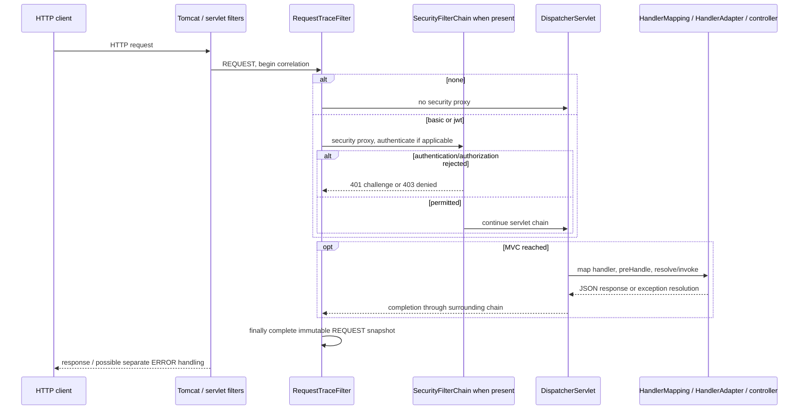

# Complete Spring MVC and Spring Security learning guide

> Current migration checkpoint: [J2.S1](J2.S1-WALKTHROUGH.md) consolidates login12 and authorization23 HTTP cases. JwtValidationIT is now JwtAuthorizationIT; redundant JwtMvcIT is retired. Negative validation remains in JwtNegativeValidationIT. Java17 verification passes94 HTTP +23 unit cases; older suite names/counts below are historical pending J3.

> Current migration checkpoint: [J1.S3](J1.S3-WALKTHROUGH.md) completes Phase J1. Credential configuration is scanned and owns the dedicated manager; issuer configuration owns only signing. The launcher keeps only the manual-proxy-related Boot exclusion. Java17 clean verification passed 94 HTTP + 23 unit cases; earlier source ownership descriptions below are historical pending J3.

> Current migration checkpoint: [J1.S2](J1.S2-WALKTHROUGH.md) makes JWT unconditional on Java17. None/basic configurations, mode selection and cross-mode suites are retired; 94 HTTP + 23 unit cases pass. Earlier three-mode descriptions below are historical and will be replaced in J3. The migration roadmap supersedes conflicting historical requirements.

> JWT-only migration checkpoint: [J1.S1](J1.S1-WALKTHROUGH.md) now requires Java17 and passed 153 HTTP + 29 unit cases on Temurin17.0.21. Three-mode behavior remains until J1.S2; earlier Java21 instructions/results below are historical. [The migration roadmap](../../ROADMAP.md) is authoritative.

## Read and run the course

The project compares one application in three mutually exclusive modes: none, basic, and jwt. Its purpose is to reconstruct request processing from code and observed HTTP behavior. It is a local learning application, not a production identity system. [Scope](../IN-SCOPE-OUT-OF-SCOPE.md) remains fixed through P5.S2: no database, frontend, Docker, OAuth2 grant or authorization server, external IdP, refresh/revocation system, or custom bearer authentication filter.

Start with the following sequence. Each walkthrough owns its step’s detailed classes, methods, annotations, meaningful code blocks, diagrams, test cases and measured evidence. Historical checkpoints remain useful for learning progression; the current source audit below resolves superseded references.

| Step | Learn | Walkthrough |
|---|---|---|
| P1.S1 | Boot, Maven, Tomcat, MVC mapping, three JSON endpoints | [Bootstrap](P1.S1-WALKTHROUGH.md) |
| P1.S2 | Servlet filter versus interceptor, bounded correlation, successful callbacks | [Nested processing](P1.S2-WALKTHROUGH.md) |
| P1.S3 | 404/500, resolved exceptions, REQUEST versus ERROR dispatch | [Application errors](P1.S3-WALKTHROUGH.md) |
| P2.S1 | Explicit mode selection and genuine absence of security infrastructure in none | [Isolation](P2.S1-WALKTHROUGH.md) |
| P2.S2 | Password authentication, DaoAuthenticationProvider, BCrypt and principal | [Basic credentials](P2.S2-WALKTHROUGH.md) |
| P2.S3 | ADMIN authorization, challenge versus denied, context cleanup | [Completed Basic](P2.S3-WALKTHROUGH.md) |
| P3.S1 | RSA keys, readable JWT parts, signature integrity | [RSA foundation](P3.S1-WALKTHROUGH.md) |
| P3.S2 | Resource Server, Nimbus, issuer/audience/timestamp and normalized schema | [Validation first](P3.S2-WALKTHROUGH.md) |
| P3.S3 | Shared credential checking, local JSON login, RS256 issuance | [Local issuer](P3.S3-WALKTHROUGH.md) |
| P4.S1 | Role conversion, authenticated versus authorized, absent/empty roles | [JWT permission](P4.S1-WALKTHROUGH.md) |
| P4.S2 | Raw types, parsing/normalization gaps, negative tokens and skew boundaries | [Strict validation](P4.S2-WALKTHROUGH.md) |
| P4.S3 | Actual filter calls versus configured order, failure handlers, identity isolation | [Diagnostics](P4.S3-WALKTHROUGH.md) |
| P5.S1 | Shared real HTTP matrix, three sequence diagrams and responsibility table | [Comparison](P5.S1-WALKTHROUGH.md) |
| P5.S2 | Current source audit, secret review and final Java 21 verification | [Final audit](P5.S2-WALKTHROUGH.md) |

For a short conceptual comparison, read [FLOWS-COMPARED](../FLOWS-COMPARED.md). For exact executed cases and counts, use [TEST-MATRIX](../TEST-MATRIX.md). For JWT representations and acceptance, read [the claim contract](../JWT-CLAIM-CONTRACT.md). [README](../../README.md) explains startup, local-only accounts and ignored development-key setup. Tests generate their own owner-only temporary keys and do not require OpenSSL.

## Reconstruct the shared HTTP path

Tomcat accepts and parses HTTP, supplies HttpServletRequest/Response, and invokes matching servlet filters. Boot’s encoding/request-context/form filters are infrastructure; the application’s RequestTraceFilter starts correlation before the security proxy. None skips security infrastructure entirely. Secured modes pass through DelegatingFilterProxy to FilterChainProxy and a matching SecurityFilterChain. Security may reject before MVC.

Allowed requests enter DispatcherServlet. RequestMappingHandlerMapping resolves annotated controller methods and their interceptor chain. RequestMappingHandlerAdapter resolves servlet/JSON/authentication arguments and invokes the handler. For RestController methods, response-body/ResponseEntity processing uses HTTP message converters and Jackson, not a view template. With these map responses, serialization happens during adapter processing before interceptor postHandle. MVC completion and outer filter finally blocks run; Tomcat finishes the response. Client receipt and trace publication are not identical synchronization points, so tests await the completed sink record.

This diagram summarizes responsibilities; the [three concrete mode diagrams](P5.S1-WALKTHROUGH.md#three-request-sequence-diagrams) show their branches. A missing path can select a resource handler before producing 404. A test-only thrown controller error produces 500. P1.S3 observes subsequent Boot ERROR dispatch under the same correlation ID with a separate probe. Production traces intentionally record REQUEST callbacks only. A 404/500 is not an authorization denial.

## Reconstruct identity and permission

BasicAuthenticationFilter interprets supplied Basic credentials and delegates to an AuthenticationManager/DaoAuthenticationProvider. InMemoryUserDetailsManager supplies users; PasswordEncoder performs BCrypt comparison. Successful authentication establishes request identity/authorities. AuthorizationFilter then evaluates public, authenticated, and ADMIN requirements. Missing/invalid credentials get 401 and a Basic challenge; USER/admin gets 403 without a new challenge. Supplied invalid Basic fails even on public. Encoding credentials is not transport encryption.

JWT has two operations. POST login reaches MVC, checks JSON credentials through its dedicated ProviderManager and the shared DaoAuthenticationProvider, then NimbusJwtEncoder signs safe claims using the local RSA private key. Claims derive from trusted identity, never caller-supplied roles. Issuance does not install the credential result into the login request’s filter SecurityContext or establish a session; the login trace remains anonymous.

Later BearerTokenAuthenticationFilter submits the compact token to JwtAuthenticationProvider. NimbusJwtDecoder checks RS256 against the trusted public key and applies normalized contract/issuer/timestamp validators. StrictJwtDecoder then checks original payload types with Nimbus before returning that normalized Jwt. This guards distinctions lost by library conversion: numeric sub must not become an accepted string subject, and explicit null optional timestamps must not become accepted omissions. JwtAuthenticationConverter maps trusted roles into ROLE_* authorities. Spring Security, not Nimbus alone, creates the request authenticated context. Authorization follows.

The issuer lifetime is 300 seconds; explicit validation skew is 60 seconds. Fixed-clock tests accept exp exactly NOW−60 and nbf exactly NOW+60, rejecting one second farther. Missing optional iat/nbf is permitted; explicit null is not. Absent/empty roles authenticate without role authorities: user is allowed, admin is denied. Malformed roles fail authentication instead. ADMIN does not inherit USER; user access requires authentication rather than that particular authority. JWT claims are readable Base64URL, not encryption.

Both secured modes avoid session security-context persistence, saved-request/browser login, and cookie dependence. That is not a general assertion of browser CSRF safety or impossibility of any application-created session. No browser client is implemented. The Resource Server library is usable without an OAuth2 Authorization Server or grant flow.

## Follow failures and evidence

| Observed result | Route through framework | Tests to inspect |
|---|---|---|
| Plain route 200 | Tomcat → outer filters → MVC; no proxy | PlainMvcIT, NoneSecurityIT |
| MVC missing/throwing route 404/500 | Handler/resource failure, MVC resolution and Boot ERROR handling | ErrorPathIT’s two cases; authenticated missing routes in comparison/BasicSecurityIT |
| Basic wrong password 401 | Basic filter → provider failure → entry point → error rendering | BasicSecurityIT.invalidBasicAuthenticationReturnsChallengeWithoutApplicationHandler |
| Protected anonymous 401 | Anonymous identity → authorization failure → ExceptionTranslationFilter → entry point | BasicSecurityIT.unauthenticatedProtectedRequestReturns401WithoutApplicationHandler; JwtValidationIT.missingBearerReturns401BeforeMvc |
| JWT invalid_token 401 | Bearer filter → provider/decoder failure → bearer failure handler, before later filters | JwtNegativeValidationIT.invalidRawTokensFailClosedBeforeMvc; JwtDiagnosticsIT parameter invalid |
| USER/admin 403 | Authentication succeeds → authority rule fails → access-denied handler | BasicSecurityIT.userCannotAccessAdminAndReceives403WithoutChallenge; JwtValidationIT endpoint policy cases |
| Local login wrong credentials 401 | MVC handler throws authentication exception → local ExceptionHandler | JwtLoginIT.badCredentialsReturnGeneric401WithoutToken |
| Separate concurrent identities | Request-local context/correlation and distinct principals | BasicSecurityIT concurrent case; JwtDiagnosticsIT.concurrentBearerIdentitiesStayCorrelatedAndSeparate |

The filter list is configuration evidence. P4.S3’s test-only chain decorator separately observes real filter entry: invalid bearer stops at BearerTokenAuthenticationFilter; role denial reaches AuthorizationFilter. Entry into a filter does not imply it authenticated. The framework AuthenticationFilter in the JWT list comes from DPoP-related automatic configuration, not an implemented project DPoP feature.

SecurityTraceFilter records authenticated/anonymous before downstream authorization, then authorization.exit in finally. Entry-point and denied-handler wrappers emit challenge/denied. RequestTraceFilter surrounds all of this and completes the snapshot. Correlation UUIDs are generated by the server. Snapshot capacity is 128, values immutable, and active event lists live on requests rather than shared mutable filter fields. The trace is synchronous REQUEST evidence, not complete async/distributed telemetry.

## Current application source audit

The following index covers every production Java source. Each linked walkthrough supplies detailed meaningful-line commentary; current block notes below resolve source moves and shifted line references. Package/import lines connect the types described rather than additional runtime behavior. Constructor injection supplies final collaborators; bean methods receive dependencies as parameters and avoid direct inter-bean calls. No main source or runtime behavior changes in P5.S2.

| Source and current blocks | Detailed walkthrough | Runtime/test evidence |
|---|---|---|
| [SecurityLearningApplication.java](../../src/main/java/com/example/securitylearning/SecurityLearningApplication.java) — 3–7 imports explicit Boot exclusions; 9–11 SpringBootApplication scans/enables ordinary Boot configuration while excluding automatic security chain/proxy/generated user; main 13–15 calls SpringApplication.run and lets startup failures propagate. | [P2.S1](P2.S1-WALKTHROUGH.md) | NoneSecurityIT; all HTTP contexts |
| [api/DemoController.java](../../src/main/java/com/example/securitylearning/api/DemoController.java) — 3–10 MVC/map/servlet/sink imports; 12–20 RestController and /api RequestMapping plus injected sink; publicEndpoint 22–26, userEndpoint 28–32, adminEndpoint 34–38 each record the fixed event then return the immutable message map. Path names impose no permission themselves. | [P1.S2](P1.S2-WALKTHROUGH.md) | PlainMvcIT; shared comparison |
| [api/AuthController.java](../../src/main/java/com/example/securitylearning/api/AuthController.java) — 19–29 jwt-only RestController and service/sink constructor; login 31–42 binds RequestBody, records entry, rejects missing/blank required values, issues, records success and returns no-store JSON; authenticationFailed 44–49 handles AuthenticationException as generic no-store 401; LoginRequest/toString 51–56 deliberately redacts display. | [P3.S3](P3.S3-WALKTHROUGH.md) | JwtLoginIT |
| config/SecurityModeConfig.java (historical, retired in J1.S2) — 3–7 Configuration/Environment; constructor 9–14 reads exact mode with default none, accepts none/basic/jwt and throws a fixed error for unsupported/blank/combined values. Current jwt acceptance supersedes the S1 temporary two-mode test. This class validates rather than creates a chain. | [P2.S1](P2.S1-WALKTHROUGH.md) | SecurityModeConfigTest |
| [config/InMemoryIdentityConfig.java](../../src/main/java/com/example/securitylearning/config/InMemoryIdentityConfig.java) — 3–9 identity/BCrypt/Bean imports; 11–12 plain imported class avoids component scanning in none; passwordEncoder 14–17 returns BCrypt; users 19–24 builds two encoded local accounts and prefixed roles; daoAuthenticationProvider 26–31 attaches injected user source and encoder. | [P3.S3](P3.S3-WALKTHROUGH.md) | BasicSecurityIT; JwtLoginIT; none identity absence |
| config/BasicSecurityConfig.java (historical, retired in J1.S2) — 26–30 conditional basic Configuration, EnableWebSecurity and Import shared identities; basicSecurityFilterChain 32–58 registers provider, stateless/demo settings, Basic entry point, REQUEST-only denied wrapper, observation filter and ordered matchers; basicEntryPoint 60–74 records REQUEST challenge then super.commence with fixed realm; securityFilterRegistration 76–82 creates named servlet proxy at -100 for REQUEST/ERROR. Identity methods moved to InMemoryIdentityConfig; these are current ranges. | [P2.S3](P2.S3-WALKTHROUGH.md) | BasicSecurityIT; BasicComparisonIT |
| [config/JwtDecoderConfig.java](../../src/main/java/com/example/securitylearning/config/JwtDecoderConfig.java) — 24–26 jwt-only configuration; jwtVerificationKey 28–37 opens local X509 PEM with try-with-resources, rejects null/weak RSA, returns public key and propagates IO failure; jwtValidationClock 39–42 returns UTC; jwtDecoder 44–53 builds RS256-only Nimbus, 60s controlled timestamp validator, normalized contract/issuer aggregate, then StrictJwtDecoder. | [P4.S2](P4.S2-WALKTHROUGH.md) | JwtDecoderConfigTest; JwtNegativeValidationIT |
| [config/JwtIssuerConfig.java](../../src/main/java/com/example/securitylearning/config/JwtIssuerConfig.java) — 25–28 jwt-only configuration imports shared identities; loginAuthenticationManager 30–33 wraps the Dao provider in ProviderManager; jwtEncoder 35–48 opens PKCS8 local material, checks size/modulus/CRT exponent match, builds private/public RSA JWK and immutable source for NimbusJwtEncoder. No private-key bean or discovery URL. | [P3.S3](P3.S3-WALKTHROUGH.md) | JwtIssuerConfigTest; JwtLoginIT |
| [config/JwtSecurityConfig.java](../../src/main/java/com/example/securitylearning/config/JwtSecurityConfig.java) — 25–28 conditional security configuration; jwtAuthenticationConverter 30–38 chooses roles and ROLE_ prefix; jwtSecurityFilterChain 40–76 wraps standard Bearer handlers with REQUEST-only fixed challenge/denied events, applies stateless/demo settings, wires wrappers at early and later failure boundaries, decoder/converter, observation and endpoint policy; jwtSecurityFilterRegistration 78–84 installs named servlet proxy at -100. | [P4.S3](P4.S3-WALKTHROUGH.md) | JwtValidationIT; JwtDiagnosticsIT; JwtComparisonIT |
| [security/RsaKeyGenerator.java](../../src/main/java/com/example/securitylearning/security/RsaKeyGenerator.java) — 3–7 JCA imports and final utility class; private constructor 9–10 prevents instances; generateDevelopmentKeyPair 12–20 requests RSA, initializes 2048 bits, returns fresh pair, wraps missing algorithm as fixed-context IllegalStateException. No Spring bean or automatic file export. | [P3.S1](P3.S1-WALKTHROUGH.md) | RsaJwtTest; generated test key fixtures |
| [security/JwtClaimContractValidator.java](../../src/main/java/com/example/securitylearning/security/JwtClaimContractValidator.java) — 11–14 validator interface and fixed issuer/audience constants; validate 16–32 reads normalized map, requires nonblank subject/string issuer/Instant exp/valid audience, validates optional Instant dates and role lists, returns success or a fixed invalid_token result. Issuer equality and timestamps are separate validators; raw types are checked by StrictJwtDecoder. | [P3.S2](P3.S2-WALKTHROUGH.md) | JwtClaimContractValidatorTest; JwtNegativeValidationIT |
| [security/StrictJwtDecoder.java](../../src/main/java/com/example/securitylearning/security/StrictJwtDecoder.java) — 3–10 Nimbus/library and Spring contracts; 13–18 final wrapper with injected delegate; decode 20–38 first delegates trusted verification/normalized validation, inspects original JSON via Nimbus, rejects wrong required/optional/roles types with fixed BadJwtException, returns original normalized Jwt, wraps checked parse failure; optionalNumericDate 40–42 distinguishes absent/null; audienceIsValid 44–48 accepts string or nonempty string list. | [P4.S2](P4.S2-WALKTHROUGH.md) | JwtNegativeValidationIT |
| [security/JwtTokenService.java](../../src/main/java/com/example/securitylearning/security/JwtTokenService.java) — 18–31 jwt-only Service with qualified credential manager, encoder and clock constructor; issue 33–44 authenticates unauthenticated credentials, derives trusted roles, truncates clock to seconds, builds seven claims and 300s expiry, signs RS256 JWT/local-issuer and returns DTO; TokenResponse/toString 46–51 redacts display without suppressing intended JSON accessors. | [P3.S3](P3.S3-WALKTHROUGH.md) | JwtLoginIT; IssuerSecretHandlingTest |
| [tracing/TraceConfiguration.java](../../src/main/java/com/example/securitylearning/tracing/TraceConfiguration.java) — 11–17 Configuration and traceEventSink bean; requestTraceFilter 19–27 creates explicit registration/name/*/REQUEST and HIGHEST_PRECEDENCE+10, before proxy -100; traceMvcConfigurer 29–37 returns WebMvcConfigurer whose addInterceptors installs one MvcTraceInterceptor. The former LOWEST_PRECEDENCE checkpoint is historical. | [P1.S2](P1.S2-WALKTHROUGH.md) | RequestTraceIT; NoneSecurityIT; denial traces |
| [tracing/TraceEventSink.java](../../src/main/java/com/example/securitylearning/tracing/TraceEventSink.java) — 13–16 header/attribute/capacity constants and insertion-ordered completed map; begin 18–21 installs request list and UUID; record 23–25 appends; synchronized complete 27–33 snapshots immutably, removes active attribute, evicts oldest over128; synchronized events 35–37 returns snapshot or empty list; private currentEvents 39–42 casts its own typed request attribute, with local SuppressWarnings. | [P1.S2](P1.S2-WALKTHROUGH.md) | TraceEventSinkTest; RequestTraceIT |
| [tracing/RequestTraceFilter.java](../../src/main/java/com/example/securitylearning/tracing/RequestTraceFilter.java) — 11–17 OncePerRequestFilter and sink constructor; doFilterInternal 19–31 begins, sets response ID and entry, delegates servlet chain, records exit and publishes in finally. IOException/ServletException propagate; no exception or credentials recorded. Explicit registration limits dispatch coverage. | [P1.S2](P1.S2-WALKTHROUGH.md) | RequestTraceIT; ErrorPathIT; all trace tests |
| [tracing/MvcTraceInterceptor.java](../../src/main/java/com/example/securitylearning/tracing/MvcTraceInterceptor.java) — 9–15 HandlerInterceptor and sink constructor; preHandle 17–21 records and returns true; postHandle 23–27 records after normal adapter completion; afterCompletion 29–33 records without logging exception; private record 35–39 checks REQUEST to avoid ERROR/async writes after publication. | [P1.S2](P1.S2-WALKTHROUGH.md) | RequestTraceIT; ErrorPathIT |
| [tracing/SecurityTraceFilter.java](../../src/main/java/com/example/securitylearning/tracing/SecurityTraceFilter.java) — 13–19 OncePerRequestFilter and sink constructor; doFilterInternal 21–33 reads SecurityContextHolder, excludes anonymous tokens from authenticated classification, emits fixed state, delegates, and records authorization.exit in finally. It observes only; it does not authorize, authenticate, erase credentials or establish context. | [P2.S3](P2.S3-WALKTHROUGH.md) | BasicSecurityIT; JwtDiagnosticsIT |

The index covers all 18 production files, including nested records, anonymous callback implementations, private helpers, bean factories and configuration lambdas. It is a teaching/traceability audit, not a claim of full branch coverage for every library exception. Historical S1/S2 source ranges are explicitly superseded where later steps moved beans, changed order or added handlers.

The Maven parent fixes Boot 3.5.7, java.version selects compiler release21, and starters provide MVC/Tomcat/security/Resource Server. Test-scoped starter-test and RestAssured do not become application dependencies. Surefire selects *Test; Failsafe selects *IT and binds integration-test plus verify. Packaging alone does not run the Failsafe verification gate. No application resource configuration or embedded private-key resource is needed: modes/key paths come from properties/arguments. The ignore rules exclude target, local environment files and /.local-keys; choosing another private-key path requires its own exclusion.

## Review questions and safe exercises

1. **Why is permitAll not none?** It leaves authentication, context, header and other security filters in place; none has no proxy/chain registration.
2. **Who populates the bearer SecurityContext?** Spring Security after provider/decoder validation and conversion, not Nimbus alone.
3. **What is the provider’s role?** A password provider loads/checks a user; a JWT provider validates a bearer and converts trusted claims. Neither endpoint naming nor interceptor tracing substitutes for these decisions.
4. **Why can validly signed JWTs fail?** Wrong algorithm, issuer, audience, time, required presence or original JSON type can reject independently of signature integrity.
5. **Why distinguish 401, 403 and 404?** Missing/invalid authentication, insufficient permission, and ordinary missing resource are different processing paths.
6. **Why can missing roles succeed while malformed roles fail?** Missing roles is valid authentication with no role authorities; malformed input violates the authentication contract.
7. **Does a finally marker prove success?** No. Exit markers are emitted on allowed and failed paths.
8. **What does no session cookie prove?** That the exercised response did not establish a client cookie; context-policy and follow-up request tests provide additional evidence, not universal claims about all application code.
9. **Why control time instead of sleeping?** Reproducible exact boundaries and no dependence on wall-clock drift.
10. **Is BCrypt a new JWT feature?** No; it is the existing P2 credential-checking primitive deliberately reused by local login. JWT verification does not repeatedly check the password.

Safe disposable-branch exercises:

- Run the comparison classes alone with `mvn verify -Dit.test=NoneComparisonIT,BasicComparisonIT,JwtComparisonIT`. Predict public invalid Basic/Bearer statuses before examining their fixed-name records.
- Run JwtNegativeValidationIT and move one boundary offset by one second. Predict the configured 60-second-skew result; restore the contract afterward.
- Remove a role from a valid signed fixture. Predict user200/admin403; malformed role type instead predicts401. Keep signing through Nimbus and never log compact values.
- Compare configured filters with invalid-bearer observed calls in JwtDiagnosticsIT. Explain why later authorization/MVC is absent even though those filters are configured.

Use the same chosen Java21 JAVA_HOME for focused runs as for final verification below. Do not add product features to answer a learning question; a small test, measured trace and explanation are sufficient.

## Final acceptance and audit result

All fourteen roadmap steps are complete. The final run passed 153 HTTP + 29 unit cases on actual Java21.0.8, not merely a newer-JDK release21 target. No production source or test behavior changed in this final documentation/audit step.

The final Maven log had zero matches for compact JWTs, private-key PEM blocks, development passwords and encoded Basic fixtures. Current tracked files and all **13 reachable Git revisions** had zero complete-token/private-PEM matches. No tracked .pem/.key/.env/.local-keys paths were found; the chosen local private-key path is ignored. The executable jar contains no PEM/key or test fixture classes. These pattern/path checks are scoped evidence, not a general-purpose guarantee against every conceivable secret format.

No further planned step remains. Production hardening, alternative mechanisms and excluded systems require a separately defined request, not continuation of this roadmap.
