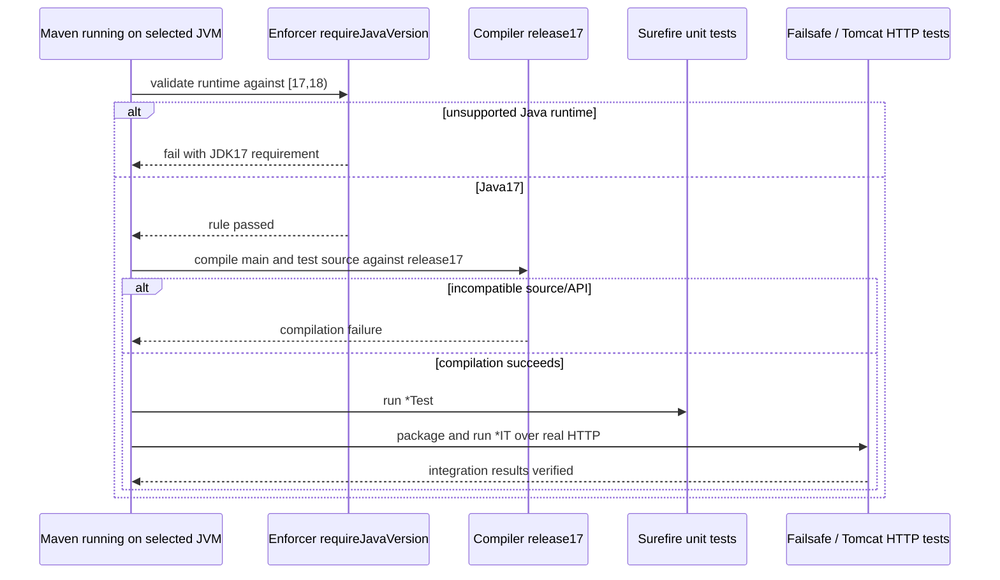

# J1.S1 — Java 17 build and runtime baseline

> J1.S3 changes credential bean ownership, issuer/bootstrap source ranges and removes the redundant direct Security starter. Current source commentary and unchanged-library evidence are in [J1.S3](J1.S3-WALKTHROUGH.md); the statements below describe this earlier checkpoint.

> J1.S2 transition: none/basic implementations and mode-selection/comparison suites are now retired. MVC/error/trace tests use JWT; PlainMvcIT is replaced by JwtMvcIT. This document retains its checkpoint source/count evidence; [J1.S2](J1.S2-WALKTHROUGH.md) records current wiring, tests and behavior.

## Objective and boundary

This is the first step of the JWT-only migration on branch `jwt-only`. It changes the Java baseline, not the security architecture. The existing none/basic/jwt configurations and complete HTTP regression suite remain available until J1.S2 explicitly removes the other modes. Read [the migration roadmap](../../ROADMAP.md) and [learning requirements](../LEARNING-SUPPORT-REQUIREMENTS.md) first. The original course is preserved on master/Git history. This walkthrough retains checkpoint evidence; current source contracts are in [JWT foundations](JWT-FOUNDATIONS.md).

There are three distinct requirements: source/API compatibility, the JVM executing Maven/tests, and the JVM chosen to launch the application. Compiler release17 controls the first. Maven Enforcer checks the second at lifecycle validation. Developers must use the selected JDK17 java executable for standalone application startup as well; the Maven rule does not inject a runtime check into an executable jar. The roadmap requires Java17 only, so a newer JDK using `--release 17` is insufficient verification.

## Changes, line by line

### `pom.xml`

Line 16 changes java.version from21 to17. Boot’s existing parent propagates this property to the compiler release configuration. Compiling with release17 restricts language/class-file target and the exposed standard-library APIs. It is stronger than merely selecting a class-file target while compiling against a newer API surface. Records, instanceof patterns, switch expressions and Stream.toList used by this project are available on Java17 and do not require rewrites or preview flags.

Lines 44–63 add the sole new build dependency, Maven Enforcer plugin3.6.2. Lines 45–47 identify the plugin and pin its version, making gate behavior reproducible rather than relying on implicit plugin resolution. This plugin is build tooling, not a packaged application dependency. Existing Boot, Framework, Security, Tomcat, Nimbus, JUnit, Mockito and RestAssured versions remain unchanged unless executed compatibility evidence requires otherwise.

Lines 48–52 create the named execution require-java-17 and explicitly bind its enforce goal to validate. Validation runs before compilation, tests or packaging in the ordinary verify lifecycle. A clean build may remove generated target files before reaching validate, but unsupported Java still fails before compilation/testing. There is no custom Java class or duplicate unit test for the version rule; actual supported/unsupported Maven executions verify it.

Lines 53–59 configure requireJavaVersion. `[17,18)` includes Java17 patch releases and excludes18 or later. The fixed message tells users to choose JDK17 with JAVA_HOME and explains which processes must use it. A bare `17` would mean a lower bound in Enforcer rather than the desired major-version restriction. [Apache’s version-range specification](https://maven.apache.org/enforcer/enforcer-rules/versionRanges.html) documents that distinction; [RequireJavaVersion3.6.2](https://maven.apache.org/components/enforcer-archives/enforcer-3.6.2/apidocs/org/apache/maven/enforcer/rules/version/RequireJavaVersion.html) is the selected built-in rule. Closing execution/plugin elements leave the existing Boot packaging and Surefire/Failsafe selection unchanged. No Maven profile enables a second Java baseline.

### Three test-method API replacements

| Source and current line | Method / reason |
|---|---|
| `src/test/java/com/example/securitylearning/BasicSecurityIT.java:100` | publicRequestTraversesSecurityAndReachesController reads `proxy.getFilterChains().get(0)` before mapping filter names |
| `src/test/java/com/example/securitylearning/JwtValidationIT.java:91` | publicEndpointDoesNotRequireToken inspects the first configured JWT chain with get(0) |
| `src/test/java/com/example/securitylearning/JwtDiagnosticsIT.java:131` | diagnosticsDistinguishAuthenticationAndAuthorization reads configured filter order with get(0) |

List.getFirst is newer than Java17. Each replacement selects index0 using the long-established List API. These tests expect a configured secured chain; if no chain exists they fail rather than silently skipping filter assertions. The exact exception class for an empty list is not the contract under test. No assertion, credential path, actual filter ordering, or HTTP expected response changes. No production class or method needs a Java17 rewrite.

The source audit searches for newer collection/virtual-thread/preview usage, while actual release17 compilation is the decisive check for all source/test references compiled by Maven. Tests keep @SpringBootTest(RANDOM_PORT), parameterized inputs, isolated contexts, real RestAssured requests and test-only observer fixtures. Mockito remains test instrumentation around real methods, not a replacement HTTP/security engine.

## Toolchain discovery and reproducible execution

System-registered Java was Oracle24; the IDE-bundled runtime used by earlier work is Java21. Neither satisfies this step. A temporary Eclipse Temurin17 macOS ARM64 JDK was obtained from the official Adoptium assets API, downloaded from its published package link and verified against the package’s published SHA-256 before extraction. The toolchain remains outside the repository in `/private/tmp/jwt-auth-jdk17`. It is not a production key or a committed artifact and changes no system Java registration, shell startup file or IDE setting.

The local file `/private/tmp/jwt-auth-jdk17-home.txt` records the extracted JDK home for this verification session. Temporary paths are not a permanent setup: install/select an available JDK17 on your own machine and use its home for future work. There is no automatic toolchain download in Maven or at application startup.

Use the selected Java17 home as JAVA_HOME and prepend its bin directory to PATH for Maven. Verify both Maven’s reported Java and javac, then run `mvn clean verify`. Use the same home’s bin/java when running the packaged application. The exact executed version, command and results are recorded below after verification.

## Build lifecycle and unchanged request lifecycle



The application request sequence is unchanged: Tomcat → servlet filters → outer RequestTraceFilter → optional mode-selected security proxy → DispatcherServlet → handler mapping/adapter → controller → HTTP message conversion/JSON → callback/filter unwind. In none, no proxy exists; permitAll is not used to imitate absence. Basic checks credentials with its provider and BCrypt. JWT uses built-in bearer authentication, Nimbus/strict decoding and authority conversion; Spring Security establishes the context and AuthorizationFilter checks permissions. Local login authenticates credentials separately before issuing RS256; it is not an OAuth2 grant endpoint. Signatures, issuer/audience/time/raw claim checks and authorization remain different decisions. JWT payloads remain readable Base64URL, not encrypted.

Successful requests produce normal interceptor/controller callbacks. Authentication failure may stop before MVC, role denial follows successful authentication, and ordinary 404/500 processing is distinct from security denial. [JWT foundations](JWT-FOUNDATIONS.md) explains the current paths without the retired course narrative. Current trace-to-code evidence and executed inventory follow below.

## Questions and safe exercises

1. Why both release17 and a runtime gate? One controls compiled language/APIs; the other prevents Maven from silently using an unsupported major JVM.
2. Why replace getFirst but retain records and Stream.toList? Their introduction versions differ; Java17 already supports the retained constructs.
3. Does the Maven gate stop someone launching the jar with a different java binary? No. Select JDK17 for launch as documented; this step adds no production launcher guard.
4. Why retain Basic and comparison tests here? J1.S1 preserves behavior while changing Java compatibility; unconditional JWT and suite deletion belong to J1.S2.

Safe exercises on a disposable branch:

- Run `mvn validate` on JDK17 and then on a newer installed JDK. Expect the first to pass and the latter to fail with the fixed requirement before tests.
- Temporarily restore one getFirst call and run test compilation under JDK17. Expect a missing-method compilation error; restore get(0) afterward rather than changing the compiler to a newer release.

No J1.S2 work is included. Detailed runtime and test evidence below is authoritative for this step.

## Actual verification and reproducibility

Executed 2026-11-02 from the repository root:

```bash
J1_JAVA17_HOME="$(cat /private/tmp/jwt-auth-jdk17-home.txt)"
env JAVA_HOME="$J1_JAVA17_HOME" PATH="$J1_JAVA17_HOME/bin:$PATH" mvn -version
"$J1_JAVA17_HOME/bin/javac" -version
env JAVA_HOME="$J1_JAVA17_HOME" PATH="$J1_JAVA17_HOME/bin:$PATH" mvn clean verify
```

Maven3.9.12 reported Eclipse Adoptium Java17.0.21; javac reported17.0.21. Surefire and Failsafe test-JVM startup and XML properties identify the same Java17 runtime. Enforcer passed, and compiler output explicitly used release17 for 18 main source files and 21 test source files. **BUILD SUCCESS**, **29.550 seconds**, **153 HTTP integration + 29 unit cases**, zero failures/errors/skips. Existing intentional provider warnings and P1’s deliberate error fixture did not fail verification; no instrumentation workaround or dependency upgrade was required.

Unsupported-runtime checks executed `mvn validate` on the installed Oracle24 and JetBrains21 JVMs. Both exited1 with RequireJavaVersion failure and the configured JDK17 message, before compilation/tests. A Java16 executable was not available, so no actual lower-runtime rejection is claimed; the configured lower bound is inclusive17. The runtime gate is build-time enforcement, not an executable-jar guard.

The JDK package came from the official [Adoptium assets API](https://api.adoptium.net/v3/assets/latest/17/hotspot?architecture=aarch64&image_type=jdk&os=mac&vendor=eclipse). curl retrieved official metadata/package after a Python HTTP request received403. The archive SHA-256 matched the published metadata before extraction. No repository download script, binary or personal toolchain path was added to Maven configuration.

Executable-jar inspection found 22 application class files, all class-file major61 (Java17). The packaged library inventory retains Boot3.5.7, Framework6.2.12, Security6.5.6, Tomcat10.1.48 and Nimbus9.37.4. All exercised tests load those libraries on Java17; this is not a claim that every unused library branch was executed.

## Executed test-to-code inventory

No new HTTP scenario or mirrored unit test was needed for this build/API migration. The complete retained suite executed; the report-derived methods and parameterized case counts below provide the handoff. Existing owner walkthroughs explain requests/status/body/assertions for each method.

| Suite | Executed methods and case counts |
|---|---|
| SecurityModeConfigTest | `missingModeDefaultsToNone` ×1; `acceptsImplementedModes` ×3; `rejectsUnsupportedOrCombinedModes` ×4 |
| JwtDecoderConfigTest | `invalidPublicKeyFails` ×1; `missingPublicKeyFailsInsteadOfGeneratingFallback` ×1; `undersizedRsaPublicKeyFails` ×1 |
| JwtIssuerConfigTest | `invalidPrivateKeyFails` ×1; `mismatchedSigningKeyFailsInsteadOfIssuingUnverifiableTokens` ×1 |
| IssuerSecretHandlingTest | `temporaryKeysAreOwnerOnlyAndRemoved` ×1; `requestAndResponseDisplayAreRedacted` ×1 |
| JwtClaimContractValidatorTest | `validNormalizedClaimsSatisfyContract` ×1; `absentOrEmptyRolesRemainAnAuthenticationCandidate` ×2; `invalidClaimShapeOrRequiredValueFails` ×5 |
| RsaJwtTest | `changedPayloadCannotVerifyOriginalSignature` ×1; `developmentKeysAreRsa2048WithMatchingPublicAndPrivateModulus` ×1; `differentPublicKeyCannotVerifySignature` ×1; `rs256TokenHasExpectedHeaderAndClaimsAndVerifiesWithPublicKey` ×1 |
| TraceEventSinkTest | `completedTracesAreBoundedAndRequestStateIsRemoved` ×1; `completedSnapshotCannotBeModifiedByReaders` ×1 |
| BasicComparisonIT | `equivalentRequestsExposeModeDifferences` ×13 |
| BasicSecurityIT | `authenticatedMissingRoutePreserves404ThroughErrorDispatch` ×1; `concurrentRequestsKeepAuthenticatedIdentitiesSeparate` ×1; `loginEndpointIsAbsentInBasicMode` ×1; `validCredentialsExposeExpectedPrincipalAndAuthority` ×2; `directErrorRequestRequiresAuthentication` ×1; `authenticatedRequestDoesNotAuthenticateNextAnonymousRequest` ×1; `adminCanAccessAdmin` ×1; `publicRequestTraversesSecurityAndReachesController` ×1; `unauthenticatedProtectedRequestReturns401WithoutApplicationHandler` ×2; `invalidBasicAuthenticationReturnsChallengeWithoutApplicationHandler` ×4; `userCannotAccessAdminAndReceives403WithoutChallenge` ×1 |
| ErrorPathIT | `unmappedUrlReturns404ThroughResourceHandlerAndErrorDispatch` ×1; `controllerExceptionReturns500AndNextRequestHasFreshTrace` ×1 |
| JwtComparisonIT | `equivalentRequestsExposeModeDifferences` ×13 |
| JwtDiagnosticsIT | `tracesAndCapturedOutputExcludeCredentialsAndKeyMaterial` ×1; `concurrentBearerIdentitiesStayCorrelatedAndSeparate` ×1; `diagnosticsDistinguishAuthenticationAndAuthorization` ×5; `authenticatedThenAnonymousRequestsRemainIndependent` ×1 |
| JwtLoginIT | `badCredentialsReturnGeneric401WithoutToken` ×2; `malformedLoginReturns400WithoutToken` ×3; `loginIssuesSafeTokenAcceptedByProtectedEndpoint` ×2 |
| JwtNegativeValidationIT | `permittedRawRepresentationsRemainAuthenticated` ×5; `invalidRawTokensFailClosedBeforeMvc` ×34; `timestampSkewHasDeterministicBoundaries` ×6 |
| JwtValidationIT | `publicEndpointDoesNotRequireToken` ×1; `missingBearerReturns401BeforeMvc` ×2; `invalidTokenReturns401BeforeApplicationHandler` ×4; `basicCredentialsCannotAuthenticateJwtMode` ×1; `endpointPolicyDistinguishesAuthenticationFromAdminRole` ×9; `bearerRequestDoesNotEstablishSessionAuthentication` ×1; `validTokenReachesExpectedEndpoint` ×2; `validatedRolesBecomeRequestAuthorities` ×5 |
| NoneComparisonIT | `equivalentRequestsExposeModeDifferences` ×13 |
| NoneSecurityIT | `loginEndpointIsAbsentInNoneMode` ×1; `noneHasNoSecurityInfrastructureAndIgnoresAuthorization` ×3 |
| PlainMvcIT | `adminEndpointReturnsAdminJsonWithoutCredentials` ×1; `publicEndpointReturnsPublicJson` ×1; `userEndpointReturnsUserJsonWithoutCredentials` ×1 |
| RequestTraceIT | `successfulRequestRecordsNestedOrder` ×3; `concurrentRequestsKeepIndependentTraces` ×1 |

BasicSecurityIT’s public traversal still verifies actual Basic filter membership; JwtValidationIT’s public traversal still verifies bearer/no-Basic configuration and login/encoder presence; JwtDiagnosticsIT still checks configured order against observed entries, cleanup and denial boundaries. Those are the three methods directly touched by the API replacement. The remaining suites establish behavior preservation across all existing modes; real HTTP tests supplement the runtime gate rather than pretending the gate itself is an HTTP feature.

## Actual sanitized traces and code map

```text
COMPARISON none user-anonymous status=200 6f6bbff7-fbca-445f-bdcf-af9857406920 [filter.entry, interceptor.preHandle, controller.user, interceptor.postHandle, interceptor.afterCompletion, filter.exit]
COMPARISON basic admin-USER status=403 73177ad5-9b86-418d-b5e9-facc228d5cdb [filter.entry, security.authenticated, security.denied, security.authorization.exit, filter.exit]
JWT DIAGNOSTIC invalid 612374ca-4645-4b21-beb0-ed3736de13d5 [filter.entry, security.challenge, filter.exit] invoked=[DisableEncodeUrlFilter, WebAsyncManagerIntegrationFilter, SecurityContextHolderFilter, HeaderWriterFilter, BearerTokenAuthenticationFilter] contextCleared=true
JWT DIAGNOSTIC allowed e36e1b37-3b0b-449f-9c25-cd9cd441308f [filter.entry, security.authenticated, interceptor.preHandle, controller.user, interceptor.postHandle, interceptor.afterCompletion, security.authorization.exit, filter.exit] invoked=[DisableEncodeUrlFilter, WebAsyncManagerIntegrationFilter, SecurityContextHolderFilter, HeaderWriterFilter, BearerTokenAuthenticationFilter, AuthenticationFilter, SecurityContextHolderAwareRequestFilter, AnonymousAuthenticationFilter, SecurityTraceFilter, SessionManagementFilter, ExceptionTranslationFilter, AuthorizationFilter] contextCleared=true
```

Trace map: filter.entry/filter.exit are RequestTraceFilter’s surrounding callbacks; interceptor events are MvcTraceInterceptor; controller.user is DemoController.userEndpoint. SecurityTraceFilter observes authenticated/anonymous context and records its finally boundary. Security challenge/denied markers come from the existing configured failure handlers. Diagnostic invoked lists are test-only observation of real configured filter entries, while contextCleared observes the server worker thread after the real proxy returns. No new trace event or filter was introduced by J1.S1.

The callback order remains reproducible on Java17. REQUEST snapshots still omit ERROR/async callbacks; the existing ErrorPathIT probe is distinct dispatch evidence. No passwords, full bearer values or private keys appear in these excerpts. The default none mode is still genuinely absent security infrastructure, not a permitAll chain. Later J1.S2 changes that architecture, not this step.
