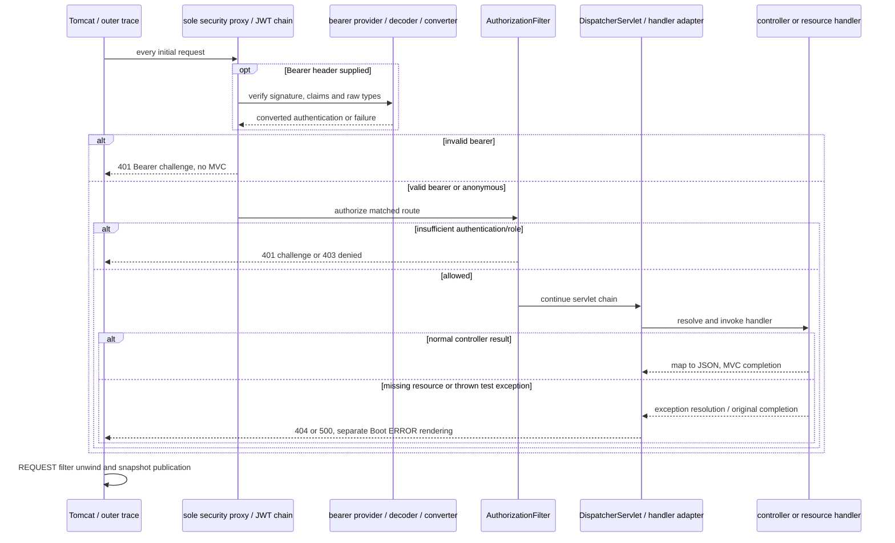

# J1.S2 — Unconditional JWT and retirement of other modes

> J2.S2 expands JwtNegativeValidationIT and JwtStartupTest, changing their source ranges/method inventory and overall totals. Historical evidence below is superseded by [J2.S2](J2.S2-WALKTHROUGH.md) for current validation/key coverage.

> J2.S1 consolidates JwtValidationIT into JwtAuthorizationIT and retires duplicate JwtMvcIT checks; login and authorization case ownership/source ranges have changed. Historical source/count records below are superseded by [J2.S1](J2.S1-WALKTHROUGH.md).

> J1.S3 changes credential bean ownership, issuer/bootstrap source ranges and removes the redundant direct Security starter. Current source commentary and unchanged-library evidence are in [J1.S3](J1.S3-WALKTHROUGH.md); the statements below describe this earlier checkpoint.

## Goal and prerequisite

[J1.S1](J1.S1-WALKTHROUGH.md) established Java17-only compilation and runtime verification. This step removes the none/basic architecture and the mode selector on `jwt-only`, while preserving local JWT issuance, Resource Server validation, role policy and diagnostics. [ROADMAP](../../ROADMAP.md) is the migration authority over the historical three-mode documents. J1.S3 cleanup and J2’s broader consolidation remain separate work.

A successful public request still traverses Spring Security. `permitAll()` is authorization inside a real chain; no unsecured none configuration remains. The Basic HTTP mechanism is disabled, but the in-memory identities and BCrypt remain necessary for JSON credential login. Removing HTTP Basic is not removal of credential authentication.

## Production changes and current code map

The production package root is `src/main/java/com/example/securitylearning/`. BasicSecurityConfig.java and SecurityModeConfig.java are deleted. There is no constructor that chooses a security mode, conditional Basic configuration, Basic entry point or Basic proxy registration. No default none path remains. An old arbitrary `app.security-mode` property has no consumer and cannot select another configuration; remove it from startup commands rather than expecting it to control the application.

Five files lose only their ConditionalOnProperty import and jwt-property annotation: api/AuthController.java, security/JwtTokenService.java, config/JwtDecoderConfig.java, config/JwtIssuerConfig.java, and config/JwtSecurityConfig.java. Their RestController/Service/Configuration annotations now register these beans unconditionally during component scanning. All methods, claim validation and credential/response behavior remain intact. Removing conditional metadata is the actual behavior change; a default property value is not used to imitate unconditional configuration.

- **AuthController:** RestController registers POST login without a selector. Constructor-injected token service/sink remain required. login binds JSON, rejects bad request shapes, authenticates/issues and returns no-store token JSON; its local AuthenticationException handler still returns generic 401 without a Bearer challenge. LoginRequest display remains redacted.
- **JwtTokenService:** Service always exists; its qualified credential manager, encoder and Clock are still injected. issue authenticates an unauthenticated username/password token, derives trusted roles, builds fixed issuer/audience and 300-second claims and signs RS256. TokenResponse display remains redacted. It does not establish a session or save credential authentication in SecurityContext.
- **JwtDecoderConfig:** Configuration always loads the public PEM, rejects weak/missing/invalid material and supplies UTC Clock plus StrictJwtDecoder wrapping Nimbus. Signature allowlist, normalized validators, original JSON type checks and 60-second skew are unchanged.
- **JwtIssuerConfig:** Configuration always imports the plain InMemoryIdentityConfig, builds the login ProviderManager and requires the matching PKCS8 signing key for NimbusJwtEncoder. The identity class comment now identifies the JWT importer; its bean factories are unchanged. No separate private-key bean or fallback key generation is added.
- **JwtSecurityConfig:** Configuration plus EnableWebSecurity always installs the chain. Existing standard Bearer handlers and REQUEST-only wrappers, observation filter, stateless settings and ordered matchers remain. JWT authentication uses built-in Resource Server; no custom bearer filter appears.

The launcher still excludes Boot’s automatic default security chain, filter registration and generated-user configuration. This is deliberate for this step: the explicit unconditional EnableWebSecurity configuration provides the security infrastructure, and the retained jwtSecurityFilterRegistration provides exactly one servlet proxy at order−100. The outer RequestTraceFilter remains HIGHEST_PRECEDENCE+10. Removing the explicit registration while retaining its Boot exclusion would disconnect security from HTTP; enabling a second registration would risk duplication. The HTTP infrastructure assertions verify one intended chain, one FilterChainProxy and one explicit DelegatingFilterProxyRegistrationBean.

Policy remains anonymous public, permitted POST login, authenticated user, ADMIN admin, and permitted internal ERROR dispatch. The application now requires both configured key paths even if a client intends only to call public. Failure to configure keys is startup failure, never unsecured fallback. Header/body/claim logging is not introduced.

## Deleted tests and retained evidence

The retired files are BasicSecurityIT, NoneSecurityIT, SecurityModeConfigTest, AbstractSecurityComparison, NoneComparisonIT, BasicComparisonIT and JwtComparisonIT. Their contracts described deliberately absent security, active Basic HTTP, mode selection or three-mode comparison, which no longer exist. They account for 59 historical HTTP cases and eight unit cases. The previous course remains on master and in Git history.

PlainMvcIT is replaced by JwtMvcIT rather than discarding its three successful-response checks. RequestTraceIT’s four cases and ErrorPathIT’s two cases are adapted. Existing JwtLoginIT, JwtValidationIT, JwtNegativeValidationIT and JwtDiagnosticsIT retain all scenarios, but their SpringBootTest annotations no longer set a mode property. Fixed clocks, dedicated key paths and test-only probes still isolate differing Spring contexts.

## Adapted test classes, every changed block

All paths here are relative to `src/test/java/com/example/securitylearning/`.

### `support/JwtTestTokens.java`

Imports connect Java Instant/List, the fixed claim-contract constants, and Spring’s JWT/JWS encoder builders. This final utility has a private constructor, no component annotation and no state. `admin(JwtEncoder encoder)` reads the system clock for the MVC suites that use the production UTC decoder Clock, builds admin subject/ADMIN roles, fixed issuer/audience, iat/nbf and exp300 seconds later, and encodes RS256 with local-issuer kid. It returns the compact value only for the request header; it never prints it. Timestamp validation is not mocked. Exact clock-boundary experiments remain in the existing fixed-clock JWT tests.

### `JwtMvcIT.java`

SpringBootTest RANDOM_PORT starts unconditional JWT without a mode property. A static JwtKeyFixture owns one fresh pair; DynamicPropertySource registers public/private paths before startup; AfterAll closes/deletes the fixture. Autowired JwtEncoder is the production issuer encoder. LocalServerPort supplies Tomcat’s actual port. These same fixture/encoder additions are present independently in RequestTraceIT and ErrorPathIT, preventing fixture cleanup in one class from invalidating another class’s key paths.

publicEndpointReturnsPublicJson, userEndpointReturnsUserJsonWithBearer and adminEndpointReturnsAdminJsonWithBearer retain the three exact message-map/content-type assertions. assertEndpoint now attaches a real signed ADMIN bearer before GET. ADMIN can access user because user requires authentication, not an implicit USER hierarchy. Anonymous public behavior remains tested in JwtValidationIT; this class focuses on MVC success under authenticated prerequisites.

### `RequestTraceIT.java`

The bootstrap loses its none property and gains its own key fixture, dynamic paths, cleanup and injected encoder. request signs a bearer before the real GET, still supplies an untrusted incoming correlation value, and checks exact 200 JSON. The tests retain public/user/admin parameterization and concurrent public/admin requests. assertTrace expects security.authenticated after filter.entry and security.authorization.exit before filter.exit in addition to the existing six MVC/outer callbacks. It still verifies a generated UUID rather than trusting the client’s value, distinct concurrent IDs, empty unknown-ID lookup, and completed publication using Awaitility. No shared HTTP session or mutable global RestAssured configuration is added.

### `ErrorPathIT.java`

Independent generated keys/encoder replace none-mode startup. get attaches the signed bearer for missing, throwing and subsequent successful routes, ensuring security permission precedes the intended MVC experiment. Expected REQUEST traces now include authenticated state and the security finally boundary. The separate dispatch-probe expectations remain unchanged: original REQUEST handler callbacks, then Boot ERROR controller callbacks. The test-only throwing controller still is not packaged in the application. BasicErrorController is Spring Boot’s generic error controller name, not HTTP Basic authentication infrastructure; its name is not removed merely because Basic security is retired.

The 404 still goes through ResourceHttpRequestHandler, with completion but no normal postHandle. The throwing handler still gives 500, original exception completion, separate ERROR rendering and a following fresh-ID successful request. Error JSON assertions still exclude exception/stack/message details. The ERROR permit rule allows rendering without converting an authenticated application error into another security denial.

### `JwtValidationIT.java`

The public traversal case now asserts that app.security-mode is absent from the effective test environment and that SecurityFilterChain, FilterChainProxy and DelegatingFilterProxyRegistrationBean each have size1. Existing live bearer/no-Basic filter assertions, anonymous trace and actual encoder/login mapping presence remain. This confirms the running unconditional application rather than just checking removed source names. Existing Basic-only protected request still returns401/Bearer: shared credential infrastructure does not enable Basic HTTP authentication.

### `config/JwtStartupTest.java`

This new supplemental context test parameterizes missing public and missing private key paths. Each invocation owns a try-with-resources JwtKeyFixture. It supplies only the other path to a WebApplicationContextRunner loading the actual JwtDecoderConfig/JwtIssuerConfig components, with no mode selection. The callback asserts actual context startup failure and identifies the missing required property in the failure chain. This checks unconditional bean creation, not merely a direct key-parser call. It intentionally isolates these key-dependent components rather than component-scanning other tests’ fixtures. It is not an HTTP test or substitute for real Tomcat integration; existing JwtDecoderConfigTest/JwtIssuerConfigTest retain invalid/weak/mismatched-key checks.

No new negative claim matrix, diagnostic system or identity abstraction is added; those remain J2 refinement topics. All unchanged method behavior is explained in the legacy owner walkthroughs, with this step’s transition notice identifying superseded none/basic contracts and source references.

## HTTP request and response sequence

Tomcat parses HTTP and invokes servlet filters. RequestTraceFilter begins the UUID/event list, then DelegatingFilterProxy invokes FilterChainProxy and the sole JWT chain. BearerTokenAuthenticationFilter submits a bearer to JwtAuthenticationProvider/decoder; Nimbus verifies RS256 and normalized semantics, StrictJwtDecoder preserves original type requirements, and the converter builds trusted role authorities. Spring Security establishes request authentication; Nimbus alone does not populate SecurityContext.

Without a bearer, anonymous processing continues for permitted public/login; protected authorization yields401/Bearer. Invalid bearer yields401 before MVC; valid identity without ADMIN yields403 via the denied handler. Allowed requests reach DispatcherServlet’s handler mapping and adapter, then controller execution and Jackson/message-converter response handling. MVC callbacks and filters unwind, security context is cleared, and the outer filter publishes its immutable REQUEST snapshot. ERROR dispatch is distinct from the original snapshot. JWT payloads remain readable Base64URL, not encrypted, and local login is not an OAuth2 grant.



Missing configured keys are a startup failure before this request flow can exist. Startup tests exercise that separate branch. No mode property is needed to activate any part of the flow.

## Questions and safe exercises

1. Why keep BCrypt after deleting BasicSecurityConfig? JSON login still authenticates passwords through the shared DaoAuthenticationProvider.
2. Does public mean no security chain? No; this application's public authorization succeeds inside the unconditional chain.
3. Why give missing/throwing route tests a bearer? Otherwise a protected request would correctly return401 before reaching the MVC path being investigated.
4. Does BasicErrorController imply HTTP Basic is enabled? No; it is Boot’s unrelated error-rendering controller.

Safe disposable-branch exercises:

- Remove a bearer from the authenticated missing-route test and predict401 rather than404. Restore it to retain the application-error experiment.
- Omit either configured key path when starting the application and inspect the fixed startup failure without printing PEM material. Restore valid local ignored paths before HTTP experiments.

Stop here before J1.S3. Exact verification, current source ranges and sanitized traces follow below.

## Actual verification and test-to-code inventory

Final `mvn verify` on 2026-11-02: **BUILD SUCCESS**, **20.310 s**, **94 HTTP integration + 23 unit cases**, zero failures/errors/skips. Eclipse Temurin17.0.21, Maven3.9.12, compiler release17. The preceding clean run also passed before the final Tomcat proxy-registration assertion was added. Dependency versions remain unchanged. The expected test-only500 log and intentional provider warning do not represent test failures.

```bash
J1_JAVA17_HOME="$(cat /private/tmp/jwt-auth-jdk17-home.txt)"
env JAVA_HOME="$J1_JAVA17_HOME" PATH="$J1_JAVA17_HOME/bin:$PATH" mvn verify
```

The temporary JDK17 setup and runtime enforcement are explained in J1.S1. The full retained HTTP suite runs actual embedded Tomcat with RANDOM_PORT/RestAssured; key startup/unit tests supplement it.

| Suite | Executed methods / case counts |
|---|---|
| JwtDecoderConfigTest | `invalidPublicKeyFails` ×1; `missingPublicKeyFailsInsteadOfGeneratingFallback` ×1; `undersizedRsaPublicKeyFails` ×1 |
| JwtIssuerConfigTest | `invalidPrivateKeyFails` ×1; `mismatchedSigningKeyFailsInsteadOfIssuingUnverifiableTokens` ×1 |
| JwtStartupTest | `missingRequiredKeyFailsStartupWithoutModeSelection` ×2 |
| IssuerSecretHandlingTest | `temporaryKeysAreOwnerOnlyAndRemoved` ×1; `requestAndResponseDisplayAreRedacted` ×1 |
| JwtClaimContractValidatorTest | `validNormalizedClaimsSatisfyContract` ×1; `absentOrEmptyRolesRemainAnAuthenticationCandidate` ×2; `invalidClaimShapeOrRequiredValueFails` ×5 |
| RsaJwtTest | `changedPayloadCannotVerifyOriginalSignature` ×1; `developmentKeysAreRsa2048WithMatchingPublicAndPrivateModulus` ×1; `differentPublicKeyCannotVerifySignature` ×1; `rs256TokenHasExpectedHeaderAndClaimsAndVerifiesWithPublicKey` ×1 |
| TraceEventSinkTest | `completedTracesAreBoundedAndRequestStateIsRemoved` ×1; `completedSnapshotCannotBeModifiedByReaders` ×1 |
| ErrorPathIT | `unmappedUrlReturns404ThroughResourceHandlerAndErrorDispatch` ×1; `controllerExceptionReturns500AndNextRequestHasFreshTrace` ×1 |
| JwtDiagnosticsIT | `tracesAndCapturedOutputExcludeCredentialsAndKeyMaterial` ×1; `concurrentBearerIdentitiesStayCorrelatedAndSeparate` ×1; `diagnosticsDistinguishAuthenticationAndAuthorization` ×5; `authenticatedThenAnonymousRequestsRemainIndependent` ×1 |
| JwtLoginIT | `badCredentialsReturnGeneric401WithoutToken` ×2; `malformedLoginReturns400WithoutToken` ×3; `loginIssuesSafeTokenAcceptedByProtectedEndpoint` ×2 |
| JwtMvcIT | `userEndpointReturnsUserJsonWithBearer` ×1; `publicEndpointReturnsPublicJson` ×1; `adminEndpointReturnsAdminJsonWithBearer` ×1 |
| JwtNegativeValidationIT | `permittedRawRepresentationsRemainAuthenticated` ×5; `invalidRawTokensFailClosedBeforeMvc` ×34; `timestampSkewHasDeterministicBoundaries` ×6 |
| JwtValidationIT | `publicEndpointDoesNotRequireToken` ×1; `missingBearerReturns401BeforeMvc` ×2; `invalidTokenReturns401BeforeApplicationHandler` ×4; `basicCredentialsCannotAuthenticateJwtMode` ×1; `endpointPolicyDistinguishesAuthenticationFromAdminRole` ×9; `bearerRequestDoesNotEstablishSessionAuthentication` ×1; `validTokenReachesExpectedEndpoint` ×2; `validatedRolesBecomeRequestAuthorities` ×5 |
| RequestTraceIT | `successfulRequestRecordsNestedOrder` ×3; `concurrentRequestsKeepIndependentTraces` ×1 |

The retained 94 HTTP cases are JwtValidationIT25, JwtNegativeValidationIT45, JwtDiagnosticsIT8, JwtLoginIT7, JwtMvcIT3, RequestTraceIT4, ErrorPathIT2. Units are the original non-selector21 plus two key-startup cases. The new context tests initially scanned unrelated test configurations and failed on duplicate clock beans, not key behavior; isolating the actual key configurations corrected the harness. No production fallback or test assertion was weakened.

## Actual sanitized request evidence

```text
TRACE b4f930b5-86dc-430a-851b-360fd06fdb03 [filter.entry, security.authenticated, interceptor.preHandle, controller.public, interceptor.postHandle, interceptor.afterCompletion, security.authorization.exit, filter.exit]
ERROR-PATH TRACE eb1cff9f-d434-4487-bef0-9d687573a1fb [filter.entry, security.authenticated, interceptor.preHandle, interceptor.afterCompletion, security.authorization.exit, filter.exit]
DISPATCH TRACE eb1cff9f-d434-4487-bef0-9d687573a1fb [REQUEST:ResourceHttpRequestHandler:preHandle, REQUEST:ResourceHttpRequestHandler:afterCompletion:none, ERROR:BasicErrorController#error:preHandle, ERROR:BasicErrorController#error:postHandle, ERROR:BasicErrorController#error:afterCompletion:none]
JWT DIAGNOSTIC invalid 66cb4063-df4e-4c55-92bf-514cf3edc3ab [filter.entry, security.challenge, filter.exit] invoked=[DisableEncodeUrlFilter, WebAsyncManagerIntegrationFilter, SecurityContextHolderFilter, HeaderWriterFilter, BearerTokenAuthenticationFilter] contextCleared=true
JWT DIAGNOSTIC denied c6b26420-c79a-405f-b19a-fe92215d1a5d [filter.entry, security.authenticated, security.denied, security.authorization.exit, filter.exit] invoked=[DisableEncodeUrlFilter, WebAsyncManagerIntegrationFilter, SecurityContextHolderFilter, HeaderWriterFilter, BearerTokenAuthenticationFilter, AuthenticationFilter, SecurityContextHolderAwareRequestFilter, AnonymousAuthenticationFilter, SecurityTraceFilter, SessionManagementFilter, ExceptionTranslationFilter, AuthorizationFilter] contextCleared=true
```

Trace-to-code: RequestTraceFilter owns entry/exit and UUID publication; SecurityTraceFilter owns authenticated/anonymous observation and authorization.exit; MvcTraceInterceptor owns MVC callbacks; DemoController and the test-only ThrowingController emit handler events. Security challenge/denied come from the unchanged Bearer handler wrappers. ErrorPathIT.DispatchProbe separately observes REQUEST and ERROR, while production snapshots remain REQUEST-only. JwtDiagnosticsIT’s invoked/cleanup fields are test-only observations of the real filter chain/server thread, not invented application events.

Current source reference map: the conditional import/annotation is removed from each of AuthController, JwtTokenService, JwtDecoderConfig, JwtIssuerConfig and JwtSecurityConfig, shifting subsequent old line references by two. The methods themselves retain their prior semantics; this document's method names are authoritative during transition. JwtMvcIT’s dynamic paths/cleanup are lines30–39, endpoint methods45–58 and authenticated request helper60–71. JwtTestTokens.admin is lines17–25; JwtStartupTest’s parameterized context check is lines11–24. RequestTraceIT/ErrorPathIT use the same explicit fixture pattern and their existing handler-probe callbacks.

The full verification log is scanned for full bearer patterns, development passwords and private PEM markers, and the executable jar is checked for retired classes/private key/test fixtures. Local documentation links and the new Mermaid fence are checked. Old documentation links to deleted production sources are converted to clearly marked historical text; broad historical documentation replacement remains J3.
