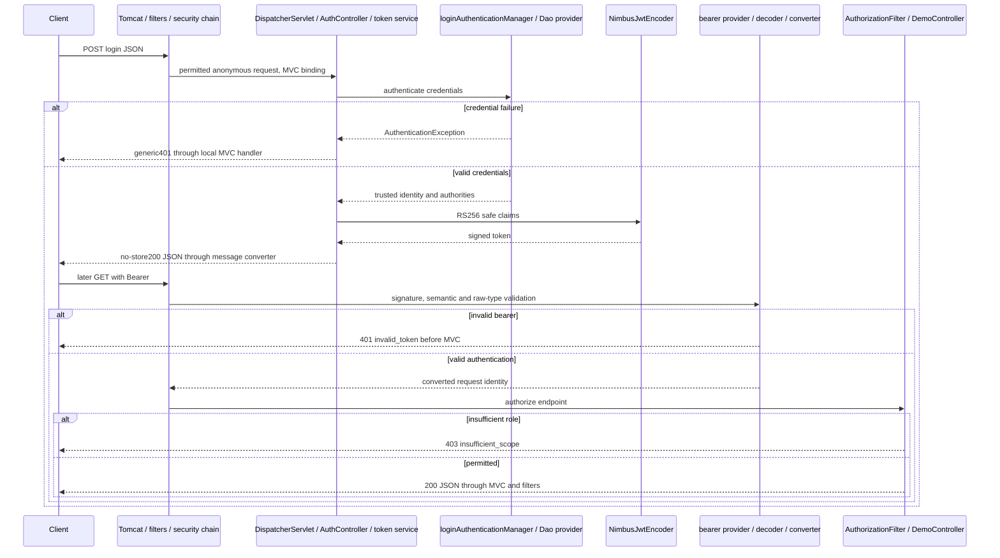

# J1.S3 — Simplified JWT credential, signing and bootstrap ownership

> J2.S1 consolidates JwtValidationIT into JwtAuthorizationIT and retires duplicate JwtMvcIT checks; login and authorization case ownership/source ranges have changed. Historical source/count records below are superseded by [J2.S1](J2.S1-WALKTHROUGH.md).

## Purpose and boundary

[J1.S2](J1.S2-WALKTHROUGH.md) removed mode selection and made JWT unconditional. This step removes wiring whose purpose was keeping shared identity beans out of none mode. It retains the endpoints, BCrypt, dedicated login manager, Nimbus encoder/decoder, strict claim guard, converter, policy and tracing. Java17 remains mandatory. [The migration roadmap](../../ROADMAP.md) is the active specification; J2’s broader test consolidation is separate work.

The resulting responsibilities are straightforward: InMemoryIdentityConfig owns credential authentication; JwtIssuerConfig owns signing; JwtDecoderConfig owns verification/validation; JwtSecurityConfig owns the HTTP chain and failure policy. Local credential authentication and later bearer verification remain logically distinct even though they share a process. No new abstraction or authentication mechanism is introduced.

## Every changed production block

### `config/InMemoryIdentityConfig.java`

Source paths in this section are relative to `src/main/java/com/example/securitylearning/`.

Lines3–12 import Bean/Configuration, manager/provider types, the UserDetails contracts and BCrypt/in-memory implementations. Configuration and AuthenticationManager/ProviderManager are the newly needed imports. Lines14–15 now use `@Configuration(proxyBeanMethods=false)`, so the application's ordinary component scan registers this class. It no longer depends on an explicit Import from the issuer. This is safe because there is no none configuration to isolate from identity creation.

No bean method calls another directly: Spring supplies dependencies through method parameters, so configuration-method proxies are unnecessary. The four bean factories each have a single responsibility:

| Current block | Meaning |
|---|---|
| passwordEncoder, lines17–20 | Create the existing BCryptPasswordEncoder; algorithm and default settings are unchanged |
| users, lines22–27 | Inject that encoder, build the two local demonstration accounts and their USER/ADMIN roles, store them in InMemoryUserDetailsManager |
| daoAuthenticationProvider, lines29–34 | Inject UserDetailsService and PasswordEncoder, construct DaoAuthenticationProvider and attach the encoder |
| loginAuthenticationManager, lines36–39 | Inject the Dao provider and return the same dedicated ProviderManager previously defined in JwtIssuerConfig |

The manager bean name remains loginAuthenticationManager. JwtTokenService's existing Qualifier therefore selects the same semantic collaborator without any service change. ProviderManager's successful credential erasure behavior is unchanged; it is not zeroization of every original Java String. BCrypt hashes are still only in local in-memory identity objects; complete password/header/authentication objects are not added to traces. ADMIN retains only ROLE_ADMIN, not an implicit ROLE_USER hierarchy.

The moved factory does not enable HTTP Basic. Password authentication happens when local login explicitly calls its manager; the HTTP chain still disables Basic and uses built-in bearer authentication for protected API requests. Scanning plus bean backoff is now sufficient; a plain imported class was historical isolation scaffolding.

### `config/JwtIssuerConfig.java`

Lines3–18 retain only local file/RSA handling, Nimbus JWK source, and Spring encoder/configuration types. Import, AuthenticationManager, ProviderManager and DaoAuthenticationProvider imports are removed because credential ownership moved. Lines20–21 retain Configuration with proxyBeanMethods=false; there is no explicit Import and no conditional mode annotation.

The sole factory, jwtEncoder at lines23–36, is unchanged in behavior: require the private-key-path and injected verified public RSA key, open PKCS8 with try-with-resources, parse using Spring's converter, require at least2048 bits and matching modulus/public exponent when available, then create a private/public RSA JWK with local-issuer kid and an immutable local source for NimbusJwtEncoder. IO/format/mismatch failures still abort bean creation; no fallback key or remote discovery is added. The encoder retains signing material internally; the decoder still receives only public verification material.

The credential manager's removal from this class means isolated encoder/key-startup tests no longer need identity infrastructure just to test key loading. No production private-key bean is introduced and no private material is packaged or logged.

### `SecurityLearningApplication.java`

Imports3–5 retain the launcher, Boot application annotation and SecurityFilterAutoConfiguration. The exclusions for SecurityAutoConfiguration and UserDetailsServiceAutoConfiguration are removed. The annotation at line7 excludes **only SecurityFilterAutoConfiguration**. main at lines10–12 still delegates to SpringApplication.run and propagates failure.

The remaining explicit SecurityFilterAutoConfiguration exclusion is intentional, not forgotten cleanup. JwtSecurityConfig already registers the named security servlet proxy at order−100 for REQUEST/ERROR. Keeping its registration and allowing Boot to register another proxy would make ownership ambiguous. Removing both that exclusion and the manual bean could also alter default dispatcher scope. This step preserves the explicit registration and its one necessary exclusion together.

Ordinary Boot security auto-configuration is now allowed to evaluate. Its default web-chain configuration backs off because the application supplies SecurityFilterChain; default generated-user configuration backs off because explicit identity/authentication beans exist. Runtime tests assert the resulting singletons rather than treating enabled auto-configuration as proof of a default user or second chain. Framework ancillary defaults, such as an authentication event publisher, may be available again; no new authentication route or logging behavior is configured by this refactor. There is no claim that disabling two exclusions leaves every auto-configured bean identical.

### `pom.xml`

Only the direct spring-boot-starter-security dependency block is removed. The selected Resource Server starter already provides spring-security-config, spring-security-core, Resource Server and JOSE; their transitive graph supplies the web/security dependencies used by the application. This was confirmed against the locally resolved starter POM and by comparing executable-jar libraries before/after the clean build. Removing a redundant starter declaration does not remove the security filter chain or password encoder.

The Boot parent, Resource Server/web/test starters, RestAssured, Java17 release/runtime gate, Surefire/Failsafe and all dependency versions remain unchanged. No speculative library upgrade or instrumentation workaround is included. Before/after library evidence and test results are recorded below.

## Verification code and retained contracts

`src/test/java/com/example/securitylearning/JwtValidationIT.java` adds singleton checks in publicEndpointDoesNotRequireToken. The existing real public GET still returns200 with an anonymous security trace, so permitAll remains observable within security. The same case now asserts exactly one UserDetailsService, PasswordEncoder, DaoAuthenticationProvider and AuthenticationManager, in addition to the existing single encoder, chain, proxy and actual servlet proxy registration. These assertions detect accidental duplicate credential infrastructure after replacing explicit import with scanning and removing Boot exclusions.

No new test case mirrors bean factory internals. Existing JwtLoginIT verifies USER/ADMIN credential authentication, trusted claims,300-second issuance and actual use on protected routes; bad credentials remain generic401 and malformed bodies400. JwtValidationIT verifies role conversion, missing/empty roles, anonymous401, role403 and Basic-only rejection. JwtNegativeValidationIT preserves signature/raw-schema/issuer/audience/time/skew behavior. JwtDiagnosticsIT preserves real filter calls, challenge/denial, context cleanup and sequential/concurrent isolation. JwtMvcIT, RequestTraceIT and ErrorPathIT retain exact successful/error/lifecycle behavior. Unit suites retain invalid/weak/mismatched/missing-key checks and fixture secrecy/permissions.

No route, claim name, issuer, audience,300-second issuer lifetime,60-second skew, converter prefix or failure response is changed. The full retained suite is the meaningful behavior regression check rather than a new implementation-mirroring unit suite. J2 can refine/consolidate this coverage later without adding requirements to this step.

## Request sequence and response handling

At startup, component scanning registers credential/signing/decoder/HTTP configuration. Dependencies resolve through injection; missing required keys fail before Tomcat can serve normal HTTP. At request time Tomcat parses bytes, invokes outer servlet filters and RequestTraceFilter, then DelegatingFilterProxy → FilterChainProxy → the sole JWT chain.

For POST login without a bearer, anonymous context and public authorization permit MVC. DispatcherServlet's handler mapping finds AuthController, its adapter binds JSON and invokes login, and JwtTokenService calls loginAuthenticationManager. DaoAuthenticationProvider loads a local user and BCrypt checks the password. On success the service builds claims from trusted identity/authorities and calls NimbusJwtEncoder. ResponseEntity handling/message conversion serializes the token response as no-store JSON. Wrong credentials resolve through the existing MVC-local ExceptionHandler as401, not a Bearer challenge. This process does not save the credential result into the login request's SecurityContext or create a session.

Subsequent protected GET requests present bearer tokens. BearerTokenAuthenticationFilter delegates through JwtAuthenticationProvider to StrictJwtDecoder/NimbusJwtDecoder. Signature verification, normalized issuer/audience/time/schema validation and raw type checks must succeed before conversion and authenticated context creation. Spring Security establishes the context; Nimbus alone does not. AuthorizationFilter then permits authentication-required user access or enforces ROLE_ADMIN for admin. Bad bearer401, anonymous protected401 and authenticated denial403 remain distinct paths before MVC. Allowed GETs reach controller mapping/adapter/execution and Jackson JSON conversion, then interceptor/filter completion and context cleanup. REQUEST traces omit separate ERROR callbacks; existing tests probe those explicitly.



Response arrows summarize the surrounding servlet/Tomcat unwind, not direct network writing by providers. Correlation events, configured chain order and observed filter calls are different evidence layers. Local issuance is not an OAuth2 grant or authorization server. Claims are readable Base64URL, not encryption. Stateless context policy does not generally remove browser CSRF risks; this remains the bounded API demonstration.

## Review questions and safe exercises

1. Why can the identity class now be scanned? The none-mode requirement that motivated hiding it no longer exists.
2. Why retain the filter auto-configuration exclusion? The application still explicitly owns the same servlet proxy registration and dispatcher scope.
3. Why can Boot user defaults be enabled without creating a generated user? Explicit identity/authentication beans satisfy the backoff conditions, and singleton tests confirm the result.
4. Is the dedicated login manager redundant with JWT authentication? No; it authenticates passwords, while the bearer provider verifies signed credentials on later requests.

Safe exercises on a disposable branch:

- Trace JwtTokenService's qualified manager injection to the new factory and predict unchanged login output. Run JwtLoginIT without printing request/response bodies.
- Compare the packaged dependency inventories and explain why removing a starter marker need not remove its underlying libraries. Do not remove security jars manually.

Stop here before J2.S1. Exact runtime, dependency comparison, tests and actual traces follow below.

## Actual verification and dependency evidence

Executed on2026-11-02:

```bash
J1_JAVA17_HOME="$(cat /private/tmp/jwt-auth-jdk17-home.txt)"
env JAVA_HOME="$J1_JAVA17_HOME" PATH="$J1_JAVA17_HOME/bin:$PATH" mvn clean verify
```

**BUILD SUCCESS**, **20.665 s**, **94 HTTP integration + 23 unit cases**, zero failures/errors/skips. Eclipse Temurin17.0.21, Maven3.9.12, compiler release17. The final whitespace-only separation between identity bean methods changes no compiled behavior. No test scenario is added/deleted in this step. Existing expected error-fixture/provider/instrumentation messages do not constitute test failures.

The before/after executable-jar `BOOT-INF/lib` sets are **identical**: no added or removed library archive, including no version change. Its underlying libraries remain available through the retained starters and their transitive dependencies; the application still packages Security6.5.6, Nimbus9.37.4, Framework6.2.12, Tomcat10.1.48 and Boot3.5.7. Removing the declaration therefore simplifies intent without asserting that a security library vanished. The full test run executes that graph on Java17.

The following inventory is derived from the fresh Maven reports, with parameterized invocations aggregated by method name. Existing step walkthroughs describe their HTTP input/status/body details; this step's directly changed test adds the credential singleton assertions to publicEndpointDoesNotRequireToken.

| Suite | Executed method / case counts |
|---|---|
| JwtDecoderConfigTest | `invalidPublicKeyFails` ×1; `missingPublicKeyFailsInsteadOfGeneratingFallback` ×1; `undersizedRsaPublicKeyFails` ×1 |
| JwtIssuerConfigTest | `invalidPrivateKeyFails` ×1; `mismatchedSigningKeyFailsInsteadOfIssuingUnverifiableTokens` ×1 |
| JwtStartupTest | `missingRequiredKeyFailsStartupWithoutModeSelection` ×2 |
| IssuerSecretHandlingTest | `temporaryKeysAreOwnerOnlyAndRemoved` ×1; `requestAndResponseDisplayAreRedacted` ×1 |
| JwtClaimContractValidatorTest | `validNormalizedClaimsSatisfyContract` ×1; `absentOrEmptyRolesRemainAnAuthenticationCandidate` ×2; `invalidClaimShapeOrRequiredValueFails` ×5 |
| RsaJwtTest | `changedPayloadCannotVerifyOriginalSignature` ×1; `developmentKeysAreRsa2048WithMatchingPublicAndPrivateModulus` ×1; `differentPublicKeyCannotVerifySignature` ×1; `rs256TokenHasExpectedHeaderAndClaimsAndVerifiesWithPublicKey` ×1 |
| TraceEventSinkTest | `completedTracesAreBoundedAndRequestStateIsRemoved` ×1; `completedSnapshotCannotBeModifiedByReaders` ×1 |
| ErrorPathIT | `unmappedUrlReturns404ThroughResourceHandlerAndErrorDispatch` ×1; `controllerExceptionReturns500AndNextRequestHasFreshTrace` ×1 |
| JwtDiagnosticsIT | `tracesAndCapturedOutputExcludeCredentialsAndKeyMaterial` ×1; `concurrentBearerIdentitiesStayCorrelatedAndSeparate` ×1; `diagnosticsDistinguishAuthenticationAndAuthorization` ×5; `authenticatedThenAnonymousRequestsRemainIndependent` ×1 |
| JwtLoginIT | `badCredentialsReturnGeneric401WithoutToken` ×2; `malformedLoginReturns400WithoutToken` ×3; `loginIssuesSafeTokenAcceptedByProtectedEndpoint` ×2 |
| JwtMvcIT | `userEndpointReturnsUserJsonWithBearer` ×1; `publicEndpointReturnsPublicJson` ×1; `adminEndpointReturnsAdminJsonWithBearer` ×1 |
| JwtNegativeValidationIT | `permittedRawRepresentationsRemainAuthenticated` ×5; `invalidRawTokensFailClosedBeforeMvc` ×34; `timestampSkewHasDeterministicBoundaries` ×6 |
| JwtValidationIT | `publicEndpointDoesNotRequireToken` ×1; `missingBearerReturns401BeforeMvc` ×2; `invalidTokenReturns401BeforeApplicationHandler` ×4; `basicCredentialsCannotAuthenticateJwtMode` ×1; `endpointPolicyDistinguishesAuthenticationFromAdminRole` ×9; `bearerRequestDoesNotEstablishSessionAuthentication` ×1; `validTokenReachesExpectedEndpoint` ×2; `validatedRolesBecomeRequestAuthorities` ×5 |
| RequestTraceIT | `successfulRequestRecordsNestedOrder` ×3; `concurrentRequestsKeepIndependentTraces` ×1 |

## Actual sanitized trace and code map

```text
LOGIN TRACE 472e64ce-6a22-4b20-aae4-85449183a4bc [filter.entry, security.anonymous, interceptor.preHandle, controller.login, login.credentials.rejected, interceptor.afterCompletion, security.authorization.exit, filter.exit]
JWT DIAGNOSTIC invalid fc258b01-52b0-4b4c-898b-200743d8a25b [filter.entry, security.challenge, filter.exit] invoked=[DisableEncodeUrlFilter, WebAsyncManagerIntegrationFilter, SecurityContextHolderFilter, HeaderWriterFilter, BearerTokenAuthenticationFilter] contextCleared=true
JWT DIAGNOSTIC denied 0803722e-ac8b-40e2-bdaf-be09a348d4ae [filter.entry, security.authenticated, security.denied, security.authorization.exit, filter.exit] invoked=[DisableEncodeUrlFilter, WebAsyncManagerIntegrationFilter, SecurityContextHolderFilter, HeaderWriterFilter, BearerTokenAuthenticationFilter, AuthenticationFilter, SecurityContextHolderAwareRequestFilter, AnonymousAuthenticationFilter, SecurityTraceFilter, SessionManagementFilter, ExceptionTranslationFilter, AuthorizationFilter] contextCleared=true
JWT DIAGNOSTIC allowed 2bcd5feb-6cc2-4f1d-9607-add6e15ce669 [filter.entry, security.authenticated, interceptor.preHandle, controller.user, interceptor.postHandle, interceptor.afterCompletion, security.authorization.exit, filter.exit] invoked=[DisableEncodeUrlFilter, WebAsyncManagerIntegrationFilter, SecurityContextHolderFilter, HeaderWriterFilter, BearerTokenAuthenticationFilter, AuthenticationFilter, SecurityContextHolderAwareRequestFilter, AnonymousAuthenticationFilter, SecurityTraceFilter, SessionManagementFilter, ExceptionTranslationFilter, AuthorizationFilter] contextCleared=true
```

| Event | Source / meaning |
|---|---|
| filter.entry, filter.exit | RequestTraceFilter surrounds the request and publishes correlation |
| security.anonymous, security.authenticated | SecurityTraceFilter observes already established request context |
| controller.login, login.credentials.rejected / login.token.issued | AuthController entry, local credential failure or successful issuance milestones |
| interceptor.preHandle/postHandle/afterCompletion | MvcTraceInterceptor wraps MVC adapter/controller processing |
| controller.user/admin | DemoController actually executes the allowed route |
| security.challenge, security.denied | Standard Bearer handlers wrapped by JwtSecurityConfig |
| security.authorization.exit | Observation filter finally boundary, not success proof |
| invoked and contextCleared | Test-only real-filter-entry/server-thread cleanup observations in JwtDiagnosticsIT |

The public-route test additionally verifies the live chain still contains bearer/authorization and no Basic filter, one registered security servlet proxy, one chain/proxy bean and one of each credential component. These are infrastructure assertions, not a claim that every configured filter authenticates every request. Source method moves do not add trace events. Context/key-format unit tests supplement, rather than replace, actual Tomcat HTTP.

No private-key/body/Authorization logging is added. Final scans check the verification log for complete JWTs, known demo passwords and private PEM markers, check packaging for key/test artifacts, and validate local links/whitespace. Historical source ranges are explicitly labeled; broad documentation replacement remains J3. Stop before J2.S1.
