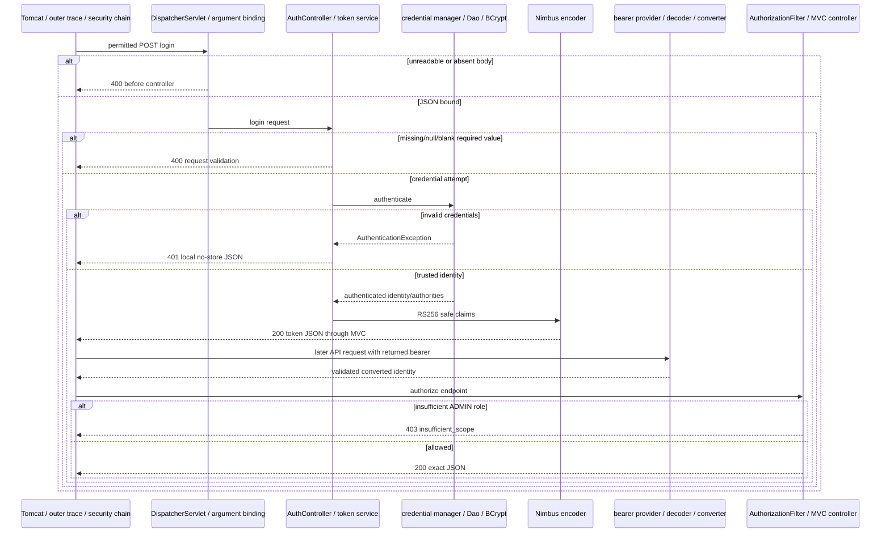

# J2.S1 — Consolidated JWT login and endpoint authorization evidence

## Objective and scope

Phase J1 established Java17, unconditional JWT security and clear credential/signing/verification ownership. This step consolidates the HTTP tests around what callers actually do: POST local login and GET public/user/admin. No production Java, endpoint policy, dependency version or credential configuration changes. [The migration roadmap](../../ROADMAP.md) and [J1.S3](J1.S3-WALKTHROUGH.md) are prerequisites.

Two suites now have explicit responsibilities. JwtLoginIT proves credential-to-token behavior and subsequent use of the **returned** token. JwtAuthorizationIT proves request authentication, trusted authority mapping, infrastructure and endpoint permission using controlled signed fixtures. JwtNegativeValidationIT remains the owner of invalid-token/raw-claim/time cases and is unchanged; further validation/key consolidation belongs to J2.S2. Diagnostics and lifecycle suites remain for J2.S3 rather than being rebuilt here.

The previous JwtValidationIT name mixed authentication/authorization, infrastructure and duplicated negative checks. It becomes JwtAuthorizationIT. JwtMvcIT is removed because its three bearer-authenticated response checks are covered by the consolidated endpoint matrix and issued-token tests. This is removal of redundant checks, not removal of successful MVC behavior evidence.

## Case ownership and coverage preservation

| Retired/previous case | Current owner and retained assertion |
|---|---|
| JwtMvcIT public/user/admin success (3) | JwtAuthorizationIT endpoint matrix checks exact JSON, content type, no challenge/cookie and full MVC trace; JwtLoginIT exercises all three with real login-issued tokens |
| JwtValidationIT validTokenReachesExpectedEndpoint (2) | Endpoint matrix covers USER/user and ADMIN/admin, plus ADMIN/user and public access with both roles |
| JwtValidationIT four invalidTokenReturns401BeforeApplicationHandler cases | Existing JwtNegativeValidationIT already checks unknown-key, expired, issuer and audience with 401 invalid_token, no cookie and pre-MVC challenge trace; no case is removed from that suite |
| Basic-only protected request (1) | Now parameterized for user/admin (2), exact Bearer challenge, no cookie, anonymous/rejection trace |
| Malformed login shapes (3) | Expanded to eight independent binding/required-field cases, with response and controller-entry evidence |

Removed nine duplicated case invocations; added nine targeted invocations (three authorization cells, one extra Basic-protected route, five malformed-login shapes). Thus the final HTTP total happens to remain94 while test ownership and request assertions change. An unchanged total is not used as proof that coverage is unchanged; the table documents the actual transfer.

## JwtAuthorizationIT, every changed block

Paths in this section start at `src/test/java/com/example/securitylearning/`.

`JwtAuthorizationIT.java` is the renamed JwtValidationIT. SpringBootTest RANDOM_PORT and explicit Import reference its own fixed-clock configuration and test-only IdentityProbe. The source imports drop KeyPair/RSA/JWK-source/Nimbus encoder construction and RsaKeyGenerator, because the suite no longer creates wrong-key/signature scenarios. It retains the actual injected JwtEncoder, Jwt/JWS builders, real HTTP/assertion types, infrastructure inspection and fixed time. No production parser/authenticator is mocked.

The static owner-only JwtKeyFixture still supplies both required PEM paths through DynamicPropertySource and is closed in AfterAll. Method names become keyPaths/removeKeyFiles to reflect both resources. The fixture and nested fixed time distinguish this context from login/negative/diagnostic contexts. The unused SIGNING_KEYS alias disappears because the suite signs through the actual configured encoder rather than rebuilding JWK sources.

`publicEndpointDoesNotRequireToken` keeps its anonymous public200 and exact callback order. It adds explicit JSON content type and no session cookie. Its existing assertions still verify exactly one encoder, user service, encoder/password provider/manager, chain, security proxy and actual Tomcat servlet proxy registration, with no mode selector. Bearer/authorization filter presence and Basic filter absence remain evidence that permitAll is inside security, not absent security. The application login mapping must still exist.

`basicCredentialsCannotAuthenticateProtectedEndpoint` replaces the mode-named method and parameterizes user/admin. Valid development Basic credentials are deliberately supplied to prove the scheme is disabled rather than merely using a wrong password. Both routes must return401, exactly WWW-Authenticate Bearer and no cookie. The expected trace is outer entry, anonymous state, challenge, authorization exit and outer exit; MVC is absent. Keeping BCrypt/UserDetails for local JSON login does not activate BasicAuthenticationFilter.

`validatedRolesBecomeRequestAuthorities` retains five cases: USER, ADMIN, missing, empty, OTHER. The test-only controller returns actual request Authentication name and authorities. Missing/empty yield no authorities; other values yield exactly ROLE_* with no implicit hierarchy. This observes the converter/context after real decoder verification, not a standalone mocked conversion.

`endpointPolicyDistinguishesAuthenticationFromAdminRole` now owns twelve cells. Existing USER/user200, USER/admin403, ADMIN/user200, ADMIN/admin200, missing/empty user200/admin403 and OTHER/admin403 remain. OTHER/user200 explicitly proves authentication is sufficient for user even without a recognized product role. USER/public200 and ADMIN/public200 prove authenticated public access remains allowed. The trusted test strings encode role, route and status; they are not a runtime policy engine.

Every response checks no Set-Cookie. Successful cells now assert JSON content type, no WWW-Authenticate and the exact message map before checking full authenticated MVC event order. Denied cells assert insufficient_scope and the fixed authenticated/denied/finally event list without MVC. The loop-free parameter matrix produces independently reported cases rather than hiding failures behind one combined mode comparison.

`missingBearerReturns401BeforeMvc` retains two anonymous protected cases with plain Bearer challenge and no cookie/MVC. `bearerRequestDoesNotEstablishSessionAuthentication` retains successful ADMIN bearer use followed by a bearer-free request carrying an arbitrary JSESSIONID that must receive401. This is no server session dependency for the exercised flow, not a universal claim that any application component can never create a session.

`roleToken` now uses the injected production JwtEncoder. It builds valid subject/issuer/audience/iat/nbf/exp from the suite's fixed NOW, varies only roles, and requests RS256/local-issuer. Missing means omit the claim; empty means an actual empty array. Using the encoder does not skip decoder validation on the subsequent HTTP request. The test constructs trusted roles intentionally to investigate resource-server authorization; only JwtLoginIT proves external login JSON cannot choose its own roles.

The old generic token(role, scenario) helper disappears with its four duplicated negative cases. IdentityProbe, assertTrace and fixedValidationClock retain their behavior. The probe is explicitly imported, excluded from scanning and never packaged. Awaitility waits for outer completion; output contains only UUID/event names, not token values. The renamed nested class references and existing key-path methods keep context isolation correct.

## JwtLoginIT, every changed block

`loginIssuesTrustedTokenForEndpointPolicy` replaces the old narrower positive-method name. USER/admin parameterization is unchanged. POST credentials deliberately include forged roles ADMIN; the returned claims must come from authenticated identity. Existing checks retain exactly accessToken/tokenType/expiresIn fields, Bearer type,300seconds, seven claim names, RS256, expected subject/roles, and deterministic iat/nbf/exp. New response checks include JSON and no WWW-Authenticate, alongside no-store/no cookie. Token presence is asserted through a boolean so a failure cannot print the compact value.

After local decoder inspection, a small loop sends the actual returned token to public, user and admin. USER gets200/200/403; ADMIN gets200/200/200. Successful responses must have exact JSON/no challenge; USER/admin must advertise insufficient_scope. Every response has no session cookie and an exact authenticated allowed/denied trace. These are multiple real HTTP requests within each two-identity case, not six extra JUnit case invocations. The distinction is recorded in the matrix/counts.

A final bearer-free GET user with a made-up JSESSIONID returns401/Bearer, no cookie and an anonymous challenge trace. It proves login and the prior successful requests do not establish session authentication. RestAssured specifications are fresh per request; no session filter silently carries cookies. JwtAuthorizationIT retains its independent bearer-fixture sequence as a separate context-policy check.

`badCredentialsReturnGeneric401WithoutToken` retains wrong-password and unknown-user inputs with the same exact invalid_credentials map. It now explicitly asserts JSON content type, alongside401/no-store/no challenge/no cookie and MVC credential-rejection callbacks. Exact map equality proves no token, exception detail or user-existence distinction is included.

`malformedLoginReturns400WithoutToken` expands to missing username, blank username, missing password, empty password, explicit null username, explicit null password, unreadable JSON and an empty body. A switch selects explicit JSON strings for null/absence distinctions; the default rejects a typo in a trusted test scenario. Six inputs are syntactically valid JSON that must enter AuthController.login; unreadable/empty bodies must fail argument binding before method entry. This callback assertion guards against accidentally testing invalid JSON for every case.

All eight assert400, JSON, no cookie/challenge, no token/password/exception/stack/message response fields, a nonblank correlation ID, and no issuance or credential-rejection event. These are request-validation failures, not failed password checks. The helper login(Object) and assertTrace keep their existing real POST/JSON/Awaitility responsibilities. Static fixture, cleanup and Primary fixedClock are unchanged. Java17 supports the switch expression and local variable syntax used here; no preview flags are required.

## Test-to-code matrix

| Suite/method | Cases | Requests, expected result and production code |
|---|---:|---|
| JwtLoginIT.loginIssuesTrustedTokenForEndpointPolicy | 2 | USER/ADMIN POST200, exact safe metadata/claims; each returned token GET public/user/admin policy; subsequent no-bearer user401; AuthController → credential manager/Dao/BCrypt → JwtTokenService/Nimbus, then Resource Server/converter/policy/MVC |
| JwtLoginIT.badCredentialsReturnGeneric401WithoutToken | 2 | Wrong password/unknown username POST401, same no-store JSON; Dao failure resolved by controller-local ExceptionHandler |
| JwtLoginIT.malformedLoginReturns400WithoutToken | 8 | Six required-field shapes plus unreadable/empty body POST400; controller guards versus MVC binding before entry; no issuer call |
| JwtAuthorizationIT.publicEndpointDoesNotRequireToken | 1 | Public anonymous200, live singleton infrastructure and anonymous MVC flow |
| JwtAuthorizationIT.basicCredentialsCannotAuthenticateProtectedEndpoint | 2 | Valid Basic-only user/admin401 Bearer; anonymous context, no MVC |
| JwtAuthorizationIT.validatedRolesBecomeRequestAuthorities | 5 | Authenticated probe200 with exact subject/ROLE_* collection, including no authorities |
| JwtAuthorizationIT.endpointPolicyDistinguishesAuthenticationFromAdminRole | 12 | Twelve role/route/status cells described above; exact JSON200 or Bearer403 and callback order |
| JwtAuthorizationIT.missingBearerReturns401BeforeMvc | 2 | Anonymous user/admin401 plain challenge, no MVC/cookie |
| JwtAuthorizationIT.bearerRequestDoesNotEstablishSessionAuthentication | 1 | ADMIN bearer200, later bearer-free JSESSIONID request401; no cookie-based identity |

The two suites contain35 cases:12 login and23 authorization. The negative45, diagnostic8, request-trace4 and error-path2 cases remain unchanged, totaling94 HTTP cases. Unit inventory remains23. No production component or dependency changes. Detailed report-derived final inventory follows below.

## Request lifecycle and failure distinctions

Tomcat parses HTTP and supplies servlet objects to outer filters/RequestTraceFilter, then DelegatingFilterProxy → FilterChainProxy and the sole JWT chain. Missing bearer permits anonymous public/login but cannot authenticate protected routes. Invalid supplied bearer is rejected earlier even on permitted routes; permitAll does not remove the chain. The unchanged negative suite owns those invalid-input cases.

Allowed login reaches DispatcherServlet; handler mapping selects AuthController.login and the handler adapter binds JSON. Unreadable/absent body fails binding, while valid JSON with missing/blank/null required fields enters the controller then produces400. Valid credential shapes go through ProviderManager/DaoAuthenticationProvider, UserDetailsService and BCrypt. Wrong credentials use MVC-local exception handling401; valid credentials issue a token and serialize no-store JSON through ResponseEntity/message conversion. The returned identity is used for issuance, not saved as the login request's authenticated SecurityContext, so the login trace remains anonymous.

Later bearer requests use JwtAuthenticationProvider and StrictJwtDecoder/Nimbus: signature, normalized issuer/audience/time/schema and original JSON type checks precede JwtAuthenticationConverter. Spring Security establishes the authenticated context; Nimbus alone does not. AuthorizationFilter checks authentication or ADMIN. USER/admin yields403 after authentication, while a bearer-free protected request yields401. Allowed requests reach MVC and DemoController, with Jackson JSON conversion during adapter processing, interceptor completion and filter/context unwind. The outer sink snapshot is published independently of client response timing.



Arrows summarize framework responsibilities and response unwind rather than direct writes by providers. Existing REQUEST traces omit separate ERROR callbacks; ErrorPathIT's dispatch probe is distinct evidence. Local issuance is not an OAuth2 grant or authorization server. Claims are readable Base64URL, not encryption. Statelessness is not a blanket browser CSRF guarantee; this remains the bounded API demonstration.

## Questions and safe exercises

1. Why inspect both decoded claims and HTTP use of an issued token? Claims show issuance contents; HTTP proves verification, context conversion, permission and controller execution actually succeed.
2. Why does a valid unknown role allow user but deny admin? User requires authentication, while admin requires exactly ROLE_ADMIN.
3. Why distinguish unreadable JSON from required-field validation? They fail at different MVC stages, evidenced by controller entry or its absence.
4. Why can the case count remain94 after consolidation? Redundant cases were removed and targeted ones added, while loops expand requests within a case. Counts alone do not establish coverage.

Safe disposable-branch exercises:

- Change the forged roles input in USER login and predict the issued USER authority remains unchanged. Check with the fixed-clock test without logging response bodies.
- Replace a missing roles fixture with a scalar roles string and predict authentication rejection instead of role403. Use the existing negative suite for that experiment and restore the valid authorization fixture afterward.

Stop before J2.S2. Actual verification, source index and sanitized evidence follow below.

## Actual verification, source index and report inventory

Final `mvn verify` on2026-11-02: **BUILD SUCCESS**, **21.234 s**, **94 HTTP integration +23 unit cases**, zero failures/errors/skips. Eclipse Temurin17.0.21, Maven3.9.12 and compiler release17. The initial clean build also passed before the final controller-entry assertions were added for malformed login. Production classes, dependency versions and the negative suite are unchanged.

```bash
J2_JAVA17_HOME="$(cat /private/tmp/jwt-auth-jdk17-home.txt)"
env JAVA_HOME="$J2_JAVA17_HOME" PATH="$J2_JAVA17_HOME/bin:$PATH" mvn verify
```

The temporary selected toolchain is explained in J1.S1; choose an installed JDK17 for future local runs. Surefire runs unit/context checks, Failsafe runs actual Tomcat HTTP integration tests. Expected error-fixture and existing provider/instrumentation output did not fail verification.

| Current source | Meaningful changed ranges |
|---|---|
| JwtAuthorizationIT.java | imports/bootstrap and collaborators3–62; key lifecycle64–73; public/infrastructure75–105; Basic-only107–118; authority probe120–130; endpoint matrix132–152; anonymous154–162; no-session164–173; controlled role fixture175–184; test probe186–194; correlation helper196–201; fixed-clock configuration202–210 |
| JwtLoginIT.java | existing fixture/bootstrap/time3–59; trusted login and returned-token matrix61–108; generic credential rejection110–119; eight malformed shapes121–149; JSON request helper151–154; trace helper156–161; fixed clock163–171 |

The method-level walkthrough above explains injected collaborators, annotations, JSON selection, response assertions, fixture signing and failure handling. No new application class/method needs explanation because this step changes only test organization and assertions. Historical source references elsewhere are explicitly marked superseded.

The following inventory is generated from the final Surefire/Failsafe XML; parameterized invocations are aggregated under their actual method name.

| Suite | Executed method / case counts |
|---|---|
| JwtDecoderConfigTest | `invalidPublicKeyFails` ×1; `missingPublicKeyFailsInsteadOfGeneratingFallback` ×1; `undersizedRsaPublicKeyFails` ×1 |
| JwtIssuerConfigTest | `invalidPrivateKeyFails` ×1; `mismatchedSigningKeyFailsInsteadOfIssuingUnverifiableTokens` ×1 |
| JwtStartupTest | `missingRequiredKeyFailsStartupWithoutModeSelection` ×2 |
| IssuerSecretHandlingTest | `temporaryKeysAreOwnerOnlyAndRemoved` ×1; `requestAndResponseDisplayAreRedacted` ×1 |
| JwtClaimContractValidatorTest | `validNormalizedClaimsSatisfyContract` ×1; `absentOrEmptyRolesRemainAnAuthenticationCandidate` ×2; `invalidClaimShapeOrRequiredValueFails` ×5 |
| RsaJwtTest | `changedPayloadCannotVerifyOriginalSignature` ×1; `developmentKeysAreRsa2048WithMatchingPublicAndPrivateModulus` ×1; `differentPublicKeyCannotVerifySignature` ×1; `rs256TokenHasExpectedHeaderAndClaimsAndVerifiesWithPublicKey` ×1 |
| TraceEventSinkTest | `completedTracesAreBoundedAndRequestStateIsRemoved` ×1; `completedSnapshotCannotBeModifiedByReaders` ×1 |
| ErrorPathIT | `unmappedUrlReturns404ThroughResourceHandlerAndErrorDispatch` ×1; `controllerExceptionReturns500AndNextRequestHasFreshTrace` ×1 |
| JwtAuthorizationIT | `publicEndpointDoesNotRequireToken` ×1; `missingBearerReturns401BeforeMvc` ×2; `basicCredentialsCannotAuthenticateProtectedEndpoint` ×2; `endpointPolicyDistinguishesAuthenticationFromAdminRole` ×12; `bearerRequestDoesNotEstablishSessionAuthentication` ×1; `validatedRolesBecomeRequestAuthorities` ×5 |
| JwtDiagnosticsIT | `tracesAndCapturedOutputExcludeCredentialsAndKeyMaterial` ×1; `concurrentBearerIdentitiesStayCorrelatedAndSeparate` ×1; `diagnosticsDistinguishAuthenticationAndAuthorization` ×5; `authenticatedThenAnonymousRequestsRemainIndependent` ×1 |
| JwtLoginIT | `badCredentialsReturnGeneric401WithoutToken` ×2; `loginIssuesTrustedTokenForEndpointPolicy` ×2; `malformedLoginReturns400WithoutToken` ×8 |
| JwtNegativeValidationIT | `permittedRawRepresentationsRemainAuthenticated` ×5; `invalidRawTokensFailClosedBeforeMvc` ×34; `timestampSkewHasDeterministicBoundaries` ×6 |
| RequestTraceIT | `successfulRequestRecordsNestedOrder` ×3; `concurrentRequestsKeepIndependentTraces` ×1 |

## Actual sanitized runtime evidence and trace map

```text
LOGIN TRACE 38e35097-5269-4b28-86b3-12cb9b5e1e7a [filter.entry, security.anonymous, interceptor.preHandle, controller.login, login.token.issued, interceptor.postHandle, interceptor.afterCompletion, security.authorization.exit, filter.exit]
LOGIN TRACE 7183219c-4af3-4a63-bcc5-e92ee421fb9f [filter.entry, security.authenticated, security.denied, security.authorization.exit, filter.exit]
LOGIN TRACE 3e409022-3c39-41e9-bf2c-e8e1897e7a34 [filter.entry, security.anonymous, interceptor.preHandle, controller.login, login.credentials.rejected, interceptor.afterCompletion, security.authorization.exit, filter.exit]
JWT TRACE 6d4c4c02-0ca7-472f-8681-18c679f494b6 [filter.entry, security.anonymous, security.challenge, security.authorization.exit, filter.exit]
```

| Event | Source and observation |
|---|---|
| filter.entry/filter.exit | RequestTraceFilter correlation and completed immutable snapshot |
| security.anonymous/authenticated | SecurityTraceFilter reads request context after mechanism processing |
| controller.login | AuthController.login has been entered after JSON binding |
| login.token.issued | AuthController observes successful service signing |
| login.credentials.rejected | AuthController’s local AuthenticationException handler |
| security.challenge/denied | JwtSecurityConfig’s wrappers around standard Bearer failure handlers |
| interceptor callbacks | MvcTraceInterceptor around handler adapter/controller processing |
| controller.public/user/admin | DemoController executed the allowed endpoint |
| security.authorization.exit | SecurityTraceFilter finally boundary, not proof of granted access |

All excerpts preserve actual final-run UUIDs without credential values. The malformed400 cases assert controller-entry presence/absence directly from the sink rather than printing request JSON. Full verification logs are scanned for compact JWTs, demo passwords and private PEM markers; packaging is checked for test/key artifacts, and documentation links/source references are reviewed. Case transfers are documented explicitly rather than claiming that an unchanged total alone proves preservation.

No J2.S2 or J2.S3 implementation is included.
