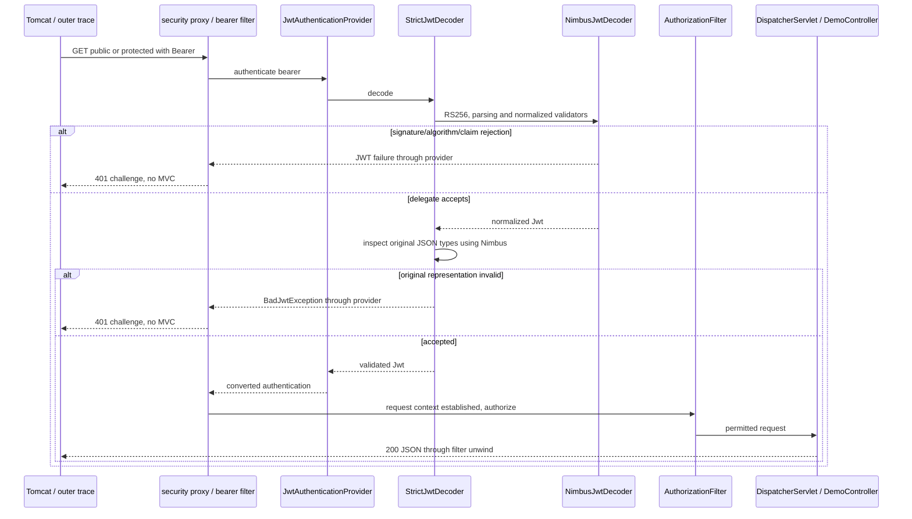

# J2.S2 — Strict raw-token validation and key-startup evidence

## Purpose and boundary

[J2.S1](J2.S1-WALKTHROUGH.md) assigned credential/login and permission behavior to focused HTTP suites. This step consolidates validation/key evidence while retaining the established acceptance contract. It adds tests, not production features. Java17 and the existing Nimbus-backed built-in Resource Server path remain unchanged. [The roadmap](../../ROADMAP.md) and [claim contract](../JWT-CLAIM-CONTRACT.md) are prerequisites. J2.S3 diagnostics/lifecycle consolidation is not implemented here.

JwtNegativeValidationIT remains the owner of raw invalid tokens and deterministic time. Its earlier45 cases remain; nine targeted cases are added: three wrong original types, three invalid-bearer public requests and three permitted representations. JwtStartupTest expands from two missing-property checks into nine failure configurations plus one successful control. Existing focused parser, normalized-validator, RSA and private-fixture tests remain supplements, not substitutes for the real HTTP pipeline.

## Validation layers and actual framework responsibilities

A signature proves integrity under the trusted key, not correct issuer/audience/time, schema, authenticated context or endpoint permission. NimbusJwtDecoder enforces the configured RS256 allowlist, parses/verifies and applies normalized contract, issuer and timestamp validators. StrictJwtDecoder delegates to it first, then uses Nimbus to inspect the original payload JSON types before returning the same normalized Jwt. This prevents numeric subject coercion or null optional-date removal from weakening the local contract. No custom bearer filter or cryptographic parser is introduced.

JwtAuthenticationProvider converts a successfully decoded token through JwtAuthenticationConverter. Spring Security establishes the request SecurityContext; Nimbus alone does not. AuthorizationFilter subsequently checks authenticated access or ADMIN. Malformed roles produce401 at authentication; missing/empty roles can authenticate but cannot grant ADMIN. JwtAuthorizationIT continues to prove the latter's user200/admin403 outcomes.

The60-second skew is explicit, not assumed from defaults. With fixed NOW, exp NOW−61 rejects and NOW−60/−59 accepts; nbf NOW+61 rejects and NOW+60/+59 accepts. Optional iat describes issuance and is not a maximum-age or future-issuance policy. The new future-iat control stays before exp and demonstrates that the application does not silently impose another requirement. Missing iat/nbf together is permitted. Spring can synthesize normalized iat from exp, so acceptance of original omission is not a claim that the resulting Jwt lacks iat.

## JwtNegativeValidationIT, code and annotations

File: `src/test/java/com/example/securitylearning/JwtNegativeValidationIT.java`.

Imports and bootstrap at lines3–51 remain the same: Java collections/time, Jackson serialization for adversarial fixture payloads, Nimbus JWS signing, JUnit parameterization, SpringBootTest RANDOM_PORT, fixed test configuration, HTTP assertions and the key/sink helpers. DynamicPropertySource and AfterAll at lines58–67 still supply both owner-only PEM paths and close the fixture. Real Tomcat sees each compact bearer; decoder/validators are not mocked. Primary fixed Clock is shared with the production decoder through injection.

`invalidRawTokensFailClosedBeforeMvc` at lines69–83 grows from34 to37 cases. The existing tampering/unknown key/HS256/malformed input, issuer/audience/time, missing/null/wrong-type claims and malformed roles remain intact. New boolean-iat and boolean-nbf require authentication failure even though booleans are truth-like values in JSON; NumericDate requires a number. mixed-roles is `["USER",42]`, proving that one legitimate role does not make a heterogeneous list valid. `alter` at lines152–188 adds exactly these three switch branches while preserving existing mutations. Every rejection asserts401, invalid_token, no session cookie and entry/challenge/exit only, before MVC.

`invalidBearerFailsBeforePublicAuthorization` at lines85–94 is new. Three inputs—tampered RS256 payload, HS256 signed token, malformed compact string—target `/api/public`. Each must still yield401/invalid_token and the same pre-MVC trace. A permitAll rule permits authorization but does not skip supplied bearer authentication. This distinction is now directly proven in the unconditional application, rather than inferred from the historical comparison course. The method labels safe console output with public- plus the scenario, never the compact value.

`timestampSkewHasDeterministicBoundaries` at lines96–114 retains all six exact boundary inputs; no sleep or machine-current-date token is used. Success assertions now explicitly include JSON content type and absence of WWW-Authenticate alongside the exact user message. Failure retains the invalid_token check. Both paths assert no cookie and exact corresponding callbacks.

`permittedRawRepresentationsRemainAuthenticated` at lines116–138 retains standard single audience, omitted individual dates/roles and empty roles. Three new branches are explicit: multiple-audiences includes another audience and the required API audience; missing-both-dates removes iat and nbf; future-iat sets issuance to NOW+60 while expiry remains NOW+300. These controls prevent overbroad validation from becoming the implementation by accident. Each returns200 exact JSON with no challenge/cookie and a full authenticated MVC trace.

The unchanged helpers remain important: claims builds a fresh valid LinkedHashMap with epoch seconds; signed uses Jackson's exact map serialization and Nimbus JWSObject/RSASSASigner, or a test-only MACSigner for HS256. It signs before payload replacement in the tampered case, generates another RSA pair for unknown-key, and never logs key/compact values. This adversarial compact-segment replacement is confined to test construction, not an application parser. successTrace and assertTrace centralize fixed events and await completed publication. FixedTimeConfiguration at lines224–232 supplies the controlled UTC clock. Default scenario branches are not a way to accept arbitrary runtime input; trusted test names determine the fixture.

## JwtStartupTest, every meaningful block

File: `src/test/java/com/example/securitylearning/config/JwtStartupTest.java`.

Lines3–18 import existing file IO, JCA RSA generation, Base64/Map, fixture ownership, parameterized/single tests, context runner and decoder/encoder assertions. These support test-only key mutation; no production key-export API is added.

`unacceptableKeysFailContextStartup` at lines21–59 lists nine scenarios. Each invocation opens two fresh JwtKeyFixture objects in try-with-resources. paths returns both configured file paths; the switch changes one aspect:

- Missing-property removes public or private configuration entirely.
- Missing-file deletes the corresponding file while retaining its configured path.
- Invalid-public/private overwrites the existing file with fixed non-PEM text.
- Weak-public/private generates a1024-bit RSA pair and overwrites just the selected file. The public path checks the decoder's size gate; weak private leaves the valid2048-bit public key so issuer checks are exercised.
- Mismatched-pair points the private property to the other independent2048-bit pair.

The default throws for an unknown fixture name rather than silently running a valid control. `context(properties).run` asserts startup failure. Missing properties must identify the required property name; missing files must have NoSuchFileException as root cause; malformed/weak/mismatched inputs must have IllegalArgumentException as root cause, with fixed2048/matching-key evidence where relevant. These assertions distinguish the intended rejection from unrelated context problems. Complete keys are never incorporated into assertion descriptions.

`matchingDevelopmentKeysCreateOneEncoderAndDecoder` at lines61–68 is the successful control: a correct pair creates exactly one of each managed component. It prevents an always-failing harness from satisfying every negative case. The runner intentionally loads actual JwtDecoderConfig/JwtIssuerConfig rather than component-scanning unrelated test fixtures. It verifies component-context startup; the integration suites separately boot the full application and actual Tomcat. This is not claimed as nine real-network process-start tests.

`paths` at lines70–75 builds a mutable ordered property map. `context` at lines77–80 creates a fresh WebApplicationContextRunner for the real key-dependent configurations and converts entries into property strings. It never sets a security mode. `overwritePem` at lines82–87 MIME-Base64 encodes a JCA key into the appropriate envelope and **overwrites an existing file**. It does not create a new private file with default permissions. The enclosing fixture created files with600 and directory700; overwriting retains that ownership/permission boundary. Files deleted by a negative case are harmless to close's deleteIfExists cleanup. Both fixture scopes close even when assertions fail.

These fixtures are POSIX-specific to this verified macOS environment. Windows ACL portability and exceptional partial-constructor cleanup remain documented limitations, not new guarantees. No local development private key is committed or placed under main resources.

## Focused unit evidence retained

JwtDecoderConfigTest retains missing-file, invalid-public and weak-public direct factory checks. JwtIssuerConfigTest retains private-format and wrong-pair checks. JwtClaimContractValidatorTest checks normalized shapes and absent/empty roles, while RSA tests isolate JCA key/signature/tamper behavior. IssuerSecretHandlingTest checks redacted record display and private fixture permissions/removal. Context tests complement those with actual managed bean creation; HTTP tests complement both with decoding, authentication and MVC reachability.

No direct factory test is relabeled as HTTP evidence. The key-success control does not mint an application token; JwtLoginIT owns end-to-end issuance. Redacted display does not zeroize Java Strings or make response-body logging safe.

## Test-to-code matrix

| Method / group | Cases | Result and layer |
|---|---:|---|
| invalidRawTokensFailClosedBeforeMvc |37 | Protected GET401 invalid_token, no cookie/MVC; Nimbus, normalized schema/semantics or original JSON guard rejects |
| invalidBearerFailsBeforePublicAuthorization |3 | Public GET401 invalid_token despite permitAll; early bearer authentication failure |
| timestampSkewHasDeterministicBoundaries |6 | Two boundary failures401, four accepted200; fixed-clock timestamp semantics with exact JSON/trace |
| permittedRawRepresentationsRemainAuthenticated |8 | Standard/optional representations200, including multi-audience, absent both dates and descriptive future iat |
| unacceptableKeysFailContextStartup |9 | Required property/file, format/strength and pair trust failures stop managed key component startup |
| matchingDevelopmentKeysCreateOneEncoderAndDecoder |1 | Matching pair succeeds with one encoder/decoder |

HTTP negative suite54 cases replaces45, adding9; overall HTTP103 replaces94. Context suite10 replaces2, adding8; overall Surefire31 replaces23. Other suites are unchanged. Exact executed methods/results and actual sanitized excerpts follow below after verification.

## HTTP lifecycle and failure branch

Tomcat parses HTTP and enters servlet filters, with RequestTraceFilter opening server correlation before the security proxy. DelegatingFilterProxy invokes FilterChainProxy and the sole JWT chain. BearerTokenAuthenticationFilter extracts a supplied value and submits it through the bearer manager/provider to StrictJwtDecoder/NimbusJwtDecoder. An unacceptable algorithm/signature/parsed claim/normalized value/original type yields authentication failure before later anonymous/observation/authorization filters and MVC. The standard Bearer entry point wrapper records challenge and returns401 invalid_token. Public-route permission has not yet been evaluated.

Accepted tokens are converted to authorities, Spring Security establishes request context, and AuthorizationFilter permits user access. DispatcherServlet uses handler mapping/adapter to invoke DemoController; message conversion/Jackson produces JSON, then interceptor and filter/context cleanup unwind. A successful decode does not imply ADMIN permission; existing authorization tests still distinguish403 after authentication from401 validation failure. REQUEST completion does not include a later ERROR redispatch. No OAuth2 grant/authorization server is needed; claims are readable Base64URL rather than encrypted.



Invalid configured keys fail earlier at startup and do not enter this request sequence. The runner tests that distinct lifecycle branch without fabricating an HTTP response from an application that never started.

## Questions and safe exercises

1. Why include successful controls? They detect an overbroad guard or a harness that always fails independently of the intended input.
2. Why can public receive401 with an invalid bearer? Credential processing precedes public authorization; permitAll does not remove security.
3. Why check raw and normalized claims? Parsing/conversion can erase original type distinctions, while semantic validators use normalized values.
4. Why separate weak-private from weak-public? Otherwise the decoder could reject the weak public key before the signing guard is exercised.

Safe disposable-branch exercises:

- Move a timestamp offset from−60 to−61 and predict the fixed-clock status without sleeping. Restore the contract afterward.
- Replace the required audience in the multi-audience control with another string. Expect401 despite a valid signature; never print the compact fixture while investigating.

Stop before J2.S3. Production code and diagnostic instrumentation are unchanged.

## Actual verification and report-derived inventory

2026-11-02: **BUILD SUCCESS**, **24.470 s**; **103 HTTP integration +31 unit/context cases**, zero failures/errors/skips. Eclipse Temurin17.0.21, Maven3.9.12, compiler release17. JwtNegativeValidationIT ran54 cases and JwtStartupTest ran10; all existing login/authorization/diagnostic/error/trace cases remained green. No production file or dependency changed.

```bash
J2_JAVA17_HOME="$(cat /private/tmp/jwt-auth-jdk17-home.txt)"
env JAVA_HOME="$J2_JAVA17_HOME" PATH="$J2_JAVA17_HOME/bin:$PATH" mvn clean verify
```

The temporary JDK17 setup is documented in J1.S1. Surefire executes the context/unit checks; Failsafe executes actual random-port Tomcat HTTP. Expected startup warnings for deliberately rejected key contexts, the test-only500 and existing provider/instrumentation messages are not unexpected failures.

| Suite | Executed methods / case counts |
|---|---|
| JwtDecoderConfigTest | `invalidPublicKeyFails` ×1; `missingPublicKeyFailsInsteadOfGeneratingFallback` ×1; `undersizedRsaPublicKeyFails` ×1 |
| JwtIssuerConfigTest | `invalidPrivateKeyFails` ×1; `mismatchedSigningKeyFailsInsteadOfIssuingUnverifiableTokens` ×1 |
| JwtStartupTest | `unacceptableKeysFailContextStartup` ×9; `matchingDevelopmentKeysCreateOneEncoderAndDecoder` ×1 |
| IssuerSecretHandlingTest | `temporaryKeysAreOwnerOnlyAndRemoved` ×1; `requestAndResponseDisplayAreRedacted` ×1 |
| JwtClaimContractValidatorTest | `validNormalizedClaimsSatisfyContract` ×1; `absentOrEmptyRolesRemainAnAuthenticationCandidate` ×2; `invalidClaimShapeOrRequiredValueFails` ×5 |
| RsaJwtTest | `changedPayloadCannotVerifyOriginalSignature` ×1; `developmentKeysAreRsa2048WithMatchingPublicAndPrivateModulus` ×1; `differentPublicKeyCannotVerifySignature` ×1; `rs256TokenHasExpectedHeaderAndClaimsAndVerifiesWithPublicKey` ×1 |
| TraceEventSinkTest | `completedTracesAreBoundedAndRequestStateIsRemoved` ×1; `completedSnapshotCannotBeModifiedByReaders` ×1 |
| ErrorPathIT | `unmappedUrlReturns404ThroughResourceHandlerAndErrorDispatch` ×1; `controllerExceptionReturns500AndNextRequestHasFreshTrace` ×1 |
| JwtAuthorizationIT | `publicEndpointDoesNotRequireToken` ×1; `missingBearerReturns401BeforeMvc` ×2; `basicCredentialsCannotAuthenticateProtectedEndpoint` ×2; `endpointPolicyDistinguishesAuthenticationFromAdminRole` ×12; `bearerRequestDoesNotEstablishSessionAuthentication` ×1; `validatedRolesBecomeRequestAuthorities` ×5 |
| JwtDiagnosticsIT | `tracesAndCapturedOutputExcludeCredentialsAndKeyMaterial` ×1; `concurrentBearerIdentitiesStayCorrelatedAndSeparate` ×1; `diagnosticsDistinguishAuthenticationAndAuthorization` ×5; `authenticatedThenAnonymousRequestsRemainIndependent` ×1 |
| JwtLoginIT | `badCredentialsReturnGeneric401WithoutToken` ×2; `loginIssuesTrustedTokenForEndpointPolicy` ×2; `malformedLoginReturns400WithoutToken` ×8 |
| JwtNegativeValidationIT | `permittedRawRepresentationsRemainAuthenticated` ×8; `invalidRawTokensFailClosedBeforeMvc` ×37; `timestampSkewHasDeterministicBoundaries` ×6; `invalidBearerFailsBeforePublicAuthorization` ×3 |
| RequestTraceIT | `successfulRequestRecordsNestedOrder` ×3; `concurrentRequestsKeepIndependentTraces` ×1 |

## Actual sanitized trace examples and code map

```text
JWT NEGATIVE TRACE boolean-iat e50d0d1b-25e7-43dd-a18c-00fc4fa17c94 [filter.entry, security.challenge, filter.exit]
JWT NEGATIVE TRACE public-hs256 977fb5b9-18aa-43b1-a9b4-145a385ce084 [filter.entry, security.challenge, filter.exit]
JWT NEGATIVE TRACE exp:-60:200 b35bc4e9-9db8-4382-be57-433044369413 [filter.entry, security.authenticated, interceptor.preHandle, controller.user, interceptor.postHandle, interceptor.afterCompletion, security.authorization.exit, filter.exit]
JWT NEGATIVE TRACE nbf:61:401 682f7d31-8f6f-4045-bbce-d28dd9a8f8c2 [filter.entry, security.challenge, filter.exit]
JWT NEGATIVE TRACE multiple-audiences 5dc44000-8ea0-4534-8af1-07123ae3345b [filter.entry, security.authenticated, interceptor.preHandle, controller.user, interceptor.postHandle, interceptor.afterCompletion, security.authorization.exit, filter.exit]
JWT NEGATIVE TRACE future-iat c9a320ba-acf0-40bd-bb74-8f64c4cef8a3 [filter.entry, security.authenticated, interceptor.preHandle, controller.user, interceptor.postHandle, interceptor.afterCompletion, security.authorization.exit, filter.exit]
```

| Observed event | Code / exact implication |
|---|---|
| filter.entry/filter.exit | RequestTraceFilter begins/publishes the completed REQUEST snapshot |
| security.challenge | JwtSecurityConfig entry-point wrapper, after bearer authentication failure |
| outer entry/challenge/exit only | Later security observation/authorization and MVC did not execute; not a per-validator invocation trace |
| security.authenticated | SecurityTraceFilter observes the validated converted request identity |
| interceptor callbacks/controller.user | MvcTraceInterceptor and DemoController on accepted user requests |
| security.authorization.exit | SecurityTraceFilter finally boundary, not an authorization-success label |

Correlated IDs are from the actual passing run; no token/key/password values are included. The same failure trace can correspond to parser, cryptographic, normalized-semantic or original-type rejection, so it is not used alone to assert a specific internal line executed. Inputs, configured collaborators and focused tests identify those responsibilities separately. Key context failure occurs before HTTP and therefore has no fabricated request trace.

Final checks scan the verification log for complete bearer patterns, development passwords and private PEM blocks; inspect packaging for keys/test fixtures; and check local links/whitespace/Mermaid label syntax. Owner-only fixture/removal evidence remains exercised by IssuerSecretHandlingTest. Broad documentation replacement and final repository audit remain J3; diagnostic changes remain J2.S3.

The final log has no complete compact JWT, known development password or private PEM block. The deliberately invalid-private startup case does produce a standard Spring parser hint naming the expected `BEGIN PRIVATE KEY` header delimiter; that fixed format hint is not encoded key material. The marker scan was inspected rather than treating its presence as proof of a leaked key. No actual key bytes appear in the message, and no PEM/test fixture is packaged in the executable jar. Local links and whitespace checks pass.
