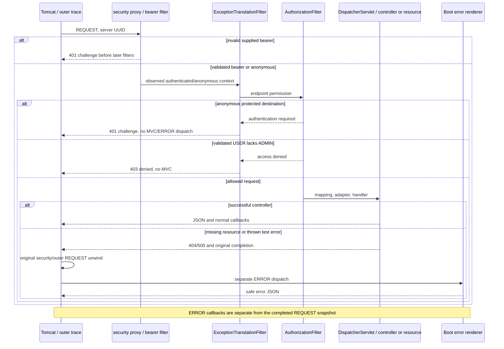
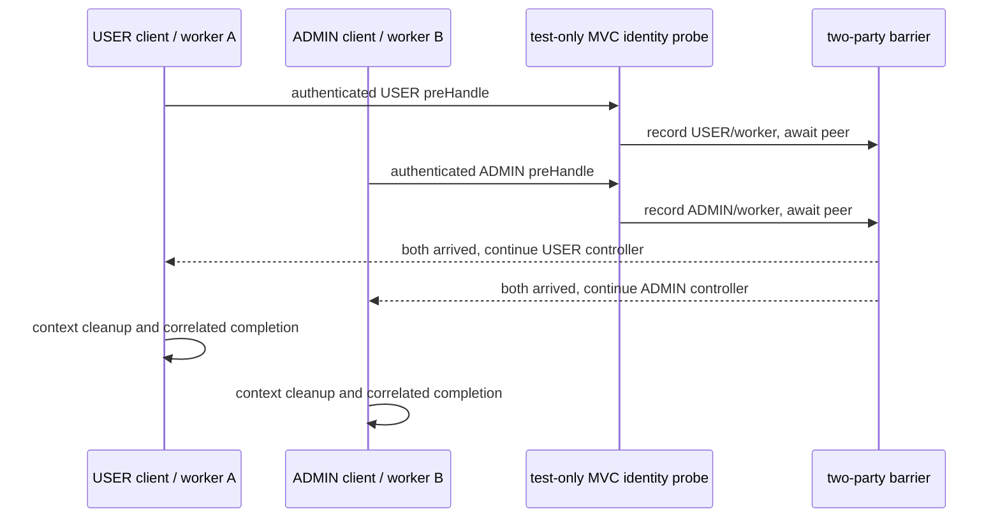

# J2.S3 — Consolidated JWT diagnostic, lifecycle and isolation evidence

## Purpose and scope

J2.S1 owns login/permission coverage and J2.S2 owns validation/key failures. This step completes Phase J2 by making diagnostic evidence precise: configured filters versus actual entry, exact callback order, worker-thread cleanup, overlapping authenticated requests, and ordinary MVC errors versus early security rejection. Read [J2.S1](J2.S1-WALKTHROUGH.md), [J2.S2](J2.S2-WALKTHROUGH.md) and [the migration roadmap](../../ROADMAP.md) first.

Only tests and learning documentation change. Production security/tracing classes, endpoint policy, failure handlers, dependencies, 128-snapshot capacity, immutable snapshot publication, REQUEST scope and Java17 enforcement remain unchanged. No custom bearer filter, authentication engine, distributed tracing system or product feature is introduced. Historical P4/P1 diagnostic experiments remain available until J3 replaces that package; this document is the current method/source map.

## Evidence layers and unchanged application behavior

A configured SecurityFilterChain is membership/order evidence. A test-only FilterChainProxy decorator records entry into real configured filters. Production trace events record application callbacks. A filter entry does not prove it authenticated; a finally event does not prove access was granted. Combining those forms of evidence makes failure branches explainable without inventing events inside framework classes.

RequestTraceFilter runs outside the security proxy, generates the UUID and completes the bounded immutable REQUEST snapshot in finally. BearerTokenAuthenticationFilter delegates to JwtAuthenticationProvider and StrictJwtDecoder/Nimbus; signature, semantic/normalized and original-JSON checks precede authentication conversion. Spring Security establishes SecurityContext, not Nimbus alone. Anonymous processing and AuthorizationFilter happen downstream. Invalid bearer stops early; no-bearer protected access triggers an authentication challenge; a validated USER denied ADMIN produces403. An allowed request reaches DispatcherServlet, handler mapping/adapter and controller, with Jackson/message-converter response processing and interceptor callbacks before unwind.

JWT login remains a distinct credential-to-token MVC path. DaoAuthenticationProvider loads in-memory users and BCrypt checks passwords; NimbusJwtEncoder signs trusted claims. No OAuth2 grant/authorization server is implemented. Payloads are readable Base64URL, not encryption, and session independence is not a universal browser CSRF claim.

## JwtDiagnosticsIT, changed code block by block

File: `src/test/java/com/example/securitylearning/JwtDiagnosticsIT.java`.

New imports CyclicBarrier and TimeUnit provide bounded synchronization using Java17 APIs. The existing SpringBootTest RANDOM_PORT, explicit test configuration, OutputCaptureExtension, owner-only key fixture, Primary fixed UTC clock and MockitoSpyBean on springSecurityFilterChain are retained. The context remains isolated from ordinary authorization, login, validation and error-fixture configurations. No mock response or fake provider replaces real HTTP.

`observeRealFilterCallsAndContextCleanup` now resets workerThreads and concurrentRequests as well as calls, identities and cleared maps before every invocation. The test-only chain decorator still wraps the **same real filter objects** in reverse construction order so forward execution matches the configured list. Wrappers record only filter class names under the generated UUID, then invoke real doFilter with the remaining chain. They do not read headers/body/claims or authenticate.

The spy still calls the real proxy and observes SecurityContextHolder authentication in finally on the server worker thread. The boolean is stored **before** defensive clearContext, so test cleanup cannot manufacture a passing observation. Proxy/framework lifecycle cleanup can both contribute; this evidence does not isolate one internal cleanup line. completed waits for that observation and the outer sink snapshot, avoiding a client-response/publication race.

`diagnosticsDistinguishAuthenticationAndAuthorization` retains public, anonymous, invalid, denied and allowed cases. After status/body/challenge/cookie assertions it now checks the **complete** expected event list through expectedTrace. Configured filter ordering and no-Basic membership remain. Invalid bearer must enter the bearer filter without reaching observation, ExceptionTranslationFilter or AuthorizationFilter. Other cases must invoke the configured list in order. The test prints actual UUID/events/filter calls/cleanup boolean; no credential objects or compact tokens are printed.

`completedSecurityBranchDoesNotAuthenticateNextRequest` replaces the old single sequential case with three inputs: allowed ADMIN/user200, validated USER/admin403 and malformed bearer401. First status/no-cookie checks prove the intended branch occurred. Each completed request must have its exact branch trace and empty post-proxy authentication. A fresh no-bearer user request then gets401/plain Bearer/no cookie with a distinct ID and exact anonymous challenge trace. Only the allowed first request has a recorded MVC identity; rejected original requests and the later anonymous request never reach the principal interceptor. This is sequential independence evidence; it does not assert Tomcat reused the same physical worker.

`concurrentBearerIdentitiesStayCorrelatedAndSeparate` retains USER/user and ADMIN/admin requests but now proves overlap instead of merely launching two futures. Before launch it sets a two-party CyclicBarrier in the test probe. Both authenticated requests record identity/worker ID in MVC preHandle and wait up to10seconds, so the first cannot finish that stage before the second arrives. CompletableFuture.allOf has a15-second timeout for bounded failure reporting. This is synchronization, not Thread.sleep or a load benchmark.

After both succeed, assertions check exact JSON, distinct IDs, actual USER/ADMIN authorities, different server worker IDs, exact endpoint-specific success traces and cleared contexts. Thread.getId is Java17-compatible. The worker map is internal evidence; safe output prints only the UUIDs and boolean conclusions. If one request never reaches MVC, the barrier times out and tests fail rather than silently claiming concurrency. Exceptions propagate through test-only interception; production code is unchanged.

`tracesAndCapturedOutputExcludeCredentialsAndKeyMaterial` now runs four resource branches: allowed, denied, invalid and anonymous. It asserts each resource's status and exact trace, then performs an actual successful JSON login and checks token presence. The sink records for both requests and captured output must contain neither bearer/issued value, development password nor private-key marker. The null anonymous bearer is explicitly guarded before String.contains. Assertions inspect token presence through booleans instead of printing the compact string on failure. The MVC identity exists only for the allowed resource request; login's anonymous identity record is a separate UUID.

`expectedTrace` is a new switch mapping trusted diagnostic names to exact fixed lists: public/allowed use successTrace; invalid is entry/challenge/exit; anonymous adds anonymous/challenge/authorization-exit; denied adds authenticated/denied/authorization-exit. The default rejects a fixture typo. `successTrace(endpoint,state)` centralizes the ordered outer/security/MVC/controller/finally callbacks. These are assertion expectations, not a production policy engine.

`request`, `completed`, `token`, Identity and ProbeConfiguration retain their previous responsibilities: fresh per-request RestAssured specification, await completed/cleared state, trusted fixed-time signed fixture, immutable safe identity value and explicit test-only beans. Probe adds a concurrent worker map and a volatile barrier reference. Its preHandle now declares throws Exception, records current authentication/name/authority plus worker ID, snapshots the optional barrier reference and awaits it only when the overlap test enabled it. It still returns true and never chooses endpoint permissions.

## ErrorPathIT: MVC errors versus security rejection

File: `src/test/java/com/example/securitylearning/ErrorPathIT.java`.

Imports add parameterization and nullValue assertions. Existing actual JWT prerequisites, key cleanup, test-only ThrowingController and DispatchProbe remain unchanged. Authenticated missing-resource404 and deliberately thrown500 still verify original MVC completion, absence of normal postHandle, Boot ERROR rendering, safe error JSON and a fresh following request. assertError now additionally requires no WWW-Authenticate or session cookie: these are application errors after authentication, not another security challenge or session establishment.

The new `anonymousRequestsFailSecurityBeforeApplicationErrors` runs `/api/not-mapped`, `/test/throw` and direct `/error` without credentials. All return401/plain Bearer/no cookie with exactly entry/anonymous/challenge/authorization-exit/exit. The separate dispatch-probe map must have no record: neither the original MVC handler nor Boot error handling was reached. Because the Bearer entry point sets the rejection response directly, this branch does not create a servlet ERROR redispatch.

The direct `/error` case is particularly useful: permitting internal DispatcherType.ERROR does not make an initial REQUEST to that path public. BasicErrorController is Boot’s generic error-rendering class name, unrelated to retired HTTP Basic authentication. No new executable failing endpoint is added; the throw fixture remains under src/test and excluded from packaging.

## RequestTraceIT and sink unit evidence

File: `src/test/java/com/example/securitylearning/RequestTraceIT.java`.

The weaker concurrentRequestsKeepIndependentTraces case is deleted, along with unused CompletableFuture/Test imports. Its unique distinct-ID/controller independence checks are covered more strongly by the barrier-backed diagnostic overlap test. The three public/user/admin parameterized success cases remain the owner of exact full callback order and proof that a client-supplied correlation ID is not trusted. The unknown-ID empty lookup assertion moves into assertTrace, preserving it for every endpoint case.

TraceEventSinkTest is unchanged: completedTracesAreBoundedAndRequestStateIsRemoved exercises eviction after129 completions against capacity128 and removes active request state; completedSnapshotCannotBeModifiedByReaders proves immutable published values. These focused unit checks supplement HTTP lifecycle evidence rather than duplicating capacity loops over the network. No new production ThreadLocal or shared mutable request list is introduced.

## Test-to-code and case transfer

| Method | Cases | Evidence |
|---|---:|---|
| JwtDiagnosticsIT.diagnosticsDistinguishAuthenticationAndAuthorization |5 | Exact allowed/public/anonymous/invalid/denied snapshots, configured versus actual calls, MVC reachability, cleanup |
| JwtDiagnosticsIT.completedSecurityBranchDoesNotAuthenticateNextRequest |3 | Success/role denial/early rejection then anonymous401, distinct IDs, no later identity, cleanup on both |
| JwtDiagnosticsIT.concurrentBearerIdentitiesStayCorrelatedAndSeparate |1 | Barrier-backed simultaneous server contexts, separate worker IDs/principals/controller traces and cleanup |
| JwtDiagnosticsIT.tracesAndCapturedOutputExcludeCredentialsAndKeyMaterial |4 | Resource success/denial/invalid/anonymous plus JSON login, sink/captured console secret checks |
| ErrorPathIT existing authenticated404/500 methods |2 | Original and ERROR callbacks, ordinary safe error JSON, no challenge/session cookie |
| ErrorPathIT.anonymousRequestsFailSecurityBeforeApplicationErrors |3 | Same error destinations/direct error path rejected before MVC; no dispatch probe |
| RequestTraceIT.successfulRequestRecordsNestedOrder |3 | Exact public/user/admin trace, generated correlation, unknown-ID empty result |
| TraceEventSinkTest existing methods |2 unit | Capacity/active-state cleanup and immutability |

Diagnostics grows8→13, error paths2→5, request traces4→3. Net HTTP103→110; unit/context count remains31. Removed weak concurrency evidence is explicitly mapped to the stronger overlap case, not silently dropped. All login, authorization, raw-token and key tests remain unchanged.

## Request lifecycle and diagrams



The diagram groups exchange responsibilities; it does not claim the outer REQUEST filter encloses ERROR callbacks. ErrorPathIT separately observes those dispatches under the original ID. Success response conversion occurs inside handler-adapter processing before normal postHandle; a handler exception skips that normal callback. Response receipt can precede final publication, so tests await evidence.



The overlap observer adds no production filter/endpoint. Two controlled requests demonstrate isolation, not every scheduler, async dispatch or future application component. The servlet and security context cleanup evidence is REQUEST-specific. Secret scans cover exercised paths; arbitrary future debug/body logging requires review.

## Questions and safe exercises

1. Why compare configured and observed filters? Early bearer failure prevents configured downstream filters from executing.
2. Why wait at a server-side barrier? Launching two client futures alone does not prove their authenticated processing overlaps.
3. Why observe cleanup before defensive clear? Otherwise test cleanup could hide a framework leak.
4. Why do anonymous missing/throwing routes yield401 rather than404/500? Security denies before MVC can discover or invoke those handlers.

Safe disposable-branch exercises:

- Compare invalid and denied exact snapshots and identify where authentication versus permission failed. Run only those diagnostic parameter values without printing credentials.
- Remove a bearer from an authenticated error fixture request and predict the anonymous401/no-MVC branch. Restore it to retain404/500 coverage.

Stop before J3.S1. Final Java17 results, source ranges and actual sanitized traces follow below.

## Actual Java17 verification and current source index

Executed2026-11-02: **BUILD SUCCESS**, **26.261 s**, **110 HTTP integration +31 unit/context cases**, zero failures/errors/skips. Eclipse Temurin17.0.21, Maven3.9.12, compiler release17. JwtDiagnosticsIT13, ErrorPathIT5 and RequestTraceIT3 all passed. Existing expected startup-format hints, test-only500 output and provider/instrumentation warnings did not fail verification.

```bash
J2_JAVA17_HOME="$(cat /private/tmp/jwt-auth-jdk17-home.txt)"
env JAVA_HOME="$J2_JAVA17_HOME" PATH="$J2_JAVA17_HOME/bin:$PATH" mvn clean verify
```

The temporary JDK17 setup is explained in J1.S1. Production classes, Maven dependencies, key/claim contracts and validation tests are unchanged. No mock servlet substitute replaces real Tomcat/RestAssured for these integration cases.

| Current test source | Method/block locations |
|---|---|
| JwtDiagnosticsIT.java | observer setup84–119; five-branch diagnostics124–155; sequential branches160–182; overlap185–205; four output branches210–229; expectations231–245; HTTP/completion/token helpers247–270; safe Identity272; concurrent Probe274–298; explicit configuration301–304 |
| ErrorPathIT.java | authenticated40481–91; thrown500/fresh request94–115; anonymous error destinations119–129; signed request131–135; safe error assertions137–143; correlated dispatch assertions145–154; test-only beans/controller157–185; dispatch probe187–227 |
| RequestTraceIT.java | retained endpoint parameterization53–57; signed request59–72; exact correlation/snapshot assertions74–83 |

The method-level explanations above cover each changed block and retained observer responsibility. Older source ranges are marked historical. Full suite inventory is derived from the final Maven XML reports below; parameterized invocations aggregate under their actual method name.

| Suite | Executed methods / cases |
|---|---|
| JwtDecoderConfigTest | `invalidPublicKeyFails` ×1; `missingPublicKeyFailsInsteadOfGeneratingFallback` ×1; `undersizedRsaPublicKeyFails` ×1 |
| JwtIssuerConfigTest | `invalidPrivateKeyFails` ×1; `mismatchedSigningKeyFailsInsteadOfIssuingUnverifiableTokens` ×1 |
| JwtStartupTest | `unacceptableKeysFailContextStartup` ×9; `matchingDevelopmentKeysCreateOneEncoderAndDecoder` ×1 |
| IssuerSecretHandlingTest | `temporaryKeysAreOwnerOnlyAndRemoved` ×1; `requestAndResponseDisplayAreRedacted` ×1 |
| JwtClaimContractValidatorTest | `validNormalizedClaimsSatisfyContract` ×1; `absentOrEmptyRolesRemainAnAuthenticationCandidate` ×2; `invalidClaimShapeOrRequiredValueFails` ×5 |
| RsaJwtTest | `changedPayloadCannotVerifyOriginalSignature` ×1; `developmentKeysAreRsa2048WithMatchingPublicAndPrivateModulus` ×1; `differentPublicKeyCannotVerifySignature` ×1; `rs256TokenHasExpectedHeaderAndClaimsAndVerifiesWithPublicKey` ×1 |
| TraceEventSinkTest | `completedTracesAreBoundedAndRequestStateIsRemoved` ×1; `completedSnapshotCannotBeModifiedByReaders` ×1 |
| ErrorPathIT | `anonymousRequestsFailSecurityBeforeApplicationErrors` ×3; `unmappedUrlReturns404ThroughResourceHandlerAndErrorDispatch` ×1; `controllerExceptionReturns500AndNextRequestHasFreshTrace` ×1 |
| JwtAuthorizationIT | `publicEndpointDoesNotRequireToken` ×1; `missingBearerReturns401BeforeMvc` ×2; `basicCredentialsCannotAuthenticateProtectedEndpoint` ×2; `endpointPolicyDistinguishesAuthenticationFromAdminRole` ×12; `bearerRequestDoesNotEstablishSessionAuthentication` ×1; `validatedRolesBecomeRequestAuthorities` ×5 |
| JwtDiagnosticsIT | `tracesAndCapturedOutputExcludeCredentialsAndKeyMaterial` ×4; `concurrentBearerIdentitiesStayCorrelatedAndSeparate` ×1; `diagnosticsDistinguishAuthenticationAndAuthorization` ×5; `completedSecurityBranchDoesNotAuthenticateNextRequest` ×3 |
| JwtLoginIT | `badCredentialsReturnGeneric401WithoutToken` ×2; `loginIssuesTrustedTokenForEndpointPolicy` ×2; `malformedLoginReturns400WithoutToken` ×8 |
| JwtNegativeValidationIT | `permittedRawRepresentationsRemainAuthenticated` ×8; `invalidRawTokensFailClosedBeforeMvc` ×37; `timestampSkewHasDeterministicBoundaries` ×6; `invalidBearerFailsBeforePublicAuthorization` ×3 |
| RequestTraceIT | `successfulRequestRecordsNestedOrder` ×3 |

## Actual sanitized passing-run evidence and trace-to-code map

```text
JWT DIAGNOSTIC invalid c57dc3e6-fe2b-472a-9131-a729710e7f6b [filter.entry, security.challenge, filter.exit] invoked=[DisableEncodeUrlFilter, WebAsyncManagerIntegrationFilter, SecurityContextHolderFilter, HeaderWriterFilter, BearerTokenAuthenticationFilter] contextCleared=true
JWT DIAGNOSTIC denied 42f066d1-5104-41a2-a422-94042921c7c1 [filter.entry, security.authenticated, security.denied, security.authorization.exit, filter.exit] invoked=[DisableEncodeUrlFilter, WebAsyncManagerIntegrationFilter, SecurityContextHolderFilter, HeaderWriterFilter, BearerTokenAuthenticationFilter, AuthenticationFilter, SecurityContextHolderAwareRequestFilter, AnonymousAuthenticationFilter, SecurityTraceFilter, SessionManagementFilter, ExceptionTranslationFilter, AuthorizationFilter] contextCleared=true
JWT SEQUENTIAL denied first=c50c1d00-9ade-4724-850f-942bc903ff48 next=11540913-1efa-4c29-8dad-a28d1b9bec8f contextCleared=true
JWT OVERLAP user=a3fdd473-faab-4d35-923e-21ad23b9621c admin=7bde8f8a-c7d7-4e34-924c-be6edc0be6dd separateWorkers=true contextCleared=true
SECURITY-BEFORE-ERROR 11c5b42c-9bfe-486a-80f9-bd2f314690e8 [filter.entry, security.anonymous, security.challenge, security.authorization.exit, filter.exit]
ERROR-PATH TRACE 36fa8759-7dcf-4ea7-99cc-620836464634 [filter.entry, security.authenticated, interceptor.preHandle, interceptor.afterCompletion, security.authorization.exit, filter.exit]
DISPATCH TRACE 36fa8759-7dcf-4ea7-99cc-620836464634 [REQUEST:ResourceHttpRequestHandler:preHandle, REQUEST:ResourceHttpRequestHandler:afterCompletion:none, ERROR:BasicErrorController#error:preHandle, ERROR:BasicErrorController#error:postHandle, ERROR:BasicErrorController#error:afterCompletion:none]
```

| Observed field/event | Source and meaning |
|---|---|
| UUID / filter.entry/filter.exit | RequestTraceFilter correlation and REQUEST completion |
| security.authenticated/anonymous | SecurityTraceFilter observes request context after mechanism handling |
| security.challenge / security.denied | Standard Bearer handlers wrapped by JwtSecurityConfig |
| security.authorization.exit | Observation-filter finally boundary, not access-success proof |
| interceptor callbacks/controller.* | MvcTraceInterceptor and actual allowed/test handler execution |
| invoked list | Diagnostic test decorator recorded entry into the real configured filters |
| contextCleared=true | Real proxy returned with no worker-thread authentication, observed before defensive clear |
| separateWorkers=true | Barrier-backed requests captured distinct non-null worker IDs with separate trusted identities |
| REQUEST/ERROR dispatch list | ErrorPathIT.DispatchProbe, separate from production REQUEST snapshot |

Actual IDs are retained, but no compact credential/key data is printed. The JWT configured chain retains built-in AuthenticationFilter from framework DPoP-related configuration; its entry does not imply this project implemented DPoP or that it authenticated these ordinary bearer requests. The test's decorator changes only observation/traversal in its own context, not production filter registration.

Final checks scan log output for complete token/password/private-key material, inspect jar contents for test/key artifacts and validate local Markdown/Mermaid syntax and whitespace. J2.S2's intentionally invalid-key context may emit a fixed PEM-header format hint, which is distinguished from actual encoded key material. Broad documentation cleanup/final audit remain Phase J3. No J3.S1 implementation is included.
