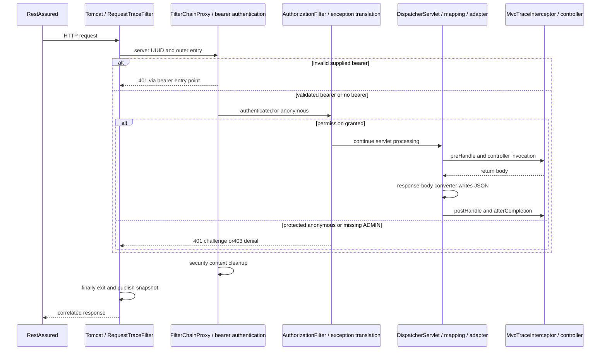

# J3.S1 — Replace obsolete course documentation

## Objective and boundary

J1 established Java 17/unconditional JWT, and J2 verified authentication, validation and lifecycle behavior. This step replaces the documentation that still described retired application configurations. Read [ROADMAP](../../ROADMAP.md), [scope](../IN-SCOPE-OUT-OF-SCOPE.md) and [learning requirements](../LEARNING-SUPPORT-REQUIREMENTS.md) first. No Java class, method, annotation, dependency, Maven configuration or test is changed. Therefore this walkthrough explains document ownership and preserved source concepts instead of inventing implementation changes. J3.S2's exhaustive source-guide assembly and J3.S3's final audit remain unimplemented.

## Changed documents and their meaningful blocks

| Document | Responsibility and changes |
|---|---|
| Root AGENTS | Reading order now names root roadmap, not removed phase files. Java17-only, unconditional security, dedicated credentials, real HTTP, one-step boundary, sanitized evidence and completion requirements replace obsolete preservation rules |
| Root README | Retains runnable JDK/key/start commands and development-only identities. Replaces removed-course navigation and outdated references with current index/claim/test/foundations links. Reports this actual verification |
| Scope | Defines the whole nine-step delivery through J3.S3, including final guide/audit, while excluding unrelated identity/deployment/product systems |
| Project structure | Lists the actual 16 production and 15 test/support Java files. Explains scanned identity ownership, separate signing/decoding, explicit proxy registration and REQUEST/ERROR scope |
| Learning requirements | Defines step/block commentary, concrete lifecycle/failure/evidence distinctions and safe diagrams. Documentation-only steps explain replacement mapping. Removes comparison-course obligations |
| Claim contract | Current original and normalized representations, issuer/audience, algorithm/key trust, exact skew boundaries, optional dates, roles and login/bearer distinction |
| Test matrix | Fresh XML-derived suite/method counts, request/status/reached-source matrix and explicit evidence limits |
| Learning README | One coherent home for all nine step slots. Existing seven walkthroughs link directly; remaining two are explicitly planned without broken placeholder links |
| JWT foundations | Extracts and refreshes prerequisite MVC/filter/interceptor, RSA, signing, validation, context, authorization, error and sink explanations against current source. Methods, annotations and meaningful helper/configuration blocks are explained rather than merely listed |
| COMPLETE-GUIDE | Replaces obsolete completed-course claims with a navigation bridge. The complete source audit remains J3.S2 |
| J1.S1 and J2.S3 walkthroughs | Retain original executed checkpoint evidence, remove deleted-file links and obsolete promises that the removed package is still present |
| Root roadmap | Retains original progress/evidence and nine steps. Updates only J3.S1 completion after executed verification and removes stale transition wording |

The16 production classes are unchanged. [Foundations](JWT-FOUNDATIONS.md) maps constructor injection, bean methods, controller methods, record redaction, token construction, normalized/raw validators, private helpers, filter finally blocks, MVC callbacks and snapshot publication to actual source links. Current configuration ownership is also detailed in [J1.S3](J1.S3-WALKTHROUGH.md); current test changes remain in their J2 walkthroughs. A complete current line-range coverage audit is deliberately deferred to the separately requested J3.S2.

## Removal and extraction map

Removed five former phase specifications,14 former walkthroughs, the cross-mode flow comparison and its obsolete roadmap-review ledger:21 documents. The original course stays recoverable through master/Git history; no branch, history rewrite or commit is created here.

| Removed package | Retained current explanation |
|---|---|
| Former MVC bootstrap/filter/error material | Foundations: Boot, MVC response handling, filter/interceptor/sink methods, ordinary404/500 and ERROR limits; J2.S3 actual error evidence |
| Former credential/provider/authorization material | Foundations: Dao/BCrypt/dedicated manager, context and permission; J1.S3 bean ownership; J2.S1 login/authorization |
| Former RSA, issuance and Resource Server material | Foundations: development RSA, key loading, token anatomy/service/header/claims, builtin bearer/provider/decoder/converter; current claim contract |
| Former raw-validation/diagnostics material | J2.S2 raw/normalized/time/key test explanation; J2.S3 configured versus actual filters, precise traces and isolation |
| Former comparison/final guide/review material | Current scope, structure, test matrix and learning index; upcoming J3.S2 complete guide and J3.S3 audit |

The retired comparison's700–800-word constraint belonged to that removed artifact. It is not transferred to the new foundations document, which needs enough detail to preserve the JWT prerequisites. Historical class/count names in J1/J2 checkpoint evidence remain clearly historical; current documents never instruct selecting another configuration.

## Request lifecycle and code-to-flow

Documentation changes do not change runtime processing. Tomcat invokes RequestTraceFilter, then the explicit DelegatingFilterProxy and selected FilterChainProxy chain. A bearer goes through built-in BearerTokenAuthenticationFilter, JwtAuthenticationProvider, Nimbus/StrictJwtDecoder and converter. Spring Security establishes SecurityContext; AuthorizationFilter evaluates permission inside the exception-translation region. Allowed requests reach DispatcherServlet, handler mapping/adapter, interceptor and controller, then response-body/Jackson handling and unwind. Invalid bearer fails before that later region. Anonymous protected requests challenge, and valid non-ADMIN admin requests are denied. Ordinary authenticated404/500 paths are distinct from those security responses.



The diagram groups framework collaborators and illustrates synchronous REQUEST flow. It does not claim one application marker for each internal filter. AuthenticationFilter appearing in the live chain is framework DPoP-related configuration, not a project DPoP feature. Internal ERROR redispatch can follow completion of an exceptional original REQUEST and is observed separately in tests, not appended to completed production snapshots. [Foundations](JWT-FOUNDATIONS.md) provides the retained deeper explanation.

## Tests and actual execution

The unchanged suites are the behavioral regression check for this documentation step. [TEST-MATRIX](../TEST-MATRIX.md) supplies every executed method name and its request-to-code responsibilities. Suite counts below are from this run, not copied historical totals.

| Suite | Type | Cases | Failures/errors/skips |
|---|---|---:|---|
| ErrorPathIT | HTTP | 5 |0/0/0 |
| JwtAuthorizationIT | HTTP | 23 |0/0/0 |
| JwtDiagnosticsIT | HTTP | 13 |0/0/0 |
| JwtLoginIT | HTTP | 12 |0/0/0 |
| JwtNegativeValidationIT | HTTP | 54 |0/0/0 |
| RequestTraceIT | HTTP | 3 |0/0/0 |
| JwtDecoderConfigTest | unit/context | 3 |0/0/0 |
| JwtIssuerConfigTest | unit/context | 2 |0/0/0 |
| JwtStartupTest | unit/context | 10 |0/0/0 |
| IssuerSecretHandlingTest | unit/context | 2 |0/0/0 |
| JwtClaimContractValidatorTest | unit/context | 8 |0/0/0 |
| RsaJwtTest | unit/context | 4 |0/0/0 |
| TraceEventSinkTest | unit/context | 2 |0/0/0 |

Command, using the same temporary checksum-verified Temurin17 installation established in J1.S1:

```bash
J3_JAVA17_HOME="$(cat /private/tmp/jwt-auth-jdk17-home.txt)"
env JAVA_HOME="$J3_JAVA17_HOME" PATH="$J3_JAVA17_HOME/bin:$PATH" mvn verify > /tmp/jwt-auth-j3s1-verify.log 2>&1
```

Actual2026-11-02 result: **BUILD SUCCESS**,24.242seconds,110HTTP+31unit/context cases, zero failures/errors/skips. Maven3.9.12; Eclipse Temurin17.0.21+9. The temporary JDK path is not a permanent install requirement; use any installed JDK17 and check `mvn -version`. Existing error/key-failure fixtures intentionally exercise rejection and can emit framework diagnostics; they did not fail the build. Production/test source and pom have no diff.

## Actual sanitized traces and source map

The following lines are copied from this passing run, with server-generated UUIDs. They contain no bearer values, credentials or private key material.

```text
JWT NEGATIVE TRACE single-audience 33cb28a9-ab31-4a10-ac84-2596d701002f [filter.entry, security.authenticated, interceptor.preHandle, controller.user, interceptor.postHandle, interceptor.afterCompletion, security.authorization.exit, filter.exit]
JWT NEGATIVE TRACE tampered 19a23479-aee9-4144-8374-5fb376c1d9b1 [filter.entry, security.challenge, filter.exit]
JWT DIAGNOSTIC denied 5d7cd66e-0783-4964-9648-71dcb093a57c [filter.entry, security.authenticated, security.denied, security.authorization.exit, filter.exit] invoked=[DisableEncodeUrlFilter, WebAsyncManagerIntegrationFilter, SecurityContextHolderFilter, HeaderWriterFilter, BearerTokenAuthenticationFilter, AuthenticationFilter, SecurityContextHolderAwareRequestFilter, AnonymousAuthenticationFilter, SecurityTraceFilter, SessionManagementFilter, ExceptionTranslationFilter, AuthorizationFilter] contextCleared=true
JWT DIAGNOSTIC anonymous 5d49958b-071e-45b4-8b1d-147e2185c78a [filter.entry, security.anonymous, security.challenge, security.authorization.exit, filter.exit] invoked=[DisableEncodeUrlFilter, WebAsyncManagerIntegrationFilter, SecurityContextHolderFilter, HeaderWriterFilter, BearerTokenAuthenticationFilter, AuthenticationFilter, SecurityContextHolderAwareRequestFilter, AnonymousAuthenticationFilter, SecurityTraceFilter, SessionManagementFilter, ExceptionTranslationFilter, AuthorizationFilter] contextCleared=true
JWT OVERLAP user=fd671290-4169-4dbb-825f-175977add439 admin=cc9439a1-c239-479c-ab3e-d9bc52bca606 separateWorkers=true contextCleared=true
```

Trace mapping: filter.entry/filter.exit come from RequestTraceFilter.doFilterInternal. security.authenticated/anonymous and security.authorization.exit come from SecurityTraceFilter.doFilterInternal. challenge/denied come from the REQUEST-only wrappers in JwtSecurityConfig.jwtSecurityFilterChain. interceptor markers come from MvcTraceInterceptor's three callbacks, and controller.user comes from DemoController.userEndpoint. JwtDiagnosticsIT's decorator/probe separately records actual filter entries and cleanup. Successful paths contain MVC markers; early invalid bearer contains only outer entry/challenge/exit. The test matrix distinguishes all branch expectations and ordinary error observations.

## Questions and safe exercises

1. Why retain historical J1/J2 counts but replace current tables? Checkpoint results describe what actually ran then; current acceptance must match today's suites.
2. Why does documentation replacement still run HTTP tests? It verifies that the documented contracts still match the real application and catches accidental implementation changes.
3. Why is public access still security processing? permitAll is an authorization decision after earlier filters, including bearer authentication.
4. Why is COMPLETE-GUIDE not marked complete here? Its exhaustive current source audit belongs to J3.S2, which requires a separate request.

Trace a successful user request from matrix to source and identify where each of its eight events originates. Expected result: outer entry, authenticated state, three interceptor events around controller, authorization exit and outer exit, with framework steps between markers. Then inspect an invalid-bearer snapshot: expect no MVC markers and explain why public permission cannot rescue invalid supplied authentication. Never print the token to answer either exercise.

Run a focused diagnostic suite using JDK17 and `mvn verify -Dit.test=JwtDiagnosticsIT`. Predict separate UUIDs/worker identities and cleanup; compare actual output without enabling verbose header/body logging. Restore any experimental document edits afterward.

## Documentation verification

All 18 Markdown files were checked: 163 local links resolve, code fences balance, and no raw semicolons occur in the nine Mermaid blocks. All nine diagrams passed Mermaid 10.9.3 parsing, loaded from a temporary standalone distribution outside the repository. A minimal document shim supports parser initialization, not diagram rendering. This verifies syntax and the known IDE label-semicolon issue, not visual layout in every IDE renderer. No parser dependency or binary is added to the project. `git diff --check` also passes, and source/test/pom diffs are empty. This is a scoped documentation acceptance check, not J3.S3's final secret/history/package audit. J3.S2 remains next.
