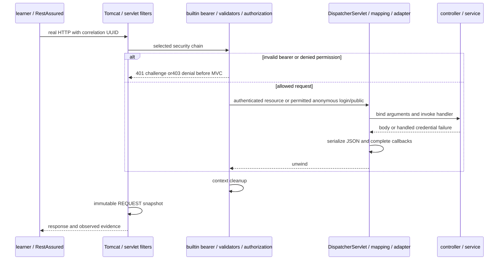

# J3.S2 — Complete JWT learning guide and source audit

## Objective, prerequisite and boundary

[J3.S1](J3.S1-WALKTHROUGH.md) replaced obsolete documentation and preserved prerequisites. This step assembles [COMPLETE-GUIDE](COMPLETE-GUIDE.md) around current Java17 source and actual HTTP evidence. Read [ROADMAP](../../ROADMAP.md), [claim contract](../JWT-CLAIM-CONTRACT.md) and [learning requirements](../LEARNING-SUPPORT-REQUIREMENTS.md) first. No production classes, methods, annotations, Maven configuration or tests change. This is documentation implementation, not a new security feature. J3.S3 final clean verification/history/package audit remains separate.

## Implemented artifacts and meaningful changes

| Artifact | Purpose and detailed contents |
|---|---|
| COMPLETE-GUIDE | Replaces navigation bridge with nine-step reading table, architecture/trust decisions, Maven/runtime explanation, exhaustive current source blocks, three request sequences, all HTTP-method mappings, answered interview questions, safe exercises, actual suite results and traces |
| This walkthrough | Records step purpose, audit method, source/reference coverage, evidence boundaries and actual verification |
| Learning index | Adds this walkthrough, replaces bridge wording with complete-guide navigation and leaves J3.S3 planned |
| README and project structure | Current completed-step status, latest run and guide ownership |
| Foundations and learning requirements | Link current exhaustive audit instead of promising it as future work |
| Test matrix | Refreshes latest actual verification and links current source-guide audit; method/case coverage unchanged |
| Scope and roadmap | Reflect J3.S2 delivery while retaining all exclusions and J3.S3 pending status; status uses existing emojis |

## Class, method, annotation and block coverage

The guide explains all 16 production classes through77 contiguous logical source blocks, accounting for561 nonblank source lines. Its audit rows identify one-based inclusive ranges checked against the actual files. Blank lines need no explanation; imports/declarations/braces belong to the surrounding explained block. A range check confirms coverage, not semantic accuracy by itself: source was also read and each explanation compared with the implementation.

Coverage includes both controllers and nested record toString methods; all bean factories and injected dependencies; launcher exclusion/main; dedicated credential manager; private/public key parsing and matching conditions; role converter; both failure-handler lambdas; HttpSecurity nested lambdas/method references/ordered matchers; normalized validation short-circuit predicates; strict raw decode and both private helpers; trusted claim/header construction; utility constructor/key generation/catch; three interceptor callbacks and private guard; both filter finally paths; anonymous WebMvcConfigurer callback; sink constants, request list, immutable publication, eviction, synchronized lookup and private cast.

The [guide source audit](COMPLETE-GUIDE.md#every-production-class-and-meaningful-source-block) is the current class/method/block explanation. The [project structure](../PROJECT-STRUCTURE.md) links all source/test files. J1/J2 walkthroughs remain checkpoint records; this guide resolves current ranges without pretending old classes still exist. No obsolete course text is needed to reconstruct the current application.

## Runtime flow and diagram ownership

The guide's login sequence distinguishes request binding/manual validation400, generic local credential401 and successful signing200. Dao/BCrypt authenticate credentials; NimbusJwtEncoder signs trusted claims; the login request remains anonymous because the service doesn't install its credential result in SecurityContext. The bearer sequence distinguishes early invalid-token401, anonymous challenge401, authenticated role403 and MVC success. Its ordinary-error diagram shows original REQUEST snapshot publication before later Tomcat ERROR redispatch, with test-only probes kept separate.

The runtime concepts are connected to Tomcat servlet processing, DelegatingFilterProxy/FilterChainProxy selection, builtin bearer/provider, Nimbus/strict validation, conversion/context establishment, exception translation/authorization, DispatcherServlet mapping/adapter, interceptor/controller, response conversion and unwind. Response JSON is written during response-body return handling before normal postHandle. The guide notes that MVC-resolved errors can yield null afterCompletion exceptions and that permitAll is still security processing.



This overview groups participants; the guide's three diagrams provide branch-specific detail. No fabricated framework callback event is added to production traces. Configured chain order and actual filter entries are reported separately; the generic AuthenticationFilter in the installed framework is not a newly implemented DPoP feature.

## Test-to-code coverage and verification approach

Every one of21 HTTP test methods across six suites is mapped to requests, expected responses, reached production collaborators and assertions in the guide. The [test matrix](../TEST-MATRIX.md) links source and lists unit/context methods too. No test cases are added or removed. Source inventory/range checks ensure every nonblank production line has an explained current block, and all HTTP test methods have a guide entry. Actual Surefire/Failsafe XML supplies suite counts and Java runtime rather than inferred results. Link/fence/Mermaid checks validate documentation.

## Actual Java 17 verification

Executed2026-11-02 with Maven3.9.12 and Eclipse Temurin17.0.21+9. Surefire/Failsafe report properties confirm test JVM17.0.21. Command:

```bash
J3_JAVA17_HOME="$(cat /private/tmp/jwt-auth-jdk17-home.txt)"
env JAVA_HOME="$J3_JAVA17_HOME" PATH="$J3_JAVA17_HOME/bin:$PATH" mvn verify > /tmp/jwt-auth-j3s2-verify.log 2>&1
```

The temporary JDK/checksum setup is described in J1.S1. Use your installed JDK17 rather than depending on this temporary path. Actual result: **BUILD SUCCESS**, **25.502 seconds**, **110 HTTP +31 unit/context cases**, zero failures/errors/skips. This documentation-only step changes no production/test code or dependencies. It verifies the current teaching contracts; J3.S3's final clean build and repository/history/package audit remain pending.

| Suite | Cases | Failures/errors/skips |
|---|---:|---|
| ErrorPathIT (HTTP) | 5 |0/0/0 |
| JwtAuthorizationIT (HTTP) | 23 |0/0/0 |
| JwtDiagnosticsIT (HTTP) | 13 |0/0/0 |
| JwtLoginIT (HTTP) | 12 |0/0/0 |
| JwtNegativeValidationIT (HTTP) | 54 |0/0/0 |
| RequestTraceIT (HTTP) | 3 |0/0/0 |
| JwtDecoderConfigTest (unit/context) | 3 |0/0/0 |
| JwtIssuerConfigTest (unit/context) | 2 |0/0/0 |
| JwtStartupTest (unit/context) | 10 |0/0/0 |
| IssuerSecretHandlingTest (unit/context) | 2 |0/0/0 |
| JwtClaimContractValidatorTest (unit/context) | 8 |0/0/0 |
| RsaJwtTest (unit/context) | 4 |0/0/0 |
| TraceEventSinkTest (unit/context) | 2 |0/0/0 |

## Actual evidence and trace-to-code ownership

The [guide's actual trace section](COMPLETE-GUIDE.md#actual-sanitized-traces-and-trace-to-code-map) contains verbatim sanitized UUID/event lines from this run for login success/failure, bearer allowed/invalid/denied/anonymous, overlapping identities, controller500/ERROR probe and security-before-error rejection. The adjacent table maps every marker/probe to its source method. No token/password/private key is printed. Fixed-name examples are copied from the passing log, not diagram labels presented as measured events.

One actual context-isolation observation:

```text
JWT OVERLAP user=19482f92-7bf7-4dc8-89ac-a5376dbc78a9 admin=dda29bd4-759d-4e91-85f0-d0995adb5852 separateWorkers=true contextCleared=true
```

The barrier-backed test proves two simultaneous server contexts with distinct workers/principals, not a benchmark. Server-thread cleanup observation precedes test defensive clear. No-cookie and sequential checks complement it; none proves universal session/CSRF properties or full third-party branch coverage.

## Questions and exercises

1. Why audit private helpers and configuration lambdas? They contain acceptance, failure, registration and policy decisions that a class-name inventory cannot explain.
2. Why does a source-range check not prove technical correctness? It verifies references/coverage only; explanation still needs comparison against code and observed framework behavior.
3. Why map both login401 and bearer401? They are different failure owners: local MVC credential resolution versus security authentication failure/challenge.
4. Why is the ninth walkthrough absent? J3.S3 is not implemented; the index reserves a planned slot without claiming an artifact exists.

Follow StrictJwtDecoder.optionalNumericDate from the guide to source and a raw null-date rejection test. Predict401 for present null versus allowed omission. Then follow AuthController.login to JwtTokenService.issue and explain why supplied caller roles do not override stored identity authorities; expect the existing USER login test to remain USER. Inspect assertions without logging compact tokens.

Run a focused HTTP suite using JDK17 and `mvn verify -Dit.test=JwtDiagnosticsIT`, predict the early-rejection versus full-filter path and compare safe output. Do not enable verbose headers/body logging or move probes into production.

## Documentation checks and stop boundary

Verified 19 Markdown files: 206 local links resolve, including both section anchors; code fences balance; all 13 Mermaid blocks are free of raw semicolons and pass Mermaid 10.9.3 parsing. The temporary standalone parser and minimal initialization shim stayed outside the repository; this checks syntax, not every IDE renderer's visual layout. The actual source inventory matches 16 audited files/77 blocks/561 nonblank lines, with no missing or out-of-range references. All 21 HTTP test method names have guide mappings. `git diff --check` passes and source/test/pom diffs are empty. J3.S3 alone owns the final clean/runtime/history/secret/package acceptance audit; this step does not mark that audit complete.
