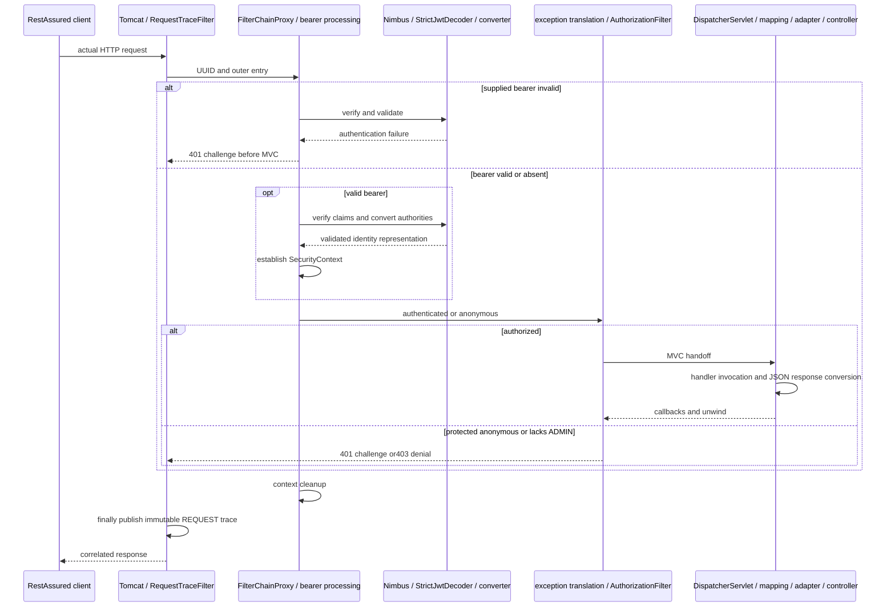

# J3.S3 — Final Java 17 verification and repository audit

## Objective, prerequisite and scope

[J3.S2](J3.S2-WALKTHROUGH.md) assembled the [complete guide](COMPLETE-GUIDE.md) with current source-block explanations. This final step checks the runnable application and teaching package together against [ROADMAP](../../ROADMAP.md), [scope](../IN-SCOPE-OUT-OF-SCOPE.md) and [learning requirements](../LEARNING-SUPPORT-REQUIREMENTS.md). No production class/method/annotation, test or Maven dependency changes. No feature beyond the nine-step migration is introduced. No commit or history rewrite is performed.

The final audit changes this walkthrough, current summary/status documents, the learning index and guide navigation/completion notes. Earlier J walkthroughs keep actual checkpoint results. No files are deleted in this step. Application behavior remains the tested JWT-only contract: initial credential authentication for local issuance, builtin bearer verification, endpoint permission and sanitized bounded lifecycle observations.

## Toolchain and exact executed commands

Maven3.9.12, Eclipse Temurin17.0.21+9 (Eclipse Adoptium), javac/compiler release17. Surefire/Failsafe XML confirms java.version17.0.21 in test JVMs. Runtime libraries inspected in the freshly packaged executable jar: Boot3.5.7, Framework6.2.12, Security6.5.6, Tomcat10.1.48 and Nimbus9.37.4. No framework upgrade was needed.

```bash
J3_JAVA17_HOME="$(cat /private/tmp/jwt-auth-jdk17-home.txt)"
env JAVA_HOME="$J3_JAVA17_HOME" PATH="$J3_JAVA17_HOME/bin:$PATH" mvn -version > /tmp/jwt-auth-j3s3-toolchain.log 2>&1
env JAVA_HOME="$J3_JAVA17_HOME" PATH="$J3_JAVA17_HOME/bin:$PATH" mvn clean verify > /tmp/jwt-auth-j3s3-verify.log 2>&1
```

The selected temporary JDK and published-checksum setup are recorded in J1.S1. These paths are session evidence, not portable installation requirements; use an installed JDK17 and inspect Maven's reported runtime. No global Java/IDE setting was changed. Actual 2026-11-02 result: **BUILD SUCCESS**, **26.226 seconds**, **110 HTTP integration +31 unit/context cases**, zero failures/errors/skips.

Separately executed `mvn validate` with JAVA_HOME/PATH set to the installed JetBrains JDK21.0.8 and Oracle JDK24. Both exited1 with the intended “This project requires JDK 17” message. Logs: `/tmp/jwt-auth-j3s3-jdk21-validate.log` and `/tmp/jwt-auth-j3s3-jdk24-validate.log`. These negative checks prove the Maven Enforcer boundary, not a JVM guard inside the standalone jar. Always launch the jar with JDK17.

## Executed suites and test-to-code evidence

| Suite | Cases | Failures/errors/skips |
|---|---:|---|
| ErrorPathIT (HTTP) | 5 |0/0/0 |
| JwtAuthorizationIT (HTTP) | 23 |0/0/0 |
| JwtDiagnosticsIT (HTTP) | 13 |0/0/0 |
| JwtLoginIT (HTTP) | 12 |0/0/0 |
| JwtNegativeValidationIT (HTTP) | 54 |0/0/0 |
| RequestTraceIT (HTTP) | 3 |0/0/0 |
| JwtDecoderConfigTest (unit/context) | 3 |0/0/0 |
| JwtIssuerConfigTest (unit/context) | 2 |0/0/0 |
| JwtStartupTest (unit/context) | 10 |0/0/0 |
| IssuerSecretHandlingTest (unit/context) | 2 |0/0/0 |
| JwtClaimContractValidatorTest (unit/context) | 8 |0/0/0 |
| RsaJwtTest (unit/context) | 4 |0/0/0 |
| TraceEventSinkTest (unit/context) | 2 |0/0/0 |

[TEST-MATRIX](../TEST-MATRIX.md) lists every executed method and links suite source; the [guide](COMPLETE-GUIDE.md#test-to-code-map-for-every-http-test-method) maps all 21 HTTP methods to requests/status/headers and reached code. Parameterized invocations count as cases. The31 Surefire cases supplement110 actual Tomcat RANDOM_PORT RestAssured cases, not mock HTTP replacements.

| Acceptance | Executed evidence and production decision |
|---|---|
| Unconditional JWT, one proxy/chain | JwtAuthorizationIT.publicEndpointDoesNotRequireToken verifies actual servlet registration, singleton beans, bearer filter and public traversal without selector |
| Basic cannot authenticate | JwtAuthorizationIT.basicCredentialsCannotAuthenticateProtectedEndpoint returns401 Bearer on both protected destinations |
| Local issuance and trusted roles | JwtLoginIT.loginIssuesTrustedTokenForEndpointPolicy authenticates through dedicated ProviderManager/Dao/BCrypt, verifies seven claims and uses the issued bearer across all endpoints |
| Credential/binding failures | JwtLoginIT badCredentialsReturnGeneric401WithoutToken and malformedLoginReturns400WithoutToken verify generic401 versus400/no issuance |
| Fail-closed keys | JwtStartupTest checks nine rejected configurations and one matching control; direct public/private parser tests supplement it |
| Raw/semantic/crypto/time contract | JwtNegativeValidationIT verifies strict types/signatures/issuer/audience/skew and accepted controls before MVC; fixed clock, no sleeps |
| Permission | JwtAuthorizationIT tests actual principal/authorities, user/admin rules and absent/empty/unknown versus malformed roles |
| Context lifetime | JwtDiagnosticsIT checks real server-thread post-proxy cleanup, sequential allowed/denied/invalid then anonymous and barrier-overlapping identities |
| Error and MVC lifecycle | ErrorPathIT distinguishes authenticated404/500 and ERROR rendering from anonymous401 before handlers; RequestTraceIT checks exact normal nesting |
| Secret handling and bounded snapshots | Captured-output branch tests, redacted object display/owner-only fixture cleanup, sink capacity128/immutability/active removal |

Also launched the fresh executable directly on JDK17 without any key properties:

```bash
"$J3_JAVA17_HOME/bin/java" -jar target/jwt-auth-0.0.1-SNAPSHOT.jar --server.port=0
```

Output was redirected to `/tmp/jwt-auth-j3s3-missing-keys.log`. It exited1, identified the required private-key property and never logged successful application startup. This confirms no public-only/unsecured fallback in the packaged bootstrap; context and HTTP suites cover the matching-key and other failure variants. A failed startup can initialize parts of Tomcat before bean creation fails; that is not a successful usable application.

## Package, configuration and source audit

The executable jar has19 application class entries for16 production source files, including two nested records and the anonymous MVC configurer. Every application class has class-file major61 (Java17). The jar contains no PEM/key/keystore files, test classes, probes, fixtures, throwing handlers, BasicSecurityConfig or SecurityModeConfig. Dependency library names confirm the exact versions above. This package audit covers application entries and key-path patterns, not a third-party dependency vulnerability audit.

The actual guide ranges were parsed again against current source:16 production files,77 explained blocks and561 nonblank lines, no missing or out-of-range lines. All21 current HTTP method names map to guide entries. This checks reference completeness; explanations were retained from the source review and executed evidence, not inferred from line coverage alone. All source/test/pom diffs are empty.

Static main-source/build checks found no selector property/conditional mode annotation, retired mode class, getFirst usage, release21 or Java21/24 build setting. The only HTTP Basic configuration action disables it; tests intentionally supply Basic credentials to prove rejection. Older mode names/version/counts in checkpoint walkthroughs and migration removal history are labeled historical, not selectable configurations. There is no custom bearer filter, OAuth2 grant, IdP/database/frontend/deployment expansion.

## Secret/path/history scan and precise limits

Scanned current tracked plus nonignored untracked files, every unique reachable Git blob from all local refs (24 commits,384 blobs), verification output and packaged application entries. Detection covers compact JWT shapes with a JSON-looking header and nontrivial three-part lengths, complete private PEM blocks with actual encoded body/end, literal private JWK d values, common GitHub token prefixes and AWS access-key patterns. No matched value is printed. No matches were found. An additional check of19 audit/toolchain/startup logs and Surefire/Failsafe XML files also found no selected secret patterns or development passwords. The current file count is recorded in the final checks below after writing this walkthrough.

No tracked PEM/key/keystore/.env or .local-keys paths were found. `git check-ignore --no-index` confirms both `.local-keys/private.pem` and `.local-keys/public.pem` are ignored. Tests use generated owner-only temporary files and test cleanup; no private file was added by this step. Ignored local development keys are intentionally outside the nonignored working-file scan, not a claimed absence of all keys on the developer's machine.

The final verification log contains zero development-password occurrences and no compact JWT/private PEM body. One literal private-key BEGIN header appears in the standard PKCS8 parser's static format-hint diagnostic during the intentionally invalid-private-key context case. It contains neither key body nor END envelope. Classifying that hint separately avoids calling an expected format description a disclosed private key. Known demo passwords appear intentionally in teaching source/setup, not verification logs; they are explicitly local demonstration credentials.

History scope is all currently reachable local refs, not remote-only revisions, dangling objects/reflogs or an external secret-manager inventory. Pattern checks cannot prove absence of every secret format/obfuscation or make this a production identity platform. No credential rotation/history rewrite was warranted by these scoped results. The original course remains recoverable on master/Git history.

## Actual request flow and trace-to-code map



The diagram groups library collaborators rather than inventing internal trace events. Allowed processing reaches handler mapping, interceptor preHandle, RequestMappingHandlerAdapter/controller and Jackson response conversion, then normal postHandle/afterCompletion before filter unwind. Local login separately reaches Dao/BCrypt then private-key signing, not bearer-password rechecking. Ordinary authenticated404/500 may trigger a later ERROR dispatch after original snapshot publication; production trace scope remains REQUEST, with separate test-only ERROR probes. [Complete guide](COMPLETE-GUIDE.md) contains the detailed login/bearer/error diagrams.

Actual lines from the passing final clean run:

```text
JWT SECURITY FILTERS [DisableEncodeUrlFilter, WebAsyncManagerIntegrationFilter, SecurityContextHolderFilter, HeaderWriterFilter, BearerTokenAuthenticationFilter, AuthenticationFilter, SecurityContextHolderAwareRequestFilter, AnonymousAuthenticationFilter, SecurityTraceFilter, SessionManagementFilter, ExceptionTranslationFilter, AuthorizationFilter]
LOGIN TRACE c7b27def-77f7-435b-b9ce-9b199b288ec2 [filter.entry, security.anonymous, interceptor.preHandle, controller.login, login.token.issued, interceptor.postHandle, interceptor.afterCompletion, security.authorization.exit, filter.exit]
JWT DIAGNOSTIC invalid f9b08141-cef0-430a-9bd2-58e00d42d92c [filter.entry, security.challenge, filter.exit] invoked=[DisableEncodeUrlFilter, WebAsyncManagerIntegrationFilter, SecurityContextHolderFilter, HeaderWriterFilter, BearerTokenAuthenticationFilter] contextCleared=true
JWT DIAGNOSTIC denied 24bf8c75-26d4-4b84-8d5c-2e273809f72e [filter.entry, security.authenticated, security.denied, security.authorization.exit, filter.exit] invoked=[DisableEncodeUrlFilter, WebAsyncManagerIntegrationFilter, SecurityContextHolderFilter, HeaderWriterFilter, BearerTokenAuthenticationFilter, AuthenticationFilter, SecurityContextHolderAwareRequestFilter, AnonymousAuthenticationFilter, SecurityTraceFilter, SessionManagementFilter, ExceptionTranslationFilter, AuthorizationFilter] contextCleared=true
JWT OVERLAP user=9fc69f39-d404-4995-850a-d8d856d5a555 admin=6b82a0d8-1b74-4bb4-a16a-7cf1448e6d0a separateWorkers=true contextCleared=true
ERROR-PATH TRACE 9864814a-5a98-469b-bdb3-212cca96edce [filter.entry, security.authenticated, interceptor.preHandle, controller.throw, interceptor.afterCompletion, security.authorization.exit, filter.exit]
DISPATCH TRACE 9864814a-5a98-469b-bdb3-212cca96edce [REQUEST:ThrowingController#fail:preHandle, REQUEST:ThrowingController#fail:afterCompletion:IllegalStateException, ERROR:BasicErrorController#error:preHandle, ERROR:BasicErrorController#error:postHandle, ERROR:BasicErrorController#error:afterCompletion:none]
```

| Marker/evidence | Code owner |
|---|---|
| filter.entry/filter.exit and UUID publication | RequestTraceFilter.doFilterInternal → TraceEventSink.begin/complete |
| security.authenticated/anonymous and authorization.exit | SecurityTraceFilter.doFilterInternal, observation plus finally |
| security.challenge/denied | JwtSecurityConfig.jwtSecurityFilterChain wrappers → standard bearer handlers |
| interceptor callbacks | MvcTraceInterceptor.preHandle/postHandle/afterCompletion with REQUEST guard |
| controller/login markers | DemoController endpoint methods and AuthController.login/authenticationFailed |
| Actual invoked filters / cleared boolean / overlap | JwtDiagnosticsIT real filter decorator, post-proxy spy and barrier-backed MVC probe |
| controller.throw / separate ERROR callbacks | ErrorPathIT test-only ThrowingController/DispatchProbe, not application classes |

Configured filter order differs from actual entry evidence. Invalid bearer stops early, role denial reaches authorization but not MVC, and finally markers do not prove success. Cleanup is observed on the server thread before defensive test clear. Separate UUIDs do not imply a particular worker was reused. No-cookie/context/fresh-request evidence supports the exercised stateless contract, not universal CSRF/session guarantees. Resource Server/Nimbus do not imply an OAuth2 grant or authorization server.

## Review questions and safe exercises

1. Why inspect the jar after a clean build? It checks delivered classes/resources rather than only source intentions or stale outputs.
2. Why scan reachable history as well as the current tree? Removing a secret now would not remove an earlier reachable blob. Here the scoped scan found no matching material.
3. Why is a standalone PEM BEGIN marker not automatically a leaked key? The parser format hint contains no encoded private material; context and complete-envelope detection matter.
4. Why separately test unsupported Maven runtimes? Compiler release17 alone would allow Maven/tests to run on a newer JVM; Enforcer supplies that execution boundary.

With JDK17 run `mvn clean verify` and compare suite totals/UUID trace ordering, expecting110HTTP+31unit/context with no failures. Never enable verbose header/body logging. On a disposable shell invocation use JDK21 `mvn validate`: expect an immediate version-gate failure, then restore JDK17 without changing global settings. Inspect jar entry names for Fixture/Probe/PEM without extracting or printing private material; expect no matching application entries.

## Final documentation checks and completion

Final link, source-range, Mermaid and working-tree scan results are recorded below. All nine steps are complete only after those checks. No further implementation step, commit, feature expansion or deployment is implied. The application remains a bounded local learning project with the limitations in scope and claim contract.

Documentation results: all20 Markdown files have balanced fences;225 local links resolve, including three section anchors. All14 Mermaid blocks passed Mermaid10.9.3 syntax parsing and contain no raw label semicolons. The temporary parser/minimal DOM initialization shim is outside the repository and validates syntax, not every IDE renderer’s visual layout. Source-range validation again accounts for16 files/77 blocks/561 nonblank lines and21 HTTP methods. `git diff --check` passes.

The final current-file secret-pattern scan covers53 tracked/nonignored untracked files after adding this walkthrough; all24 reachable commits/384 unique blobs remain clean for the documented patterns. There are no unresolved acceptance blockers within scope. All nine steps are complete.
