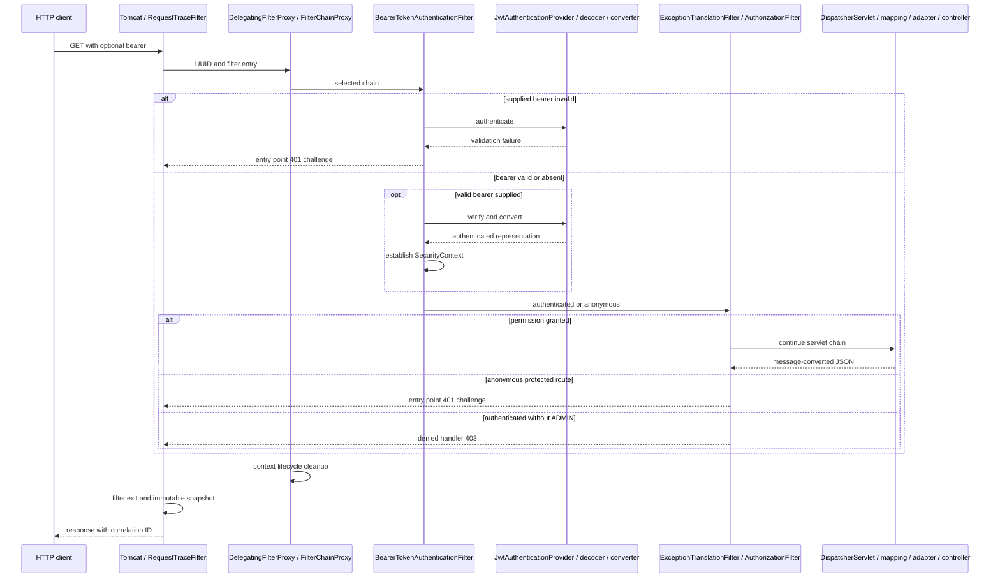

# Spring MVC and JWT foundations

This document preserves prerequisites from the removed course: Boot/MVC response handling, filters versus interceptors, RSA/JWT anatomy, credential issuance, bearer verification, errors and bounded tracing. It describes the actual Java 17 JWT-only source, without requiring retired modes. [J1.S3](J1.S3-WALKTHROUGH.md) explains current configuration ownership; [J2.S1](J2.S1-WALKTHROUGH.md), [J2.S2](J2.S2-WALKTHROUGH.md) and [J2.S3](J2.S3-WALKTHROUGH.md) provide executed test/evidence detail. The [complete guide](COMPLETE-GUIDE.md) now supplies the exhaustive current source/block audit and test-to-code map.

## Boot, MVC and response handling

[SecurityLearningApplication](../../src/main/java/com/example/securitylearning/SecurityLearningApplication.java) uses @SpringBootApplication to enable component scanning and Boot configuration. main passes arguments to SpringApplication.run. Boot creates the context and embedded Tomcat. Missing required key properties or invalid key loading prevents successful startup, even if only public access is desired. The sole exclusion is SecurityFilterAutoConfiguration: the application owns proxy registration explicitly rather than letting Boot register it again. This is not a blanket exclusion of Spring Security.

[DemoController](../../src/main/java/com/example/securitylearning/api/DemoController.java) is a @RestController, combining controller discovery with response-body semantics. Class @RequestMapping supplies `/api`; each @GetMapping chooses its GET suffix. Constructor injection supplies the final sink. publicEndpoint, userEndpoint and adminEndpoint accept the current HttpServletRequest, append a fixed controller event and return Map.of with one deterministic message. Map.of is immutable. Neither method names nor URL names enforce security: the configuration does.

Tomcat parses HTTP and invokes matching servlet filters with servlet request/response objects. Filters can reject before any handler mapping. Allowed requests reach DispatcherServlet, which asks handler mappings for a HandlerExecutionChain. RequestMappingHandlerMapping matches annotated controller methods; RequestMappingHandlerAdapter resolves arguments and invokes the selected method. @RequestBody uses a message converter before invocation; a malformed JSON body can fail at this stage without entering login.

For response-body methods, the return-value handler selects a compatible HttpMessageConverter. Jackson writes the map/record as JSON to the servlet response. ResponseEntity supplies status and headers in addition to its body. With these synchronous REST responses, conversion occurs during adapter handling, before normal interceptor postHandle. A postHandle marker therefore does not mean JSON conversion is still pending. Tomcat ultimately sends the response after surrounding processing unwinds. Neither an application event nor a client response alone proves all server finally blocks have finished; tests await published snapshots/cleanup observations.

## The two filter layers and MVC hooks

[TraceConfiguration](../../src/main/java/com/example/securitylearning/tracing/TraceConfiguration.java) is @Configuration(proxyBeanMethods=false). @Bean methods receive collaborators as parameters, avoiding direct inter-bean calls. traceEventSink creates one sink. requestTraceFilter creates a FilterRegistrationBean with name, `/*` mapping, REQUEST dispatch only and order HIGHEST_PRECEDENCE+10. It therefore surrounds the security servlet proxy at -100. traceMvcConfigurer returns a WebMvcConfigurer whose addInterceptors registers MvcTraceInterceptor inside MVC, not as a servlet filter.

[RequestTraceFilter](../../src/main/java/com/example/securitylearning/tracing/RequestTraceFilter.java) extends OncePerRequestFilter. Constructor injection provides the sink. doFilterInternal calls begin, writes the generated X-Correlation-ID response header, records filter.entry and invokes chain.doFilter. That call transfers control to downstream servlet processing; returning from it unwinds the nesting. finally records filter.exit and completes the snapshot on normal and exceptional paths. IOException/ServletException can propagate. The filter does not catch and log credentials or exception bodies. Its explicit registration defines observed REQUEST scope, rather than promising all dispatcher types or async completion.

[MvcTraceInterceptor](../../src/main/java/com/example/securitylearning/tracing/MvcTraceInterceptor.java) implements HandlerInterceptor. preHandle records and returns true so invocation continues. postHandle records normal adapter completion; it is skipped when handler execution throws out of the adapter. afterCompletion records completion after applicable exception processing, without exposing the exception. The private record helper checks DispatcherType.REQUEST, so later ERROR callbacks cannot append to an already published snapshot. An interceptor runs after handler mapping inside DispatcherServlet; it cannot observe every security rejection. It does not authenticate or authorize.

[TraceEventSink](../../src/main/java/com/example/securitylearning/tracing/TraceEventSink.java) stores active ArrayList events as request attributes. begin creates the list and generates a fresh UUID, ignoring any client correlation value. record appends to that request's list. synchronized complete uses List.copyOf for an immutable snapshot, removes the active attribute, and evicts the oldest insertion when the LinkedHashMap exceeds128. synchronized events returns a stored value or immutable empty list. The private currentEvents cast is suppressed locally because the sink owns the typed attribute. Synchronization protects the completed shared map; it is not an async-safety guarantee for request-local lists. No HTTP trace-reading endpoint or durable audit database exists.

## Credential authentication and local signing

[InMemoryIdentityConfig](../../src/main/java/com/example/securitylearning/config/InMemoryIdentityConfig.java) is scanned configuration. passwordEncoder creates BCryptPasswordEncoder. users builds two local demonstration identities with encoded passwords and USER/ADMIN roles, using User builder roles to produce ROLE_ authorities. daoAuthenticationProvider binds the injected UserDetailsService and PasswordEncoder. loginAuthenticationManager returns a dedicated ProviderManager around that provider. BCrypt hashes/verifies passwords with salt and work factor; it does not sign JWTs. Ordinary bearer verification does not reload users or recheck their passwords.

[AuthController](../../src/main/java/com/example/securitylearning/api/AuthController.java) constructor receives JwtTokenService and the sink. POST login is permitted through the security chain. @RequestBody binds LoginRequest. login records controller.login, rejects null/blank username or null/empty password with400, calls issue, records login.token.issued and returns a no-store ResponseEntity. JSON binding failures can occur before these manual checks. The local @ExceptionHandler(AuthenticationException.class) returns the same no-store401 invalid_credentials JSON for wrong or unknown users. This is MVC credential-failure handling, distinct from the bearer entry point; it does not add a bearer challenge. LoginRequest overrides toString to redact fields, while JSON binding still uses the record components.

[JwtTokenService](../../src/main/java/com/example/securitylearning/security/JwtTokenService.java) is @Service. Its constructor @Qualifier selects loginAuthenticationManager instead of a bearer manager. issue creates an unauthenticated UsernamePasswordAuthenticationToken and asks the manager to authenticate. DaoAuthenticationProvider loads the in-memory user and checks BCrypt. ProviderManager normally erases credentials on the successful result. The service derives unprefixed roles only from trusted ROLE_ authorities, takes the injected clock truncated to seconds and builds sub/iss/aud/roles/iat/nbf/exp. Expiration is300seconds later. It signs using JwtEncoderParameters and RS256/JWT/local-issuer header, returning TokenResponse(accessToken, Bearer,300). The redacted TokenResponse.toString protects incidental display without suppressing the intended JSON token accessor. Explicit logging of that accessor would still leak a credential and is prohibited.

Calling the credential manager does not automatically install that result into the login request's filter SecurityContext. The login trace remains anonymous and creates no session authentication. A later request must present its bearer. This local endpoint is not an OAuth2 grant, authorization server, refresh mechanism or external identity provider.

[JwtIssuerConfig](../../src/main/java/com/example/securitylearning/config/JwtIssuerConfig.java) opens the configured private file with try-with-resources, converts PKCS8, rejects null/weak/mismatched RSA material and builds an RSAKey/JWKSet/ImmutableJWKSet for NimbusJwtEncoder. Modulus and CRT public exponent checks ensure the configured pair matches. Key I/O and parsing failures fail startup. There is no standalone private-key bean, exported JWK endpoint or automatic production key generation.

[RsaKeyGenerator](../../src/main/java/com/example/securitylearning/security/RsaKeyGenerator.java) is a final utility with private constructor. generateDevelopmentKeyPair obtains the JCA RSA generator, initializes2048bits and returns a new pair. Missing algorithm support becomes a fixed-context IllegalStateException. It is not a Spring bean or startup hook and writes no files. Test fixtures generate owner-only temporary PEM files and clean them up; local manual startup uses ignored development files.

A compact signed JWT has Base64URL header, payload and signature parts. RS256 means RSA signing with SHA-256. The private key signs and the trusted public key verifies. A changed payload or another signing key breaks verification. Encoding is readable, not encryption. kid is a key identifier, not proof of trust. The decoder fixes its trusted algorithm/key independently of untrusted header claims.

## Bearer verification, conversion and permission

[JwtDecoderConfig](../../src/main/java/com/example/securitylearning/config/JwtDecoderConfig.java) loads an X.509 RSA public PEM via RsaKeyConverters, rejects keys below2048bits and supplies Clock.systemUTC. jwtDecoder constructs NimbusJwtDecoder.withPublicKey restricted to RS256, creates JwtTimestampValidator with60-second skew and the injected Clock, and combines normalized contract, issuer and timestamp validation using DelegatingOAuth2TokenValidator. It returns a StrictJwtDecoder wrapper, not a custom bearer filter. No issuer URL discovery occurs.

[JwtClaimContractValidator](../../src/main/java/com/example/securitylearning/security/JwtClaimContractValidator.java) implements OAuth2TokenValidator<Jwt>. validate checks normalized required subject/string issuer/Instant exp/audience list and optional date/role types. Audience must contain the fixed API name. Malformed data produces a fixed invalid_token error. This validator does not itself check signature, exact issuer equality or current time; its collaborators do. [StrictJwtDecoder](../../src/main/java/com/example/securitylearning/security/StrictJwtDecoder.java) first delegates verification/validation, then uses Nimbus SignedJWT to inspect original payload JSON. decode rejects wrong required types, null optional dates and malformed roles before returning the normalized Jwt. optionalNumericDate distinguishes absence from present invalid type; audienceIsValid accepts a nonblank string or nonempty string list. ParseException is wrapped as BadJwtException. No unverified payload is used to authorize. The [claim contract](../JWT-CLAIM-CONTRACT.md) details acceptance and exact clock boundaries.

[JwtSecurityConfig](../../src/main/java/com/example/securitylearning/config/JwtSecurityConfig.java) combines @Configuration and @EnableWebSecurity. jwtAuthenticationConverter configures roles and ROLE_ prefix on JwtGrantedAuthoritiesConverter and installs it into JwtAuthenticationConverter. jwtSecurityFilterChain disables saved-request caching, form login, HTTP Basic and logout, selects STATELESS and disables CSRF for this bounded non-browser API demonstration. Statelessness alone is not a universal CSRF guarantee.

The Resource Server config uses the supplied decoder/converter and standard BearerTokenAuthenticationEntryPoint/BearerTokenAccessDeniedHandler wrapped only to record fixed REQUEST challenge/denied markers. The wrappers are installed for both early bearer failure and later exception translation. SecurityTraceFilter is inserted after AnonymousAuthenticationFilter. Ordered authorization permits internal ERROR dispatch, `/api/public` and POST login, requires ADMIN for `/api/admin`, and authentication for everything else. Public permitAll does not bypass bearer processing. The servlet registration bean points to springSecurityFilterChain, order-100, REQUEST/ERROR. There is one intended proxy and security chain.

The servlet DelegatingFilterProxy delegates to FilterChainProxy, which selects a matching SecurityFilterChain. Built-in BearerTokenAuthenticationFilter extracts a bearer and submits it through an AuthenticationManager to JwtAuthenticationProvider. The provider invokes decoder and converter. After successful validation/conversion, Spring Security establishes an authenticated JwtAuthenticationToken in SecurityContext. Nimbus alone does not establish this context. Anonymous processing fills the no-credential path; AuthorizationFilter then evaluates endpoint permission. ExceptionTranslationFilter surrounds authorization and translates anonymous denial into a challenge, or authenticated denial into403. Invalid supplied bearer can fail earlier in the bearer filter and return401 without reaching that later region or MVC.

[SecurityTraceFilter](../../src/main/java/com/example/securitylearning/tracing/SecurityTraceFilter.java) reads SecurityContextHolder and excludes AnonymousAuthenticationToken from its authenticated classification even though anonymous tokens report authenticated. It records one fixed state, delegates and records security.authorization.exit in finally. It does not validate tokens, choose permissions, erase credentials or clear context. Framework context lifecycle and proxy cleanup handle request completion. Tests observe actual server-thread emptiness before their defensive clear, then verify sequential and genuinely overlapping identities without assuming worker reuse.

## Sequence and failure branches

The diagram groups collaborating framework classes; it is not a literal per-filter event log. Configured order and actual filter entries are separately asserted in JwtDiagnosticsIT. A configured AuthenticationFilter is supplied by framework DPoP-related configuration; the project implements no DPoP feature.

## Ordinary errors and evidence boundaries

Authenticated missing-route404 reaches resource handling; a test-only throwing handler reaches500. MVC resolves/errors unwind, the original REQUEST snapshot completes, then Tomcat can perform an ERROR dispatch to Boot error rendering. Internal ERROR is permitted, but direct anonymous REQUEST to `/error` is not. BasicErrorController is Boot's error controller class name and does not mean HTTP Basic authentication is enabled. Original exceptional REQUEST skips postHandle but runs afterCompletion; the separate test-only DispatchProbe records ERROR callbacks under the same correlation ID. Those callbacks are not appended to production's completed REQUEST snapshot. Bearer401/403 handlers set responses directly in the tested paths and do not imply the same ERROR redispatch.

| Evidence | Owner | What it proves |
|---|---|---|
| Exact successful REQUEST order | RequestTraceIT | Generated IDs and outer/security/MVC/controller nesting for three endpoints |
| Public/login/permission outcomes | JwtLoginIT and JwtAuthorizationIT | Issued token use, trusted claims/roles, generic credential failures and401/403 policy |
| Signature/raw/schema/time rejection | JwtNegativeValidationIT | Actual HTTP pipeline, invalid bearer before MVC, accepted controls and deterministic boundaries |
| Filter entry and cleanup | JwtDiagnosticsIT | Configured versus invoked filters, early rejection, sequential isolation and barrier-backed overlap |
| Ordinary404/500 versus anonymous401 | ErrorPathIT | Authenticated MVC/ERROR paths and security-before-application-error branches |
| Snapshot bounds/immutability | TraceEventSinkTest | Capacity128, active-state removal and immutable completed values |

A configured list is membership evidence; filter-entry recording proves invocation; fixed sink markers prove application callbacks; separate probes prove server context/ERROR observations. None alone supplies a complete library call trace. Actual sanitized UUID examples and exact lists are in [J2.S3](J2.S3-WALKTHROUGH.md); no trace here is fabricated. The [test matrix](../TEST-MATRIX.md) owns current suite totals.

## Review and safe exercises

1. Why can an invalid bearer reject a public request? Authentication executes before permitAll authorization.
2. Who creates the authenticated context? Spring Security after provider validation/conversion, not Nimbus parsing alone.
3. Why is missing roles different from malformed roles? Missing roles is valid with no role authorities, malformed data violates authentication requirements.
4. Why can login succeed while its trace remains anonymous? The service's explicit credential authentication result is used for signing rather than installed as request/session authentication.
5. Why is filter.exit not proof of success? finally also runs when downstream work denies or throws.

On a disposable branch, omit roles from a valid signed fixture and predict user200/admin403; use a scalar roles claim and predict401. Restore the fixture afterward and never print its token. With the controlled clock, compare exact60-second and61-second timestamp offsets: the configured boundaries accept the former and reject the latter. Use JDK17 and `mvn verify -Dit.test=JwtNegativeValidationIT` to inspect evidence, preserving the project's contract.
