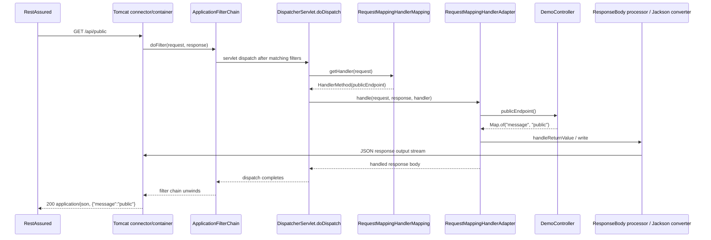
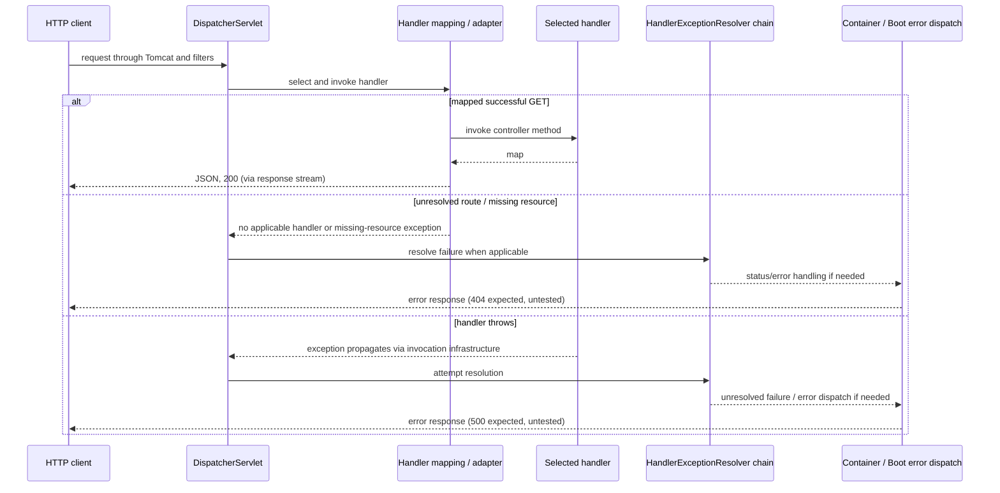

# P1.S1 — Bootstrap and three plain MVC endpoints

> Final P5.S2 audit: this document retains its original checkpoint counts/source references. Current code is indexed in [COMPLETE-GUIDE](COMPLETE-GUIDE.md#current-application-source-audit); [final clean verification](P5.S2-WALKTHROUGH.md) passed on Java21.0.8, closing earlier runtime-gap statements. Later bean moves, filter order and trace-handler changes are summarized there.

> P2.S1 update: security libraries are now present, but explicit `none` mode has no security proxy/chain registration. The application excludes default security auto-configuration; tracing now precedes the security proxy. P1 test annotations add an explicit none property, shifting subsequent test-source line references by one. Dependency-absence claims and previous registration order below describe the P1 checkpoint; see [current implementation](P2.S1-WALKTHROUGH.md).

> Historical checkpoint: this walkthrough records P1.S1's implementation and executed evidence. Source references describe that checkpoint; S1 controller references predate S2's instrumentation. The production source is unchanged from S2 in S3. Error paths previously described as future work are now tested in [P1.S3](P1.S3-WALKTHROUGH.md), which supersedes those status statements.

## Learning objectives, prerequisites, and boundaries

Start with Java basics (classes, static methods, annotations, generic maps), Maven's lifecycle, and HTTP requests/responses. This is the first executable step: the previous repository was documentation only. Learn how Boot creates an application context and Tomcat, how MVC discovers a controller, and how an ordinary Java return value becomes JSON over a socket.

Only P1.S1 is implemented. No application filter, interceptor, event sink, error endpoint, authentication, or runtime mode selector exists. P1.S2 will instrument successful requests; P1.S3 will test unmapped URLs and controller exceptions. The baseline corresponds to the planned `none` behavior, but no `security.mode` property is implemented yet. Names `user` and `admin` describe future policies; today they have no access restrictions.

## Build configuration, line by line

References use repository-relative paths and the implemented line numbers.

| `pom.xml` lines | Meaning |
|---|---|
| 1–4 | UTF-8 XML, Maven namespace/schema, and Maven model version 4.0.0. This model version is unrelated to the Maven executable version. |
| 5–10 | Boot parent pinned to 3.5.7 supplies compatible dependency and plugin management. Empty `relativePath` prevents Maven from choosing an unrelated parent POM from the filesystem. |
| 11–14 | Coordinates remain `com.example:jwt-auth:0.0.1-SNAPSHOT`; the human-readable project name is `spring-security-learning`. Default packaging is jar. |
| 15–17 | Java 21 is the compilation target. The parent connects this property to compiler `release`; a newer JDK may build it, but that does not prove execution on JDK 21. |
| 18–22 | Web starter adds Spring MVC, embedded Tomcat, Jackson JSON support, and Boot infrastructure. It does not bring Spring Security. |
| 23–27 | Test starter, test scope only, supplies JUnit Jupiter, Spring's test support, Hamcrest, and other test utilities. Test scope excludes these from the executable runtime jar. |
| 28–32 | RestAssured is test scoped; Boot manages its version. It sends actual HTTP requests rather than invoking controllers directly. |
| 34–39 | Boot Maven plugin inherits the parent's repackage execution, creating an executable jar containing application classes and runtime dependencies. |
| 40–46 | Surefire runs `*Test.java` in the `test` phase. No unit tests are needed for three constant-returning methods, so this step has none. |
| 47–60 | Failsafe selects `*IT.java`; `integration-test` executes the tests after packaging, and `verify` checks their result. Running only `mvn test` does not exercise this suite. |
| 61–64 | Close the plugin list, build configuration, and Maven project. |

Dependency and plugin versions are inherited, not independently guessed. The verified run uses Surefire/Failsafe 3.5.4, Spring Boot 3.5.7, and Tomcat 10.1.48. `.gitignore:1` excludes generated `/target/`; test reports can be regenerated rather than committed.

## Entry point: `src/main/java/com/example/securitylearning/SecurityLearningApplication.java`

| Lines | Explanation |
|---|---|
| 1 | Root package. Placing the application here makes `com.example.securitylearning.api` a descendant in the default component scan. |
| 3–4 | Import Boot's launcher and its configuration annotation. Imports name types; they do not instantiate beans. |
| 6 | `@SpringBootApplication` combines Boot configuration, auto-configuration enablement, and component scanning. Auto-configuration uses classpath/bean/property conditions; it is not unconditional creation of every framework component. |
| 7 | Public application configuration class. It has no custom collaborators, interfaces, fields, or explicit constructor. Spring manages it as configuration. |
| 9 | Standard JVM `public static void main(String[] args)` entry point. `static` permits invocation without an application instance, and `void` returns no application value. Arguments can supply Boot options such as `--server.port=8081`. |
| 10 | `SpringApplication.run(SecurityLearningApplication.class, args)` identifies the primary configuration, prepares the environment, creates and refreshes the servlet web application context, and starts the web server. It returns a `ConfigurableApplicationContext`; this program does not retain it. |
| 11–12 | End method/class. No application catch block: bootstrap failure propagates and prevents a usable server from starting. |

The web starter makes this a servlet application. Boot's embedded Tomcat factory and servlet web application context cooperate to initialize Tomcat. MVC auto-configuration supplies a `DispatcherServlet`, its registration (default `/` mapping), handler mappings/adapters, and message converters. The controller is discovered by scanning; it is not constructed by `main` or on every request. Boot's test bootstrap uses this configuration directly, without needing to call the `main` method.

## Controller: `src/main/java/com/example/securitylearning/api/DemoController.java`

| Lines | Explanation |
|---|---|
| 1 | Subpackage lies beneath the application's scan root. Moving it outside without changing scanning would stop default discovery. |
| 3 | `java.util.Map` represents a simple response object; there is no separate DTO or service for constant data. |
| 5–7 | Import MVC annotations: GET-only method mappings, shared path mapping, and REST controller semantics. |
| 9 | `@RestController` combines `@Controller` (a component stereotype) with `@ResponseBody`. Spring creates a singleton bean; MVC treats method results as response bodies rather than view names. |
| 10 | Class-level `@RequestMapping("/api")` prefixes each method's path. This is MVC routing metadata, not a servlet registration or authorization rule. |
| 11 | Public class, implicit no-argument constructor. No injected dependencies, mutable state, explicit interfaces, or exception handlers. |
| 13–16 | `@GetMapping("/public")` narrows routing to GET `/api/public`. `publicEndpoint()` takes no arguments and returns a `Map<String,String>`. `Map.of("message", "public")` constructs an immutable one-entry map; it is not JSON text yet. |
| 18–21 | The same structure maps GET `/api/user` to `userEndpoint()`, returning `{"message":"user"}` after conversion. No principal is required or examined. |
| 23–26 | GET `/api/admin` calls `adminEndpoint()` and returns `{"message":"admin"}` after conversion. The method name grants no special rights. |
| 27 | Class ends. All state is method local, so concurrent requests share no mutable response data. |

No explicit status annotation is required: successful processing retains HTTP 200. Jackson's HTTP message converter writes the map as JSON and sets the response content type. JSON object key order is not a contract; tests compare parsed objects. There is no hand-built JSON, `ResponseEntity`, repository, or service layer because none adds value to this step.

## Successful request lifecycle: code to framework

The framework classes below are supplied by resolved dependencies, not project source. This is the synchronous success path; the integration tests observe its final HTTP behavior, not every internal call.

1. RestAssured opens an HTTP connection to `localhost:<port>` (`PlainMvcIT:35–39`). Tomcat's connector accepts it, parses HTTP, creates servlet request/response objects, and dispatches through its container pipeline on a worker thread.
2. Tomcat's `ApplicationFilterChain.doFilter` invokes matching servlet filters and ultimately the servlet. Plain MVC still has a servlet filter chain. Boot normally registers infrastructure such as `CharacterEncodingFilter`, `FormContentFilter`, and `RequestContextFilter`; P1.S1 neither instruments their registration/order nor claims an observed exact filter order. Their `chain.doFilter` calls delegate inward, with cleanup unwinding afterward.
3. No Spring Security dependency means no Spring Security `FilterChainProxy`, bearer filter, or Basic authentication processing. This is stronger evidence than a successful anonymous response; `permitAll()` could also return 200 while security remained active.
4. The servlet registration routes this application request to `DispatcherServlet`. Its inherited `FrameworkServlet` request processing reaches `DispatcherServlet.doService` and `doDispatch`.
5. `DispatcherServlet.getHandler` consults handler mappings. `RequestMappingHandlerMapping` has registered the controller's combined `/api` + method mappings at startup. It selects a `HandlerMethod` representing `DemoController.publicEndpoint` for this GET.
6. `getHandlerAdapter` selects `RequestMappingHandlerAdapter`; its invocation infrastructure (`ServletInvocableHandlerMethod`) calls the controller bean. No request arguments need resolving here. The controller returns a map at line 15.
7. Because of `@ResponseBody`, `RequestResponseBodyMethodProcessor` handles the return value. Content negotiation and configured converters select `MappingJackson2HttpMessageConverter` for the JSON response. Jackson serializes the map into the response output stream. No template/view is rendered.
8. MVC completes processing; servlet filter calls unwind. Tomcat commits/writes HTTP headers and body as needed and completes the response. Writing/commit may occur during conversion; do not infer that all bytes wait for filter exit. RestAssured parses JSON and performs the assertions at test lines 41–43.



The same flow reaches `userEndpoint:19–20` or `adminEndpoint:24–25`. This diagram intentionally has no project trace filter or security chain.

## Failure branches: explanatory, not tested in S1

Do not mistake these framework expectations for test evidence. Unmapped-URL and thrown-controller-exception cases belong to P1.S3. Existing default static-resource handling can participate in unmatched routes, so a 404 is not necessarily a direct `DispatcherServlet` no-handler branch.



Resolvers may handle an exception inside MVC; otherwise it propagates toward the container and Boot's `/error` handling may run via an ERROR dispatch. Once output is committed, replacing status/body is constrained. No current controller intentionally throws, and no application exception handler is implemented. Unsupported methods and unacceptable media types are also outside S1's executed assertions. These are not authentication failures; there are no configured 401/403 policies.

## Actual verification and runtime evidence

Executed 2026-10-31 with Maven 3.9.12, Oracle JDK 24, and compiler release 21. Only JDK 24 was found by `/usr/libexec/java_home -V`; runtime compatibility on JDK 21 has not been executed. The first sandboxed `mvn verify` stopped at a denied Maven-cache write before compilation. The approved retry of the same command succeeded:

```text
Tests run: 3, Failures: 0, Errors: 0, Skipped: 0
--- failsafe:3.5.4:verify (default) @ jwt-auth ---
BUILD SUCCESS
Total time: 5.661 s
```

Report: `target/failsafe-reports/com.example.securitylearning.PlainMvcIT.txt`; individual test results and captured console output: `target/failsafe-reports/TEST-com.example.securitylearning.PlainMvcIT.xml`. These generated files are not source-controlled. Surefire had no unit tests to run; all three tests ran under Failsafe. The test starter emitted Mockito dynamic-agent warnings on JDK 24; they did not fail this run.

Actual chronological log excerpts from that passing run (logger prefixes shortened, messages retained):

```text
2026-10-31T16:56:48.092+02:00 [main] Tomcat initialized with port 0 (http)
2026-10-31T16:56:48.100+02:00 [main] Starting Servlet engine: [Apache Tomcat/10.1.48]
2026-10-31T16:56:48.365+02:00 [main] Tomcat started on port 49813 (http) with context path '/'
2026-10-31T16:56:49.089+02:00 [o-auto-1-exec-1] Initializing Spring DispatcherServlet 'dispatcherServlet'
2026-10-31T16:56:49.090+02:00 [o-auto-1-exec-1] Completed initialization in 0 ms
```

This proves actual server startup and lazy servlet initialization during the test run. **Correlation ID: unavailable in S1.** These are startup/initialization logs, not a correlated controller/filter trace; no request path or test identity can reliably be assigned to the first dispatch from these lines. Adding correlation IDs and an ordered event sink here would implement S2 prematurely. No trace events have been invented to fill that gap.

Resolved dependency evidence: `mvn dependency:tree -DoutputFile=target/dependency-tree.txt` and inspection of that tree establish the absence of `org.springframework.security` artifacts; the executable jar's `BOOT-INF/lib` also contains no `spring-security` jars. Successful anonymous HTTP alone is not the absence proof.

## Security comparison and later learning

This first baseline has servlet/MVC infrastructure but no security authentication or authorization step. There is no `AuthenticationManager`, provider, `UserDetailsService`, `PasswordEncoder`, `SecurityContext`, security entry point, or access-denied handler to explain as implemented beans. Basic will add those concepts later; the controller routing and JSON conversion can remain the same. A `permitAll` security chain would still execute security infrastructure and is not this baseline.

JWT header/claims/signature processing, issuer/audience/time validation, authentication conversion, and authorization are all future work. Spring Security's OAuth2 Resource Server can validate bearer JWTs without an OAuth2 Authorization Server or grant flow. Nimbus verification alone does not install an authenticated `SecurityContext`; Spring Security does that through its authentication pipeline. Later RS256 keys must separate private signing from public verification; Base64URL claims are readable, not encrypted, and must contain no secrets. None of these future classes/dependencies is added now.

## Review questions and safe exercises

1. Why does moving `DemoController` outside the scan root change discovery? Because the default scan starts at the application's package, not every package on the classpath.
2. Why does returning a map produce JSON instead of a view? `@RestController` supplies response-body semantics, and MVC's return-value processor selects a JSON message converter.
3. Does a 200 from `/api/admin` prove no security filter exists? No. Inspect dependencies/registration; `permitAll` could also produce 200.
4. Why is `mvn test` insufficient? Failsafe's IT execution is bound to later lifecycle phases; run `mvn verify`.
5. Does a passing JDK 24 build prove execution on Java 21? No. Release 21 constrains compilation; run on JDK 21 to validate that runtime separately.

Exercises on a temporary local edit (revert afterward; do not expand the committed scope):

- Change only the public response value to `hello`, then run `mvn verify`. Expect exactly the public test's body assertion to fail. Update that expectation temporarily and expect all three to pass; restore both changes afterward.
- Change the class path prefix to `/demo` while leaving tests unchanged. Expect the existing `/api/*` requests to fail their 200 assertions. Update all three test paths temporarily to `/demo/*` to restore success; then revert. This shows that controller routing is separate from Tomcat's chosen TCP port.

Checkpoint handoff was P1.S2, which is now complete. For the current next step, follow [the master roadmap](../../ROADMAP.md).
