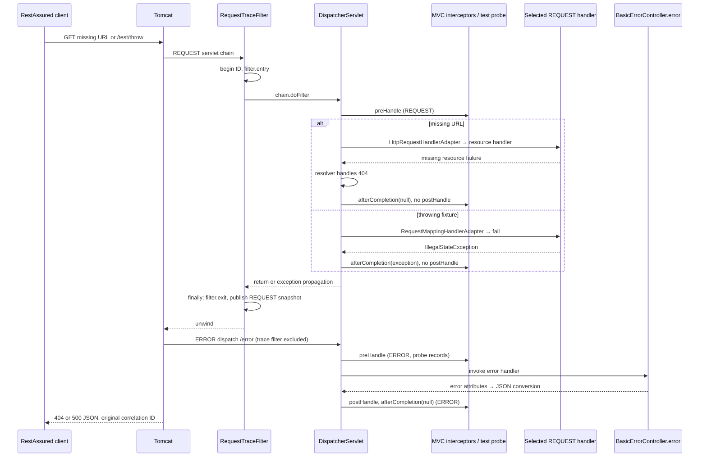

# P1.S3 — Error paths, exception resolution, and ERROR dispatch

> J2.S3 consolidates diagnostic/error/request-trace evidence, adds actual overlapping-worker synchronization and changes test helper/source ranges. Historical records below are superseded by [J2.S3](J2.S3-WALKTHROUGH.md) for current case ownership and lifecycle assertions.

> J1.S2 transition: none/basic implementations and mode-selection/comparison suites are now retired. MVC/error/trace tests use JWT; PlainMvcIT is replaced by JwtMvcIT. This document retains its checkpoint source/count evidence; [J1.S2](J1.S2-WALKTHROUGH.md) records current wiring, tests and behavior.

> Final P5.S2 audit: this document retains its original checkpoint counts/source references. Current code is indexed in [COMPLETE-GUIDE](COMPLETE-GUIDE.md#current-application-source-audit); [final clean verification](P5.S2-WALKTHROUGH.md) passed on Java21.0.8, closing earlier runtime-gap statements. Later bean moves, filter order and trace-handler changes are summarized there.

> P2.S1 update: security libraries are now present, but explicit `none` mode has no security proxy/chain registration. The application excludes default security auto-configuration; tracing now precedes the security proxy. P1 test annotations add an explicit none property, shifting subsequent test-source line references by one. Dependency-absence claims and previous registration order below describe the P1 checkpoint; see [current implementation](P2.S1-WALKTHROUGH.md).

## Objectives, prerequisites, and boundaries

Read [P1.S1](P1.S1-WALKTHROUGH.md) for bootstrapping/routing/JSON and [P1.S2](P1.S2-WALKTHROUGH.md) for nested filter/interceptor callbacks. This final P1 step tests an unmapped URL and an uncaught controller exception over actual embedded Tomcat HTTP. Learn why an error can have a selected handler, why `postHandle` can be absent, and why `afterCompletion` receiving null does not prove that nothing failed.

Only `src/test/java/com/example/securitylearning/ErrorPathIT.java` adds executable code. The intentionally failing controller and dispatch observer are test fixtures. No production endpoint, exception advice, security dependency, or custom error controller is added. The three existing endpoints and production tracing classes remain unchanged. Spring Security authentication/authorization, Basic, and JWT remain future phases; there is no `FilterChainProxy`, authentication manager, provider, or security context in P1.

## Two observation boundaries

The production `TraceEventSink` retains one synchronous **REQUEST dispatch** per correlation ID. `RequestTraceFilter` is registered for REQUEST only; its finally block publishes before a later container ERROR dispatch. `MvcTraceInterceptor` deliberately ignores ERROR callbacks. Consequently its snapshot is not a complete timeline of the HTTP exchange.

The test-only `DispatchProbe` observes MVC callbacks on both REQUEST and ERROR dispatches. It uses the existing response correlation header as its key and records dispatch type, handler name, callback, and exception class only. A pair of traces therefore explains both the application hooks and the subsequent error-handler execution. The two lists preserve their own append order; their printed order does not interleave every event across both observers. We do not add timestamps or claim a complete Tomcat filter trace.

## Source commentary: `src/test/java/com/example/securitylearning/ErrorPathIT.java`

Paths and line numbers refer to the final implementation of this step. Package declaration at line 1 keeps the suite under the application's test root. Closing braces end the surrounding methods/classes; blank lines have no runtime behavior.

| Lines | Explanation |
|---|---|
| 3–5 | `List` expresses expected sequences. `ConcurrentHashMap` and `CopyOnWriteArrayList` permit safe publication/reading across Tomcat and test threads. The probe's event volume is tiny, so copy-on-write append cost is acceptable. |
| 7–11 | Import the application sink, RestAssured content/response types, and Jakarta request/response interfaces. Capturing a `Response` allows checking HTTP output and then looking up correlated events. |
| 12–20 | JUnit tests/cleanup, Spring field injection, RANDOM_PORT bootstrapping, test-only component/configuration markers, port injection, and explicit bean/import registration. |
| 21–27 | MVC routing/controller annotations, `HandlerMethod` metadata, interceptor callbacks, optional view-model type, and MVC registration interfaces. |
| 29–32 | Static imports provide HTTP requests, AssertJ collection/string assertions, Awaitility retries, and Hamcrest response assertions. |
| 34–36 | `@SpringBootTest(RANDOM_PORT)` starts the real application and Tomcat. `@Import` explicitly adds this suite's fixture configuration, making its context configuration different from normal endpoint suites. JUnit supports the package-private test class. |
| 38–45 | Inject actual listening port, production sink, and test observer. The test reads the same sink instance the server uses rather than creating a substitute. |
| 47–50 | `@AfterEach` clears all probe entries after each test. Its history is test-owned and discarded; the production sink remains independently bounded to 128 completed traces. Tests use JUnit's default sequential execution. |
| 52–63 | `unmappedUrlReturns404ThroughResourceHandlerAndErrorDispatch` sends GET `/api/not-mapped`, checks its HTTP error contract, and asserts both exact ordered lists. No demo-controller event or REQUEST `postHandle` is allowed. |
| 65–75 | `controllerExceptionReturns500AndNextRequestHasFreshTrace` requests the failing fixture, checks 500, and asserts controller entry, skipped REQUEST post-processing, exception-bearing completion, and ERROR controller callbacks. |
| 77–87 | The same test then requests `/api/public`, asserts 200/JSON/message, requires a different ID, and checks a complete success sequence with no ERROR dispatch or previous failure events. This demonstrates fresh request tracing, not guaranteed reuse of the same Tomcat worker thread. |
| 89–92 | Private HTTP helper targets localhost and the injected port, explicitly accepts JSON, then performs the GET. This is a socket exchange, not MockMvc or direct method invocation. |
| 94–99 | Private error assertion checks status, JSON media type, body status/error/original path, and absence of exception/stack-trace/message fields under the default Boot configuration. It intentionally does not compare the dynamic timestamp or claim this is a globally customized error schema. |
| 101–110 | Extract the response correlation ID, reject blank IDs, and await both completed event sequences. Exact equality detects missing/extra/reordered events. Retry is necessary because response output can reach the client before all completion callbacks finish. Print only the verified ID and fixed, sanitized event data. |
| 112–124 | Nested static `ErrorTestConfiguration` supplements the main application. `proxyBeanMethods=false` avoids unnecessary configuration proxies. The two `@Bean` factories create the failing controller with the injected sink and a separate observer. They do not replace MVC auto-configuration. |
| 126–134 | `@TestComponent` prevents ordinary Boot test scanning from automatically discovering the fixture; explicit configuration creates it here. `@RestController` gives the bean MVC handler/response-body semantics. Its constructor retains the production sink. The source lives under `src/test`, so the fixture is excluded from the executable application jar. |
| 136–140 | GET `/test/throw` is a test-only mapped method. MVC resolves its request parameter. The method records `controller.throw`, then throws a deliberate `IllegalStateException`. Its `void` signature returns no response object; the throw prevents normal completion. No exception is caught or converted locally. |
| 143–151 | `DispatchProbe` implements both `WebMvcConfigurer` and `HandlerInterceptor`. One instance holds a thread-safe map and registers itself through `addInterceptors`; it needs no additional component annotation or servlet filter registration. |
| 153–157 | `preHandle` records selected-handler metadata and returns true, preserving normal processing. The probe does not decide status or access. |
| 159–163 | `postHandle` records successful handler-adapter completion, including the ERROR controller's successful JSON generation. The optional model parameter is unused. |
| 165–170 | `afterCompletion` records the exception's simple class name or `none`. It never records exception messages, stack traces, request headers, or credentials. A null exception is a callback observation, not a claim that no exception occurred earlier. |
| 172–180 | Private recorder distinguishes annotated methods (`BeanType#method`) from handlers such as `ResourceHttpRequestHandler`. It obtains the existing response ID, creates the per-ID list atomically, then appends dispatch/handler/callback data. A missing ID would violate this fixture's initial-REQUEST-through-filter invariant; the probe does not generate a replacement ID that would hide the error. |

## Exact request and error lifecycles

### Missing URL: HTTP 404

Tomcat accepts GET `/api/not-mapped` and enters servlet filters. The production tracing filter creates the ID and records entry. `DispatcherServlet` finds no annotated controller for that path, but default static-resource mapping selects `ResourceHttpRequestHandler`. Its MVC interceptor pre-handlers execute. `HttpRequestHandlerAdapter` invokes resource handling; lookup fails. The default resolver turns the missing-resource failure into a 404 error response. `postHandle` is skipped; the completion callback receives null after resolution. Production filter cleanup records exit and publishes the REQUEST snapshot.

Tomcat then dispatches the error to `/error` with dispatcher type ERROR. MVC selects `BasicErrorController#error`; the test probe sees preHandle, postHandle, and afterCompletion. Boot's error attributes retain the original path. JSON conversion writes the 404 body. The production trace filter and its guarded interceptor do not append ERROR events.

Framework explanation is supported by [DefaultHandlerExceptionResolver, Spring 6.2.12](https://github.com/spring-projects/spring-framework/blob/v6.2.12/spring-webmvc/src/main/java/org/springframework/web/servlet/mvc/support/DefaultHandlerExceptionResolver.java): it maps missing-resource errors to 404. The probe directly observes the selected handler and callback data; it does not directly log the resolver invocation or exception creation.

### Uncaught controller exception: HTTP 500

GET `/test/throw` follows the same initial Tomcat/filter/dispatcher path, but `RequestMappingHandlerMapping` selects the fixture's `fail` method. `RequestMappingHandlerAdapter` invokes it. The controller records entry then throws. No normal return-value conversion or REQUEST `postHandle` occurs. With no application exception advice handling this failure, REQUEST completion observes `IllegalStateException`; the exception propagates out, while the filter finally block still publishes its partial trace.

The container error dispatch reaches Boot's `/error` controller, which generates the 500 JSON response. Its own processing succeeds: ERROR postHandle runs and ERROR completion reports no exception. This distinction separates the original failure from successful rendering of its error response.

[DispatcherServlet's version-matched source](https://github.com/spring-projects/spring-framework/blob/v6.2.12/spring-webmvc/src/main/java/org/springframework/web/servlet/DispatcherServlet.java) explains exception-resolution and completion branching. The actual two dispatches and their callback exception values are established by the test probe. Neither trace measures the servlet exception wrapper nor all internal resolver calls.



The final arrow represents response completion, not the first transmitted byte. `BasicErrorController` is Boot infrastructure, not Spring Security HTTP Basic authentication. No login or authentication policy is involved.

## Test-to-code map and observed differences

| Executed method | Request and expected response | Reached code / assertions |
|---|---|---|
| `unmappedUrlReturns404ThroughResourceHandlerAndErrorDispatch` | GET `/api/not-mapped`; 404 JSON; status 404, error `Not Found`, original path | Resource handler REQUEST; Boot ERROR handler; exact event lists; no demo-controller event, no REQUEST postHandle; no response message/exception/trace fields |
| `controllerExceptionReturns500AndNextRequestHasFreshTrace` | GET `/test/throw`; 500 JSON, `Internal Server Error`, original path; then GET `/api/public`, 200 JSON `message=public` | Fixture `fail:137–139`; exception class on REQUEST completion; Boot ERROR handler; different ID and normal six-event public trace afterward |

The remaining P1 suite still exercises all three successful endpoints, concurrent request isolation, trace retention/cleanup, and immutable snapshots. Trace examples below come from passing tests, not manually constructed expected lists. Security decision for all P1 requests: none configured. A 404/500 is routing/application error behavior, not a 401/403 authentication/authorization result.

## Actual verification and traces

Executed `mvn verify` on 2026-10-31 with Maven 3.9.12, JDK 24 compiling with release 21, Boot 3.5.7, Spring Framework 6.2.12, and Tomcat 10.1.48. JDK 21 execution remains unverified. The final run passed after isolating the fixture with `@TestComponent` and adding ERROR postHandle observation. The deliberate server exception produces an expected Tomcat error log; it is not a test failure. Mockito dynamic-agent warnings also remain non-failing.

| Runner / suite | Cases | Failures / errors / skipped |
|---|---:|---|
| Surefire / `TraceEventSinkTest` | 2 | 0 / 0 / 0 |
| Failsafe / `RequestTraceIT` | 4 | 0 / 0 / 0 |
| Failsafe / `PlainMvcIT` | 3 | 0 / 0 / 0 |
| Failsafe / `ErrorPathIT` | 2 | 0 / 0 / 0 |

Total: 11 cases, including 9 integration cases; `BUILD SUCCESS`, 6.139 seconds. Generated reports: `target/surefire-reports/` and `target/failsafe-reports/`. Full executed names are in the report XMLs and the test matrix. Artifact inspection confirms no test fixture or Spring Security libraries in the packaged application.

Actual correlated output from the final passing run:

```text
ERROR-PATH TRACE 1fa64097-1058-4cdc-aa24-164d2271806a [filter.entry, interceptor.preHandle, interceptor.afterCompletion, filter.exit]
DISPATCH TRACE 1fa64097-1058-4cdc-aa24-164d2271806a [REQUEST:ResourceHttpRequestHandler:preHandle, REQUEST:ResourceHttpRequestHandler:afterCompletion:none, ERROR:BasicErrorController#error:preHandle, ERROR:BasicErrorController#error:postHandle, ERROR:BasicErrorController#error:afterCompletion:none]
ERROR-PATH TRACE 25246475-8570-4f09-b970-b01604525c5d [filter.entry, interceptor.preHandle, controller.throw, interceptor.afterCompletion, filter.exit]
DISPATCH TRACE 25246475-8570-4f09-b970-b01604525c5d [REQUEST:ThrowingController#fail:preHandle, REQUEST:ThrowingController#fail:afterCompletion:IllegalStateException, ERROR:BasicErrorController#error:preHandle, ERROR:BasicErrorController#error:postHandle, ERROR:BasicErrorController#error:afterCompletion:none]
ERROR-PATH TRACE b8ab612d-91f7-4e8d-b134-7150c5e30131 [filter.entry, interceptor.preHandle, controller.public, interceptor.postHandle, interceptor.afterCompletion, filter.exit]
DISPATCH TRACE b8ab612d-91f7-4e8d-b134-7150c5e30131 [REQUEST:DemoController#publicEndpoint:preHandle, REQUEST:DemoController#publicEndpoint:postHandle, REQUEST:DemoController#publicEndpoint:afterCompletion:none]
```

Trace-to-code references: production filter entry/exit remain `RequestTraceFilter:24/28`; REQUEST interceptor pre/post/completion remain `MvcTraceInterceptor:19/26/32`; failure controller event is `ErrorPathIT:138`. Probe pre/post/completion events originate at `ErrorPathIT:155/162/168–169`; the common formatter and correlation lookup are at lines 172–179. The lack of a REQUEST postHandle event is asserted through exact-list comparison, not inferred from a missing console log.

## Comparison, limitations, and review

Successful processing remains identical to S2. Errors retain finally cleanup but skip normal REQUEST postHandle; resolved 404 and unresolved 500 differ in the REQUEST completion exception value. Both tested errors have an additional successful ERROR dispatch. These conclusions apply to this pinned configuration: resource mappings, exception resolvers, error attributes, and custom advice can change the path. Async behavior remains explanatory only; active request lists are not an async lifecycle observer. Test-probe state is cleared after each sequential test, whereas production snapshots use bounded retention.

Security-specific JWT/password concepts remain planned, as explained in the [combined guide](../FLOWS-COMPARED.md). Resource Server integration will not introduce an OAuth2 grant flow; none is implemented here. No credentials or tokens are involved in these traces.

Review questions:

1. Why does an unmapped API URL still execute interceptor callbacks? A default resource mapping selects a resource handler even though no demo controller matches.
2. Why does 404 completion report `none` while 500 reports `IllegalStateException`? MVC resolves the resource failure, whereas the fixture exception remains unresolved during REQUEST processing.
3. Why does ERROR postHandle run after REQUEST postHandle was skipped? The error controller is a separate handler invocation that successfully produces the error response.
4. Does `filter.exit` mean the full HTTP error exchange has finished? No; it closes the initial traced dispatch, before the later ERROR handling observed here.
5. Why is there no failing production endpoint? The fixture is explicitly imported test infrastructure and omitted from the application jar.

Safe exercises, reverting local edits afterward:

- Change only the fixture exception to `IllegalArgumentException`, then run verification. Expect the response still to be 500, but the completion-class assertion to fail. Update that expectation temporarily to see it pass, then restore both edits.
- Temporarily set `spring.web.resources.add-mappings=false` for this test context. Expect the missing-URL handler/callback sequence assertions to change; observe and explain the new route instead of assuming the resource-handler path is universal. Restore the setting afterward.

P1 is complete. The checkpoint handoff was P2.S1, now implemented in its [own walkthrough](P2.S1-WALKTHROUGH.md). No P2 behavior was implemented during this P1 step.
