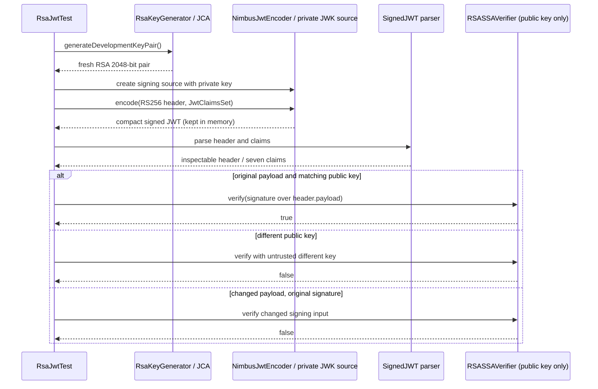

# P3.S1 — RSA key material and signed JWT anatomy

## Objectives, prerequisites, and scope

Read [P2.S3](P2.S3-WALKTHROUGH.md) first for the completed none/basic request paths. This step introduces the cryptographic foundation before JWT HTTP authentication. Learn the distinction between an RSA key pair, a JSON Web Key representation, signed JWT contents, and signature verification. No runtime JWT mode, decoder configuration, login issuer endpoint, or bearer authentication filter is implemented.

The new main-source `RsaKeyGenerator` has no Spring annotation or startup hook. Tests alone call it and hold freshly generated keys in memory. There are no key files, PEM parsers, key-loading beans, or private-key resources. This uses the roadmap's test-generated-key option rather than prematurely wiring a production issuer. The existing `app.security-mode` continues accepting none/basic and rejecting jwt.

The four new crypto tests are Surefire unit tests; all 27 real Tomcat HTTP cases still run under Failsafe. Unit signing tests supplement those regressions and do not claim to prove JWT HTTP acceptance. New JWT-mode integration tests belong to P3.S2.

## Changes and dependency boundary

`pom.xml` adds `spring-security-oauth2-jose` with **test scope**. The Boot parent manages version 6.5.6; its test classpath resolves Nimbus JOSE + JWT 9.37.4. `JwtClaimsSet`, `JwsHeader`, `NimbusJwtEncoder`, and Nimbus verifier types are needed only in S1 tests. They are not included as runtime JWT support in the executable jar. P3.S2 must replace this test-only dependency arrangement with the Resource Server starter and runtime JOSE support; leaving an explicit test-scoped declaration could shadow the starter's transitive runtime dependency.

`.gitignore:55–56` reserves `/.local-keys/` before any possible future local key export. `git check-ignore -v .local-keys/private.pem` confirms that path is ignored. S1 writes no key file at all; ignore rules do not encrypt keys or guarantee safe handling of arbitrary other paths. The test encoder's JWK stays in memory and is never serialized into repository artifacts.

## Application source: `src/main/java/com/example/securitylearning/security/RsaKeyGenerator.java`

| Lines | Explanation |
|---|---|
| 1 | Package identifies the small security foundation utility beneath the application root. It is not a component stereotype. |
| 3–5 | JCA imports: KeyPair is the result, KeyPairGenerator creates matching RSA keys, and NoSuchAlgorithmException represents an unavailable algorithm/provider. |
| 7–10 | Final utility class with a private constructor: no instances or subclass extension are needed. There is no injected collaborator, shared key field, or implicit Spring bean. |
| 12–16 | Static `generateDevelopmentKeyPair()` returns a fresh KeyPair on each call. `getInstance("RSA")` selects JCA RSA generation; `initialize(2048)` sets modulus size. The JCA provider supplies its default secure randomness; no predictable seed is used. `generateKeyPair()` performs generation rather than loading a committed key. |
| 17–19 | Convert the checked unavailable-algorithm failure into IllegalStateException with a fixed non-secret message and original cause. Never fall back to an insecure algorithm or log key values. No test forces removal of the JVM's RSA implementation; this failure branch is explanatory, not executed evidence. |

The KeyPair contains both private and public parts. Only the test issuer receives the private part; verification helpers take `RSAPublicKey`, not a KeyPair/private key. Regeneration changes the trust relationship: a different public key cannot verify the earlier signature. Memory-only key handling avoids filesystem persistence but does not promise secure JVM memory zeroization or durable key management.

## Test source: `src/test/java/com/example/securitylearning/security/RsaJwtTest.java`

| Lines | Explanation |
|---|---|
| 1, 3–7 | Test package matches the utility. Import key-pair and RSA-specific interfaces, deterministic Instant values, and immutable role/audience lists. |
| 9–16 | Nimbus imports provide verification exceptions/algorithms, an RSA verifier, JWK containers/source, Base64URL encoding, and parsing of a signed JWT. They are framework/library operations, not a hand-written signing algorithm. |
| 17–25 | JUnit lifecycle/test annotations; Spring Security signature/header/claims/encoder types; static AssertJ assertions. |
| 27–31 | Package-private JUnit class stores a fixed issuance instant, one generated test KeyPair, and the test-only encoder. Static fields belong to this test class, not the running application's bean graph. |
| 33–39 | BeforeAll creates an ephemeral key pair, builds a private signing JWK from its public/private parts plus `local-test-key` ID, wraps it in a JWKSet and ImmutableJWKSet source, and constructs NimbusJwtEncoder. The “immutable source” name does not mean its contents are safe to publish: this signing source includes a private key. |
| 41–46 | Key test asserts minimum modulus size and that public/private modulus values match; output prints only bit length. Matching modulus is checked alongside real sign/verify in the next test, not treated as the only proof of a usable pair. |
| 48–55 | Issue a compact token, require three dot-separated parts, parse it, and assert emitted RS256 algorithm, JWT type, and key ID. The segment-count assertion operates on an integer so it does not print the complete token. Parsing a header does not establish that it is trusted. |
| 56–65 | Inspect subject, issuer, audience, roles, issuance, not-before, and expiration. Require exactly those seven claim names. This demonstrates serialization and safe payload contents; it does not run issuer/audience/time validators. Date conversions back to Instant show NumericDate round-tripping. |
| 66–68 | Verify using only the public key, then print fixed metadata and boolean outcome. Neither token nor key encoding is printed. |
| 70–75 | Generate a different pair, pass only its public key to verification, and assert false. This checks the signing/verification key relationship, not an HTTP 401 policy. |
| 77–83 | Preserve the original protected header/signature but replace the payload with a valid Base64URL-encoded JSON object. Parsing still works; public-key verification returns false because the signed bytes changed. No claim validator is needed to detect this integrity failure. |
| 85–91 | Private test issuer constructs explicit RS256/JWT/kid header, subject and issuer, audience and roles lists, fixed iat/nbf, and exp 300 seconds later. Pass JwtEncoderParameters to NimbusJwtEncoder; extract compact token only for in-memory tests. No endpoint or reusable production login service is introduced. |
| 93–95 | Narrow the generated public key to RSAPublicKey for Nimbus verification. Only the public half leaves this accessor. |
| 97–99 | Verification helper receives a parsed SignedJWT and an explicitly supplied public key. RSASSAVerifier performs cryptographic verification; JOSEException is allowed to fail the test if library processing fails unexpectedly. A boolean false is asserted for expected wrong-key/tampering cases. |

Each test may throw checked parsing/JOSE exceptions to JUnit rather than swallowing them. The direct verifier is not a production decoder policy: it does not implement the planned RS256 allowlist plus issuer/audience/time/required-claim checks. S1 asserts that its issuer emits RS256; negative algorithm-policy tests remain P4 work.

## JWT, JWS, RS256, and JWK explained

JWT is the claims representation. Here it is carried inside JWS compact serialization: protected header, payload, and signature, separated by dots. Header/payload use Base64URL and are readable. The signature protects integrity/authenticity relative to a trusted key; it does not encrypt claims. Changing readable payload bytes invalidates the signature rather than hiding them.

RS256 is RSA signature generation with SHA-256 and PKCS#1 v1.5 padding; “256” describes the hash choice, not the RSA key length. This project uses a 2048-bit modulus. See [RFC 7518, section 3.3](https://www.rfc-editor.org/rfc/rfc7518.html#section-3.3) for the algorithm definition. A public key can verify but cannot create the signing operation that requires the private key.

A JWK is a structured key representation. The test RSA JWK includes private signing material and public parameters. `kid` is merely a selection identifier for the one local signing key, not a trust assertion or network address. There is no JWKS HTTP endpoint, rotation service, external identity provider, or discovery request.

[NimbusJwtEncoder's 6.5.6 contract](https://docs.spring.io/spring-security/site/docs/6.5.6/api/org/springframework/security/oauth2/jwt/NimbusJwtEncoder.html) explains its JWK source and signed compact output. The encoder selects a compatible key, serializes the header/claims, and delegates signing to Nimbus. The test then parses and independently verifies the signed result with a public-only verifier.



## Claims, time, and future authentication

The [claim contract](../JWT-CLAIM-CONTRACT.md) defines application-required sub/iss/aud/exp, optional accepted iat/nbf, emitted five-minute lifetime, 60-second validation skew, and roles semantics for the assigned P3/P4 steps. The S1 fixture emits all seven claims, but optional acceptance and missing/malformed-role outcomes are specification only until runtime validators/conversion exist.

Fixed time `2030-01-01T12:00:00Z` makes payload assertions repeatable. Cryptographic signature verification does not consult the current date. These tests neither accept nor reject the token as “currently usable”; a runtime not-before validator could reject it today. Future time tests must use a controlled decoder clock and explicit skew, not Thread.sleep. Enforcing a required expiration is different from checking expiration when present.

The future complete order is signature verification → claim validation → authentication conversion/context creation → authorization. Nimbus signature verification alone creates no authenticated Spring SecurityContext. Spring Security Resource Server can implement bearer validation without an OAuth2 Authorization Server or grant flow; that integration is P3.S2, and local credential-to-token login is P3.S3. Do not infer a new application mode from the test dependency's OAuth2 package names.

## Request lifecycle and test-to-code evidence

S1's cryptographic path has no HTTP request, Tomcat, servlet filter, DispatcherServlet, or correlation ID. It directly exercises the utility/encoder/verifier. Existing real HTTP suites still exercise Tomcat → outer servlet trace → optional Basic security chain → MVC/controller → JSON or error rendering, with actual correlated events described in P1/P2. Their 27 integration cases all passed in this run. Unit tests do not substitute for future JWT-mode HTTP tests.

| New RsaJwtTest method | Direct input / expected output | Code reached / security decision |
|---|---|---|
| `developmentKeysAreRsa2048WithMatchingPublicAndPrivateModulus` | Generated pair; ≥2048 bits, matching modulus | Generator :12–19; no HTTP/access decision |
| `rs256TokenHasExpectedHeaderAndClaimsAndVerifiesWithPublicKey` | Explicit header/claims; three segments, expected seven claims, signature true | Test issuer :85–90 → encoder → parse → verifier :97–98; no context/authorization |
| `differentPublicKeyCannotVerifySignature` | Original token, different public key; signature false | New generator call → verifier; no asserted HTTP 401 |
| `changedPayloadCannotVerifyOriginalSignature` | Changed payload with original signature; verification false | Test :79–81 → verifier; proves integrity, not runtime claims policy |

No new integration-test method is claimed. The executed HTTP suites are BasicSecurityIT (15), NoneSecurityIT (3), RequestTraceIT (4), PlainMvcIT (3), and ErrorPathIT (2). Existing unit suites remain SecurityModeConfigTest (7) and TraceEventSinkTest (2). The new four unit cases make 13 unit cases total.

## Actual verification and sanitized output

Executed `mvn verify` on 2026-10-31: **27 real HTTP integration cases + 13 unit cases**, zero failures/errors/skips; BUILD SUCCESS, 11.835 seconds. Maven 3.9.12; JDK 24 with release-21 compilation; Boot 3.5.7; Framework 6.2.12; Security 6.5.6; test Nimbus 9.37.4; Tomcat 10.1.48. JDK 21 runtime execution remains unverified.

RsaJwtTest's generated report confirms four cases, zero failures/errors/skips. Reports remain in `target/surefire-reports/` and `target/failsafe-reports/`. Existing Mockito/provider warnings and the P1 deliberate error log remain non-failing. Packaged-jar inspection confirms no test JOSE/Nimbus libraries or RsaJwtTest class. No `.local-keys` directory was created; ignore-rule inspection succeeds for its reserved private-key path. A log scan found no compact JWT or private-key PEM marker.

Actual new crypto output from the passing run (order is JUnit's observed order, not a required method order):

```text
RSA FOUNDATION changedPayloadVerified=false
RSA FOUNDATION keyBits=2048
RSA FOUNDATION wrongKeyVerified=false
RSA FOUNDATION algorithm=RS256 segments=3 signatureVerified=true claimsChecked=7
```

Correlation ID for these direct crypto checks: not applicable; there is no servlet request and none is invented. For contrast, an actual passing HTTP regression trace from this same verification run is:

```text
BASIC TRACE a567d23c-ecf6-4698-8b8e-ae018cc6a912 [filter.entry, security.authenticated, interceptor.preHandle, controller.admin, interceptor.postHandle, interceptor.afterCompletion, security.authorization.exit, filter.exit] contextCleared=true
```

That line is a Basic-mode HTTP regression, not JWT authentication evidence. Crypto metadata lines map to RsaJwtTest:45/67/74/82. The correlated Basic hooks remain mapped in the P2.S3 walkthrough. No keys, signatures, complete tokens, or development passwords are printed by the new tests.

## Comparative notes, review questions, and exercises

None/basic requests, users, BCrypt, ADMIN policy, context cleanup, and source annotations are unchanged. Unlike Basic password checking during an HTTP request, this step signs once with a private key and verifies integrity with a public key directly in tests. It does not yet replace Basic with bearer processing. Claim validation, context creation, and authorization remain separate later stages.

Review questions:

1. Why does RS256 not imply a 256-bit RSA key? The suffix names the SHA-256 hash; the RSA modulus here is 2048 bits.
2. Why can the payload be read without the private key? JWS protects integrity, not confidentiality; Base64URL is encoding.
3. Does a verified signature prove current validity? No. Issuer/audience/time/required claims still need validation, then Spring authentication/conversion and authorization.
4. Why is a private signing JWK unsafe to publish even inside an immutable source? Immutability does not remove its private-key parameters.
5. Why is changing a payload without re-signing detectable? The signature covers the protected-header and payload signing input.
6. Why does the current jar not include Nimbus? The S1 dependency is test scoped; runtime Resource Server integration is deliberately deferred.

Safe temporary exercises, restoring edits afterward:

- Change the fixture role to ADMIN without changing the expected roles assertion, then run verification. Expect the claims test to fail while signature verification still works if examined independently. This separates signed integrity from the meaning of claim values.
- Change the fixture lifetime from 300 to 600 seconds while retaining the expected expiration. Expect the expiration-content assertion to fail; this is not an expired-token test because S1 never validates current time. Restore the value.

Next step is P3.S2 only when requested. It must add runtime Resource Server dependencies, public-key decoder/validators, jwt mode, and real HTTP token tests. P3.S3 alone introduces the local login endpoint. No OAuth2 grant or external identity provider is needed.
