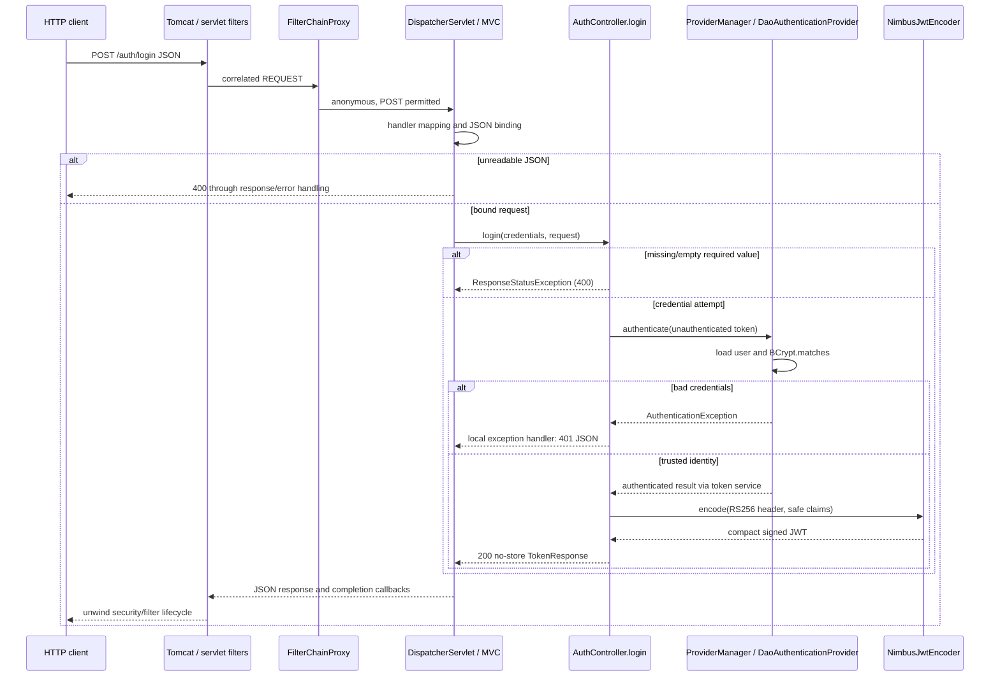
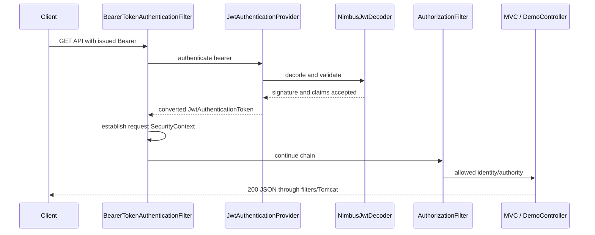

# P3.S3 — Local credential authentication and RS256 issuance

> Final P5.S2 audit: this document retains its original checkpoint counts/source references. Current code is indexed in [COMPLETE-GUIDE](COMPLETE-GUIDE.md#current-application-source-audit); [final clean verification](P5.S2-WALKTHROUGH.md) passed on Java21.0.8, closing earlier runtime-gap statements. Later bean moves, filter order and trace-handler changes are summarized there.

> P4.S3 updates JwtSecurityConfig handler wiring and line numbers, and adds REQUEST-only security.challenge/security.denied events. Earlier rejection traces, source references and pending-diagnostics statements are historical checkpoint evidence. See [current wiring, actual calls and context isolation](P4.S3-WALKTHROUGH.md).

> P4.S1 extends JwtValidationIT with a test-only identity probe and 17 authorization/conversion cases. Earlier test-line references and pending-role statements describe this checkpoint; see [current evidence](P4.S1-WALKTHROUGH.md).

## Objectives and checkpoint

P3.S2 established a Resource Server using test-issued JWTs. This step adds a deliberately small local issuer: JSON credentials enter MVC, an AuthenticationManager checks them against the existing in-memory identities, and Nimbus signs a short-lived token. A later HTTP request authenticates independently using that bearer token. These are separate operations even though issuer and Resource Server share a process. No OAuth2 grant, authorization endpoint, consent, refresh token, or external identity provider is involved.

Prerequisites: the P2 password/provider explanation, [P3.S2 validation](P3.S2-WALKTHROUGH.md), and [the claim contract](../JWT-CLAIM-CONTRACT.md). Only P3.S3 is implemented here; P4 remains pending. Production startup in jwt mode now requires both `app.jwt.public-key-path` (X.509 public PEM) and `app.jwt.private-key-path` (matching PKCS8 private PEM). Public-only S2 startup is historical. Missing or invalid material fails startup rather than selecting none.

## Current application source, block by block

Paths in this section are relative to `src/main/java/com/example/securitylearning/`. The cited line numbers refer to the verified S3 source. Imports connect Java time/files/RSA APIs, Nimbus JWK representation, and Spring’s managed configuration, authentication, and HTTP contracts; none introduces an independent security engine.

### `config/InMemoryIdentityConfig.java`

Lines 3–9 import bean factories, DaoAuthenticationProvider, user-building/storage APIs, and BCrypt’s PasswordEncoder implementation. Lines 11–12 deliberately define a plain class without `@Configuration` or `@Component`: component scanning must not create identities in none mode. Both conditional secured configurations explicitly `@Import` it. Spring processes its `@Bean` methods as imported configuration; no method directly calls another bean method, so configuration-proxy interception is unnecessary.

Lines 14–17 define `passwordEncoder()`, returning the existing BCrypt encoder. This step adds no new password scheme: BCrypt was already introduced for P2’s password comparison. Lines 19–24 define `users(PasswordEncoder encoder)`. Spring injects the encoder, hashes the two local demonstration passwords, and stores the resulting UserDetails in InMemoryUserDetailsManager. `.roles("USER")` and `.roles("ADMIN")` create ROLE-prefixed authorities. ADMIN does not acquire USER implicitly. The development credentials are documented in README, not printed in traces.

Lines 26–31 define `daoAuthenticationProvider(UserDetailsService users, PasswordEncoder encoder)`: construct the provider with the user source, attach the same encoder, return the managed provider. BasicSecurityConfig now imports this class instead of defining duplicate identity beans; its request policy and Basic filter remain unchanged. None still has neither identity/encoder beans nor a security proxy. Sharing a provider does not enable HTTP Basic in jwt mode.

### `config/JwtIssuerConfig.java`

Lines 3–23 import resource-safe file handling, RSA interfaces, Nimbus JWK/source types, Spring configuration, provider management, and encoding APIs. `RSAPrivateCrtKey` exposes the public exponent for an additional pair-consistency check when available.

Lines 25–28: `@Configuration(proxyBeanMethods=false)` enables bean definitions without method-call proxies; `@ConditionalOnProperty(...havingValue="jwt")` limits creation to jwt; `@Import` supplies the shared identity infrastructure. Lines 30–33 define `loginAuthenticationManager`: a ProviderManager containing the DaoAuthenticationProvider. The login manager is separate from Resource Server’s bearer authentication machinery. Its default successful-result credential erasure reduces retention of provider credentials; this is not erasure of every original Java String. No application authentication-event publisher is configured here.

Lines 35–37 define the encoder factory. `@Value` requires the private path; the already validated `RSAPublicKey` comes from JwtDecoderConfig. `Files.newInputStream(Path.of(path))` opens the local resource, and try-with-resources closes it even if conversion fails. IOException propagates as startup failure.

Line 38 delegates PKCS8 parsing to Spring’s RsaKeyConverters. Lines 39–43 reject null, RSA modulus shorter than 2048 bits, different moduli, and different CRT public exponent. The fixed exception text contains no key contents. A mismatched pair would otherwise allow signing tokens the local decoder cannot verify. Lines 45–46 construct one RSA JWK with public/private components and kid `local-issuer`, wrap it in an immutable local JWK source, and return NimbusJwtEncoder. There is no remote JWKS discovery or key rotation feature. The private key stays in the encoder’s object graph; verification receives the public key only. The issuer does not publish a separate private-key bean.

### `security/JwtTokenService.java`

Lines 3–16 import the clock and collection types plus Spring authentication and JOSE/JWT builders. Lines 18–20 register a jwt-only `@Service`. Lines 22–31 retain the manager, encoder, and clock through constructor injection. `@Qualifier("loginAuthenticationManager")` explicitly selects credential authentication. Clock injection shares a consistent time source with decoding; production uses UTC while tests override time.

Line 34 creates an **unauthenticated** UsernamePasswordAuthenticationToken and calls `manager.authenticate`. ProviderManager delegates to DaoAuthenticationProvider; that provider loads the user and invokes BCrypt password matching. Unknown users and wrong passwords become AuthenticationException branches. Only the trusted returned Authentication supplies identity and authorities.

Lines 35–36 select authorities beginning `ROLE_`, strip that prefix, and collect role strings for the claim. Arbitrary JSON fields cannot choose the subject or roles. Line 37 truncates the clock instant to seconds, matching JWT NumericDate precision. Lines 38–40 build seven claims: authenticated subject, fixed local issuer, singleton API audience, trusted roles, iat, nbf, and exp exactly 300 seconds after issuance. The decoder still applies the separate 60-second validation skew. `expiresIn=300` describes issued lifetime, not a promise about every skew boundary.

Lines 41–43 request RS256 with typ JWT and kid `local-issuer`, encode the claims, obtain the compact serialization, and return the response. Nimbus performs signing; the application does not implement RSA or a JWT parser. Claims are readable Base64URL, not encrypted. Lines 46–50 declare the immutable TokenResponse record and override `toString()` to a fixed redacted value. Its accessors intentionally still serialize `accessToken`, `tokenType`, and `expiresIn` as JSON. Redacted display does not make response bodies safe to log.

Crucially, `issue()` does not save its credential Authentication in SecurityContextHolder or a session. It authenticates for the purpose of minting a token. The login request’s filter-level anonymous context remains anonymous; the next bearer request creates its own authenticated context.

### `api/AuthController.java` and the chain rule

Lines 3–17 import the service/sink, servlet request, MVC annotations, HTTP response builders, and exception types. Lines 19–21 make a jwt-only RestController: mapping methods return HTTP bodies rather than view names. Lines 23–29 inject the service and bounded event sink.

Lines 31–34 map POST `/auth/login`, bind JSON using `@RequestBody LoginRequest`, receive Tomcat’s HttpServletRequest for correlation, and record the fixed `controller.login` milestone. Binding occurs before method entry; malformed JSON can fail without this event. Lines 35–38 reject null/blank username and null/empty password with 400. Whitespace passwords are not silently trimmed; they undergo ordinary credential checking. A missing/unreadable body is handled by MVC before invocation.

Lines 39–41 call issuance, record success only after encoding, and return ResponseEntity with 200, `Cache-Control: no-store`, and the token DTO. Lines 44–48 use a controller-local `@ExceptionHandler(AuthenticationException.class)` to turn credential failures into the same 401 `{"error":"invalid_credentials"}`, also no-store. No exception detail, username-existence distinction, or WWW-Authenticate challenge is emitted. This JSON credential failure differs from a Resource Server Bearer challenge. Unexpected encoder/key failures are not mislabeled bad credentials. Lines 51–55 define LoginRequest’s two JSON properties and redacted display; this is not memory zeroization.

JwtSecurityConfig adds `HttpMethod.POST` and permits exactly that method/path in jwt mode. `permitAll()` affects authorization, not filter presence. Supplied bearer authentication still runs before MVC; an invalid supplied bearer may be rejected even on permitted paths. The existing stateless configuration, disabled request cache/session login, and bounded API-demo CSRF decision remain. Statelessness alone is not a general CSRF defense, particularly for browsers that automatically resend credentials. This course adds no browser client.

## Request sequence and response handling

Tomcat parses bytes and creates servlet request/response objects. Registered servlet filters surround DispatcherServlet. RequestTraceFilter opens correlation before the security proxy at order -100. DelegatingFilterProxy delegates to FilterChainProxy, which selects the jwt SecurityFilterChain. The S2 live-chain evidence remains applicable: this step changes an authorization matcher and adds issuer beans, not a custom filter. The configured built-in AuthenticationFilter associated with framework DPoP infrastructure is not evidence of a project DPoP implementation.

For login without a bearer header, BearerTokenAuthenticationFilter has no bearer credential to authenticate. AnonymousAuthenticationFilter supplies the anonymous context; SecurityTraceFilter observes it; AuthorizationFilter permits POST login. DispatcherServlet asks RequestMappingHandlerMapping for AuthController.login. RequestMappingHandlerAdapter binds JSON with Jackson, runs the controller, then HTTP response processing serializes the ResponseEntity body through a message converter. This response processing is not a servlet filter. Interceptor postHandle and afterCompletion run, the security observation unwinds, context lifecycle filters clean up, and the outer filter completes its immutable snapshot. Tomcat sends the response; event completion is not proof that the client already received all bytes.





Signature verification, issuer/audience/time validation, authenticated-token conversion, context establishment, and endpoint authorization are separate decisions. Nimbus alone does not populate SecurityContext. Subsequent bearer verification does not check the password again. Complete failure/role/time-boundary diagnostics remain P4.

## Test-to-code and fixture map

All HTTP requests use RestAssured and actual embedded Tomcat, `@SpringBootTest(RANDOM_PORT)`, with separate mode contexts. Maven Failsafe runs IT classes; Surefire runs unit classes. No MockMvc replacement is used.

| Test/method | Input and assertion | Code/decision reached |
|---|---|---|
| JwtLoginIT.loginIssuesSafeTokenAcceptedByProtectedEndpoint (2) | USER/ADMIN JSON plus forged roles; 200, exact three fields, no-store/no cookie, RS256, seven safe claims and fixed times; returned bearer gets user/admin 200 | Full controller→manager→provider→encoder, then independent Resource Server→DemoController |
| JwtLoginIT.badCredentialsReturnGeneric401WithoutToken (2) | Wrong password/unknown user; identical 401 map, no challenge/cookie/token, rejection trace | Provider fails; controller-local exception resolution |
| JwtLoginIT.malformedLoginReturns400WithoutToken (3) | Missing username, empty password, invalid JSON; 400, no token/password/exception/trace/message fields | Guard or Jackson/MVC exception resolution; no issuance |
| NoneSecurityIT.loginEndpointIsAbsentInNoneMode | POST login 404 | No AuthController and no security infrastructure |
| BasicSecurityIT.loginEndpointIsAbsentInBasicMode | Valid Basic then POST login 404 | Credential processing succeeds but no login handler exists |
| JwtValidationIT existing eight cases | Anonymous public; valid USER/ADMIN; signature/expiry/issuer/audience rejection; Basic-only rejection | Existing validator/Resource Server regressions; encoder/login now asserted present |
| JwtIssuerConfigTest.mismatchedSigningKeyFailsInsteadOfIssuingUnverifiableTokens | Two different pairs rejected | Encoder key-consistency guard |
| JwtIssuerConfigTest.invalidPrivateKeyFails | Invalid private format rejected | Spring PKCS8 conversion |
| IssuerSecretHandlingTest.requestAndResponseDisplayAreRedacted | Fixed record display | Both record overrides |
| IssuerSecretHandlingTest.temporaryKeysAreOwnerOnlyAndRemoved | Files 600, directory 700, then absent | Fixture creation and close |

JwtLoginIT’s static fixture exists before DynamicPropertySource supplies both paths. `@LocalServerPort` selects the real bound port; injected decoder verifies returned tokens without printing them, supplementing the subsequent HTTP proof. ParameterizedTest/ValueSource produce seven cases, not seven distinct methods. `login(Object)` sets JSON content/accept headers and performs POST; `assertTrace` waits for the completed sink snapshot because HTTP response availability can race final filter cleanup. It prints only UUID and fixed event names. The nested `@TestConfiguration` supplies a `@Primary` Clock fixed at 2030-01-01T12:00Z for both issuance and validation. AfterAll removes key files.

`support/JwtKeyFixture` implements AutoCloseable. Its fields hold one fresh JCA-generated pair and three paths. The constructor creates a random temporary directory with POSIX 700 permissions, resolves public/private filenames, then calls `writePem` using public X.509 and private PKCS8 encoded bytes. IOException becomes a fixed-context IllegalStateException. Accessors expose fixtures only to tests. `writePem` creates files with 600 permissions **at creation**, MIME-Base64 encodes with 64-character lines, and writes the matching PEM envelope. `close()` deletes private, public, then directory. The fixture is POSIX-specific to this verified environment; it does not claim Windows ACL portability. Partial-construction failures are not a tested cleanup guarantee. JwtValidationIT now uses the same helper instead of its former public-only writer. These test classes/resources are not part of the executable application.

## Actual sanitized evidence and trace-to-code map

Final `mvn verify` on 2026-11-01: **BUILD SUCCESS**, 14.459 seconds. Surefire: **29**, Failsafe: **44**; zero failures/errors/skips. HTTP totals: BasicSecurityIT 16, NoneSecurityIT 4, JwtValidationIT 8, JwtLoginIT 7, PlainMvcIT 3, RequestTraceIT 4, ErrorPathIT 2. Unit totals and inventory are in [TEST-MATRIX](../TEST-MATRIX.md). Execution used JDK 24 with release 21; actual JDK 21 execution remains unverified. Resolved Boot 3.5.7, Spring Framework 6.2.12, Security 6.5.6, Tomcat 10.1.48 and Nimbus 9.37.4 remain unchanged.

Passing-run excerpts (UUIDs are real; no token or credential values):

```text
LOGIN TRACE 5680ed80-c58b-440c-9ef9-4c8818f41ffe [filter.entry, security.anonymous, interceptor.preHandle, controller.login, login.token.issued, interceptor.postHandle, interceptor.afterCompletion, security.authorization.exit, filter.exit]
LOGIN TRACE 3a98cc57-9b24-4274-96e5-11a2987f4a01 [filter.entry, security.authenticated, interceptor.preHandle, controller.user, interceptor.postHandle, interceptor.afterCompletion, security.authorization.exit, filter.exit]
LOGIN TRACE ef6938d7-c6b7-4429-89fd-4d8cda5bb425 [filter.entry, security.anonymous, interceptor.preHandle, controller.login, login.credentials.rejected, interceptor.afterCompletion, security.authorization.exit, filter.exit]
```

| Event | Application source / interpretation |
|---|---|
| filter.entry / filter.exit | RequestTraceFilter surrounds the servlet chain; finally completes snapshot |
| security.anonymous / security.authenticated | SecurityTraceFilter observes existing context before authorization; not a password-check event |
| interceptor.preHandle | MvcTraceInterceptor before handler adapter invocation |
| controller.login | AuthController.login line 34, after successful argument binding |
| login.token.issued | AuthController line 40, after service signing succeeds |
| login.credentials.rejected | AuthController.authenticationFailed line 46 |
| controller.user/admin | Existing DemoController invoked by the subsequent bearer request |
| interceptor.postHandle | Normal handler completion only; absent when login throws |
| interceptor.afterCompletion | MVC completion, including resolved credential exception |
| security.authorization.exit | SecurityTraceFilter finally boundary; not proof of successful authorization |

These application callbacks corroborate order, not every internal framework invocation. Provider/decoder descriptions are grounded in configured collaborators and framework contracts. The [ProviderManager API](https://docs.spring.io/spring-security/site/docs/6.5.6/api/org/springframework/security/authentication/ProviderManager.html) explains provider delegation and default credential erasure. Existing REQUEST snapshots omit ERROR-dispatch callbacks; the P1 test-only dispatch probe is the distinct evidence for those. The malformed-JSON warning redacts source content. Expected deliberate P1 failure logs and existing provider/Mockito warnings did not fail verification.

## Comparison, questions, and exercises

None continues to ignore authentication headers and has no security proxy. Basic checks credentials on supplied Basic requests. JWT login reuses credential verification once per issuance, without enabling Basic headers, while later API requests trust validated signed claims and establish a fresh request context. Credential failure in MVC is handled locally; bad bearer authentication is rejected earlier by Resource Server.

Review questions:
1. Why is the successful login trace anonymous? The credential result is used to sign, not installed in the filter context.
2. Why reject mismatched keys at startup? Otherwise issued signatures would fail local public-key verification.
3. Why does an injected roles field not grant ADMIN? Claims derive from trusted Authentication authorities.
4. Why is no postHandle recorded after wrong credentials? The original handler threw; MVC resolved that exception using the local handler.

Safe exercises, on a disposable local branch:
1. Remove the forged roles input from the positive test: trusted output roles and both HTTP successes should remain identical.
2. Change the fixed test clock and keep both issuer/decoder on it: relative exp stays 300 seconds and tests remain deterministic. Change only one clock sufficiently and validation should fail; restore before committing.

Do not print bearer values while experimenting. No P4 behavior is claimed complete by these exercises or the passing S3 suite.
