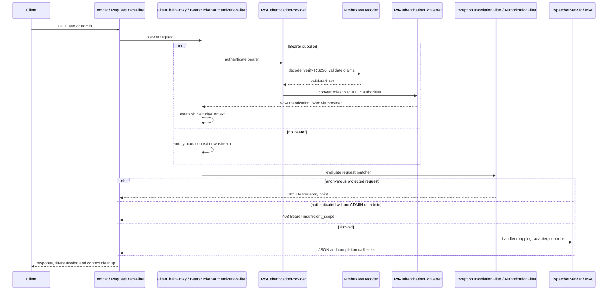

# P4.S1 — Validated identity, authorities, and endpoint permission

> J2.S1 consolidates JwtValidationIT into JwtAuthorizationIT and retires duplicate JwtMvcIT checks; login and authorization case ownership/source ranges have changed. Historical source/count records below are superseded by [J2.S1](J2.S1-WALKTHROUGH.md).

> Final P5.S2 audit: this document retains its original checkpoint counts/source references. Current code is indexed in [COMPLETE-GUIDE](COMPLETE-GUIDE.md#current-application-source-audit); [final clean verification](P5.S2-WALKTHROUGH.md) passed on Java21.0.8, closing earlier runtime-gap statements. Later bean moves, filter order and trace-handler changes are summarized there.

> P4.S3 updates JwtSecurityConfig handler wiring and line numbers, and adds REQUEST-only security.challenge/security.denied events. Earlier rejection traces, source references and pending-diagnostics statements are historical checkpoint evidence. See [current wiring, actual calls and context isolation](P4.S3-WALKTHROUGH.md).

> P4.S2 updates JwtDecoderConfig to return StrictJwtDecoder wrapping Nimbus. Earlier decoder line references describe this checkpoint; the normalized validator alone did not preserve numeric-sub/null-date distinctions. See [current code and raw HTTP evidence](P4.S2-WALKTHROUGH.md).

## Purpose and prerequisites

P3 established RSA signing, claim validation, and local credential-to-token issuance. This step finalizes the existing role conversion contract with HTTP evidence rather than adding another authentication path. Read the [claim contract](../JWT-CLAIM-CONTRACT.md), [decoder explanation](P3.S2-WALKTHROUGH.md), and [local issuer explanation](P3.S3-WALKTHROUGH.md) first. No production Java change is needed: the existing converter, validators, and endpoint rules already express the intended behavior. The new implementation is test coverage and its learning material. P4.S2’s malformed-token/claim/time-boundary expansion and P4.S3’s detailed diagnostic instrumentation are not included.

The essential distinction is that authentication does not require an ADMIN role. A valid token with a subject and no roles can establish an authenticated identity and access `/api/user`. Only an authority exactly equal to `ROLE_ADMIN` permits `/api/admin`. ADMIN can also access user because user requires authentication, not because of a USER hierarchy.

## Production code to behavior

Paths below start at `src/main/java/com/example/securitylearning/`; source line references are current at this step.

`config/JwtSecurityConfig.java:26–34` defines the managed `jwtAuthenticationConverter()` bean. `@Bean` makes the returned converter injectable into the chain factory. `JwtGrantedAuthoritiesConverter` reads the explicitly configured `roles` claim instead of the default scope claims. `setAuthorityPrefix("ROLE_")` turns a trusted `USER` role string into `ROLE_USER`, ADMIN into ROLE_ADMIN, and OTHER into ROLE_OTHER. It does not consult the in-memory users or grant an implied hierarchy. Absent and empty roles produce an empty authority collection. `JwtAuthenticationConverter` uses the subject as the principal name by default and wraps the validated Jwt and mapped authorities in JwtAuthenticationToken.

`JwtSecurityConfig.java:36–55` builds the conditional jwt SecurityFilterChain using HttpSecurity. The factory parameters inject the decoder, converter, and trace sink. Lines 40–45 select STATELESS and disable request cache, CSRF for this bounded API demonstration, form login, Basic, and logout. STATELESS means the security context is not recovered from or saved into an HTTP session; it does not make all possible application code incapable of creating a session. Existing controllers do not create one. Statelessness is not by itself a universal browser CSRF defense.

Lines 46–47 wire Resource Server’s built-in bearer authentication to the decoder and converter. Conversion occurs after successful decoding and validation. No unverified JSON claim is used to grant permissions. Line 48 places the observation-only SecurityTraceFilter after AnonymousAuthenticationFilter; that filter records state but does not authenticate or authorize. Lines 49–54 apply authorization rules in order: internal ERROR dispatch allowed, public allowed, POST login allowed, admin requires `hasRole("ADMIN")`, other requests require authentication. `hasRole` adds the ROLE_ convention; it does not require the literal unprefixed authority ADMIN. `permitAll()` does not remove the security filter chain. The proxy registration at lines 58–65 remains order -100 for REQUEST and ERROR dispatch.

`security/JwtClaimContractValidator.java:17–31` accepts an absent roles claim or a list whose members are nonblank strings, including an empty list. Therefore missing roles and malformed roles have intentionally different contracts. This step exercises only absent/empty/valid roles over HTTP. Malformed roles and raw normalization belong to P4.S2. Signature verification, issuer/audience/time validation, conversion into authorities, request-context establishment, and endpoint authorization remain separate responsibilities. Nimbus alone does not populate SecurityContextHolder.

## HTTP lifecycle and failures

Tomcat receives the HTTP bytes, parses the Authorization header into servlet request state, and invokes its registered filter chain. RequestTraceFilter opens a server-generated correlation ID outside the security proxy. DelegatingFilterProxy delegates to FilterChainProxy, which selects the jwt chain. With a bearer credential, BearerTokenAuthenticationFilter extracts it and asks its AuthenticationManager to authenticate. JwtAuthenticationProvider uses NimbusJwtDecoder for RS256 signature verification and configured claim validators, then calls the converter. The successful JwtAuthenticationToken is placed in a request security context by Spring Security.

AuthorizationFilter subsequently evaluates the endpoint rule. For allowed requests, DispatcherServlet obtains a handler through RequestMappingHandlerMapping. RequestMappingHandlerAdapter resolves method arguments, invokes DemoController, and uses response-body/message-converter processing to serialize its map as JSON. MVC interceptor callbacks and surrounding filters unwind, the request security context is cleaned up, and Tomcat completes the HTTP response. The test-only identity controller follows the same MVC path and reads the request’s actual Authentication.

Without a bearer header, no JWT is decoded; anonymous authentication is available to downstream authorization. A protected endpoint fails authentication requirements and ExceptionTranslationFilter invokes the Bearer authentication entry point: 401 and `WWW-Authenticate: Bearer`. It does not reach the application MVC handler. A valid identity without ADMIN instead fails the role rule: the Resource Server access-denied handler returns 403 and a Bearer challenge describing `insufficient_scope`. This differs from completed Basic behavior, where the configured 403 has no challenge. The response’s scope terminology is framework protocol output, not an application OAuth2 grant implementation.



This diagram summarizes framework responsibilities; it is not an assertion that each filter produces a recorded event. Existing invalid-token tests still demonstrate the earlier rejection branch before the observation filter and MVC.

## New test code, every meaningful block

The only changed Java file is `src/test/java/com/example/securitylearning/JwtValidationIT.java`. Its existing `@SpringBootTest(RANDOM_PORT)` starts actual embedded Tomcat in jwt mode; separate none/basic suites retain isolated contexts. The `@Import` at line 51 now includes the nested IdentityProbe alongside FixedTimeConfiguration. It is deliberately test-only and is not a production endpoint.

Lines 137–147 add `validatedRolesBecomeRequestAuthorities`. ParameterizedTest and ValueSource run five independent inputs: USER, ADMIN, missing, empty, OTHER. RestAssured sends each signed token over HTTP to `/test/identity`. Assertions check 200, no Set-Cookie, the subject-derived name, and the exact authority list. Checking the actual controller Authentication is stronger evidence of context establishment than merely invoking a converter in a unit test. No token value is included in logs or asserted as a string that would print on mismatch.

Lines 149–168 add `endpointPolicyDistinguishesAuthenticationFromAdminRole`. The nine colon-separated scenario strings encode role, endpoint suffix, and expected status. Splitting those trusted test constants and parsing the status avoids repeating identical request construction. Every request carries a correctly signed, time-valid token; thus a 403 isolates authorization rather than malformed authentication. Success checks the exact message map. Denial checks the framework’s insufficient_scope challenge. Both paths assert no session cookie and an exact correlated trace; the conditional expectation includes MVC callbacks only for allowed requests.

Lines 170–178 add `missingBearerReturns401BeforeMvc` for user/admin. No Authorization header is supplied. The test verifies 401, exact plain Bearer challenge, no session cookie, an anonymous security observation, and absence of MVC/controller callbacks.

Lines 180–189 add `bearerRequestDoesNotEstablishSessionAuthentication`. An authenticated ADMIN request succeeds without Set-Cookie. A fresh request to admin sends an arbitrary JSESSIONID but no bearer and receives 401 without a cookie. This proves the prior successful request does not establish reusable client session authentication in this path; it is not exhaustive same-thread/concurrent context-isolation instrumentation, which remains P4.S3. No shared RestAssured cookie/session filter is installed.

Lines 191–202 define `roleToken`. The helper builds a Nimbus RSA JWK from the fixture’s matching keys, constructs valid subject/issuer/audience/iat/nbf/exp claims using the existing fixed instant, and changes only roles. The string `missing` omits the claim, `empty` writes an empty list, and the other inputs become singleton lists. A local NimbusJwtEncoder signs RS256 and returns the compact string solely for the request header. This helper is test issuance, not a second runtime authentication path.

Lines 204–212 define the nested IdentityProbe. Fully qualified MVC/security types keep the small test-only dependency surface explicit. `@TestComponent` excludes the probe from ordinary test component scanning, so only the explicit import registers it in this context. `@RestController` enables JSON response processing; `@GetMapping` maps only the probe path. The Authentication argument is resolved from the real request principal, not supplied in JSON. `getName()` observes the authenticated subject. The authority stream extracts strings, sorts them for stable assertions, and returns them in an immutable map. It exposes neither credentials nor the Jwt/token body. The probe has no special permit rule, so the existing authenticated fallback protects it.

The unchanged `assertTrace` at lines 214–218 waits until the outer filter has published a completed immutable snapshot and prints only the correlation ID and event names. Existing key-fixture cleanup and fixed-clock configuration still apply. No sleep-based time tests were introduced. Maven Surefire continues running unit tests and Failsafe runs this IT suite.

## Test-to-code traceability

| Method | Cases | Observed contract / code reached |
|---|---:|---|
| validatedRolesBecomeRequestAuthorities | 5 | USER/ADMIN/OTHER gain exactly one prefixed authority; missing/empty gain none; subject matches; decoder→converter→context→test MVC probe |
| endpointPolicyDistinguishesAuthenticationFromAdminRole | 9 | USER/user 200, USER/admin 403, ADMIN/user and admin 200, missing/empty user 200 and admin 403, OTHER/admin 403; authorization matcher and allowed/denied traces |
| missingBearerReturns401BeforeMvc | 2 | Anonymous user/admin 401 Bearer, no MVC or cookie |
| bearerRequestDoesNotEstablishSessionAuthentication | 1 | ADMIN bearer 200, subsequent bearer-free request with arbitrary session ID 401; no session cookie |

All pre-existing HTTP tests remain regressions, including eight original JwtValidationIT cases and seven JwtLoginIT cases. The complete current inventory is maintained in [TEST-MATRIX](../TEST-MATRIX.md). Production code stays identical because these tests verify its existing intended behavior. No mock authentication or MockMvc replaces HTTP.

## Evidence, questions, and exercises

Verification output and actual trace excerpts are recorded below after running the suite. A configured filter list, observed context in a controller, and ordered application callbacks are different forms of evidence. In particular, `security.authorization.exit` is a finally-boundary observation, not an assertion that access was granted. No new challenge/denial trace event is added in this step.

Review questions:
1. Can an authenticated token have no authorities? Yes; missing/empty valid roles do not prevent authentication, but they cannot satisfy ADMIN authorization.
2. Why can ADMIN access user without ROLE_USER? The route requires an authenticated identity rather than that particular authority.
3. Why can both 401 and 403 include a Bearer challenge? The entry point identifies missing authentication; Resource Server’s denied handler additionally communicates insufficient permission for an authenticated bearer.
4. Does a readable JWT payload make its roles trustworthy? No; verification and all required claim checks must succeed before conversion.

Safe local exercises:
1. Change OTHER to AUDITOR in the probe parameter and matching expectation. Expect ROLE_AUDITOR and continued denial on admin; no production role feature is needed.
2. On a disposable branch, change the user rule to require USER and rerun the relevant tests. ADMIN-only and no-role user access should fail, illustrating the difference between authenticated() and hasRole(). Restore the contract afterward.

JWT Resource Server remains usable without an OAuth2 Authorization Server or grant flow. Claims are readable Base64URL, not encrypted. None still lacks the security proxy; Basic still uses its own authentication scheme. P4.S2 is the next separate step.

## Final observed verification and source map

Final `mvn verify`: **BUILD SUCCESS**, 2026-11-01, **15.272 seconds**. Failsafe: **61 HTTP cases**; Surefire: **29 unit cases**; zero failures, errors, or skips. JwtValidationIT runs 25 cases, including 17 added here. Runtime was JDK 24, compilation release 21; execution on JDK 21 remains unverified. Boot 3.5.7 / Security 6.5.6 / Tomcat 10.1.48 remain unchanged. The initial sandboxed attempt failed during Mockito self-attachment; rerunning with process permissions resolved that environment issue. The final run includes the isolated @TestComponent probe.

Passing-run traces, with actual correlation IDs and no credential/token contents:

```text
JWT TRACE 580e7259-66b1-48df-ac91-e00dfcbb3baf [filter.entry, security.anonymous, security.authorization.exit, filter.exit]
JWT TRACE 3988c355-8ced-4b06-b2bc-b84186503519 [filter.entry, security.authenticated, security.authorization.exit, filter.exit]
JWT TRACE 7bc095fb-3adc-473f-a3b8-9f87b79f3ace [filter.entry, security.authenticated, interceptor.preHandle, controller.user, interceptor.postHandle, interceptor.afterCompletion, security.authorization.exit, filter.exit]
```

| Event / observable value | Source and meaning |
|---|---|
| filter.entry, filter.exit | RequestTraceFilter surrounds servlet processing and completes the sink snapshot |
| security.anonymous | SecurityTraceFilter sees anonymous context after no-bearer processing; 401 test has no MVC callbacks |
| security.authenticated | SecurityTraceFilter sees the successful bearer identity; this alone does not imply authorization |
| security.authorization.exit | SecurityTraceFilter finally block after allowed or denied downstream execution |
| interceptor.preHandle/postHandle/afterCompletion | MvcTraceInterceptor wraps the allowed MVC handler; absent in protected-route security rejection |
| controller.user/admin | DemoController successful endpoint execution |
| name and authorities in probe JSON | IdentityProbe reads actual request Authentication, corroborating converter/context behavior |

Configured runtime filter list printed by the passing test (membership/order, not proof of per-request execution):

```text
JWT SECURITY FILTERS [DisableEncodeUrlFilter, WebAsyncManagerIntegrationFilter, SecurityContextHolderFilter, HeaderWriterFilter, BearerTokenAuthenticationFilter, AuthenticationFilter, SecurityContextHolderAwareRequestFilter, AnonymousAuthenticationFilter, SecurityTraceFilter, SessionManagementFilter, ExceptionTranslationFilter, AuthorizationFilter]
```

The observed chain puts bearer authentication before anonymous/context observation and authorization; ExceptionTranslationFilter surrounds authorization failures. P4.S3 will add the detailed diagnostic experiments rather than treating this configured list as an invocation trace.
