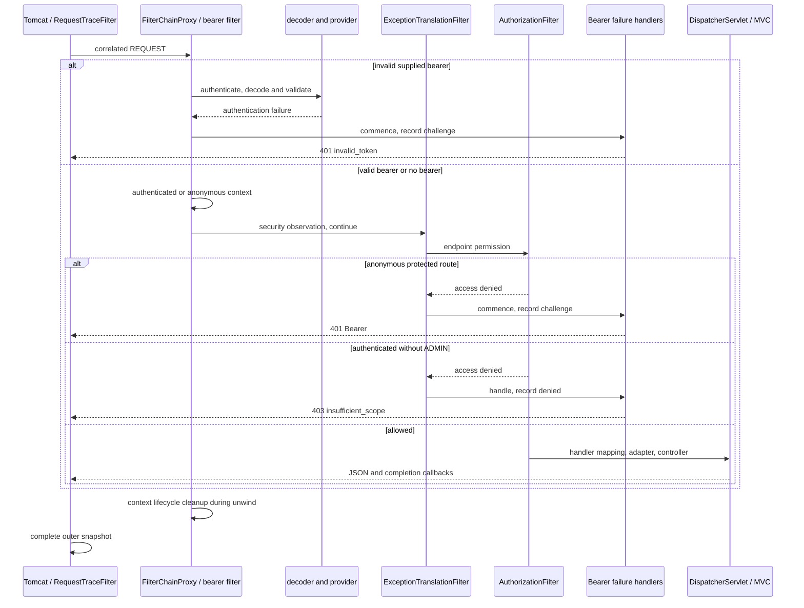

# P4.S3 — JWT filter boundaries, failure diagnostics, and context isolation

> J2.S3 consolidates diagnostic/error/request-trace evidence, adds actual overlapping-worker synchronization and changes test helper/source ranges. Historical records below are superseded by [J2.S3](J2.S3-WALKTHROUGH.md) for current case ownership and lifecycle assertions.

> J1.S2 transition: none/basic implementations and mode-selection/comparison suites are now retired. MVC/error/trace tests use JWT; PlainMvcIT is replaced by JwtMvcIT. This document retains its checkpoint source/count evidence; [J1.S2](J1.S2-WALKTHROUGH.md) records current wiring, tests and behavior.

> J1.S1 replaces the first-filter-chain List.getFirst call in the relevant IT with Java17-compatible get(0). Its line number and security assertions are unchanged. Current build instructions and verification are in [J1.S1](J1.S1-WALKTHROUGH.md).

> Final P5.S2 audit: this document retains its original checkpoint counts/source references. Current code is indexed in [COMPLETE-GUIDE](COMPLETE-GUIDE.md#current-application-source-audit); [final clean verification](P5.S2-WALKTHROUGH.md) passed on Java21.0.8, closing earlier runtime-gap statements. Later bean moves, filter order and trace-handler changes are summarized there.

## Learning purpose and prerequisites

[P4.S1](P4.S1-WALKTHROUGH.md) established request authorities and permission decisions; [P4.S2](P4.S2-WALKTHROUGH.md) exercised malformed tokens and raw claim types. This step makes the failure boundaries visible and verifies request context isolation. Read those walkthroughs and the existing [tracing explanation](P1.S2-WALKTHROUGH.md) first. This completes P4; P5’s unified comparison/package is not implemented here.

The application already retained bounded, correlated REQUEST snapshots. Each snapshot has a server UUID and ordered fixed-name events. This is the course’s structured diagnostic record, not a durable audit service or distributed tracing system. We extend it with fixed `security.challenge` and `security.denied` markers in jwt mode. The markers contain no username, Authorization header, compact JWT, password, exception message, or private key. Successful request events stay unchanged.

There are three kinds of evidence: the configured SecurityFilterChain list; a test observer that records entry into the actual filter objects; and application callbacks recorded by the sink. A filter appearing in the configured list does not prove it was reached on a failed request. A filter entry does not prove it performed authentication. A finally event does not prove access was granted.

## Production configuration, every changed block

Current paths are relative to `src/main/java/com/example/securitylearning/`.

`config/JwtSecurityConfig.java:19–22` imports Spring’s AuthenticationEntryPoint and AccessDeniedHandler interfaces plus the standard Bearer implementations. These interfaces describe failure response handlers, not authentication providers. The existing conditional configuration, EnableWebSecurity, JwtAuthenticationConverter bean, roles claim and ROLE_ prefix remain unchanged apart from shifted source line numbers. Conversion is now at lines 30–38.

Inside `jwtSecurityFilterChain`, lines 43–44 create BearerTokenAuthenticationEntryPoint and BearerTokenAccessDeniedHandler delegates. Lines 45–50 create an AuthenticationEntryPoint lambda receiving request, response, and authentication exception. Only REQUEST dispatch records `security.challenge`; the standard delegate then constructs the status and WWW-Authenticate response. We do not serialize exception text ourselves or change invalid_token semantics. This handler is used both when supplied bearer authentication fails early and when downstream authorization discovers an anonymous caller.

Lines 51–56 create the corresponding AccessDeniedHandler lambda. It records `security.denied` only for REQUEST and delegates to the standard Bearer denied handler. An authenticated bearer without ADMIN still receives 403 and an insufficient_scope challenge. These defaults differ from the project’s Basic denied response, which does not send a new challenge. ERROR dispatch is excluded from recording because the production sink intentionally covers REQUEST only; this also avoids trying to append after that request snapshot has completed.

Lines 58–63 retain the stateless/demo configuration: no security session persistence, request cache, form login, Basic, or logout, and the bounded API-demo CSRF decision. Lines 64–67 wire the **same** handler wrappers through exceptionHandling and oauth2ResourceServer. Both placements matter: BearerTokenAuthenticationFilter handles its own authentication failures, while ExceptionTranslationFilter surrounds later authorization failures. Configuring only one boundary would leave some 401s unobserved. The original decoder, including StrictJwtDecoder, and converter remain inside built-in Resource Server processing.

Line 68 retains SecurityTraceFilter after AnonymousAuthenticationFilter. Lines 69–75 retain the public/login/admin/authenticated matcher policy. Lines 78–84 retain DelegatingFilterProxy registration at order −100 for REQUEST and ERROR. No custom bearer authentication filter or additional authentication mechanism has been introduced.

`tracing/SecurityTraceFilter.java` itself is unchanged. It observes the already established authentication or anonymous state, invokes downstream filters, and records `security.authorization.exit` in finally. That last marker means the surrounding region finished; both denied and successful requests can contain it. The outer RequestTraceFilter still creates correlation before the security proxy and publishes the immutable bounded snapshot after unwinding.

## Exact lifecycle and failure branches

Tomcat parses HTTP, creates servlet objects, and invokes registered servlet filters. RequestTraceFilter begins the correlation snapshot. DelegatingFilterProxy delegates to FilterChainProxy, whose selected jwt chain contains context management, bearer authentication, anonymous handling, exception translation, authorization, and the application observation filter.

A valid bearer is submitted by BearerTokenAuthenticationFilter to its AuthenticationManager/JwtAuthenticationProvider. The provider delegates to StrictJwtDecoder/NimbusJwtDecoder for signature, normalized claim and original-shape validation. Only afterward does JwtAuthenticationConverter construct authorities and a JwtAuthenticationToken. Spring Security establishes the request context; Nimbus alone never creates that authenticated context.

With an invalid supplied token, the bearer filter’s authentication-failure path clears its context and calls the configured entry point. The downstream anonymous, observation, exception-translation and authorization filters are not reached in that request. The snapshot is entry → challenge → exit, and MVC never runs.

With no bearer, downstream anonymous authentication is available. AuthorizationFilter denies a protected route. ExceptionTranslationFilter distinguishes anonymous access from an authenticated permission failure and invokes the authentication entry point: anonymous → challenge → authorization exit. With a valid USER requesting admin, authentication succeeds, but authorization throws access denial; exception translation invokes the denied handler: authenticated → denied → authorization exit. These are distinct branches despite both skipping MVC.

An allowed request reaches DispatcherServlet, RequestMappingHandlerMapping selects DemoController, and RequestMappingHandlerAdapter invokes it after interceptor preHandle. Response-body processing uses an HTTP message converter/Jackson to serialize the Java map. MVC completion callbacks and surrounding filters unwind. Security context lifecycle processing clears the thread-bound context; the test additionally observes cleanup after the real proxy returns. Tomcat completes the response. Snapshot completion is not a measurement of network delivery time.



This is a framework responsibility diagram, not a claim that every arrow is a production log event. No OAuth2 Authorization Server or grant flow is required. JWT claims remain readable Base64URL, not encrypted.

## Diagnostics test code, block by block

The new file is `src/test/java/com/example/securitylearning/JwtDiagnosticsIT.java`. Imports cover collection/concurrency and fixed time, servlet/filter contracts, JUnit, Spring test configuration/output capture, Mockito, RestAssured, security/JWT interfaces, and MVC observation. No test code ships in the executable jar.

Lines 58–68 start actual Tomcat with RANDOM_PORT in jwt mode, import only ProbeConfiguration, and enable OutputCaptureExtension. A fixed instant and owner-only JwtKeyFixture support deterministic local keys/time. LocalServerPort and Autowired provide real collaborators. MockitoSpyBean wraps the named springSecurityFilterChain bean while retaining its real methods. This isolated diagnostic context avoids changing the none/basic or ordinary JWT test contexts.

Lines 70–79 register the two key paths and remove the temporary fixture in AfterAll. Lines 81–116 install request-local diagnostic observation before each case. The three concurrent maps are cleared between tests. `setFilterChainDecorator` replaces only the test context’s virtual-chain traversal decorator. Starting from the downstream original servlet chain, the reverse loop builds wrappers around the same configured filter objects, preserving invocation order. Each wrapper records the filter’s simple class name under the response correlation UUID, then calls its real doFilter with the remaining chain. CopyOnWriteArrayList allows safe readback; no request body/header/exception is stored. This instrumented traversal is test evidence, not a claim that production’s default observability decorator is identical.

The doAnswer spy calls `invocation.callRealMethod()` and observes SecurityContextHolder in finally on the server worker thread. It stores whether authentication is null **before** a defensive test clearContext. Therefore the defensive clear cannot manufacture a passing result. Observation after the proxy returns also includes the proxy’s own lifecycle cleanup; this does not isolate which individual framework cleanup line did the work. Only REQUEST is recorded. The outer application filter completes after this observation, so waiting for both data sources avoids response/cleanup races.

Lines 118–151 run `diagnosticsDistinguishAuthenticationAndAuthorization` for five scenarios: public, anonymous protected, invalid token, denied role, and allowed bearer. Status/body/challenge/cookie checks precede diagnostic assertions. The configured list must contain context management → bearer → anonymous → SecurityTraceFilter → exception translation → authorization as an ordered subsequence, and no BasicAuthenticationFilter. Invalid bearer must enter the bearer filter but never the downstream observation/authorization filters; its exact production trace has three events. All other cases must invoke the entire configured filter list. The test distinguishes challenge from denied markers and checks MVC absence for 401/403. Safe printing includes UUID, event names, filter names and cleanup boolean only.

Lines 153–163 run `authenticatedThenAnonymousRequestsRemainIndependent`. ADMIN bearer first reaches user; a fresh bearer-free request gets 401 with a distinct UUID, no MVC identity record and no authenticated marker. The MVC probe confirms the first identity really was admin/ROLE_ADMIN. This is sequential-request evidence, not a promise that Tomcat reused the same physical worker thread.

Lines 165–182 run `concurrentBearerIdentitiesStayCorrelatedAndSeparate`. Tokens are prepared before launching two CompletableFuture requests. USER/user and ADMIN/admin must both return exact 200 maps, distinct IDs, their expected identity/authority and separate controller events. Concurrent maps prevent probe-state races. Two overlapping client operations are tested; no load/performance claim is made.

Lines 184–199 run `tracesAndCapturedOutputExcludeCredentialsAndKeyMaterial`. A bearer request and a real JSON development login traverse the actual server. The returned accessToken is checked for presence through a boolean assertion, then both compact values are checked against captured output and sink events without printing them on assertion failure. The records must omit demo passwords and private-key PEM markers. This verifies the exercised paths; the final full Maven-log scan supplements it across suites. It is not a guarantee about arbitrary future debug/body logging.

Lines 201–205 implement `request`: build a per-call RestAssured specification, set Authorization only when a bearer is supplied, and GET the selected API route. There is no global mutable RestAssured session/cookie state. Lines 207–215 implement `completed`: require a correlation ID and wait until the sink is published and the same server request’s cleanup boolean is true. Every diagnostic request using this helper verifies post-proxy context cleanup.

Lines 217–224 implement `token`: construct subject, issuer, audience, issuance/not-before/expiry and role claims using the controlled time, then call the actual local JwtEncoder with RS256/local-issuer. No password lookup occurs for later bearer validation. Line 226 defines an immutable Identity containing only name and authority strings, never the full Authentication/Jwt object.

Lines 228–247 define Probe implementing WebMvcConfigurer and HandlerInterceptor. Concurrent maps retain filter calls, observed identities and cleanup results. addInterceptors registers the probe. preHandle records request-context name/authorities only on REQUEST, using the existing response UUID, and returns true so it cannot deny the request. Anonymous public/login can have anonymous identity observations; rejected protected requests do not reach this interceptor. Lines 249–253 define explicitly imported TestConfiguration with Probe and Primary fixed Clock beans, keeping observation out of production.

## Test-to-code traceability and historical updates

| JwtDiagnosticsIT method | Cases | Evidence / classes reached |
|---|---:|---|
| diagnosticsDistinguishAuthenticationAndAuthorization | 5 | Public/allowed 200, anonymous/invalid 401, USER-admin 403; configured order vs actual filter calls; handler events; MVC handoff or absence; context cleanup |
| authenticatedThenAnonymousRequestsRemainIndependent | 1 | Trusted first MVC identity, later anonymous 401, distinct IDs, no identity carryover; post-proxy empty contexts |
| concurrentBearerIdentitiesStayCorrelatedAndSeparate | 1 | Parallel USER and ADMIN requests get distinct principal/authority/controller traces; cleanup true for both |
| tracesAndCapturedOutputExcludeCredentialsAndKeyMaterial | 1 | Real bearer and JSON login, issued-token presence, captured console/sink exclude complete credentials, tokens and PEM markers |

Existing JwtValidationIT exact expectations now include challenge on anonymous/invalid branches and denied on role failures. JwtNegativeValidationIT’s rejected inputs now expect entry/challenge/exit rather than the prior two-event trace. These are richer diagnostic observations; HTTP behavior remains verified by the existing suites. JwtLoginIT’s MVC-local credential exception remains `login.credentials.rejected`, not a Resource Server challenge. Older walkthrough excerpts are explicitly historical and linked here.

P4.S1–S2 walkthroughs have been audited for the changed handler wiring and trace contract. Their original result counts remain checkpoint evidence, while TEST-MATRIX and README carry current totals. Full raw malformed/time-boundary tests remain intact. The shared flow comparison remains within its requested 700–800 words.

## Questions and exercises

1. Why is invalid-token challenge recorded without security.anonymous? Bearer authentication rejects before the downstream anonymous/observation filters.
2. Why wire handlers at two configuration boundaries? Early bearer failures and later exception translation have separate response-handler entry points.
3. What does contextCleared prove? The real request’s worker-thread authentication was null after the security proxy returned, before the test’s defensive clear.
4. Why not print Authentication.toString()? JWT-bearing objects can expose sensitive credential material; the probe copies only name/authority strings.

Safe exercises on a disposable branch:
1. Change the allowed diagnostic token from USER to ADMIN while keeping the user endpoint. Expect 200 and ROLE_ADMIN in the MVC observation; no implicit USER authority is required.
2. Compare the invalid and denied observed filter lists. Predict that invalid stops at bearer while denied reaches AuthorizationFilter; run those parameter cases to check the prediction without logging the request header.

Stop after P4.S3. The next separately authorized step is P5.S1.

## Actual passing-run evidence and trace-to-code map

Final `mvn verify` on 2026-11-01: **BUILD SUCCESS**, **23.245 seconds**; **114 HTTP integration + 29 unit cases**, zero failures/errors/skips. JwtDiagnosticsIT ran eight cases. Runtime JDK 24, compilation release 21; actual JDK 21 execution remains unverified. Resolved versions remain Boot 3.5.7, Framework 6.2.12, Security 6.5.6, Tomcat 10.1.48 and Nimbus 9.37.4. Existing expected P1 failure output and provider/Mockito warnings do not represent test failures.

Configured chain from the real running context:

```text
JWT CONFIGURED FILTERS [DisableEncodeUrlFilter, WebAsyncManagerIntegrationFilter, SecurityContextHolderFilter, HeaderWriterFilter, BearerTokenAuthenticationFilter, AuthenticationFilter, SecurityContextHolderAwareRequestFilter, AnonymousAuthenticationFilter, SecurityTraceFilter, SessionManagementFilter, ExceptionTranslationFilter, AuthorizationFilter]
```

The built-in AuthenticationFilter appears because of Security 6.5’s automatic DPoP-related framework configuration, as inspected in earlier JWT learning work. Its observed entry is not evidence that it authenticated these requests or that this project implements DPoP. The course remains ordinary RS256 bearer authentication.

Actual correlated traces and test-observed filter entries:

```text
JWT DIAGNOSTIC invalid 108a2c7e-5c4c-480d-9fdc-a4d5460d7bc0 [filter.entry, security.challenge, filter.exit] invoked=[DisableEncodeUrlFilter, WebAsyncManagerIntegrationFilter, SecurityContextHolderFilter, HeaderWriterFilter, BearerTokenAuthenticationFilter] contextCleared=true
JWT DIAGNOSTIC anonymous dd9641c8-4731-4f79-ade2-bfd5a0d6e21a [filter.entry, security.anonymous, security.challenge, security.authorization.exit, filter.exit] invoked=[DisableEncodeUrlFilter, WebAsyncManagerIntegrationFilter, SecurityContextHolderFilter, HeaderWriterFilter, BearerTokenAuthenticationFilter, AuthenticationFilter, SecurityContextHolderAwareRequestFilter, AnonymousAuthenticationFilter, SecurityTraceFilter, SessionManagementFilter, ExceptionTranslationFilter, AuthorizationFilter] contextCleared=true
JWT DIAGNOSTIC denied 7f6416e5-bbbd-4117-b813-5665b3a652a3 [filter.entry, security.authenticated, security.denied, security.authorization.exit, filter.exit] invoked=[DisableEncodeUrlFilter, WebAsyncManagerIntegrationFilter, SecurityContextHolderFilter, HeaderWriterFilter, BearerTokenAuthenticationFilter, AuthenticationFilter, SecurityContextHolderAwareRequestFilter, AnonymousAuthenticationFilter, SecurityTraceFilter, SessionManagementFilter, ExceptionTranslationFilter, AuthorizationFilter] contextCleared=true
JWT DIAGNOSTIC allowed 148edadd-d495-4db0-82e9-653aaf61a2ca [filter.entry, security.authenticated, interceptor.preHandle, controller.user, interceptor.postHandle, interceptor.afterCompletion, security.authorization.exit, filter.exit] invoked=[DisableEncodeUrlFilter, WebAsyncManagerIntegrationFilter, SecurityContextHolderFilter, HeaderWriterFilter, BearerTokenAuthenticationFilter, AuthenticationFilter, SecurityContextHolderAwareRequestFilter, AnonymousAuthenticationFilter, SecurityTraceFilter, SessionManagementFilter, ExceptionTranslationFilter, AuthorizationFilter] contextCleared=true
```

| Event / field | Source / exact interpretation |
|---|---|
| filter.entry / filter.exit | RequestTraceFilter begins and completes the REQUEST snapshot |
| security.challenge | JwtSecurityConfig entryPoint wrapper immediately before the real Bearer entry point; early bearer failure or anonymous authorization branch |
| security.denied | JwtSecurityConfig deniedHandler wrapper before the real Bearer access-denied handler |
| security.authenticated / security.anonymous | SecurityTraceFilter observes existing request authentication after bearer/anonymous handling |
| security.authorization.exit | SecurityTraceFilter finally boundary after downstream allowed/denied processing |
| interceptor callbacks / controller.user | MvcTraceInterceptor and DemoController on the allowed path |
| invoked=[...] | Test-only decorator records actual entry into each configured real filter object; not proof each filter authenticated |
| contextCleared=true | Test spy observes null worker-thread authentication after real proxy return, before defensive test cleanup |

The final log scan checks all Maven output for compact JWT patterns, development passwords, private PEM markers and encoded Basic development credentials. Jar inspection checks that no PEM or test probe is packaged. These checks complement the focused captured-output test; documentation/link and whitespace validation complete the handoff.
