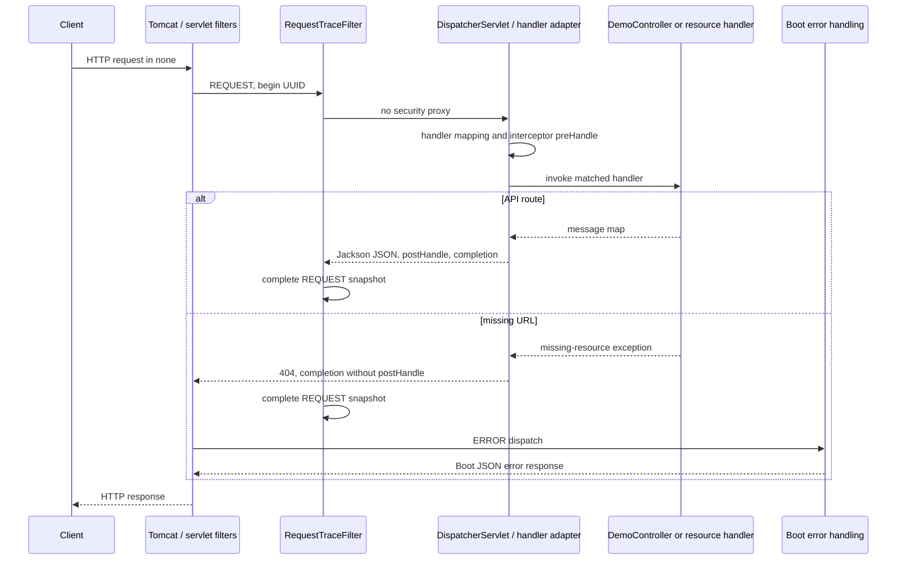
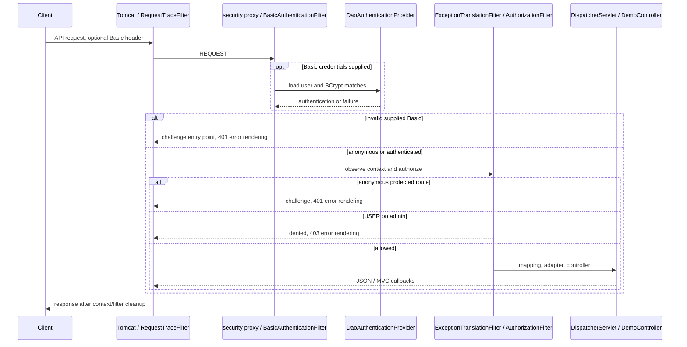
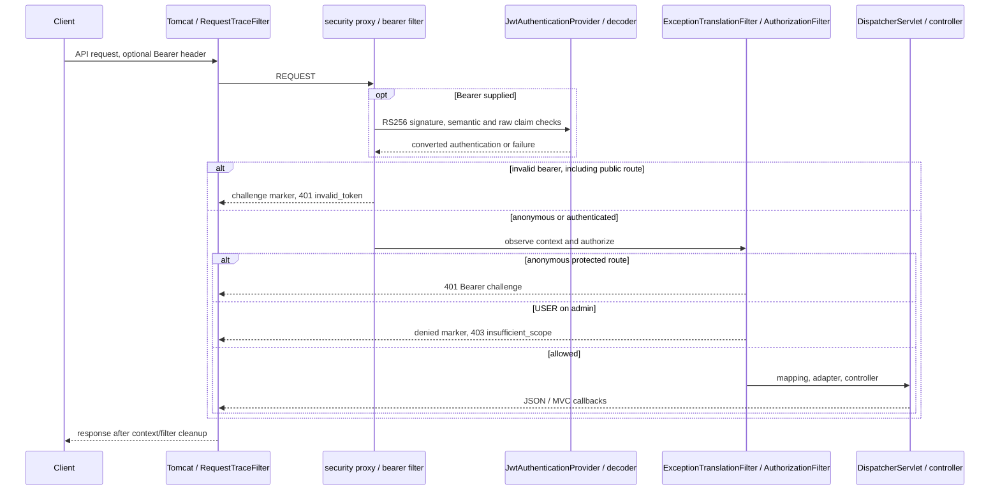

# P5.S1 — One HTTP contract, three isolated security modes

> J1.S2 transition: none/basic implementations and mode-selection/comparison suites are now retired. MVC/error/trace tests use JWT; PlainMvcIT is replaced by JwtMvcIT. This document retains its checkpoint source/count evidence; [J1.S2](J1.S2-WALKTHROUGH.md) records current wiring, tests and behavior.

> Final P5.S2 audit: this document retains its original checkpoint counts/source references. Current code is indexed in [COMPLETE-GUIDE](COMPLETE-GUIDE.md#current-application-source-audit); [final clean verification](P5.S2-WALKTHROUGH.md) passed on Java21.0.8, closing earlier runtime-gap statements. Later bean moves, filter order and trace-handler changes are summarized there.

## Goal and prerequisites

This step compares equivalent requests across none, basic, and jwt using the same inherited HTTP test method. Read [P2’s completed Basic behavior](P2.S3-WALKTHROUGH.md), [local JWT issuance](P3.S3-WALKTHROUGH.md), and [P4’s diagnostics](P4.S3-WALKTHROUGH.md) first. No production authentication or authorization change is needed. P5.S2’s complete guide and final application-wide audit remain pending.

The comparison distinguishes absent security infrastructure from permitted authorization. None has ordinary servlet filters but no FilterChainProxy bean. Basic and JWT retain their full security chains even for public routes. Invalid supplied credentials can fail authentication before public authorization is considered; an unsupported credential scheme can instead be ignored by that mode. The tests make those distinctions explicit rather than treating every public request alike.

## Runtime matrix

Each row is the same scenario in all three contexts. USER/ADMIN rows use the mode’s native credential scheme; none receives a harmless ignored bearer value because it has no identity mechanism. Login requests in basic carry valid Basic credentials so a 404 proves mapping absence rather than being hidden by anonymous 401. This authentication precondition is explicit: login itself is not implemented in basic.

| Scenario | none | basic | jwt |
|---|---:|---:|---:|
| Public, no credential | 200 | 200 | 200 |
| User, no credential | 200 | 401 | 401 |
| Admin, no credential | 200 | 401 | 401 |
| User as USER | 200 | 200 | 200 |
| Admin as USER | 200 | 403 | 403 |
| Admin as ADMIN | 200 | 200 | 200 |
| User with valid Basic | 200 | 200 | 401 |
| User with malformed bearer | 200 | 401 | 401 |
| Login valid JSON credentials | 404 | 404 with valid Basic precondition | 200 + token |
| Login invalid JSON credentials | 404 | 404 with valid Basic precondition | 401 local JSON |
| Public with invalid Basic | 200 | 401 | 200 |
| Public with malformed bearer | 200 | 200 | 401 |
| Missing route with native authentication | 404 | 404 | 404 |

The login-invalid row means syntactically valid JSON containing wrong credentials, not malformed JSON. Malformed login bodies remain covered by JwtLoginIT. Basic ignores a bearer header, but the user route still needs Basic authentication and therefore returns 401; that same ignored bearer on public receives 200. JWT ignores Basic headers, but an invalid bearer on public is actively processed and rejected.

## Responsibilities compared

| Responsibility | none | basic | jwt |
|---|---|---|---|
| Servlet environment | Embedded Tomcat, encoding/context/form filters, RequestTraceFilter, DispatcherServlet | Same outer environment plus registered security proxy | Same outer environment plus registered security proxy |
| Security chain | Absent; no permitAll substitute | Context/header filters, BasicAuthenticationFilter, anonymous handling, SecurityTraceFilter, ExceptionTranslationFilter, AuthorizationFilter | Context/header filters, BearerTokenAuthenticationFilter, framework AuthenticationFilter, anonymous handling, SecurityTraceFilter, ExceptionTranslationFilter, AuthorizationFilter |
| Credential | None interpreted | Supplied Basic username/password | Bearer signed compact JWT; local login separately accepts JSON username/password |
| Provider/manager | None for request security | AuthenticationManager → DaoAuthenticationProvider | Bearer manager → JwtAuthenticationProvider; separate login ProviderManager → DaoAuthenticationProvider |
| Verification | No identity check | In-memory user lookup and BCrypt match | Nimbus RS256 verification and normalized validators, StrictJwtDecoder original-type guard |
| Context population | No security-managed request identity | Security filter establishes successful password authentication | Built-in bearer filter establishes converted JwtAuthenticationToken; Nimbus alone does not |
| Authorization | All three API GET routes open | Public allowed, user authenticated, admin ADMIN | Same API policy; POST login additionally permitted |
| Authentication failure | No security denial | 401 Basic challenge; Basic handler uses error dispatch for JSON | 401 Bearer challenge before MVC; local login failure is MVC-local JSON without Bearer challenge |
| Authenticated role denial | No security denial | 403 without challenge | 403 Bearer insufficient_scope |
| Successful response | MVC map → message converter/Jackson → JSON | Same MVC path after security permission | Same MVC path after security permission |
| Ordinary missing route | 404 through resource handler and Boot error rendering | Authenticated missing route retains 404 through allowed internal ERROR dispatch | Authenticated missing route retains 404 through allowed internal ERROR dispatch |

The framework AuthenticationFilter in the JWT configured list was inspected in P4 and comes from DPoP-related framework configuration; entry into it does not imply DPoP authentication or a project DPoP feature. The application remains an RS256 bearer demonstration. Both secured modes are stateless in their security-context persistence policy; this does not prove every possible application component can never create a session or remove browser CSRF concerns.

## Three request sequence diagrams

These diagrams compare responsibilities rather than adding synthetic per-filter trace events. Configured order and instrumented real filter entries are separately evidenced in P4.S3.



The REQUEST snapshot does not include ERROR callbacks. This diagram groups the HTTP exchange; it does not assert that RequestTraceFilter encloses ERROR dispatch. The existing ErrorPathIT separately observes dispatch order and also verifies a deliberately thrown, test-only 500. None has no authentication/authorization denial; its 404/500 are application-processing errors, not security rejections.





The local JWT login remains logically separate from later bearer requests: permitted POST login reaches MVC, authenticates credentials through the login manager/provider, and signs using the private key. Subsequent bearer verification uses the public key. No OAuth2 grant/authorization server, external IdP, or custom bearer filter is involved. Readable Base64URL claims are not encryption.

## New test classes and meaningful code

Paths below start at `src/test/java/com/example/securitylearning/`. Every new file is test-only; production classes remain unchanged.

`AbstractSecurityComparison.java` imports fixed-time claim construction, immutable collection values, the bounded sink, HTTP response/assertion APIs, Spring injection/context interfaces, and Resource Server JWT builders. It is abstract and has no test bootstrap annotation, so it is not independently started by Failsafe. LocalServerPort injects each concrete context’s actual Tomcat port; Value reads that context’s explicit mode; Autowired supplies its sink/context. Using ApplicationContext for JwtEncoder only inside the jwt branch avoids accidentally requiring signer beans in none/basic.

`equivalentRequestsExposeModeDifferences` is the inherited ParameterizedTest. ValueSource lists 13 scenario names; each concrete class executes all of them. The method derives login/API route, builds a local RestAssured specification, and applies the requested credential or native-mode identity. Wrong-scheme and public-invalid cases are explicit branches rather than assumptions. Basic login receives the stated precondition. Requests use JSON accept headers; login supplies username/password JSON, while API scenarios use GET.

The method checks the expected status and no Set-Cookie on every row. Successful API responses must equal the exact message map; missing routes must report 404. Security 401s require the correct Basic/Bearer challenge. JWT login separately checks no challenge and either the exact response field set or generic invalid_credentials map. Token presence is asserted as a boolean to avoid printing a compact value on failure. The 403 branch explicitly distinguishes Basic’s absent challenge from JWT’s insufficient_scope response.

After receiving the response, the method requires a server correlation ID and waits for the sink’s completed snapshot. Entry/exit must enclose the record. None must have no FilterChainProxy bean and no security.* event. Secured contexts must contain exactly one proxy. Role denial must order authenticated → denied → authorization exit; protected API 401 must contain challenge and no MVC preHandle. Successful API traces must order preHandle → controller → postHandle → completion. Missing routes must have preHandle/completion and no postHandle, matching existing resource-handler/error evidence. Safe output prints only mode, scenario, expected-and-verified status, UUID, and event list.

`expectedStatus` centralizes the matrix oracle: login exists only in jwt; missing route is 404 after the stated precondition; none ignores credentials; active Basic or Bearer invalid credentials reject according to mode; anonymous protected routes reject; wrong Basic scheme in jwt rejects protected access; USER/admin yields 403; other native successful identities pass. Its explicit branches are intentionally tied to documented scenario names, not a production policy engine.

`token` builds a trusted subject, issuer, audience, three timestamps and role using the fixed 2030 instant. It obtains only the jwt context’s actual encoder, requests RS256/local-issuer and returns the compact serialization for the header. This is a test fixture, not authentication in a controller and not an additional production decoder.

`NoneComparisonIT.java` and `BasicComparisonIT.java` each contain only the package, SpringBootTest import, RANDOM_PORT annotation with an explicit mode property, and an empty subclass of the shared contract. Different mode properties give different application contexts and prevent a global mode flip in one running server. They inherit the same test method and assertions.

`JwtComparisonIT.java` similarly selects jwt and explicitly imports nested FixedTimeConfiguration. Its static JwtKeyFixture generates owner-only temporary public/private PEM material. DynamicPropertySource supplies both paths before bean creation; AfterAll removes the fixture. The nested TestConfiguration is not ordinary component-scanned application configuration. Bean and Primary supply the deterministic UTC Clock matching the inherited token helper. Java time imports support that Clock; IOException belongs to cleanup. No private material or full token is logged or committed.

## Test-to-code traceability

| Shared case group | Total executions | Observable decision / path |
|---|---:|---|
| Public/user/admin anonymous | 9 | None MVC for all; secured public MVC; secured protected challenge before MVC |
| USER/user, USER/admin, ADMIN/admin | 9 | Native provider/filter establishes identity; user/admin permission, including 403; none ignores supplied identity header |
| User Basic / invalid bearer | 6 | Scheme-specific authentication or missing identity; none ignores supplied headers |
| Login valid/invalid credentials | 6 | No mapping in none/basic after precondition; jwt MVC issuer success or local generic 401 |
| Public invalid Basic / invalid bearer | 6 | Active mechanism rejects even though permitted; unsupported scheme ignored |
| Authenticated missing route | 3 | Ordinary 404 remains 404, MVC completion without postHandle |

Total: 39 new HTTP cases. Existing mode-specific tests remain responsible for deeper provider/principal, filter invocation, concurrency, malformed claim and timestamp assertions; the comparison does not replace them. ErrorPathIT.unmappedUrlReturns404ThroughResourceHandlerAndErrorDispatch and controllerExceptionReturns500AndNextRequestHasFreshTrace remain the none-mode 404/500 evidence. The test-only throwing controller is not added to secured modes.

## Questions and safe exercises

1. Why does public invalid Basic differ between basic and jwt? Only the active mechanism attempts that credential; permitAll does not bypass authentication filters.
2. Why authenticate Basic before testing an absent login mapping? Otherwise protected fallback authorization could hide absence behind 401.
3. Why three concrete test contexts? Mode properties control conditional bean creation at startup, not a per-request switch.
4. Does identical 200 JSON prove identical processing? No; none has no proxy, while secured requests still traverse authentication/context/authorization infrastructure.

Safe exercises on a disposable branch:
1. Run only the three *ComparisonIT classes with Failsafe’s test selector and compare public-invalid scenarios. Expect the two active mechanisms to reject their own invalid supplied credential.
2. Remove the Basic precondition from a login comparison request. Expect 401 instead of 404, illustrating how security can prevent MVC mapping discovery. Restore the documented test contract afterward.

This step consolidates runtime comparison and diagrams only. COMPLETE-GUIDE.md and the final application-wide/JDK-21 audit are P5.S2 work.

## Current source index and actual verification

| New source | Verified source blocks |
|---|---|
| AbstractSecurityComparison.java | imports 3–26; injected context 28–32; parameterization 34–37; request preparation 38–60; HTTP assertions 61–77; correlation and flow assertions 78–96; status oracle 99–109; signed fixture 111–119 |
| NoneComparisonIT.java / BasicComparisonIT.java | each lines 3–7: bootstrap import, explicit RANDOM_PORT/mode and inherited contract |
| JwtComparisonIT.java | imports 3–16; bootstrap/import 18–20; key fixture 21; dynamic paths 23–27; cleanup 29–32; fixed clock configuration 34–42 |

Final `mvn verify`, 2026-11-01: **BUILD SUCCESS**, **29.739 seconds**, **153 HTTP integration cases + 29 unit cases**, zero failures/errors/skips. Each concrete comparison class ran 13 cases. Execution used JDK 24 with release-21 compilation, not a verified JDK 21 runtime. Boot 3.5.7 / Security 6.5.6 / Tomcat 10.1.48 remain unchanged. Existing expected P1 error-fixture output and provider/Mockito warnings did not fail verification.

Actual sanitized correlated records:

```text
COMPARISON none user-anonymous status=200 6385768c-ba35-4acf-8598-e7ce790bb949 [filter.entry, interceptor.preHandle, controller.user, interceptor.postHandle, interceptor.afterCompletion, filter.exit]
COMPARISON basic user-anonymous status=401 dde0509f-9f29-4252-8029-854ea65a098a [filter.entry, security.anonymous, security.challenge, security.authorization.exit, filter.exit]
COMPARISON jwt user-anonymous status=401 cbb9834d-9139-48b0-b268-d071061e9130 [filter.entry, security.anonymous, security.challenge, security.authorization.exit, filter.exit]
COMPARISON basic admin-USER status=403 387b1d4a-fa85-47a7-989c-43df390d7e94 [filter.entry, security.authenticated, security.denied, security.authorization.exit, filter.exit]
COMPARISON jwt admin-USER status=403 8d40be6e-2ca2-4b20-ac7a-0b933dbe4167 [filter.entry, security.authenticated, security.denied, security.authorization.exit, filter.exit]
COMPARISON none missing-authenticated status=404 34423c76-3f99-45f9-b153-296485699d54 [filter.entry, interceptor.preHandle, interceptor.afterCompletion, filter.exit]
```

| Event | Source and code-to-flow interpretation |
|---|---|
| filter.entry / filter.exit | RequestTraceFilter surrounds REQUEST and completes the sink snapshot |
| interceptor.preHandle / postHandle / afterCompletion | MvcTraceInterceptor callbacks around handler execution; missing resource omits postHandle |
| controller.user/admin/public | DemoController endpoint actually executed |
| security.anonymous / security.authenticated | SecurityTraceFilter observes the request context after mechanism processing |
| security.challenge | Basic entry point or JWT entry-point wrapper; response challenge assertions identify the mechanism |
| security.denied | Configured access-denied wrapper, after authenticated role failure |
| security.authorization.exit | Observation-filter finally boundary, not proof of granted access |

The basic/jwt anonymous traces have matching application event names while their challenge headers and response handling differ. None’s user request reaches MVC directly, and none’s missing route records MVC completion without a security denial. These callback records are not a claim that every framework method emitted an event; P4.S3 separately instruments actual security filter entry.

Final log and executable-jar checks exclude compact tokens, development passwords, private PEM material and test-only comparison fixtures; local Markdown links and whitespace are verified separately. P5.S2 remains unimplemented.
